# 基礎から学べる 世界標準のSCM教本 直接目視文字起こし 原図切り出し対照 v3

このMarkdownは、図画像を埋め込んだDOCX版の編集用・照合用コンパニオンです。画像をファイル単体に保持する主形式はDOCXです。Markdownでは、このファイルと同じ場所に figures、images、mermaid_svg の各フォルダを置いてください。ZIPはフォルダ構成を保って展開してから開いてください。

提供動画 IMG_6677.MOV の229撮影画像を元の順番で収録しています。v2の直接目視による本文・表・判読不能箇所・表現上の注記を保持し、Mermaidの107コードブロックも文字単位で変更していません。v3では比較しやすいよう、元ページ全体の本文内表示をやめ、対応する図の範囲を切り出した126点の画像を本文に表示します。図題と出典・動画時刻は編集可能な文字として記しています。

## 原図と再現図の読み方

- 図の見出しの下、または対応するコードの直前に「原図切り出し」を表示します。一つの原図を複数のMermaidブロックに分けている場合、画像はそのまとまりの先頭に一度だけ表示し、各ブロックの直前に同じ図題と切り出しIDを明記します。
- 図7.7・図7.8に対応する一つのコードブロックには、両方の原図切り出しを対応付けています。
- Mermaidを置かない28点の図も削除していません。図の切り出し画像と、既存の文字・表・注記で保持しています。図7.1のように原図全体と一部のコードを併用する場合も、同じ切り出しを重複表示しません。
- 各コードの下の「描画済みSVGを開く」でv2の検証済み描画に基づく再現図を参照できます。Mermaid非対応のビューアではコードが文字で表示されるため、DOCX版またはSVGを利用してください。コードの構文解析・実描画はv2で公式Mermaid 12.2.0を用いて検証され、v3のコードハッシュも一致しています。v3で図の意味を改変したわけではありません。16点のSVGに限り、見出しと線の接触、短い双方向矢印の重なり、透明な合流点での線の途切れを描画後に調整しています。ノード、ラベル、接続関係、数値は変更していません。コードを別のビューアで再描画した場合、この表示調整は適用されません。表示調整済みの図はDOCX版・PDF版または付属SVGで確認してください。
- ページ全体は各撮影画像の先頭にある「原画像」のリンクから開けます。元画像は images フォルダに付属資料として収録します。
- [原図切り出し対応表](原図切り出し対応表_v3.csv)には、図題、撮影順、確認された印刷ページ番号、動画時刻、元画像名、切り出し座標、元画像／切り出しのSHA-256、コードIDを記しています。[元画像と動画時刻の対応表](原画像と動画時刻の対応表_v3.csv)で全229撮影画像の出典を確認できます。

## 収録範囲と注意

- 動画は印刷4–5ページから始まり、最後に全体が開いて写る見開きは226–227ページです。途中の無番号扉・白紙も画像の順序どおり収録しています。
- 末尾に参考文献の部分画像2枚、カバー折返しの部分画像1枚、奥付側の部分画像1枚、裏表紙1枚を収録しています。部分画像は見える断片のみです。
- 表紙・1–3ページなど動画にない箇所は含みません。229は撮影画像数であり、書籍全体の完全なページ数ではありません。
- 読み取れない文字は [判読不能] とし、該当位置と理由を併記しています。隠れている文字や数値を推測して補っていません。
- 「図の表現注」「判読注」「撮影範囲の注記」およびv3の比較用キャプションは転記・照合のための注記であり、原文ではありません。原文に印刷された数値・用語の不整合や誤記らしい箇所も、読めたとおりに保持しています。
- 印刷4ページの著者名1字は確定できないため、v2と同じ[判読不能]と判読注を保持しています。

## 4ページ

<!-- capture_id: page_001; capture_order: 1; source: IMG_6677.MOV; source_time_seconds: 0.0; image: 001_p004.jpg; transcription_method: direct_visual; status: transcribed -->

原画像: [001_p004.jpg](images/001_p004.jpg) · 動画時刻: 00:00.000

### 著者の紹介

著者の三人は、全員がAPICSのインストラクター資格を持つ現役実務家です。また、ともに公益財団法人日本生産性本部が主催する『APICSディクショナリー（第16版）』の翻訳プロジェクトのメンバーでもあり、本書には著者らの世界標準のSCMについての知見とともに、ERPソフトウェアベンダー、コンサルティングファーム、メーカーという異なるフィールドに根差した実務の観点からの考察がふんだんに盛り込まれています。この点において本書は他のSCM関連書籍とは一線を画すものであると、著者らは確信しています。

山本 圭一（やまもと けいいち：CPIM, CPA）は、本企画の発起人であり、ビジネスエンジニアリング株式会社において国産ERPパッケージソフトウェアmcframeの導入コンサルテーション業務の最前線に立つ現役の実務家です。また、公益財団法人日本生産性本部が主催するAPICS紹介セミナーの講師でもあり、ERPソフトウェアベンダーにおける実務で培われた観点からの考察を本書に加えています。

水谷 [判読不能]志（みずたに ただし：CPIM, CSCP, CLTD）は、国内コンサルティング会社において、製造業・流通業企業のサプライチェーン改革を専門領域とする現役のコンサルタントです。また、日本におけるAPICSコミュニティ立ち上げおよびAPICS紹介セミナーを通じて世界標準のSCM普及活動に携わっています。これらを通じた知見と多様な業種でのサプライチェーン改革コンサルティング経験に基づく考察を本書に加えています。

行本 顕（ゆきもと けん：CPIM-F, CSCP-F, CLTD-F）は、国内大手消費財メーカーでの財務・法務・海外事業・生産統括・経営企画部門の経験を有する現役の実務家です。APICSの上位資格であるCPIM-F・CSCP-F・CLTD-Fを日本地区で唯一保有しており、APICS認定インストラクターとしても公益財団法人日本生産性本部および公益社団法人日本ロジスティクスシステム協会他にて、本書の中心的なテーマであるMP＆Cを主軸とした実務家向けSCM教育プログラムを担当しています。日・米におけるSCM実務経験と世界標準のSCMを推進する活動を通じて培われた観点からの考察を本書に加えています。

判読注: 水谷氏の名の最初の漢字は原画像で不鮮明なため確定せず、[判読不能]とした。撮影画像220（印刷223ページ）末尾では「水谷禎志」と明瞭に読めるが、それをこのページの字形の確定根拠として補完してはいない。


## 5ページ

<!-- capture_id: page_002; capture_order: 2; source: IMG_6677.MOV; source_time_seconds: 0.0; image: 002_p005.jpg; transcription_method: direct_visual; status: transcribed -->

原画像: [002_p005.jpg](images/002_p005.jpg) · 動画時刻: 00:00.000

### 本書を読んでいただきたい方

以上に述べたとおり本書は、主に日本語でSCMを体系的に学びたいと考えている以下のような方に読んでいただきたいと思っています。

（1）SCMの基礎知識を得たいと考える実務家・新社会人・学生

（2）今までの業務経験を通じて得たSCMに関する知識を、標準的なフレームワークに基づいて棚卸し、応用可能な知識を補強したいと考える実務経験者

（3）自社の海外拠点、海外サプライヤー、海外販売代理店との間で、齟齬のない意思疎通を図るための共通言語を、日本語で学びたいと考えるサプライチェーン関連業務従事者

（4）試験が英語で行われるAPICSの資格を取得するために、何を学ぶ必要があるのかの概要を日本語で知りたい人


## 6ページ

<!-- capture_id: page_003; capture_order: 3; source: IMG_6677.MOV; source_time_seconds: 3.733333; image: 003_p006.jpg; transcription_method: direct_visual; status: transcribed -->

原画像: [003_p006.jpg](images/003_p006.jpg) · 動画時刻: 00:03.733

### 推薦の言葉

本書は、SCMの世界の共通言語ともいうべきAPICSの知識体系に準拠して書かれた本邦初の書籍です。私もよく存じ上げている著者の3人は日本にわずか7人しかいないAPICS認定インストラクターであります。本書の著者の方々がERPパッケージベンダー、コンサルタント、メーカーという異なるバックグラウンドの実務経験者であることも大きな魅力でしょう。本書は、彼らの実務経験や知識が反映され、図解も多いことから、SCM分野の初学者にとってはその知見に触れる貴重な機会であり、かつ経験を積まれた実務家にとっても貴重な機会を提供することができると考えております。

私は1998年に『サプライチェーン理論と戦略』（ダイヤモンドハーバードビジネス編集部編、ダイヤモンド社）、1999年に『サプライチェーン経営入門』（日本経済新聞出版）を著し、2001年には経営情報学会のビジネスモデル特集号で「招待論文 サプライチェーン・マネジメントに関するビジネスモデル：分析と設計理論の考察」という寄稿も行いました。さらに、約10年前に東京工業大学の社会人向けMOT、CUMOTで始まり、現在は日本ロジスティクスシステム協会に受け継がれた「ストラテジックSCMコース」では、年に2回講師を務めてきました。このほか、SCMについては、ビジネススクールや社会人向けの講演も多数行ってきました。また、何より90年代の末から、NRIの事業として海外でERPのクラウドサービスを新規に立ち上げるという貴重な機会を得て、NRIの仲間とともに、多数の日本企業の百数十拠点に及ぶ海外事業展開に取り組んできました。

私が、外部向けの講演の中で常に訴え続けてきたことの1つに、本書が取り扱う「SCMに関わる国際標準のAPICS言語体系、知識体系の存在」があります。日本ではあまり語られないのですが、多数あるERPやSCMのソリューションにおける業務の知識体系は共通で、このAPICS標準が活用されています。日本企業でのERP活用が実質的には経理業務に留まることが多いのはよく知られていますが、その理由の1つは、APICSがそもそも知られておらず、学習機会も乏しく、知識体系が日本では定着していないことではないかと考えています。


## 7ページ

<!-- capture_id: page_004; capture_order: 4; source: IMG_6677.MOV; source_time_seconds: 3.733333; image: 004_p007.jpg; transcription_method: direct_visual; status: transcribed -->

原画像: [004_p007.jpg](images/004_p007.jpg) · 動画時刻: 00:03.733

この二十数年間で日本企業がERPやSCMへ行った投資額は巨額ですが、日本で活用しているERPをそのまま海外拠点で、経理業務だけでなく、調達、生産、配送、原価管理、財務管理などの企業の基幹業務で活用できたとしたら、日本企業の生産性向上への効果は極めて大きかったのではないでしょうか。

SCMは、複数の企業や、企業組織内のいわゆる機能組織が相互に緊密に連携しながら、国や地域や、もちろん部門、企業の境界を越えて商品を円滑にエンドユーザーに届けるための、いわば新しい産業機構（業務体系とメカニズム）を形成するための業務、オペレーションズマネジメント（OM）の設計・運用についての知識体系です。

もっともSCMは、単に物流や工場管理業務だけを取り扱っているわけではなく、戦略、戦術、実行を一貫した適応制御機構として、つまりSBU・事業部門の運営を円滑に行うための階層型意思決定システムについて、世界で、今、実践され、発展してきている標準的な知識と言語体系と考えていただければ、俯瞰的に理解しやすいと思います。

たとえば、S&OPというSBUの経営会議の新しい業務モデルはこの十数年でかなり定着してきたといえるでしょう。S&OPは、いわゆる規律とコントロールのための「単年度の予算統制型会議」から「毎月のローリング型で中期スパンの計画を見直す機能組織横断での戦略実行会議」へ転換させるというダイナミックケイパビリティを実現する経営会議のモデルです。

最近では、不確実性が高まる国際情勢の中、参加する企業の経営層から現場までが、互いに齟齬のない意思疎通を機敏に行うことが望まれます。グローバル化が進む中、SCMにおいても国際標準の言語体系を活用してダイナミックケイパビリティを獲得し、いつでもスケールアウトでき、いつでもピボットできる競争力を増している海外企業と、国際標準よりも自社特有の言語体系、自部門特有の知識体系を世界に定着させようとして体力を消耗してしまい、「もはや、人材がいない」という理由で、構造的閉塞に陥りがちな日本企業とでは、長期的にみると大きく差が開いてしまう危険性も高いと思います。

いわゆる「ダイナミックケイパビリティ」を獲得するためには、海外で既にサティフィケーション（認証）を保有するメンバーが十数万人に及び、新興国においても学習している人材の規模も格段に多いAPICSの国際標準の知識体系や言語体系を活用することは、極めて有効な手段の1つでしょう。海外企業


## 8ページ

<!-- capture_id: page_005; capture_order: 5; source: IMG_6677.MOV; source_time_seconds: 6.533333; image: 005_p008.jpg; transcription_method: direct_visual; status: transcribed -->

原画像: [005_p008.jpg](images/005_p008.jpg) · 動画時刻: 00:06.533

では、APICSの知識体系を活用しつつ、この上に自社や自事業部門特有の業務や知識体系を追加する方法で、グローバルオペレーションの業務モデルを確立し、定着させる負荷を下げ、スケールアウトとピボットというダイナミックケイパビリティを獲得できている企業が多いようです。

SCMは複雑でテーマが極めて広い分野なのですが、その基礎を一貫した考え方で学べる本書は貴重と思います。これまで日本では、国際的には常識となっているSCMを俯瞰するための標準言語体系を書籍で学ぼうとしても、一見、関連書籍が膨大でどの書籍を選択すればよいか悩ましいという問題もありました。また、物流業務や生産管理、スケジューリング、S&OPなど、特定の分野に特化した書籍が多く、SCM全体を俯瞰して解説した本は必ずしも多くないと思います。ようやく複数の分野のSCM書籍を集めても、今度は書籍間で用語や概念が統一されておらず、つなぎ合わせて読むことが困難な問題がありました。本書1冊を学習することでSCMを俯瞰することができ、これらの問題を解決することができるでしょう。

本書は、グローバル競争に臨むには国際標準の言語体系、知識体系を理解し、共通言語でコミュニケーションすることがいかに効果的かを教えてくれます。当方の経験では、通訳で解決できる英語の問題ではなく、逆にAPICSの用語（テクニカルターム）を知っていれば格段にコミュニケーションが円滑になります。実は、KANBAN、JIT、ANDON、5Sなどの数百に及ぶ日本の現場で活用されている言語も既に収録されています。

日本企業でSCMに関わる少しでも多くの方が、本書を手に取りこの事実を理解し、ひいては日本企業のグローバル展開を通じた成長に寄与するために、本書が必携のバイブルとなることを期待しています。

藤野 直明

株式会社 野村総合研究所 主席研究員  
公益社団法人 日本経営工学会 副会長  
早稲田大学大学院 情報生産システム（IPS）研究科 客員教授  
社団法人 日本オペレーションズ・リサーチ学会 フェロー  
JOMSA（日本オペレーションズマネジメント＆ストラテジー学会）理事  
2020年代の総合物流施策大綱に関する検討会 構成員


## 9ページ

<!-- capture_id: page_006; capture_order: 6; source: IMG_6677.MOV; source_time_seconds: 6.533333; image: 006_p009.jpg; transcription_method: direct_visual; status: transcribed -->

原画像: [006_p009.jpg](images/006_p009.jpg) · 動画時刻: 00:06.533

### 基礎から学べる！世界標準のSCM教本

- はじめに …… 1
- 著者の紹介 …… 4
- 本書を読んでいただきたい方 …… 5
- 推薦の言葉 …… 6

### 第1章 サプライチェーンマネジメントとMP&C

- 1-1 サプライチェーンとはどのような概念か …… 16
- 1-2 サプライチェーンの定義 …… 18
- 1-3 さまざまな供給体制 …… 20
- 1-4 サプライチェーンの構造に由来する問題 …… 22
- 1-5 SCMとは …… 24
- 1-6 SCMの目的 …… 26
- 1-7 SCMでの意思決定 …… 28
- 1-8 製造オペレーションにおける意思決定の特徴 …… 30
- 1-9 MP&Cの概略 …… 32
- 1-10 MP&Cの構成要素 …… 34
- 1-11 今後のSCMで考慮が求められる外部環境 …… 36
- 1-12 MP&CとROICの関係 …… 38

### 第2章 戦略：ストラテジックプランニング

- 2-1 サプライチェーンのストラテジーとは …… 40
- 2-2 サプライチェーンの戦略的意思決定の例（社内） …… 42


## 10ページ

<!-- capture_id: page_007; capture_order: 7; source: IMG_6677.MOV; source_time_seconds: 10.266667; image: 007_p010.jpg; transcription_method: direct_visual; status: transcribed -->

原画像: [007_p010.jpg](images/007_p010.jpg) · 動画時刻: 00:10.267

- 2-3 サプライチェーンの戦略的意思決定の例（社外） …… 44
- 2-4 MP&Cでのストラテジックプランニングの位置づけ …… 46

### 第3章 計画：デマンドマネジメント（需要計画）

- 3-1 デマンド（需要）とは …… 50
- 3-2 独立需要と従属需要 …… 52
- 3-3 需要予測の方法 …… 54
- 3-4 定量的手法①：移動平均法 …… 56
- 3-5 定量的手法②：指数平滑法 …… 58
- 3-6 定量的手法③：外因的予測手法 …… 60
- 3-7 定性的手法 …… 62
- 3-8 予実乖離の把握（MAD） …… 64
- 3-9 受注の条件 …… 66

### 第4章 計画：サプライプランニング

- 4-1 サプライプランニングの構造 …… 70
- 4-2 S&OP …… 72
- 4-3 リソースプランニング …… 76
- 4-4 マスター・スケジューリング …… 78
- 4-5 マスター・スケジューリングの手順 …… 80
- 4-6 基準生産計画 …… 82
- 4-7 ラフカットキャパシティプランニング（RCCP） …… 84
- 4-8 ボトルネック工程での資源所要量の算出例 …… 86
- 4-9 MRP …… 88
- 4-10 MRP計算はどのように進められるのか？ …… 90
- 4-11 MRP計算の具体例①（準備） …… 92


## 11ページ

<!-- capture_id: page_008; capture_order: 8; source: IMG_6677.MOV; source_time_seconds: 10.266667; image: 008_p011.jpg; transcription_method: direct_visual; status: transcribed -->

原画像: [008_p011.jpg](images/008_p011.jpg) · 動画時刻: 00:10.267

- 4-12 MRP計算の具体例②（親品目の正味所要量計算） …… 94
- 4-13 MRP計算の具体例③（子孫品目の正味所要量計算） …… 96
- 4-14 マテリアル・リクワイアメント・プランの管理 …… 98
- 4-15 CRP …… 100
- 4-16 CRPの計算例① …… 102
- 4-17 CRPの計算例② …… 104

### 第5章 SCMの観点から見た在庫

- 5-1 在庫管理とMP&Cの関係 …… 108
- 5-2 在庫補充方式 …… 110
- 5-3 安全在庫 …… 114
- 5-4 経済的発注量（EOQ） …… 118
- 5-5 ABC在庫分析 …… 120
- 5-6 在庫数量の把握方法 …… 122
- 5-7 在庫金額の計算方法 …… 124
- 5-8 在庫の評価方法 …… 128
- 5-9 SCMにおける在庫の意義 …… 130

### 第6章 実行と管理：仕入

- 6-1 SCMにおけるプロキュアメントの役割 …… 134
- 6-2 仕様の決定 …… 136
- 6-3 サプライヤー選定とサプライヤーとの関係性 …… 138
- 6-4 プロキュアメントの実行 …… 140


## 12ページ

<!-- capture_id: page_009; capture_order: 9; source: IMG_6677.MOV; source_time_seconds: 13.065; image: 009_p012.jpg; transcription_method: direct_visual; status: transcribed -->

原画像: [009_p012.jpg](images/009_p012.jpg) · 動画時刻: 00:13.065

### 第7章 実行と管理：製造活動と品質

- 7-1 製造活動の実行と管理 …… 144
- 7-2 計画プロセス …… 146
- 7-3 実行プロセス …… 152
- 7-4 監視・制御プロセス …… 156
- 7-5 品質とは …… 162
- 7-6 主な品質管理手法の概要 …… 164

### 第8章 実行と管理：販売

- 8-1 販売と販売管理 …… 172
- 8-2 販売管理におけるデザイン活動 …… 174
- 8-3 販売管理におけるスケジューリング活動 …… 176
- 8-4 販売管理におけるコントロール活動 …… 178

### 第9章 ロジスティクス

- 9-1 ロジスティクスとは …… 182
- 9-2 ロジスティクスの設計 …… 184
- 9-3 ロジスティクスの計画 …… 188
- 9-4 ロジスティクスの実行・管理 …… 190
- 9-5 ロジスティクスを取り巻く外部環境変化 …… 192

### 第10章 SCMの観点から見た原価

- 10-1 原価とは …… 194
- 10-2 製造品原価計算の概要 …… 200


## 13ページ

<!-- capture_id: page_010; capture_order: 10; source: IMG_6677.MOV; source_time_seconds: 13.065; image: 010_p013.jpg; transcription_method: direct_visual; status: transcribed -->

原画像: [010_p013.jpg](images/010_p013.jpg) · 動画時刻: 00:13.065

- 10-3 基本的な製造品原価計算方法のパターンと特徴 …… 202
- 10-4 SCMに関連した原価分析手法 …… 206
- 10-5 ROICを使ったSCMの評価・分析 …… 212

### 第11章 世界標準のSCMを学ぶことの重要性

- 11-1 なぜSCMに標準が必要なのか …… 216
- 11-2 SCMにおける「標準」 …… 218

- むすび …… 220
- あとがき …… 222
- さらに学びたい人のために …… 224
- 参考文献 …… 226
- 索引 …… 232

### column

- ファッションアパレル企業のストラテジーの違い …… 48
- 清涼飲料と季節性 …… 61
- 「デルファイ法」の由来 …… 63
- ASCM／APICSのSCM普及活動 …… 68
- S&OPにおける経営層の関与 …… 79
- 鉛筆の製造工程 …… 99
- MRPの社会実装① APICS／ASCMを通じたコンセプトの標準化 …… 106
- 循環棚卸とABC分析 …… 127
- SKU（Stock Keeping Unit） …… 132
- MRPの社会実装② コンピューティング技術の進歩 …… 142
- ロジスティクス原価は低ければ低いほどよいのか …… 199
- APICS／ASCMの共通言語と日本語 …… 219


## キャプチャ011（印刷ページ番号なし）

<!-- capture_id: page_011; capture_order: 11; source: IMG_6677.MOV; source_time_seconds: 16.798333; image: 011_spread_left.jpg; transcription_method: direct_visual; status: transcribed -->

原画像: [011_spread_left.jpg](images/011_spread_left.jpg) · 動画時刻: 00:16.798

転記注: 白紙ページ。本文・図・印刷ページ番号はありません。


## キャプチャ012（印刷ページ番号なし）

<!-- capture_id: page_012; capture_order: 12; source: IMG_6677.MOV; source_time_seconds: 16.798333; image: 012_spread_right.jpg; transcription_method: direct_visual; status: transcribed -->

原画像: [012_spread_right.jpg](images/012_spread_right.jpg) · 動画時刻: 00:16.798

### 第1章
### サプライチェーンマネジメントとMP&C

この章を読み終えると、以下の内容を理解することができます。

- サプライチェーンとは何か
- サプライチェーンマネジメントとは何か
- 製造オペレーションの計画・管理の仕組みMP&C

転記注: 背景の薄い幾何学模様は装飾であり、Mermaidには置換していません。原画像を参照してください。


## 16ページ

<!-- capture_id: page_013; capture_order: 13; source: IMG_6677.MOV; source_time_seconds: 19.598333; image: 013_p016.jpg; transcription_method: direct_visual; status: transcribed -->

原画像: [013_p016.jpg](images/013_p016.jpg) · 動画時刻: 00:19.598

### 1-1 サプライチェーンとは
### サプライチェーンとはどのような概念か

#### 図1.1 「サプライチェーン」の世界観（SCE：Supply Chain Ecosystem）

原図切り出し: 図1.1 「サプライチェーン」の世界観（SCE：Supply Chain Ecosystem）（切り出しID: c013_f01）

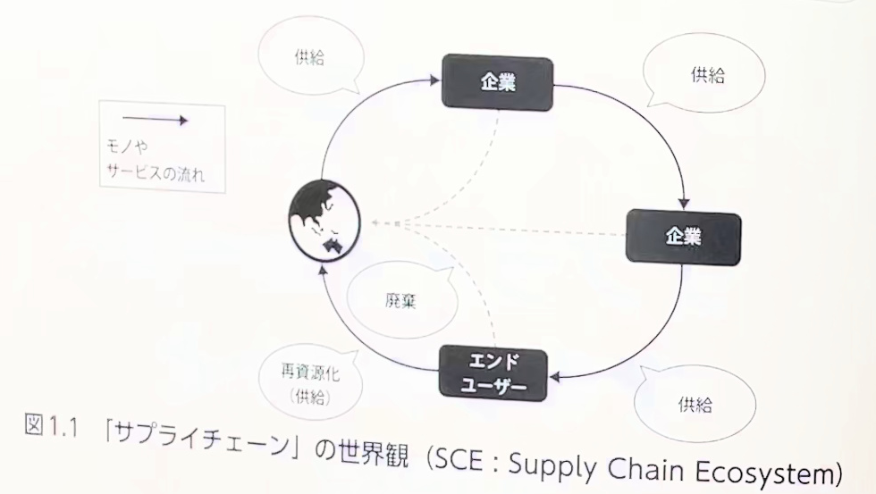

出典: 013_p016.jpg ／ 撮影順: 013 ／ 確認された印刷ページ: 16 ／ 動画時刻: 00:19.598（19.598333秒）


Mermaid再現図（コードID: 013_p016_1）

対応する原図: 図1.1 「サプライチェーン」の世界観（SCE：Supply Chain Ecosystem）（[c013_f01](figures/c013_f01.png)）

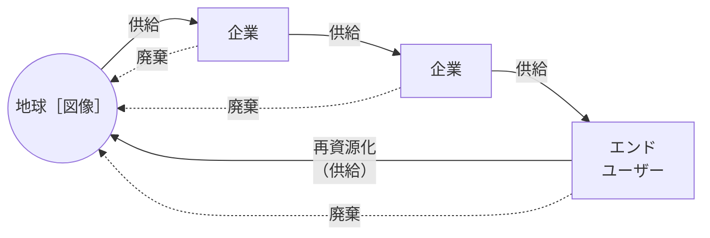

[描画済みSVGを開く（013_p016_1）](mermaid_svg/013_p016_1.svg)


図の凡例: 実線矢印は「モノやサービスの流れ」。原図の地球の絵は「地球［図像］」というノードで代用した。「廃棄」の吹き出しは、地球へ向かう3本の点線に対応する。

### サプライチェーンは地球規模の活動を想定した概念である

「サプライチェーン」とは、様々な企業や人々の活動が相互に関連することによって、モノ（製品）やサービスがエンドユーザーに供給される仕組み（エコシステム）を指す概念です<sup>（1）</sup>。

私たちは日常生活の中で様々な商品を購入して利用しています。つまり商品を購入したお店からモノやサービスの「供給（supply）」を受けているということができます。また、このお店も同様に卸売業者やメーカーから商品の供給を受けています。さらにその商品のメーカーは別のメーカーから原材料の供給を受けているかもしれません。つまり「サプライチェーン」という用語は、このような個々の企業や人々の供給活動がエンドユーザーに向かって連鎖した状態を表しているといえます。なお、「サプライチェーン」を通じて供給される製品やサービスを「上流」に向かってたどると地球資源に由来すること、他方で「下流」に向かってたどると利用・廃棄・再資源化される過程で地球環境に影響を与えることから、サプライチェーンは地球規模（グローバル）の活動を想定した概念であるといえます（図1.1）。


## 17ページ

<!-- capture_id: page_014; capture_order: 14; source: IMG_6677.MOV; source_time_seconds: 19.598333; image: 014_p017.jpg; transcription_method: direct_visual; status: transcribed -->

原画像: [014_p017.jpg](images/014_p017.jpg) · 動画時刻: 00:19.598

欄外: 第1章 サプライチェーンマネジメントとMP＆C

### 現代のサプライチェーンは情報の断絶が起きやすい

初期の自動車産業においては、完成品である自動車を製造するメーカーが自社で所有する鉱山から鉄鉱石を採掘して精錬し、これを原材料として作った部品を用いて完成車を生産していました。さらに完成車の流通網も自社で構築することでエンドツーエンドのサプライチェーンを自前で整備していました<sup>（2）</sup>。

このようなサプライチェーンは「垂直統合型」のサプライチェーンと呼ばれます（図1.2）。垂直統合型のサプライチェーンは、すべての活動を企業内の活動として行うことからこれらについての高い可視性と柔軟性を得られるという特徴があります。その一方でサプライチェーンを構成する各活動に必要な投資を自前で行う必要があることから、サプライチェーンを維持するためのコストが高価になるという特徴をあわせもちます。

これに対して、現在多く見られるサプライチェーンでは原材料の採掘や部品の製造、完成品の製造、完成品の販売といったサプライチェーンを構成する個々の活動を複数の企業が行います（図1.3）。そして、これらの企業は主に売買取引を通じてこれらの活動のアウトプットを供給しています。このようなサプライチェーンは、個々の活動が専業化することにより規模の経済性が生じやすくなる一方で、これらの企業間で情報の非対称性が生じやすくなるという特徴をあわせもちます<sup>（3）</sup>。

#### 図1.2 垂直統合型のサプライチェーン

原図切り出し: 図1.2 垂直統合型のサプライチェーン（切り出しID: c014_f01）

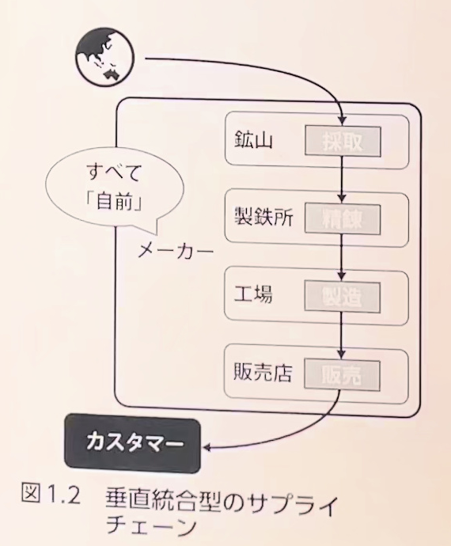

出典: 014_p017.jpg ／ 撮影順: 014 ／ 確認された印刷ページ: 17 ／ 動画時刻: 00:19.598（19.598333秒）


Mermaid再現図（コードID: 014_p017_1）

対応する原図: 図1.2 垂直統合型のサプライチェーン（[c014_f01](figures/c014_f01.png)）

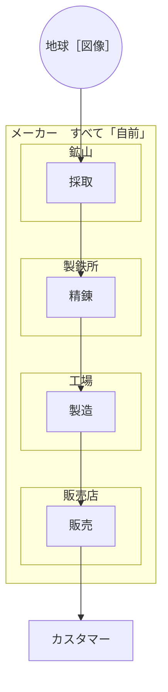

[描画済みSVGを開く（014_p017_1）](mermaid_svg/014_p017_1.svg)


図の表現注: 地球の絵はテキストのノードで代用した。原図の吹き出し（すべて「自前」）は、メーカーの囲みのラベルに併記した。

#### 図1.3 売買取引を介してつながるサプライチェーン

原図切り出し: 図1.3 売買取引を介してつながるサプライチェーン（切り出しID: c014_f02）

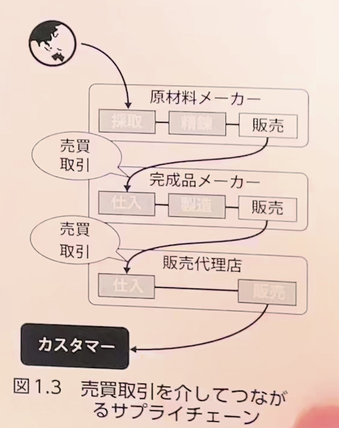

出典: 014_p017.jpg ／ 撮影順: 014 ／ 確認された印刷ページ: 17 ／ 動画時刻: 00:19.598（19.598333秒）


Mermaid再現図（コードID: 014_p017_2）

対応する原図: 図1.3 売買取引を介してつながるサプライチェーン（[c014_f02](figures/c014_f02.png)）

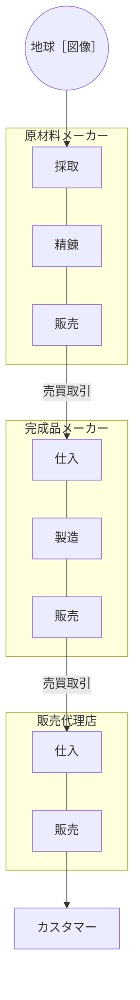

[描画済みSVGを開く（014_p017_2）](mermaid_svg/014_p017_2.svg)


図の表現注: 地球の絵はテキストのノードで代用した。企業内の工程を結ぶ線は、原図どおり矢印のない実線とした。


## 18ページ

<!-- capture_id: page_015; capture_order: 15; source: IMG_6677.MOV; source_time_seconds: 21.465; image: 015_p018.jpg; transcription_method: direct_visual; status: transcribed -->

原画像: [015_p018.jpg](images/015_p018.jpg) · 動画時刻: 00:21.465

### 1-2 サプライチェーンとは
### サプライチェーンの定義

### サプライチェーンを構成する「仕入」「生産」「販売」

サプライチェーンは、様々な企業や人々が「供給活動」を通じて連鎖している点に特徴があることについて前項で触れました。このことは、これらの企業や人々がいずれも上流に位置する企業や人々（サプライヤー）からモノやサービスの供給を受け、下流に位置する企業や人々（カスタマー）に供給する役割を担っていることを意味します。ビジネスの場において前者は「仕入」、後者は「販売」と呼ばれる活動と概ね同義と捉えて差し支えありません。

実際のサプライチェーンを構成する企業や人々の活動には、これら「仕入」「販売」の他に「生産」が含まれます<sup>（4）</sup>。「生産」は、サプライチェーンを構成する企業や人々が上流のサプライヤーから供給を受けたモノやサービスを用いて新たなモノやサービスを生み出す活動であり、この役割を担う企業や人々は特に製造業（メーカー）と呼ばれます。後続の各章では、特に製造業に注目する形でサプライチェーンにおける「仕入」「生産」「販売」を通じた供給活動を掘り下げて整理・解説していきます（図1.4）。

#### 図1.4 サプライチェーンを構成する活動群

原図切り出し: 図1.4 サプライチェーンを構成する活動群（切り出しID: c015_f01）

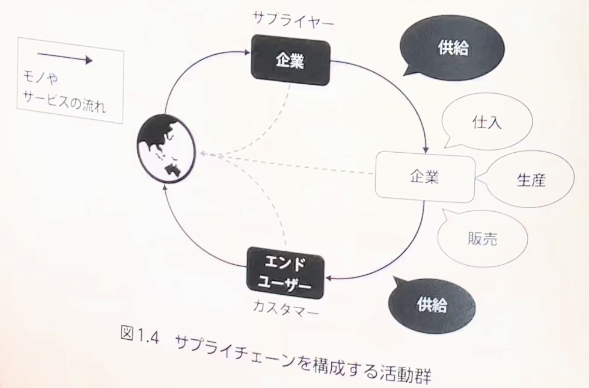

出典: 015_p018.jpg ／ 撮影順: 015 ／ 確認された印刷ページ: 18 ／ 動画時刻: 00:21.465（21.465秒）


Mermaid再現図（コードID: 015_p018_1）

対応する原図: 図1.4 サプライチェーンを構成する活動群（[c015_f01](figures/c015_f01.png)）

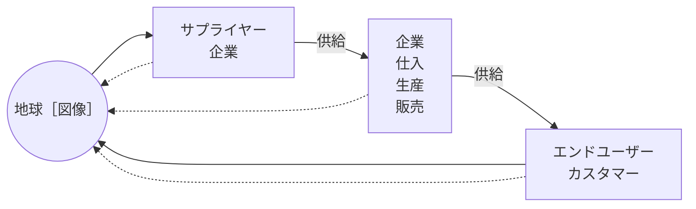

[描画済みSVGを開く（015_p018_1）](mermaid_svg/015_p018_1.svg)


図の凡例: 実線矢印は「モノやサービスの流れ」。

図の表現注: このflowchartは供給・回収の向きと企業の関係を表す。原図の円形配置に数値的意味はない。地球の絵はテキストで代用した。中央の企業の上側（入ってくる供給）に「仕入」、企業自体に「生産」、下側（出ていく供給）に「販売」の吹き出しが付く。Mermaidでは3つの活動名を同じ企業の箱内に併記しており、別々の活動間に原図にない矢印は加えていない。「供給」は企業間の矢印に対応する。吹き出しの正確な指示位置は原図で確認できる。


## 19ページ

<!-- capture_id: page_016; capture_order: 16; source: IMG_6677.MOV; source_time_seconds: 21.465; image: 016_p019.jpg; transcription_method: direct_visual; status: transcribed -->

原画像: [016_p019.jpg](images/016_p019.jpg) · 動画時刻: 00:21.465

欄外: 第1章 サプライチェーンマネジメントとMP＆C

### サプライチェーンと情報の流れ、お金の流れ

サプライチェーンを構成する個々の企業の活動である「仕入」「生産」「販売」は、モノやサービスの流れを意識した整理といえます。これらの活動では、自社の上流に位置する仕入先、および自社の下流に位置する得意先との間で取引（契約）が生じます。たとえば、メーカーは仕入先との間で原材料などの「購入契約」に基づいて取引を行う一方、得意先との間では「販売契約」に基づいて取引を行います。これらの契約はいずれも両者の合意が前提となりますので、齟齬のない認識を得るための情報の授受が行われることになります。

また、仕入や販売はいずれもモノやサービスの提供に対して金銭対価の授受を伴います。すなわち、これらの契約はいずれも売買契約を基本とした双務契約であるということができます。つまり、サプライチェーンを構成する「仕入」「生産」「販売」といった活動は、モノやサービスの流れであるとともに、情報や金銭の流れを伴ってなされる意思決定の連鎖でもあるといえます（図1.5）。このように、**世界標準のSCMにおいて「サプライチェーン」は、様々な企業や人々の供給活動の連鎖であるとともに意思決定の連鎖として認識されているのです。**

#### 図1.5 サプライチェーンを流れるモノやサービス・情報・お金

原図切り出し: 図1.5 サプライチェーンを流れるモノやサービス・情報・お金（切り出しID: c016_f01）

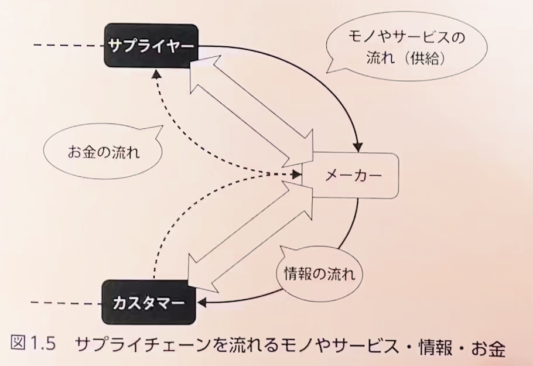

出典: 016_p019.jpg ／ 撮影順: 016 ／ 確認された印刷ページ: 19 ／ 動画時刻: 00:21.465（21.465秒）


Mermaid再現図（コードID: 016_p019_1）

対応する原図: 図1.5 サプライチェーンを流れるモノやサービス・情報・お金（[c016_f01](figures/c016_f01.png)）


[描画済みSVGを開く（016_p019_1）](mermaid_svg/016_p019_1.svg)


図の表現注: 原図の白抜きの太い双方向矢印を、Mermaidの太い双方向矢印で代用しました。サプライヤーとカスタマーの左側に延びる破線は接続先が描かれていないため、接続先を補わず、この注記に記録しています。


## 20ページ

<!-- capture_id: page_017; capture_order: 17; source: IMG_6677.MOV; source_time_seconds: 24.265; image: 017_p020.jpg; transcription_method: direct_visual; status: transcribed -->

原画像: [017_p020.jpg](images/017_p020.jpg) · 動画時刻: 00:24.265

### 1-3 サプライチェーンとは
### さまざまな供給体制

#### 図1.6 「リードタイム」「プッシュ・プル」「デカップリングポイント」の関係

原図切り出し: 図1.6 「リードタイム」「プッシュ・プル」「デカップリングポイント」の関係（切り出しID: c017_f01）

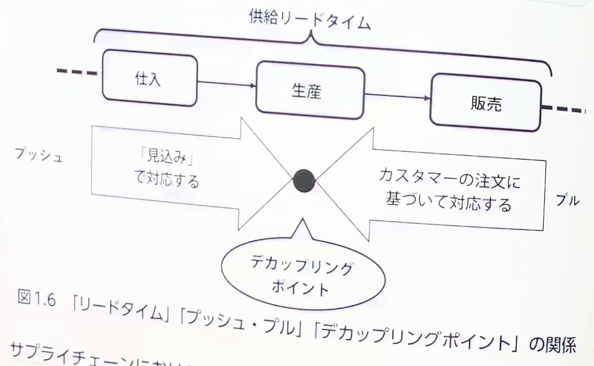

出典: 017_p020.jpg ／ 撮影順: 017 ／ 確認された印刷ページ: 20 ／ 動画時刻: 00:24.265（24.265秒）


Mermaid再現図（コードID: 017_p020_1）

対応する原図: 図1.6 「リードタイム」「プッシュ・プル」「デカップリングポイント」の関係（[c017_f01](figures/c017_f01.png)）

```mermaid
block-beta
    columns 13
    lead["供給リードタイム"]:13
    purchase["仕入"]:3 space:2 production["生産"]:3 space:2 sales["販売"]:3
    space:13
    push<["プッシュ<br/>「見込み」で対応する"]>(right):6 point((" ")) pull<["プル<br/>カスタマーの注文に<br/>基づいて対応する"]>(left):6
    space:4 boundary["デカップリング<br/>ポイント"]:5 space:4
    purchase --> production
    production --> sales
    style lead fill:none,stroke:none
    style push fill:#fff,stroke:#555,color:#111
    style pull fill:#fff,stroke:#555,color:#111
    style point fill:#111,stroke:#111
    style boundary fill:none,stroke:none
```

[描画済みSVGを開く（017_p020_1）](mermaid_svg/017_p020_1.svg)


図の表現注: 自動配置のフローチャートではなく、位置を指定するブロック図で再現した。上段は「仕入」→「生産」→「販売」で、供給リードタイムはその全範囲を表す。下段は左から右を向くプッシュと、右から左を向くプルが黒丸の境界で向かい合う。黒丸は処理工程ではなくデカップリングポイントであり、上段の工程から黒丸への接続はない。原図の括弧、両端の行先のない破線、吹き出しの輪郭は省略した。境界の位置に時間の数値は与えていない。

### サプライチェーンにおける時間の概念

サプライチェーンをより深く理解する上で重要な概念の一つに「リードタイム」があります。「リードタイム」とは、ある活動を完了するために必要となる時間的な範囲を指す用語であり、特にサプライチェーンの文脈においては、その構成要素である「仕入」「生産」「販売」といった活動に着手してから目的を遂げるまでに要する期間を指す概念として用いられます。また、サプライチェーンを構成する企業や人々が、需要情報を起点としてこれらの「仕入」「生産」「販売」といった一連の供給活動を実行して、商品をカスタマーに供給するまでの期間は「供給リードタイム」と呼ばれます（図1.6）。

### 供給活動はどのような情報に基づいて行われるのか

もっとも、供給リードタイム（仕入・生産・販売の各リードタイムの合計）は長期に及ぶことが多く、カスタマーの要望する納期との乖離が見られることは珍しくありません。そのため、サプライチェーンにおいて供給活動を行う企業や人々は、カスタマーから受け取る需要情報に加えて、予測による需要情報


## 21ページ

<!-- capture_id: page_018; capture_order: 18; source: IMG_6677.MOV; source_time_seconds: 24.265; image: 018_p021.jpg; transcription_method: direct_visual; status: transcribed -->

原画像: [018_p021.jpg](images/018_p021.jpg) · 動画時刻: 00:24.265

欄外: 第1章 サプライチェーンマネジメントとMP＆C

に基づいて行動することになります。自ら予測した需要情報に基づいて着手・実行される供給活動は「プッシュ」、カスタマーから提供された需要情報に基づいて着手・実行される供給活動は「プル」と呼ばれ、供給リードタイムにおける両者の境界は「デカップリングポイント（Customer Order Decoupling Point）」と呼ばれます<sup>（5）</sup>。

### 供給体制の例

日頃我々が目にする商品は、多様な供給体制を経て提供されています。これらを「プッシュ」「プル」の観点から整理した場合、商品の特徴によってデカップリングポイントの置かれている場所が異なることがわかります（図1.7）。

日用品：歯ブラシや文房具のようにユーザーが直接店頭で選んで購入することの多い日用品については、供給リードタイムに対して顧客の要望する納期は相対的に短くなります。そのため、日用品の供給活動においてはプッシュを中心とした体制が採られやすい特徴を持っています。

セミオーダーのパーソナルコンピュータ：メモリーのサイズやCPUのグレードなど、ユーザーが用途に合わせて機能を指定することが前提となっている商品については、プッシュとプルが混在した体制が採られやすい特徴を持っています。

工作機械などは、さらにプルの割合の多い、受注生産を中心とした供給体制が採られやすい特徴を持っています。

#### 図1.7 製品の特徴と「プッシュ」「プル」の関係

原図切り出し: 図1.7 製品の特徴と「プッシュ」「プル」の関係（切り出しID: c018_f01）

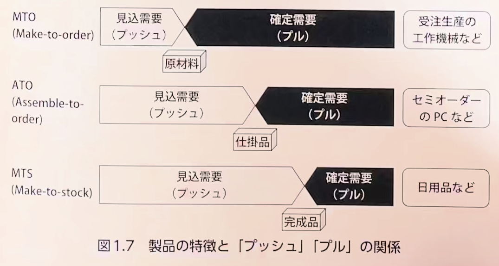

出典: 018_p021.jpg ／ 撮影順: 018 ／ 確認された印刷ページ: 21 ／ 動画時刻: 00:24.265（24.265秒）


Mermaid再現図（コードID: 018_p021_1）

対応する原図: 図1.7 製品の特徴と「プッシュ」「プル」の関係（[c018_f01](figures/c018_f01.png)）

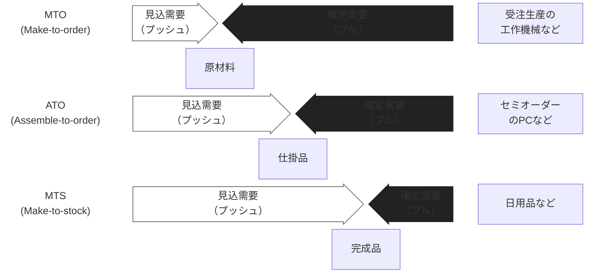

[描画済みSVGを開く（018_p021_1）](mermaid_svg/018_p021_1.svg)


図の表現注: 固定配置の比較帯として再現した。3行の供給範囲の始点・終点をそろえ、左向きのプルと右向きのプッシュが接する境界を、MTO・ATO・MTSの順に右へずらした。原材料・仕掛品・完成品はその境界の下に置く在庫の状態であり、矢印の終点や処理ノードではない。右端の商品例にも接続線はない。原図に数量目盛りや百分率はないため、帯幅はプッシュが増えプルが減る相対関係だけを表し、数値比率を意味しない。箱の立体形状は省略した。

## 22ページ

<!-- capture_id: page_019; capture_order: 19; source: IMG_6677.MOV; source_time_seconds: 27.998333; image: 019_p022.jpg; transcription_method: direct_visual; status: transcribed -->

原画像: [019_p022.jpg](images/019_p022.jpg) · 動画時刻: 00:27.998

### 1-4 サプライチェーンとは
### サプライチェーンの構造に由来する問題

### サプライチェーンと情報の非対称性

サプライチェーンは、様々な企業や人々の活動が相互に関連することによって「全体として」供給活動を行う仕組みである一方、これを構成する個々の企業や人々は本来「各々の」利益を求めて活動する側面を残している点に特徴があります。そのため、サプライチェーンを構成する企業や人々の間で情報が完全に共有されることは極めてまれであり、特に上流のサプライヤーについて「どれくらい供給してもらえるのか」といった情報や、下流のカスタマーについて「どれくらいの需要があるのか」といった情報は、適切なタイミングでは共有されにくい側面があります（図1.8）。

この「情報の非対称性」はサプライチェーンに様々な影響を及ぼします。典型的な問題的状況の一つに「ブルウィップ効果」と呼ばれる現象があります。これは、企業が材料などの仕入を行う際に自社のカスタマーからの需要情報のみに基づいて判断する行動が上流に向かって連鎖する過程で、本来の需要情報が増幅される現象です（図1.9）。

#### 図1.8 サプライチェーンに内在する情報の非対称性

原図切り出し: 図1.8 サプライチェーンに内在する情報の非対称性（切り出しID: c019_f01）

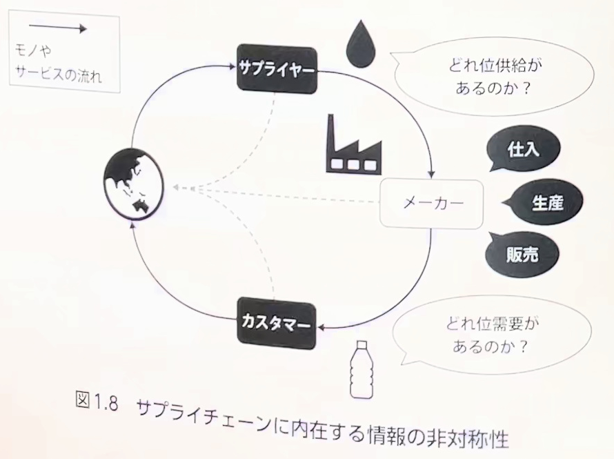

出典: 019_p022.jpg ／ 撮影順: 019 ／ 確認された印刷ページ: 22 ／ 動画時刻: 00:27.998（27.998333秒）


Mermaid再現図（コードID: 019_p022_1）

対応する原図: 図1.8 サプライチェーンに内在する情報の非対称性（[c019_f01](figures/c019_f01.png)）

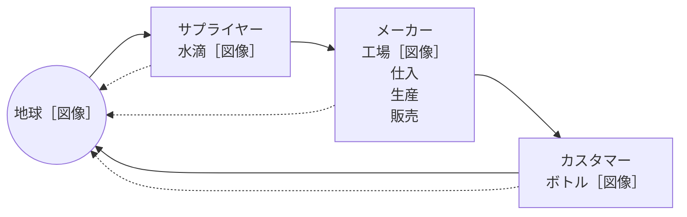

[描画済みSVGを開く（019_p022_1）](mermaid_svg/019_p022_1.svg)


図の凡例: 実線矢印は「モノやサービスの流れ」。

図の表現注: flowchartはモノやサービスの流れだけを表す。地球・水滴・工場・ボトルの絵は文字で代用した。「仕入」「生産」「販売」はメーカー周囲の活動の吹き出しで、別のフローではない。サプライヤー側の吹き出しは「どれ位供給があるのか？」、カスタマー側の吹き出しは「どれ位需要があるのか？」であり、メーカーが把握しにくい情報を示す問いである。これらをモノの流れの名称として矢印に付けると意味が変わるため、矢印ラベルから分離した。


## 23ページ

<!-- capture_id: page_020; capture_order: 20; source: IMG_6677.MOV; source_time_seconds: 27.998333; image: 020_p023.jpg; transcription_method: direct_visual; status: transcribed -->

原画像: [020_p023.jpg](images/020_p023.jpg) · 動画時刻: 00:27.998

欄外: 第1章 サプライチェーンマネジメントとMP＆C

#### 図1.9 需要情報を増幅させる「ブルウィップ効果」

原図切り出し: 図1.9 需要情報を増幅させる「ブルウィップ効果」（切り出しID: c020_f01）

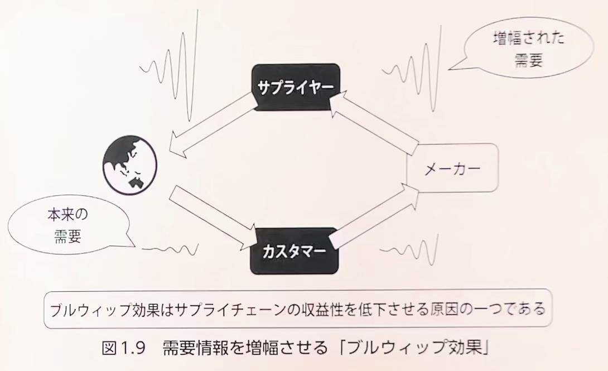

出典: 020_p023.jpg ／ 撮影順: 020 ／ 確認された印刷ページ: 23 ／ 動画時刻: 00:27.998（27.998333秒）

対照方法: この図はMermaidを追加せず、原図の切り出しと既存の文字・表・注記で保持しています。


ブルウィップ効果はサプライチェーンの収益性を低下させる原因の一つである

図の表現注: 原図は、地球の図像・カスタマー・メーカー・サプライヤーを巡る白抜き矢印と、各段階で振幅が大きくなる需要変動の波形を組み合わせている。単なる循環flowchartでは、図の中心的な意味である「上流に向かう需要情報の増幅」が失われるため、Mermaidへの置換は行わず原図を保持した。波形に数値・軸・目盛りはなく、XYグラフ用の値は補っていない。

図中の文字・関係:
- ラベル: サプライヤー、メーカー、カスタマー、本来の需要、増幅された需要。
- 白抜き矢印の向き: 地球の図像からカスタマー、カスタマーからメーカー、メーカーからサプライヤー、サプライヤーから地球の図像。
- カスタマーより下流側の「本来の需要」の波形が小さく、メーカー、サプライヤーを経て上流側へ向かうほど波形の振幅が大きくなる。これは模式的な相対関係であり、正確な数値の大小比を示してはいない。

### ブルウィップ効果（フォレスター効果）

ブルウィップ効果の概念は、ジェイ・フォレスター<sup>（6）</sup>によって提唱されたのちハウ・リーらの研究<sup>（7）</sup>により広く知られるようになりました。その研究を通じて、サプライチェーンにおける上流の需要変動が下流の需要変動よりも大きい場合にこの現象が起こりやすいことが知られています（図1.9）。たとえば、工場が製品を作る際の最小単位（バッチサイズ）が需要の規模よりも大きい場合などがこれにあたります。また、企業が需要予測を起案するための情報を直接接点を持つ顧客からの需要情報のみに依存しているほど（エンドユーザーの需要情報を知り得ない状況であるほど）ブルウィップ効果が生じやすいことも知られています。

また、ブルウィップ効果に起因する典型的な問題状況の一つとして「ファントムオーダー」と呼ばれる実需を伴わない購買行動が挙げられます。この状況は、突発的な需要の増加（サージ）などによる欠品の情報がサプライチェーンの上流に向かって伝播する過程で陳腐化することによって生じるもので、実際に商品が供給されるタイミングでは増加していたはずの需要が消滅していることから「ファントム（幽霊）」と呼ばれます。日本では1970年代のオイルショック時のトイレットペーパー需要や、2020年のパンデミック下における不織布マスク需要などがこれに該当すると考えられています<sup>（8）</sup>。


## 24ページ

<!-- capture_id: page_021; capture_order: 21; source: IMG_6677.MOV; source_time_seconds: 29.865; image: 021_p024.jpg; transcription_method: direct_visual; status: transcribed -->

原画像: [021_p024.jpg](images/021_p024.jpg) · 動画時刻: 00:29.865

### 1-5 サプライチェーンマネジメント（SCM）とは
### SCMとは

### SCMの定義

前節（1-1）で、「サプライチェーンとは、様々な企業や人々の活動が相互に関連することによってモノ（製品）やサービスがエンドユーザーに供給される仕組みを指す概念」であると述べました。原材料サプライヤーから最終消費者に至る「サプライチェーン」上の業務全体を「マネジメント」することを指すので、サプライチェーンマネジメント（SCM）と呼びます。

### SCMの業務と対象期間

SCMの業務には、サプライチェーン活動の設計（Design）、計画（Plan）、実行（Do）、監視（Check）、制御（Action）という5種類があります（図1.10）。

ある意思決定の影響が及ぶ期間で分けると、「設計」は長期、「計画」は中期と短期、「実行」「監視」「制御」は短期に分類されます（表1.1）。

#### 図1.10 サプライチェーンをマネジメントする5つの業務

原図切り出し: 図1.10 サプライチェーンをマネジメントする5つの業務（切り出しID: c021_f01）

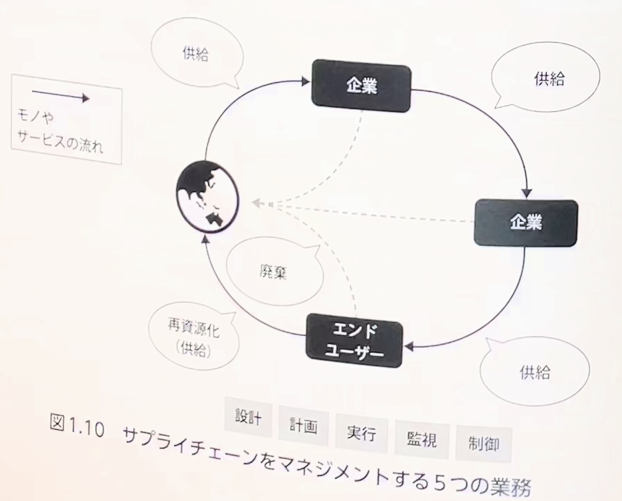

出典: 021_p024.jpg ／ 撮影順: 021 ／ 確認された印刷ページ: 24 ／ 動画時刻: 00:29.865（29.865秒）

対照方法: この切り出しは以下の複数のMermaidブロックに共通する原図です。各ブロックの直前にも同じ図題と切り出しIDを記しています。


Mermaid再現図（コードID: 021_p024_1）

対応する原図: 図1.10 サプライチェーンをマネジメントする5つの業務（[c021_f01](figures/c021_f01.png)）

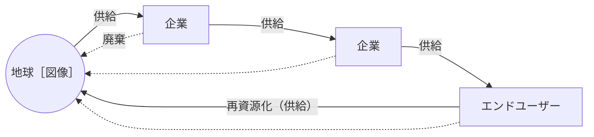

[描画済みSVGを開く（021_p024_1）](mermaid_svg/021_p024_1.svg)


Mermaid再現図（コードID: 021_p024_2）

対応する原図: 図1.10 サプライチェーンをマネジメントする5つの業務（[c021_f01](figures/c021_f01.png)）


[描画済みSVGを開く（021_p024_2）](mermaid_svg/021_p024_2.svg)


図の凡例: 実線矢印は「モノやサービスの流れ」。

図の表現注: 地球の絵はテキストのノードで代用しました。「廃棄」の吹き出しは地球へ向かう3本の破線に対応します。「設計」「計画」「実行」「監視」「制御」は原図の下部に左からこの順で横並びの独立したラベルとして置かれている。これらは供給フローのノードではないため、別の5列block図に分けて配置した。接続線・矢印は追加していない。


## 25ページ

<!-- capture_id: page_022; capture_order: 22; source: IMG_6677.MOV; source_time_seconds: 29.865; image: 022_p025.jpg; transcription_method: direct_visual; status: transcribed -->

原画像: [022_p025.jpg](images/022_p025.jpg) · 動画時刻: 00:29.865

欄外: 第1章 サプライチェーンマネジメントとMP＆C

読者の多くはおそらくPDCAをご存じと思います。前出のサプライチェーン活動の5つの業務で最初に出てくる「設計（Design）」とは何でしょうか。それは、需要計画や生産計画など計画を立てる上での前提となるものです。

計画を立てる上での前提とは何でしょうか。製造業のSCMを取り上げてみます。製品を製造するには原材料を調達し、工場で手順に沿って加工・組み立てを行います。それには資源が必要です。資源には工場、製造設備、工場で働く従業員のほか、製造ノウハウも含まれます。これらの資源を調達するには、自ら投資するほかに、サプライヤーと長期的な関係を築く必要があります。「注文したら1週間後に届く」といった類ではなく、事前に相当量の調査を行った上で、投資の意思決定を下すことが多く含まれます。さらに、一旦、投資をした後は、それを使い続ける必要に迫られます。つまり、製品の供給を行うために必要となる資源をどこにどれだけ持つかに関する意思決定が、設計です。

「計画」「実行」「監視」「制御」は、サプライチェーン上で発生する調達・生産・販売活動でそれぞれ行われます。生産を例にとって説明しましょう。需要計画をインプットとして生産の「計画」が立てられます。その「計画」はあらかじめ定められた時刻に「実行」され、半製品や製品が製造されます。ただし、何らかの理由で、事前に計画した通りに生産が実行されないことがあります。そこで、生産が「実行」されている状況、すなわち、計画と実績のギャップが「監視」されます。そして、必要に応じて、ギャップを縮小する方向で適切な是正措置が取られます（これを「制御」と呼びます）。

#### 表1.1 SCMの5つの業務の分類

| 区分 | 特徴 | 業務 |
|---|---|---|
| 長期 | 数か年におよぶ。繰り返しは基本的にない。 | 設計 |
| 中期 | 数週～数か月におよぶ。繰り返し行うことがある。 | 計画 |
| 短期 | 1～数日におよぶ。繰り返し行うことがある。 | 計画、実行、監視、制御 |

表の表現注: 原表では「計画」のラベルが中期・短期の2行をまたぐため、このMarkdown表では両方の行に記しました。


## 26ページ

<!-- capture_id: page_023; capture_order: 23; source: IMG_6677.MOV; source_time_seconds: 33.598333; image: 023_p026.jpg; transcription_method: direct_visual; status: transcribed -->

原画像: [023_p026.jpg](images/023_p026.jpg) · 動画時刻: 00:33.598

### 1-6 サプライチェーンマネジメント（SCM）とは
### SCMの目的

### SCMは何のために行うのか？

企業のサプライチェーン改革プロジェクトで「コスト削減」「在庫削減」「リードタイム短縮」「納期遵守率向上」といった目標が設定されることがあります。これら目標はサプライチェーンのパフォーマンスの良し悪しを測る指標です。ではSCMは何のために行うのでしょうか。

最も普遍的と考えられるSCMの狙いは、製造設備などの固定資産および在庫などの流動資産に資金を投じ、調達・生産・販売活動を通じてできるだけ多くの利益を生み出すことにより、その事業の価値を高めることです。手短に言うと「投資し、効率よく儲ける」ことです。利益を生み出すには、当然ながら顧客が望むサービスレベルで商品を届けることが必要ですし、その際にできるだけ無駄が発生しないように原材料・部品を調達し、製品を生産することが求められます。

「投資し、効率よく儲ける」ことを測る指標のひとつで、近年注目を集めているのがROIC（Return on Invested Capital；投下資本収益率）です<sup>（9）</sup>。アール・オー・アイ・シー、あるいはロイックと発音されます。これは事業のために投じられた資本（株式、社債、借入金）を元に、どれほどの税引き後営業利益を生み出したかの比率を測定する指標です（図1.11）。ソニー、オムロン、味の素など日本の大手グローバル製造業で採用されています。本書では事業経営者視点の指標であるROICを重要視しています。

#### 図1.11 ROIC

原図切り出し: 図1.11 ROIC（切り出しID: c023_f01）

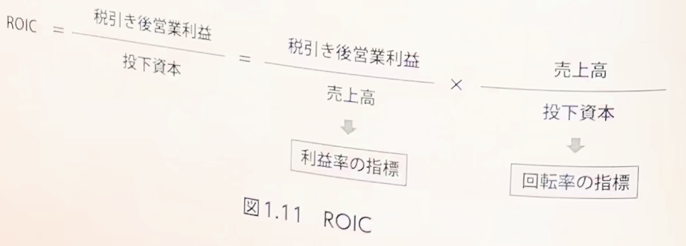

出典: 023_p026.jpg ／ 撮影順: 023 ／ 確認された印刷ページ: 26 ／ 動画時刻: 00:33.598（33.598333秒）


$$
\mathrm{ROIC}=\frac{\text{税引き後営業利益}}{\text{投下資本}}=\frac{\text{税引き後営業利益}}{\text{売上高}}\times\frac{\text{売上高}}{\text{投下資本}}
$$


Mermaid再現図（コードID: 023_p026_1）

対応する原図: 図1.11 ROIC（[c023_f01](figures/c023_f01.png)）

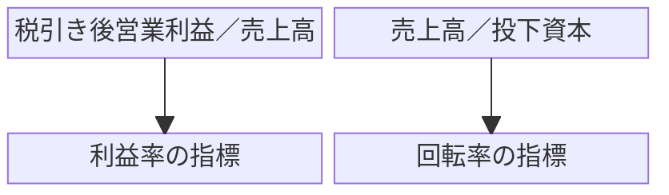

[描画済みSVGを開く（023_p026_1）](mermaid_svg/023_p026_1.svg)


図の表現注: 等式そのものは上記の数式として転記した。下のblock図では、右辺の2つの分数とそれぞれの指標名を、原図と同じ左右2列・上下2段の対応関係に置いた。下向き矢印は指標名を示す注釈であり、因果や業務フローではない。「／」は原図の分数線の代用である。


## 27ページ

<!-- capture_id: page_024; capture_order: 24; source: IMG_6677.MOV; source_time_seconds: 33.598333; image: 024_p027.jpg; transcription_method: direct_visual; status: transcribed -->

原画像: [024_p027.jpg](images/024_p027.jpg) · 動画時刻: 00:33.598

欄外: 第1章 サプライチェーンマネジメントとMP＆C

### ROICとROAとROEの比較

ROICは、特定の事業を対象として、税引き後営業利益を投下資本で割って算出されます。分子の税引き後営業利益には当期の特別損益が含まれないため、特定の事業に着目した収益性を把握できます。分母の投下資本は、特定の事業に投下された資本（株式、社債、借入金）を意味し、特定の事業に使われている運転資本と固定資産の和に相当します。ROICは事業経営者向けの指標です。ROICに似た指標として投資家視点の指標であるROA、株主向けの指標ROEがあります（表1.2）。

ROAとはReturn on Assetの略で、日本語では総資産利益率と呼びます。分子の当期純利益には当期に発生した特別損益が含まれます。また、複数の事業を持つ企業では収益性が事業によって異なりますが、ROAでは事業別の収益性の差がわかりません。そういう意味で、ROAは経営者向けの指標ではなく、投資家向けの指標といえます。

ROEとはReturn on Equityの略で、日本語では株主資本利益率と呼びます。分子の当期純利益はROAと同じですが、分母は株主資本です。「借入金を調達し、自己株式を購入する」といった事業活動と関係のないことでROEは改善します。そのため、ROEは株主を意識した指標といえます。

#### 表1.2 ROICとROAとROE

| | ROIC | ROA | ROE |
|---|---|---|---|
| 対象 | 特定の事業 | 全事業 | 全事業 |
| 分子 | 税引き後営業利益 | 当期純利益 | 当期純利益 |
| 分母 | 投下資本 | 総資産<br>（純資産＋有利子負担＋その他すべての負担） | 株主資本 |
| 誰向けの指標か？ | 経営者 | 投資家 | 株主 |


## 28ページ

<!-- capture_id: page_025; capture_order: 25; source: IMG_6677.MOV; source_time_seconds: 37.331667; image: 025_p028.jpg; transcription_method: direct_visual; status: transcribed -->

原画像: [025_p028.jpg](images/025_p028.jpg) · 動画時刻: 00:37.332

### 1-7 サプライチェーンマネジメント（SCM）とは
### SCMでの意思決定

### 製造オペレーションにおける意思決定

サプライチェーンは複数の企業および同一企業内の複数部署の活動で構成されており、それぞれが様々な意思決定を行っています。製造業（メーカー）であれば、原材料・部品を調達し、組立加工を経て製品を作り、それを販売します。企業では多くの事業経営上の意思決定が行われています。そこでサプライチェーンでの意思決定を、製造オペレーションに着目して深掘してみましょう。

メーカーは、製造オペレーションに関してあわせて主に7つの意思決定を行います（図1.12）<sup>（10）</sup>。

メーカーが意思決定を行う局面は様々です（2-4「ストラテジックプランニング」を参照）。新たに会社を立ち上げる場合、新たな製品群を作り出す場合、既存の製品群の中で新製品を開発する場合で、意思決定の順序・重要度が異なります。近年では、競争が激しい市場に投入する新製品を開発する場合、需要予測と原価企画が起点となることが多いと思われます。

#### 図1.12 製造オペレーションの7つの意思決定と関連する業務

原図切り出し: 図1.12 製造オペレーションの7つの意思決定と関連する業務（切り出しID: c025_f01）

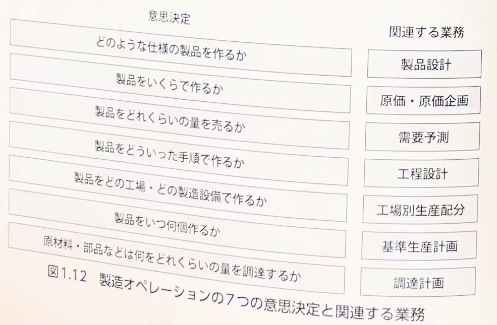

出典: 025_p028.jpg ／ 撮影順: 025 ／ 確認された印刷ページ: 28 ／ 動画時刻: 00:37.332（37.331667秒）


Mermaid再現図（コードID: 025_p028_1）

対応する原図: 図1.12 製造オペレーションの7つの意思決定と関連する業務（[c025_f01](figures/c025_f01.png)）

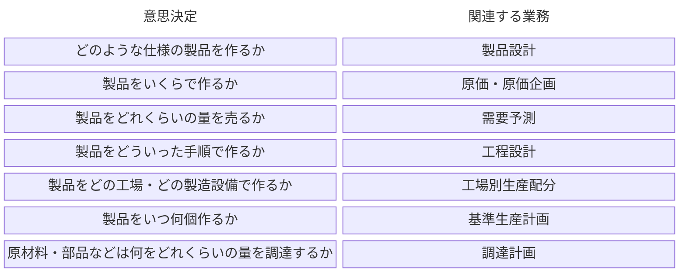

[描画済みSVGを開く（025_p028_1）](mermaid_svg/025_p028_1.svg)


図の表現注: 原図は左右2列・7行の対応表であり、業務フローではない。block図の各行で意思決定と業務を対にし、原図の上からの順序を固定した。接続線や矢印、原図にない列全体の囲みは追加していない。


## 29ページ

<!-- capture_id: page_026; capture_order: 26; source: IMG_6677.MOV; source_time_seconds: 37.331667; image: 026_p029.jpg; transcription_method: direct_visual; status: transcribed -->

原画像: [026_p029.jpg](images/026_p029.jpg) · 動画時刻: 00:37.332

欄外: 第1章 サプライチェーンマネジメントとMP＆C

### SCMを意思決定システムとしてとらえる

本書を手に取った読者の中には「別に、意思決定を学びたいわけではない」とお考えの方がいらっしゃると思います。実は、著者が最も強調したいのが「SCMは意思決定システム」であるということなのです。

1967年に『オペレーションズ・マネジメント入門』という本が刊行されました。執筆したのはロチェスター工科大学のハワード・L・ティムズ教授です。目次は以下のとおりで、オペレーションズ・マネジメントが意思決定システムであることが一目でわかります。

1. オペレーション機能
2. マネジメント理論
3. 決定理論
4. システム理論
5. オペレーションズ・マネジメントのための決定システム

同書の日本語訳が1970年に刊行されました。監訳を務めた故・松田武彦氏が監訳者序文で興味深いことを述べています。「意思決定システムというとらえ方であらゆるオペレーションを考察していくことによって、従来ともすれば別々の分野として扱われがちだったオペレーションズ・リサーチ、インダストリアル・エンジニアリング、会計学、経営学等の主要な問題が、具体的な経営システムの全体的活動としてひとつのまとまった視野に統一されてくる」<sup>（11）</sup>。

SCMは多様なオペレーションで構成されるため「わかりにくい」と思われがちです。本書では松田氏があらゆるオペレーションを意思決定システムととらえたのと同様に、「SCMは多種の意思決定システムで成り立っている」ととらえることで、「SCMのわかりにくさ」が和らぐと考えられます。

「オペレーション・マネジャーはどんな意思決定を行うべきか」「その意思決定が適切に行われるために、業務プロセスはどうあるべきか、支援する情報システムはどうあるべきか、また、組織をどう設計するべきか」「意思決定を担うオペレーション・マネジャーをどう評価するべきか」など、読者が抱えている疑問に対し、本書を通じてヒントを届けることができればと思っています。


## 30ページ

<!-- capture_id: page_027; capture_order: 27; source: IMG_6677.MOV; source_time_seconds: 40.13; image: 027_p030.jpg; transcription_method: direct_visual; status: transcribed -->

原画像: [027_p030.jpg](images/027_p030.jpg) · 動画時刻: 00:40.130

### 1-8 サプライチェーンマネジメント（SCM）とは
### 製造オペレーションにおける意思決定の特徴

### 階層型意思決定が必要な「製造」

前述の7つの意思決定事項には相互関係があります。相互関係とは、たとえば「Aが必ずBより先に決まる。ただし、Bの状況を考慮する必要がある。」といったことです。この場合、単独に決めることができず、関係する事項を考慮して決める必要があります。2つ以上の意思決定事項を同時に決められない場合は、意思決定を階層型にし、逐次決めていくことが必要です。たとえば、新製品開発では需要予測の後、原価企画を行い、目標原価を定めます。目標原価に近づくよう試作品製造が繰り返される中で、原材料や製造方法が見直されます。

また、意思決定の影響が及ぶ期間は、何を決めるかによって異なります。たとえば、製造設備投資が決定された場合、その後数か年は見直されることはありません。一方、継続生産品を作るための部品調達量は、一度決定されてもその数日から数週間後には同じ部品の調達量が決定されます。意思決定の影響が長期に及ぶ事項を先に決め、それを前提として意思決定の影響が及ぶのが短期に留まる事項を決めるのが一般的です。

一般的な製造オペレーションを例に挙げると、図1.13に示すように製品群、製品、部品の順に計画が決まります。「製品群は計画対象期間12か月で計画バケットは月単位、製品は期間3か月で週単位、部品は期間3か月で週単位」

#### 図1.13 階層型意思決定のイメージ図

原図切り出し: 図1.13 階層型意思決定のイメージ図（切り出しID: c027_f01）

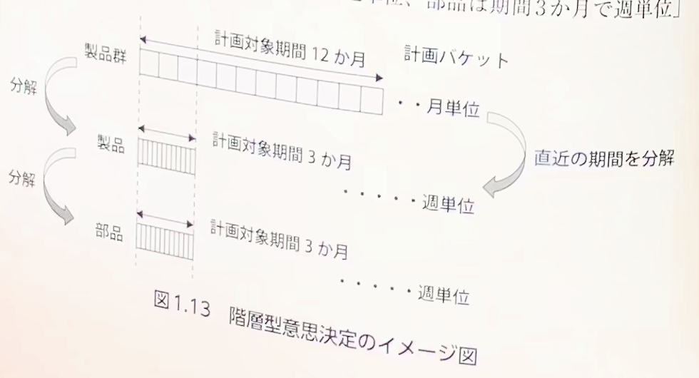

出典: 027_p030.jpg ／ 撮影順: 027 ／ 確認された印刷ページ: 30 ／ 動画時刻: 00:40.130（40.13秒）


Mermaid再現図（コードID: 027_p030_1）

対応する原図: 図1.13 階層型意思決定のイメージ図（[c027_f01](figures/c027_f01.png)）

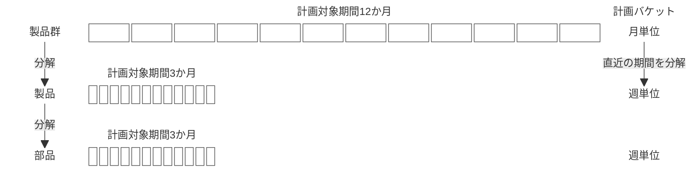

[描画済みSVGを開く（027_p030_1）](mermaid_svg/027_p030_1.svg)


図の表現注: 共通の始点を持つ時間帯を固定配置のブロック図で再現した。製品群は12か月、製品・部品は直近3か月で、横幅は12:3:3。上段は月単位の12区画、下2段は原図に描かれた細かい週単位の区画を対応させた。下2段の右端は上段の3か月分の境界にそろえている。左の「分解」は製品群→製品→部品の階層分解、右の「直近の期間を分解」は月単位→製品の週単位の詳細化を表す別の関係であり、部品の週単位に向けた追加の矢印はない。週区画は原図の模式表現であり、暦日・週番号や「1か月は必ず4週」という換算規則を追加していない。原図の両端矢印・縦の補助点線・曲線矢印の形状は省略した。

## 31ページ

<!-- capture_id: page_028; capture_order: 28; source: IMG_6677.MOV; source_time_seconds: 40.13; image: 028_p031.jpg; transcription_method: direct_visual; status: transcribed -->

原画像: [028_p031.jpg](images/028_p031.jpg) · 動画時刻: 00:40.130

欄外: 第1章 サプライチェーンマネジメントとMP＆C

というように、計画が逐次作られます。上位計画を前提として下位計画を詳細に立てます。

### フィードバックに基づく計画更新が必要な「製造」

実際には、事前に立てた計画が予定通りに進まないことがしばしば起きます。このような不確実性に対処するために、よく使われるのが「フィードバック」という考え方です<sup>（12）</sup>。

フィードバックとは「アウトプットがどういう状態になっているかを把握し、あらかじめ定めた基準を満たすようにインプットの投入を増減する方法」です（図1.14）。たとえば暖房装置の出力を調整し室温を一定範囲に保つサーモスタットや、暗くなったら点灯し明るくなったら消灯する街灯のような仕組みです。

#### 図1.14 フィードバック

原図切り出し: 図1.14 フィードバック（切り出しID: c028_f01）


出典: 028_p031.jpg ／ 撮影順: 028 ／ 確認された印刷ページ: 31 ／ 動画時刻: 00:40.130（40.13秒）


Mermaid再現図（コードID: 028_p031_1）

対応する原図: 図1.14 フィードバック（[c028_f01](figures/c028_f01.png)）

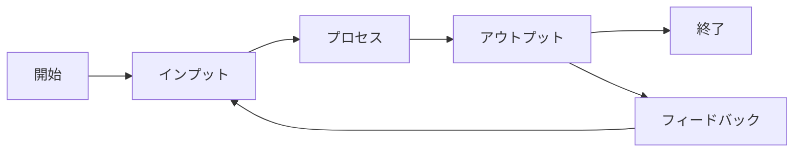

[描画済みSVGを開く（028_p031_1）](mermaid_svg/028_p031_1.svg)


リードタイムを常に伴う製造オペレーションに不確実性はつきものです。たとえば、製造設備の不具合によって生産能力が低下し、予定していた数量を生産できなかったり、サプライヤーからの納入遅延により予定していたスケジュールで生産できなかったりします。

フィードバックでは、計画した通りに作業が進んでいるか否かを適切な時間間隔で把握し、計画と実績との乖離があらかじめ定めた閾値を上回った場合に、計画を更新します。進捗が計画を下回る場合に対策が打たれることが一般的です。製造オペレーションのフィードバックの結果、単位時間あたり生産能力は不変のまま稼働時間を長くしたり、単位時間あたり生産能力を増やしたりすることで、遅れを取り戻します。

フィードバックの間隔は、意思決定が影響を及ぼす期間に応じて、適切に選択される必要があります。フィードバックの間隔が短すぎると余計な調整が発生します。他方、フィードバックの間隔が長すぎると、計画を達成できる見込みが低くなることにつながります。


## 32ページ

<!-- capture_id: page_029; capture_order: 29; source: IMG_6677.MOV; source_time_seconds: 43.863333; image: 029_p032.jpg; transcription_method: direct_visual; status: transcribed -->

原画像: [029_p032.jpg](images/029_p032.jpg) · 動画時刻: 00:43.863

### 1-9 製造オペレーションの計画・管理の仕組み MP＆C
### MP＆Cの概略

一般的な製造業は、複数の製造群を揃え、多数の製品を製造し、そのために多種の部品を調達します。このことを「製品群」「製品」「部品」という3つの模式図で示したのが図1.15です。

#### 図1.15 製品群・製品・部品で構成される3階層の模式図

原図切り出し: 図1.15 製品群・製品・部品で構成される3階層の模式図（切り出しID: c029_f01）

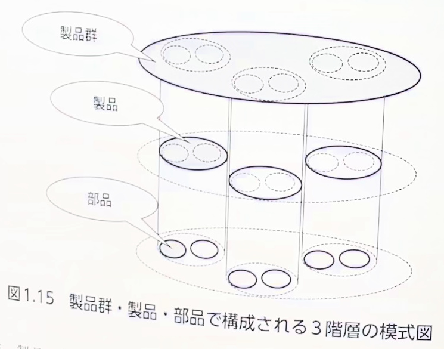

出典: 029_p032.jpg ／ 撮影順: 029 ／ 確認された印刷ページ: 32 ／ 動画時刻: 00:43.863（43.863333秒）


Mermaid再現図（コードID: 029_p032_1）

対応する原図: 図1.15 製品群・製品・部品で構成される3階層の模式図（[c029_f01](figures/c029_f01.png)）

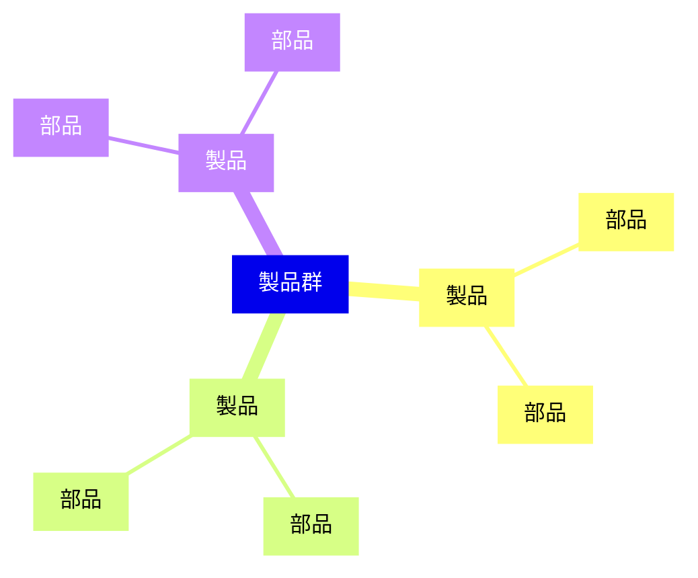

[描画済みSVGを開く（029_p032_1）](mermaid_svg/029_p032_1.svg)


図の表現注: 原図は、製品群1つの中に製品3つがあり、それぞれの製品に部品2つ（合計6つ）が対応することを、3段の立体・透視図で示す。mindmapはこの包含階層を表し、製造工程の順番やフローを示すものではない。「製品」「部品」は原図では代表の図形に一度ずつ付く名称だが、同じ種類の図形を対応させるため各枝で繰り返している。個数はこの模式図に描かれた例であり、一般的な製品構成の固定個数ではない。原図の楕円断面・円柱状の輪郭・透視点線はMermaidでは再現しないため、原図も保持した。


製品群、製品、部品の3階層を意識し、製造オペレーションにおける階層型意思決定とフィードバック機構を備えた仕組みが、図1.16に示すManufacturing Planning and Control（MP＆C）です。今後の技術革新によって、SCMを支援する新しいソフトウェアが登場したとしても、MP＆Cは理解しておかなければならない重要な概念であると考えています。

MP＆C全体俯瞰図は、メーカーを想定しています。しかし、その視点は製造業以外の物流業やサービス業にも通じるものです。


## 33ページ

<!-- capture_id: page_030; capture_order: 30; source: IMG_6677.MOV; source_time_seconds: 43.863333; image: 030_p033.jpg; transcription_method: direct_visual; status: transcribed -->

原画像: [030_p033.jpg](images/030_p033.jpg) · 動画時刻: 00:43.863

欄外: 第1章 サプライチェーンマネジメントとMP＆C

#### 図1.16 MP＆Cの全体俯瞰図

原図切り出し: 図1.16 MP＆Cの全体俯瞰図（切り出しID: c030_f01）

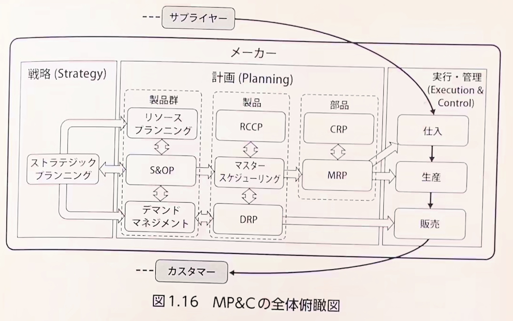

出典: 030_p033.jpg ／ 撮影順: 030 ／ 確認された印刷ページ: 33 ／ 動画時刻: 00:43.863（43.863333秒）

対照方法: この図はMermaidを追加せず、原図の切り出しと既存の文字・表・注記で保持しています。


外枠とラベル:
- 「メーカー」の囲みの内側に、左から「戦略（Strategy）」「計画（Planning）」「実行・管理（Execution ＆ Control）」の3領域がある。
- 戦略領域の箱: ストラテジックプランニング。
- 実行・管理領域の箱は上から: 仕入、生産、販売。
- サプライヤーとカスタマーはメーカーの外側にある。双方の左側の短い破線には接続先が描かれていないため、接続先を補わない。

計画領域の配置（見出しの製品群・製品・部品は、原図の破線の各囲みを表す）:

| 原図の位置 | 製品群 | 製品 | 部品 |
|---|---|---|---|
| 上段 | リソースプランニング | RCCP | CRP |
| 中段 | S＆OP | マスタースケジューリング | MRP |
| 下段 | デマンドマネジメント | DRP | 原図に箱なし |

矢印の全対応（↔は両端に矢じり、→は終点側だけに矢じり）:

| 線の種類 | 始点 | 向き | 終点 |
|---|---|---|---|
| 意思決定（白抜き） | ストラテジックプランニング | → | リソースプランニング |
| 意思決定（白抜き） | ストラテジックプランニング | ↔ | S＆OP |
| 意思決定（白抜き） | ストラテジックプランニング | → | デマンドマネジメント |
| 意思決定（白抜き） | リソースプランニング | ↔ | S＆OP |
| 意思決定（白抜き） | RCCP | ↔ | マスタースケジューリング |
| 意思決定（白抜き） | CRP | ↔ | MRP |
| 意思決定（白抜き） | S＆OP | → | マスタースケジューリング |
| 意思決定（白抜き） | マスタースケジューリング | → | MRP |
| 意思決定（白抜き） | S＆OP | ↔ | デマンドマネジメント |
| 意思決定（白抜き） | マスタースケジューリング | ↔ | DRP |
| 意思決定（白抜き） | デマンドマネジメント | ↔ | DRP |
| 意思決定（白抜き） | MRP | → | 仕入 |
| 意思決定（白抜き） | MRP | → | 生産 |
| 意思決定（白抜き） | DRP | → | 販売 |
| モノやサービス（細線） | サプライヤー | → | 仕入 |
| モノやサービス（細線） | 仕入 | → | 生産 |
| モノやサービス（細線） | 生産 | → | 販売 |
| モノやサービス（細線） | 販売 | → | カスタマー |

図の表現注: この図では、上下・左右の位置、複数の囲みの内外、矢印の接続先が一体で意味を持つ。自由配置のflowchartは対応する行・列を崩し、今回のblock図への変換でも入れ子の囲みや接続が重なったため、不正確なMermaid図を残さず原図を保持した。表は原図の文字・包含関係・18本の矢印を転記したものであり、新しい工程・接続・範囲は追加していない。

図1.16に示したMP＆C全体俯瞰図には、大別して3つの活動が含まれます。図1.17の左から戦略を立案する活動、計画を立案する活動、これらの実行とその管理に関する活動です。これら3つの活動群の関係は階層的なものである点に特徴があります。つまり、まず「戦略」が定まり、次に「計画」が決まり、最後に「実行・管理」で仕入・生産・販売という活動が実行されます。逆にみると、現場で日々実行されている活動の前提には「計画」が存在し、さらにその「計画」の前提には「戦略」が存在するということです。

#### 図1.17 MP＆Cの全体俯瞰図（概略図）

原図切り出し: 図1.17 MP＆Cの全体俯瞰図（概略図）（切り出しID: c030_f02）

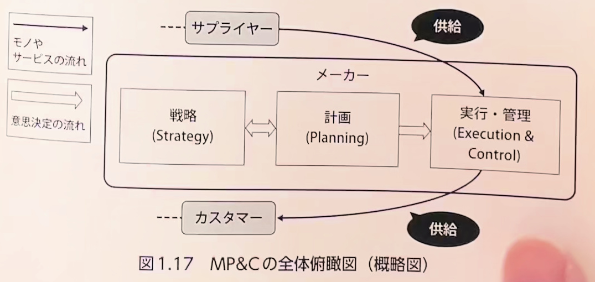

出典: 030_p033.jpg ／ 撮影順: 030 ／ 確認された印刷ページ: 33 ／ 動画時刻: 00:43.863（43.863333秒）


Mermaid再現図（コードID: 030_p033_1）

対応する原図: 図1.17 MP＆Cの全体俯瞰図（概略図）（[c030_f02](figures/c030_f02.png)）

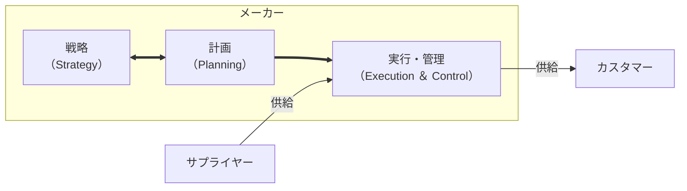

[描画済みSVGを開く（030_p033_1）](mermaid_svg/030_p033_1.svg)


凡例: 細い矢印「モノやサービスの流れ」、白抜き矢印「意思決定の流れ」。

図の表現注: 原図の白抜き矢印をMermaidでは太い矢印で表した。サプライヤーとカスタマーの左側にある接続先の描かれていない短い破線は省略し、ここに記録した。


## 34ページ

<!-- capture_id: page_031; capture_order: 31; source: IMG_6677.MOV; source_time_seconds: 47.596667; image: 031_p034.jpg; transcription_method: direct_visual; status: transcribed -->

原画像: [031_p034.jpg](images/031_p034.jpg) · 動画時刻: 00:47.597

### 1-10 製造オペレーションの計画・管理の仕組み MP＆C
### MP＆Cの構成要素

本節ではMP＆Cの構成要素を説明するとともに、構成要素が本書のどの章で解説しているか示します（図1.18）。本書の見取り図と呼べるものです。

MP＆C全体俯瞰図（図1.16）では製造業、すなわちメーカーを想定していると述べました。サプライチェーンはメーカーだけでなくそのサプライヤー、そのカスタマーで構成されます。サプライヤー、メーカー、カスタマーを含めた範囲を取り扱っているのが本章（第1章）と最後の第11章です。中身にあたる第2章から第10章では、MP＆Cの構成要素を1つずつ説明します。

#### 図1.18 MP＆Cの構成要素と本書記載箇所の対応関係

原図切り出し: 図1.18 MP＆Cの構成要素と本書記載箇所の対応関係（切り出しID: c031_f01）

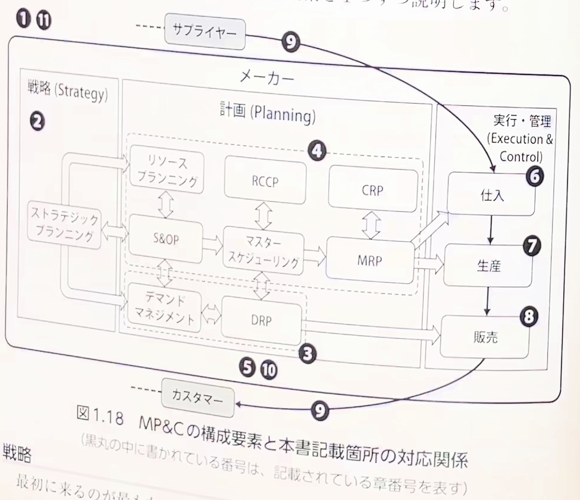

出典: 031_p034.jpg ／ 撮影順: 031 ／ 確認された印刷ページ: 34 ／ 動画時刻: 00:47.597（47.596667秒）

対照方法: この図はMermaidを追加せず、原図の切り出しと既存の文字・表・注記で保持しています。


（黒丸の中に書かれている番号は、記載されている章番号を表す）


外枠とラベル:
- 「メーカー」の囲みの内側に、左から「戦略（Strategy）」「計画（Planning）」「実行・管理（Execution ＆ Control）」の3領域がある。
- 戦略領域の箱: ストラテジックプランニング。
- 実行・管理領域の箱は上から: 仕入、生産、販売。
- サプライヤーとカスタマーはメーカーの外側にある。双方の左側の短い破線には接続先が描かれていないため、接続先を補わない。

計画領域の配置:

| 原図の位置 | 左列 | 中央列 | 右列 | 破線囲み |
|---|---|---|---|---|
| 上段 | リソースプランニング | RCCP | CRP | ④の領域 |
| 中段 | S＆OP | マスタースケジューリング | MRP | ④の領域 |
| 下段 | デマンドマネジメント | DRP | 原図に箱なし | ③の領域 |

章番号と指示対象（番号は工程順ではなく、本書の記載箇所を示す）:

| 原図の黒丸番号 | 位置・対象 |
|---|---|
| ①・⑪ | メーカーの囲みの左上外側。サプライヤー・メーカー・カスタマーを含む全体の範囲 |
| ② | 戦略領域 |
| ③ | デマンドマネジメントとDRPの2要素をまとめる破線囲み |
| ④ | 上・中段の6要素をまとめる破線囲み |
| ⑤・⑩ | 計画領域の下部 |
| ⑥ | 仕入 |
| ⑦ | 生産 |
| ⑧ | 販売 |
| ⑨ | サプライヤーから仕入への線と、販売からカスタマーへの線の2か所 |

矢印の全対応（↔は両端に矢じり、→は終点側だけに矢じり）:

| 線の種類 | 始点 | 向き | 終点 |
|---|---|---|---|
| 意思決定（白抜き） | ストラテジックプランニング | → | リソースプランニング |
| 意思決定（白抜き） | ストラテジックプランニング | ↔ | S＆OP |
| 意思決定（白抜き） | ストラテジックプランニング | → | デマンドマネジメント |
| 意思決定（白抜き） | リソースプランニング | ↔ | S＆OP |
| 意思決定（白抜き） | RCCP | ↔ | マスタースケジューリング |
| 意思決定（白抜き） | CRP | ↔ | MRP |
| 意思決定（白抜き） | S＆OP | → | マスタースケジューリング |
| 意思決定（白抜き） | マスタースケジューリング | → | MRP |
| 意思決定（白抜き） | S＆OP | ↔ | デマンドマネジメント |
| 意思決定（白抜き） | マスタースケジューリング | ↔ | DRP |
| 意思決定（白抜き） | デマンドマネジメント | ↔ | DRP |
| 意思決定（白抜き） | MRP | → | 仕入 |
| 意思決定（白抜き） | MRP | → | 生産 |
| 意思決定（白抜き） | DRP | → | 販売 |
| モノやサービス（細線） | サプライヤー | → | 仕入 |
| モノやサービス（細線） | 仕入 | → | 生産 |
| モノやサービス（細線） | 生産 | → | 販売 |
| モノやサービス（細線） | 販売 | → | カスタマー |

図の表現注: この図では、上下・左右の位置、複数の囲みの内外、矢印の接続先が一体で意味を持つ。自由配置のflowchartは対応する行・列を崩し、今回のblock図への変換でも入れ子の囲みや接続が重なったため、不正確なMermaid図を残さず原図を保持した。表は原図の文字・包含関係・18本の矢印を転記したものであり、新しい工程・接続・範囲は追加していない。

### 戦略

最初に来るのが最も左にある戦略です。製造業での戦略とは、端的に言えば「どんな製品をどんな顧客にどうやって提供し、最終的にどう儲けるか？」です。これは第2章「ストラテジックプランニング」で取り上げています。


## 35ページ

<!-- capture_id: page_032; capture_order: 32; source: IMG_6677.MOV; source_time_seconds: 47.596667; image: 032_p035.jpg; transcription_method: direct_visual; status: transcribed -->

原画像: [032_p035.jpg](images/032_p035.jpg) · 動画時刻: 00:47.597

欄外: 第1章 サプライチェーンマネジメントとMP＆C

### 計画

戦略の次に来るのが計画です。「どう儲けるか？」が一段階具体化されます。この計画は、水平方向と上下方向の2つの軸があるととらえてください。

水平方向には、点線の囲いの中に箱が3つ並んでいます。左から製品群、製品、部品を表しています。前述のとおりこれら3つには階層的関係があります。まず製品群レベルの計画が決まり、次に製品レベルの計画が決まり、最後に部品レベルの計画が決まります。

上下方向には、計画は3段に分かれています。まず、下段は需要を示しています。製品群と製品について考えます。部品の需要については、製品の従属需要ととらえるため、ここでは考えません。中段がその需要に基づいて何をどれだけ作るかを示しています（優先順位計画と呼びます）。上段は、製品群・製品・部品を作るためにどれだけの生産能力が必要かを示しています（能力計画と呼びます）。優先順位計画は、製品群・製品・部品の3階層で能力計画からフィードバックを受けて決定されます。需要を第3章「デマンドマネジメント」で、供給を第4章「サプライプランニング」で、在庫プランニングを第5章「SCMの観点から見た在庫」で取り上げています。

### 実行・管理

計画の次に来るのが実行・管理です。実行・管理は、サプライヤーからの「仕入」、自社での「生産」、顧客への「販売」の3つに分かれています。仕入は第6章「仕入」で、生産は第7章「製造活動と品質」、販売は第8章「販売」で取り上げています。なお、仕入・生産・販売はいずれも在庫コントロールが関係します。在庫コントロールは第5章の中で在庫プランニングとあわせて取り上げています。サプライヤーからの「仕入」と顧客への「販売」についてはロジスティクスが関係します。第9章で「ロジスティクス」で取り上げています。

仕入、生産、販売、ロジスティクスといった諸活動の実行により発生する原価は、第10章「SCMの観点から見た原価」で取り上げています。


## 36ページ

<!-- capture_id: page_033; capture_order: 33; source: IMG_6677.MOV; source_time_seconds: 53.196667; image: 033_p036.jpg; transcription_method: direct_visual; status: transcribed -->

原画像: [033_p036.jpg](images/033_p036.jpg) · 動画時刻: 00:53.197

### 1-11 製造オペレーションの計画・管理の仕組み MP＆C
### 今後のSCMで考慮が求められる外部環境

SCMの意思決定は、内部だけでなく外部環境も考慮する必要があります。外部環境とは、すなわち自社ではコントロールできない要素です。外部環境をとらえる際にはPESTLEと呼ばれるフレームワークがよく使われます。PESTLEとはPolitical（政治的）、Economic（経済的）、Social（社会的）、Technological（技術的）、Legal（法的）、Environmental（環境的）の頭文字をとったものです。少し例を見てみましょう。

### Political（政治的）

英国では、2016年6月に欧州連合（EU）離脱の是非を問う国民投票が行われました<sup>（13）</sup>。開票の結果、離脱支持が52％を占め、英国の欧州連合離脱（BREXIT：ブレグジット）が決まりました。英国を欧州進出の要衝と位置づけている日系企業も少なくありません。在英日系企業にとってはブレグジットにより関税や輸出入手続きの負担などが増えることが予想されるため、拠点を英国に構え続けるか、EU地域に移転するかの選択を迫られます（関税の増加を考慮した、サプライチェーンの拠点配置見直し）。

### Economic（経済的）

景気、雇用、賃金、消費動向などの経済的要因が自社に及ぼす影響のことです。高性能・多機能の高額製品は好況期に売れますが、不況期に売れません。経済的要因に合わせて製品ラインアップを見直すことがあります。

### Social（社会的）

人口動態、流行や習慣などの社会的要因が自社に及ぼす影響のことです。最近起きている大きな社会的要因の1つは、所有からシェアリングへのシフトです。消費者が今まで買っていたモノを買わなくなる変化です。


## 37ページ

<!-- capture_id: page_034; capture_order: 34; source: IMG_6677.MOV; source_time_seconds: 53.196667; image: 034_p037.jpg; transcription_method: direct_visual; status: transcribed -->

原画像: [034_p037.jpg](images/034_p037.jpg) · 動画時刻: 00:53.197

欄外: 第1章 サプライチェーンマネジメントとMP＆C

### Technological（技術的）

新たな技術を製造オペレーションに活用することなどです。一例として3Dプリンティング技術があります。3Dプリンティング技術とは、3つの次元（英語でDimensionと呼びます）の設計データを用いて、2次元の層を1枚ずつ積み重ねていくことにより、立体モデルを製作する技術です。3Dプリンターでの製造が適しているのは、建設機械の補修部品など、販売数量が少なく、かつ在庫保有期間が長いロングテール商品と言われています。3Dプリンターでの補修部品製造により、建設機械であれば、MTTR（Mean Time To Repair；平均復旧時間）が短くなるというメリットがあります。

### Legal（法的）

欧州連合は、2021年に自動車の排ガス規制（CAFE規制）を導入する見通しです<sup>（14）</sup>。自動車メーカー各社が、販売した車両のCO₂の排出量平均値が算出されます。排出量基準を達成できない場合は、自動車メーカーは罰金を支払うか、排出枠に余裕のある企業から排出枠を購入する必要があります。たとえば、電気自動車メーカーの米国テスラ社は、他の自動車メーカーに温暖化ガス排出権を売却することでも収益を得ています。

このCAFE規制によって、ガソリン車メーカーは燃費向上（＝製品改良）あるいは電気自動車への転換（＝新製品開発）が迫られます。2020年9月には、さらに厳格な規制が米国で導入されることが決まりました。米国カリフォルニア州は2035年以降に州内で販売される新車をすべてゼロエミッション車にすることを義務付けたため、ガソリン車メーカーは戦略転換を余儀なくされることになります。

### Environmental（環境的）

地球温暖化など、自然環境の変化が自社に及ぼす影響のことです。たとえば、メーカーではカーボンニュートラル対応が一層重要になると考えられます。日本では、2020年10月下旬に菅義偉首相が国内の温暖効果ガスでの排出を2050年までに実質ゼロにする方針を所信表明演説で述べました<sup>（15）</sup>。今後、カーボンニュートラル対応を進める日本企業が増えていくことが予想されます。


## 38ページ

<!-- capture_id: page_035; capture_order: 35; source: IMG_6677.MOV; source_time_seconds: 57.863333; image: 035_p038.jpg; transcription_method: direct_visual; status: transcribed -->

原画像: [035_p038.jpg](images/035_p038.jpg) · 動画時刻: 00:57.863

### 1-12 MP＆CとROICの関係

1-6「SCMの目的」では、ROICが企業の活動を経営者の観点から評価するのに適した指標であることについて触れました。このことを階層型意思決定の仕組みであるMP＆Cとの関係で再整理しますと、ROICは主に経営層による「戦略」を立案する活動において設定されるKPIといえます。そして、このKPIについて現場の活動との関係における実効性を担保する役割を担うのが「計画」であり、その計画に基づいて実際に活動するのが「実行・管理」といえます。したがってROICの計算式を構成する個別の要素は主として実行・管理の結果として集積され、事業年度ごとの予算立案や中期的な経営計画立案といった戦略を起案する活動における継続的なKPIの見直しの手がかりとして参照されることになります。ROICを構成する各要素については、第10章で触れたいと思います。

$$
\mathrm{ROIC}=\frac{\text{利益}}{\text{売上高}}\times\frac{\text{売上高}}{\text{投下資本}}
$$

#### 図1.19 MP＆CとROICの関係

原図切り出し: 図1.19 MP＆CとROICの関係（切り出しID: c035_f01）

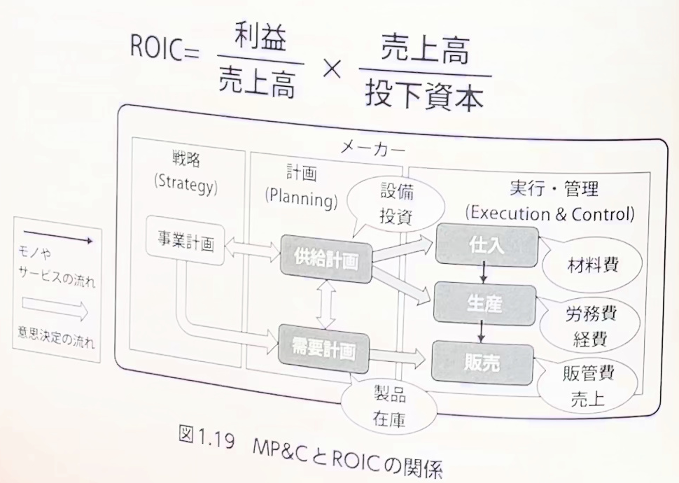

出典: 035_p038.jpg ／ 撮影順: 035 ／ 確認された印刷ページ: 38 ／ 動画時刻: 00:57.863（57.863333秒）


Mermaid再現図（コードID: 035_p038_1）

対応する原図: 図1.19 MP＆CとROICの関係（[c035_f01](figures/c035_f01.png)）

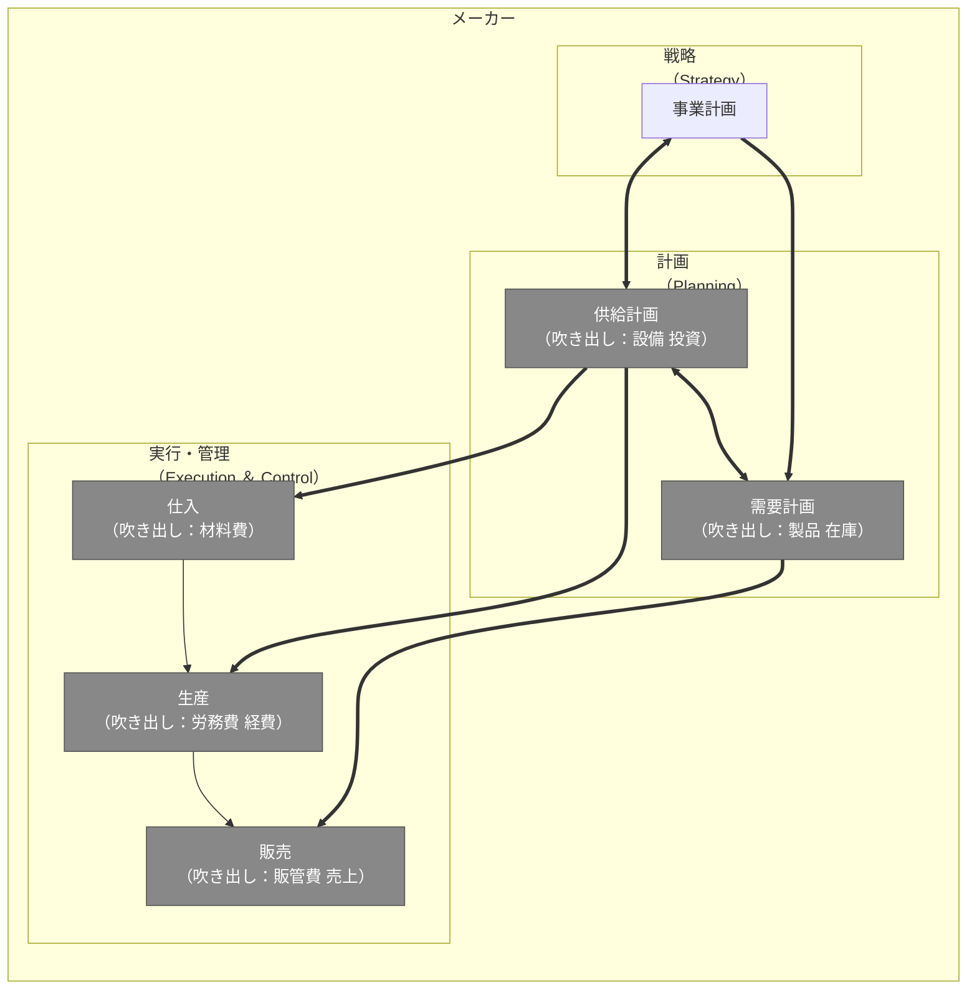

[描画済みSVGを開く（035_p038_1）](mermaid_svg/035_p038_1.svg)


凡例: 細い矢印「モノやサービスの流れ」、白抜き矢印「意思決定の流れ」。

図の表現注: 白抜き矢印を太い矢印で表した。吹き出しの内容は対応する箱のラベルに併記し、吹き出しの尾を新たなフロー矢印として扱っていない。原図で灰色の計画・実行の5項目は、Mermaidでも灰色で示した。


## キャプチャ036（印刷ページ番号なし）

<!-- capture_id: page_036; capture_order: 36; source: IMG_6677.MOV; source_time_seconds: 55.996667; image: 036_spread_right.jpg; transcription_method: direct_visual; status: transcribed -->

原画像: [036_spread_right.jpg](images/036_spread_right.jpg) · 動画時刻: 00:55.997

### 第2章
### 戦略：ストラテジックプランニング

この章を読み終えると、以下の内容を理解することができます。

- ストラテジーとは
- ストラテジーとサプライチェーンの関係
- サプライチェーンのストラテジックな意思決定の例
- MP＆Cでのストラテジックプランニングの位置づけ

画像の表現注: 背景の淡い幾何模様は装飾のため再現していない。左端に写る前ページの断片は、この扉ページの本文ではない。


## 40ページ

<!-- capture_id: page_037; capture_order: 37; source: IMG_6677.MOV; source_time_seconds: 59.73; image: 037_p040.jpg; transcription_method: direct_visual; status: transcribed -->

原画像: [037_p040.jpg](images/037_p040.jpg) · 動画時刻: 00:59.730

### 2-1 サプライチェーンのストラテジーとは

### ストラテジー（戦略）とは何か

立てた目標をどのようにして達成するか定めたものを、ストラテジーと呼びます。ストラテジーはもともと政治的判断を意味する用語であり、政治的判断の1つに戦争するか否かが含まれていました。1960年代に米国の国防総省で勤務していた専門家が、ビジネス界や学界に転じた際に持ち込まれ、世の中に広まったといわれています<sup>（1）</sup>。

企業にとってのストラテジーとは、その企業が置かれた環境で、どのような役割を果たすかを示したものです。そこには、その企業が誰を顧客とするか、その顧客をどのように満足させるか、競合他社とどのように戦うか、事業としてどのように成長させるか、売上高・利益などの財務的目標をどのように達成するかが示されています。

製造業でストラテジーを定める際によく取り上げられるのが「どのような品質の製品をいくらで売るか」です。競合他社の製品とどのように差別化を図るか、ターゲット顧客を絞り込む（ニッチマーケットに集中する）か否か、価格帯をどこに設定するか、といったことが議論されます。

### ストラテジーを定める際に何が重要か

ストラテジーを定めることは、目標を達成するまでの段取りを決めることといえます。その際にもっとも重要なのが、自社で使える資源をどう分配するかを決めることです。ここでいう資源とはヒト、モノ、カネ、情報、さらには時間を指します。目標を達成するために、有限の資源をどこにどれだけ分配するかを決める必要があります。

### ストラテジーとサプライチェーンの関係

製造業の場合を考えます。メーカーはサプライヤーから原材料・部品を調達し、製造設備を用いて製品を生産します。そして、顧客に近い場所に製品在庫を保有し、顧客からの注文に応じて供給します。これらの活動を実現するために多


## 41ページ

<!-- capture_id: page_038; capture_order: 38; source: IMG_6677.MOV; source_time_seconds: 59.73; image: 038_p041.jpg; transcription_method: direct_visual; status: transcribed -->

原画像: [038_p041.jpg](images/038_p041.jpg) · 動画時刻: 00:59.730

欄外: 第2章 戦略：ストラテジックプランニング

数の要素が必要であり、メーカーは様々な資源を投入しなければなりません。その際に「有限の資源をどこにどれだけ分配するか」の意思決定が必要となります。

メーカーが意思決定する内容は次のようなことです（図2.1）。製品に使われる部品を内製するか社外から調達するか、製造を自社工場で行うか外部に委託するか、顧客からの受注・納品リードタイムを短縮するために多数の在庫拠点を構えるか、それとも高速輸送手段を採用するか。製品に使う部品が汎用品で充足するならばその部品を社外から調達できますが、その部品を製造できるサプライヤーを見つけられない場合は内製が必要です。製品を作るために特殊な製造工程がある場合は自社工場で作らざるをえませんが、製造工程が汎用的である場合は製造が社外に委託されることが一般的です。その代表例がアパレル製品です。

また、物流には各種のトレードオフがあります。在庫拠点を増やせば、顧客からの受注・納品リードタイムを短縮できる一方、在庫金額が膨らみます。インディテックス社（章末のコラム参照）のように高速輸送手段を使えば工場から店舗への供給リードタイムを縮め需要に追随できますが、割高な空輸費用を負担しなければなりません。競合他社に勝つために、自社が提供するべきサービスレベル（3-1「デマンド（需要）とは」で解説）を決める必要もあります。このようにサプライチェーンを構築する際には多種の意思決定が必要とされています。これらはすべて、その企業が顧客に対してどのような価値を提供したいか次第で決まります。

#### 図2.1 メーカーの意思決定の例

原図切り出し: 図2.1 メーカーの意思決定の例（切り出しID: c038_f01）

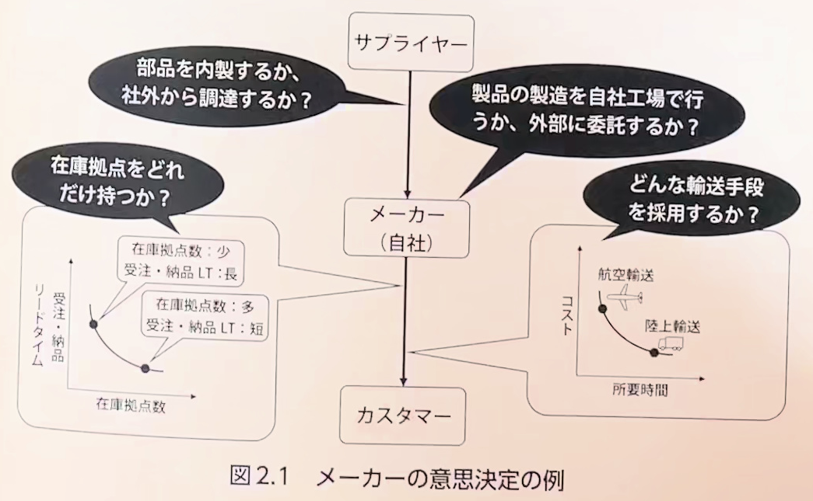

出典: 038_p041.jpg ／ 撮影順: 038 ／ 確認された印刷ページ: 41 ／ 動画時刻: 00:59.730（59.73秒）


原図には供給フローに加えて、2つのトレードオフ曲線と意思決定の吹き出しが含まれる。下のMermaidは供給フロー部分だけの転記であり、図全体の代替ではない。


Mermaid再現図（コードID: 038_p041_1）

対応する原図: 図2.1 メーカーの意思決定の例（[c038_f01](figures/c038_f01.png)）

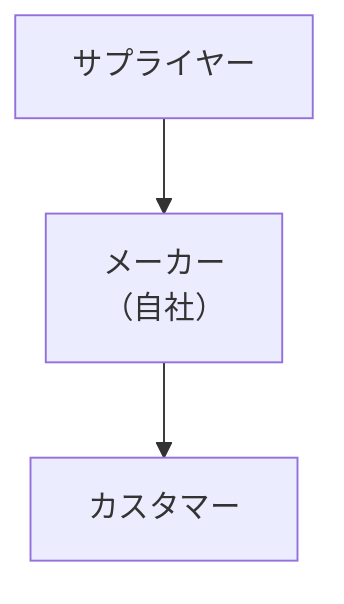

[描画済みSVGを開く（038_p041_1）](mermaid_svg/038_p041_1.svg)


図中の吹き出し:
- サプライヤーからメーカーへの矢印: 部品を内製するか、社外から調達するか？
- メーカー: 製品の製造を自社工場で行うか、外部に委託するか？
- 左側のグラフ: 在庫拠点をどれだけ持つか？
- 右側のグラフ: どんな輸送手段を採用するか？

左側グラフの文字:
- 縦軸: 受注・納品リードタイム
- 横軸: 在庫拠点数
- 左上の点: 在庫拠点数：少／受注・納品LT：長
- 右下の点: 在庫拠点数：多／受注・納品LT：短

右側グラフの文字:
- 縦軸: コスト
- 横軸: 所要時間
- 左上の点: 航空輸送
- 右下の点: 陸上輸送

図の表現注: 左右のグラフはいずれも数値目盛のない下降曲線で、2つの点と注記がある。原図どおりの曲線形状・点の座標はMermaidで再現できないため、原画像を参照。数値は補っていない。右グラフの飛行機・トラックは図像であり、文字ラベルのみ転記した。グラフを囲う吹き出しの尾はメーカーからカスタマーへの矢印を指しており、別のフローとしては描いていない。


## 42ページ

<!-- capture_id: page_039; capture_order: 39; source: IMG_6677.MOV; source_time_seconds: 62.53; image: 039_p042.jpg; transcription_method: direct_visual; status: transcribed -->

原画像: [039_p042.jpg](images/039_p042.jpg) · 動画時刻: 01:02.530


### 2-2 サプライチェーンの戦略的意思決定の例（社内）

サプライチェーンは一度構築されたら、一般的には相当な期間、維持されます。製造設備などの投資を回収する必要があるからです。そのため、どのようなサプライチェーンを構築するかという「サプライチェーンの設計」が重要になります。

製品のライフサイクルコストは設計・開発の段階でほぼ決まるとよくいわれますが、サプライチェーンの設計も同じです<sup>（2）</sup>。サプライチェーンが設計される時に、ライフサイクルのオペレーションコストの大半が決まるのです。そこで、サプライチェーンに関わるストラテジックな意思決定の例2つを以降に示します。

#### 図2.2 デカップリングポイント（図中の▼）

原図切り出し: 図2.2 デカップリングポイント（図中の▼）（切り出しID: c039_f01）

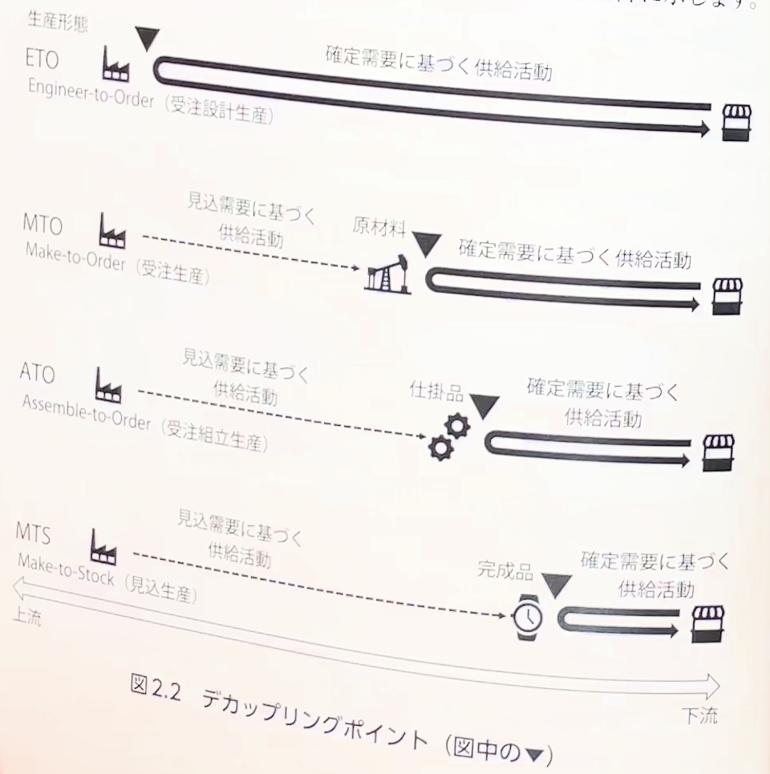

出典: 039_p042.jpg ／ 撮影順: 039 ／ 確認された印刷ページ: 42 ／ 動画時刻: 01:02.530（62.53秒）

対照方法: この図はMermaidを追加せず、原図の切り出しと既存の文字・表・注記で保持しています。


生産形態

| 生産形態 | 英語表記 | 日本語表記 | ▼の位置 | ▼より上流の表示 | ▼から下流への表示 |
|---|---|---|---|---|---|
| ETO | Engineer-to-Order | 受注設計生産 | 工場のすぐ右 | なし | 確定需要に基づく供給活動 |
| MTO | Make-to-Order | 受注生産 | 原材料の右 | 見込需要に基づく供給活動 | 確定需要に基づく供給活動 |
| ATO | Assemble-to-Order | 受注組立生産 | 仕掛品の右 | 見込需要に基づく供給活動 | 確定需要に基づく供給活動 |
| MTS | Make-to-Stock | 見込生産 | 完成品の右 | 見込需要に基づく供給活動 | 確定需要に基づく供給活動 |

図像：各行の左に工場、右に店舗。途中の「原材料」は採油機、「仕掛品」は歯車、「完成品」は腕時計で表されている。

図中の方向表示: 左「上流」、右「下流」（両端に矢印のある横長の白抜き矢印）。

図の表現注: これは工程を別々に並べたフローではなく、同じ上流→下流方向におけるデカップリングポイントの位置を4つの生産形態で比較した図。▼はETO、MTO、ATO、MTSの順に下流側へ移り、確定需要に基づく供給活動の帯は短くなる。見込需要の活動は破線、確定需要の活動は左で折り返す右向きの帯で描かれている。位置と長さの比較が図の意味に不可欠なため、自由配置のMermaidフロー図には置き換えず、原画像と対応表を保持する。位置の数値や帯の長さの数値は原図にないため補わない。


## 43ページ

<!-- capture_id: page_040; capture_order: 40; source: IMG_6677.MOV; source_time_seconds: 62.53; image: 040_p043.jpg; transcription_method: direct_visual; status: transcribed -->

原画像: [040_p043.jpg](images/040_p043.jpg) · 動画時刻: 01:02.530

欄外: 第2章 戦略：ストラテジックプランニング

### デカップリングポイントをどこに置くか？

デカップリングポイントとは、簡単にいうと、顧客からの注文に対して、サプライチェーン上のどこにある在庫で構えるか、ということです<sup>（3）</sup>。図2.2は4つの生産形態（ETO、MTO、ATO、MTS）でのデカップリングポイントの場所を示したものです。

顧客から近い場所に倉庫を配置し、そこに製品在庫を保管する方法もあれば、顧客から注文が届いてから手持ち部品在庫を使って製品を組み立てる方法もあります。このデカップリングポイントの場所を、サプライチェーン上のなるべく下流に配置することで、顧客からの受注・納品リードタイムをある程度短い範囲に抑えながら、製品数が膨れ上がり在庫金額がかさむのを避けることができます。ただし、デカップリングポイントを下流に配置し顧客からの要求に俊敏に対応するには、それ相応の供給能力を持つ必要があり、追加コストが発生します。トレードオフの関係があることを理解してデカップリングポイント配置を決める必要があります。

### サプライチェーンネットワークをどう設計するか？

メーカー、特に見込生産型の生産形態を採るメーカーの場合、少数の生産拠点で製品を作り、その製品を顧客に近い場所にある多数の物流拠点に供給するというオペレーションが採用されることが一般的です。

他方、同じ加工食品であっても、賞味期限の長さによってサプライチェーンのネットワークが異なります。たとえば、菓子や清涼飲料のように賞味期限が数か月間と長い加工食品の場合、日本国内に工場を1つ構え、全国に供給することが可能です。他方、日配品（納豆、豆腐など）のように賞味期限の短い加工食品の場合、日本国内に工場を1つ構え、全国に供給することは不可能です。

また、製品の容積・重量あたりの販売単価の高低によっても、サプライチェーンのネットワークが異なります。製品の容積・重量あたりの販売単価が低く、物流費負担力が小さい商品は、工場から遠隔地にある市場まで運ぶと採算が取れなくなるため、工場が分散して配置される傾向があります。

製品そのものの賞味期限や顧客が許容する受注・納品リードタイム、物流費負担力などの条件をふまえて、生産および物流拠点の配置、すなわち、サプライチェーンネットワークを設計する必要があります<sup>（4）</sup>。


## 44ページ

<!-- capture_id: page_041; capture_order: 41; source: IMG_6677.MOV; source_time_seconds: 66.261667; image: 041_p044.jpg; transcription_method: direct_visual; status: transcribed -->

原画像: [041_p044.jpg](images/041_p044.jpg) · 動画時刻: 01:06.262


### 2-3 サプライチェーンの戦略的意思決定の例（社外）

前節で述べた戦略的意思決定のほか、外部環境をふまえて戦略的に意思決定を行う必要に迫られることが増えています。ここでは例としてサプライヤーとの関係、自然災害リスクの2つを取り上げてみましょう。

### サプライヤーとどのような関係を築くか？

製品改廃が多いカテゴリーでは、競合他社より優位に立つために、新製品導入リードタイムを短縮したり、単位期間内の新製品投入数を増やしたりすることが多々あります。その際に重要になるのがサプライヤーとの関係です。新製品の設計情報はメーカーにとってきわめて機密性の高い情報です。新製品導入リードタイム短縮や単位期間内の新製品投入数増加のためには、サプライヤーとの信頼関係を築いたうえで、新製品開発を協働することが必要になります<sup>（5）</sup>。

#### 図2.3 サプライヤーとの関係構築

原図切り出し: 図2.3 サプライヤーとの関係構築（切り出しID: c041_f01）

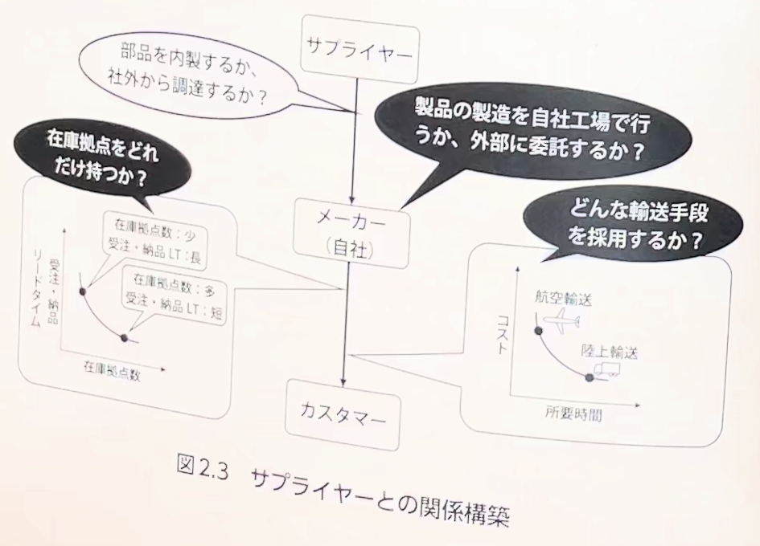

出典: 041_p044.jpg ／ 撮影順: 041 ／ 確認された印刷ページ: 44 ／ 動画時刻: 01:06.262（66.261667秒）


Mermaidは中央の供給関係のみを表す。左右のトレードオフ曲線と吹き出しを含む図全体は原画像を参照。


Mermaid再現図（コードID: 041_p044_1）

対応する原図: 図2.3 サプライヤーとの関係構築（[c041_f01](figures/c041_f01.png)）


[描画済みSVGを開く（041_p044_1）](mermaid_svg/041_p044_1.svg)


図中の吹き出し:
- サプライヤーからメーカーへの矢印: 部品を内製するか、社外から調達するか？
- メーカー: 製品の製造を自社工場で行うか、外部に委託するか？
- 左側のグラフ: 在庫拠点をどれだけ持つか？
- 右側のグラフ: どんな輸送手段を採用するか？

左側グラフの文字:
- 縦軸: 受注・納品リードタイム
- 横軸: 在庫拠点数
- 左上の点: 在庫拠点数：少／受注・納品LT：長
- 右下の点: 在庫拠点数：多／受注・納品LT：短

右側グラフの文字:
- 縦軸: コスト
- 横軸: 所要時間
- 左上の点: 航空輸送
- 右下の点: 陸上輸送

図の表現注: 左右のグラフはいずれも数値目盛のない下降曲線で、2つの点と注記がある。曲線形状・点の座標はMermaidで再現できないため原画像を参照。数値は補っていない。右グラフの飛行機・トラックは図像であり、文字ラベルのみ転記した。グラフを囲う吹き出しの尾はメーカーからカスタマーへの矢印を指しており、別のフローとしては描いていない。部品調達についての吹き出しは白地、ほかの3つの質問の吹き出しは黒地。


## 45ページ

<!-- capture_id: page_042; capture_order: 42; source: IMG_6677.MOV; source_time_seconds: 66.261667; image: 042_p045.jpg; transcription_method: direct_visual; status: transcribed -->

原画像: [042_p045.jpg](images/042_p045.jpg) · 動画時刻: 01:06.262

欄外: 第2章 戦略：ストラテジックプランニング

ただし、このような関係を築けるのは少数のサプライヤーに限定されます。どのサプライヤーと取引するかを慎重に選択する必要があります。

数年前にロケットの基幹部品開発を取り扱った人気テレビドラマがありました。部品の買い手であるロケットメーカーは基幹部品の内製化を図るため、部品メーカーからの特許買取を要望していましたが、最終的には部品メーカーが特許を保持しロケットメーカーに部品を供給するという形で収まった、という話でした。

コモディティを調達する場合は、サプライヤーから特許を買い取る必要はありません。しかし、特殊な部品、しかも、製品の競争力を左右する重要部品を必要とする場合は、特許を買い取ったり、独占的供給契約を締結したりして、競合企業への重要部品供給を遮断し競争優位を築くことがあります。

### 自然災害リスクにどう備えるか？

日本は台風、豪雨、豪雪、地震といった自然災害によく見舞われます。自然災害で拠点が被災し製造や出荷ができなくなる、また、輸送ネットワークの遮断により製品在庫があるのに供給できない、といった事態が発生します。

2000年代に入り、大きな成長を見込めない日本市場を対象とするメーカーでは、サプライチェーンコストを削減するため生産拠点や在庫拠点を集約する動きが続いていました。しかし、サプライチェーン遮断リスクへの対応力を高めるため、この動きが見直されています。具体的には輸送ネットワーク遮断や輸送能力低下に備えて生産拠点や在庫拠点を分散配置することです。たとえば、2011年の東日本大震災の後、とある製薬メーカーは製品在庫拠点数を増やしています。もちろん、リスクに備えるには相応の投資が必要となるため、経営判断が求められる事項です。

最近では「レジリエンス」という言葉を耳にすることが増えてきました。これは回復力という意味ですが、自然災害などによって一時的にサプライチェーンが遮断された場合に、元の状態に短時間で戻れる能力のことを指します。これにはいろいろな方法があります。まったく同じ仕様の工場を複数作る（インテル）、部品の標準化を進め部品種類数を減らすなどです<sup>（6）</sup>。


## 46ページ

<!-- capture_id: page_043; capture_order: 43; source: IMG_6677.MOV; source_time_seconds: 72.795; image: 043_p046.jpg; transcription_method: direct_visual; status: transcribed -->

原画像: [043_p046.jpg](images/043_p046.jpg) · 動画時刻: 01:12.795


### 2-4 MP＆Cでのストラテジックプランニングの位置づけ

### ビジネスプラン

企業のストラテジーを、数字を用いて表現したものを「ビジネスプラン」と呼びます。日本語でいうと「事業計画」という言葉が近いかもしれません。ビジネスプランには自社の将来の事業内容（製品系列、マーケットなど）が示されています。ビジネスプランは詳細なものではありません。個々の製品の販売数量ではなく、製品群単位の売上高で示されています。

取扱商品のライフサイクルの長短、市場での競合状況などに依存しますが、ビジネスプランの対象期間は一般的には3～5年、長い場合は10年におよぶことがあります。そして通常、半年あるいは1年ごとに計画が更新されます。

### ストラテジックプランニング

ビジネスプランを立てるプロセスのことを「ストラテジックプランニング」と呼びます。図2.4に示すMP＆C全体像のもっとも左側にある部分です。

#### 図2.4 MP＆C全体像とストラテジックプランニングの位置づけ

原図切り出し: 図2.4 MP＆C全体像とストラテジックプランニングの位置づけ（切り出しID: c043_f01）

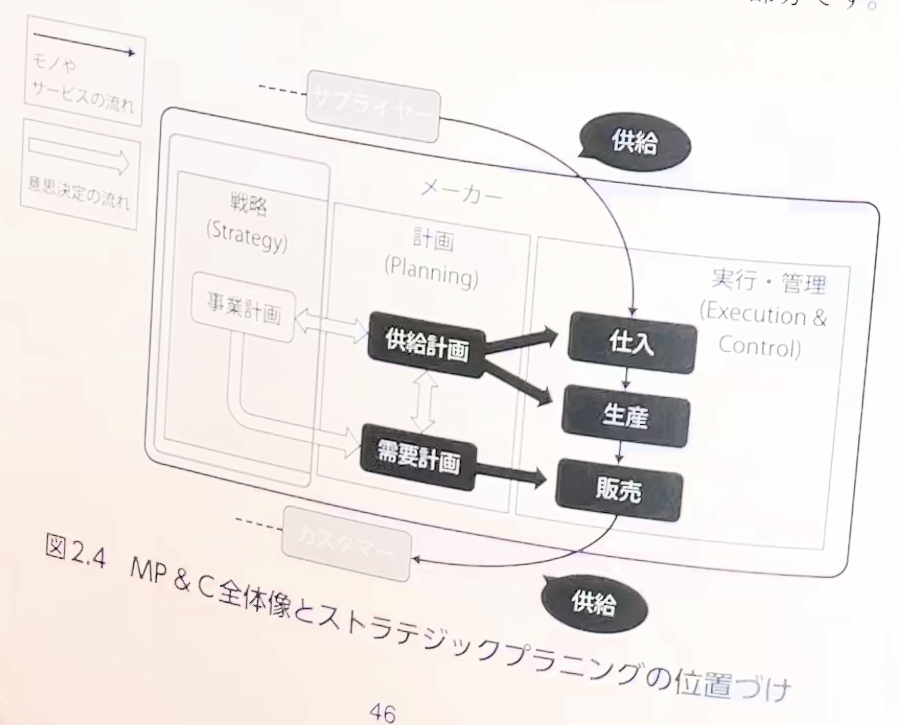

出典: 043_p046.jpg ／ 撮影順: 043 ／ 確認された印刷ページ: 46 ／ 動画時刻: 01:12.795（72.795秒）


Mermaid再現図（コードID: 043_p046_1）

対応する原図: 図2.4 MP＆C全体像とストラテジックプランニングの位置づけ（[c043_f01](figures/c043_f01.png)）

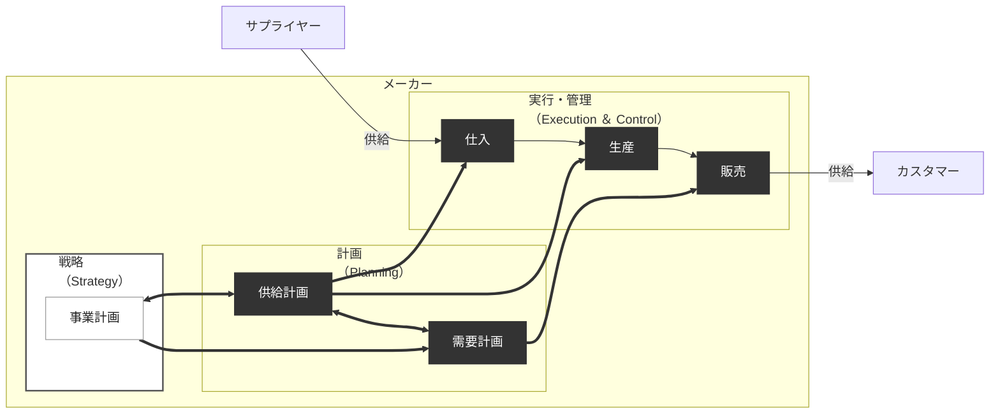

[描画済みSVGを開く（043_p046_1）](mermaid_svg/043_p046_1.svg)


凡例: 細い矢印「モノやサービスの流れ」、白抜き矢印「意思決定の流れ」。

図の表現注: 原図では供給計画・需要計画・仕入・生産・販売の箱、および供給計画から仕入・生産と需要計画から販売への矢印が黒く、ほかの箱と意思決定矢印は淡色。Mermaidはモノやサービスの矢印を細線、意思決定矢印を太線で区別する。サプライヤーとカスタマーの左には接続先の描かれていない短い破線がある。戦略欄の追加の囲みは、ストラテジックプランニングの対象範囲を強調している。原図の左から「戦略」「計画」「実行・管理」という領域順、計画欄で供給計画が上・需要計画が下という配置は原画像でも保持する。


## 47ページ

<!-- capture_id: page_044; capture_order: 44; source: IMG_6677.MOV; source_time_seconds: 72.795; image: 044_p047.jpg; transcription_method: direct_visual; status: transcribed -->

原画像: [044_p047.jpg](images/044_p047.jpg) · 動画時刻: 01:12.795

欄外: 第2章 戦略：ストラテジックプランニング

ビジネスプランは、長期の需要予測に基づいて、社内の関係部門（マーケティング、財務、生産、技術）が参画して作られます。内部環境と外部環境が把握された上で、課題を洗い出し、その課題をどうやって実現するかについての基本方針を決めることになります。

ビジネスプランは、自社の将来の事業内容が製品群単位で売上高が示されますが、「自社がどう商売したいか？」によって書かれる内容は様々です。簡単な例を紹介します。

まず、米国の電気自動車メーカーであるテスラ・モーターズのように、新たに会社を立ち上げる場合があります。このテスラ・モーターズ社の会長に2004年に就任したのがイーロン・マスク氏です。2008年に最初の生産車両テスラ・ロードスターが販売された後、2012年に乗車定員5人のセダンであるモデルSが、2016年に5人乗りセダンの小型・低価格版であるモデル3が販売されました。最初はプレミアム価格を負担できる顧客層がいる高級車市場に参入し、その後、量産可能な新車種を開発して低価格帯市場を展開するという戦略を採用したことがうかがえます。この例から、新たに会社を立ち上げる場合、商品ラインアップと研究開発を含め10年程度の期間に及ぶ事業計画を検討する必要があることがわかります。

次に、1989年に北米市場でレクサスという高級車ブランドを立ち上げたトヨタ自動車のように、新たな製品群を揃える場合があります。レクサスの日本での販売が始まったのは2005年ですが、レクサス専用の製造ラインほかレクサス専用の販売店網・整備工場が設けられました。新たなブランドを構築するには、新たなコンセプトの商品開発に留まらず、販売店や整備工場など、新たな顧客層と関係を築くための接点の用意が必要な場合があります。サプライチェーンの全体にわたって相当な規模の資源投入が必要であることがわかります。

そして、消費財メーカーが小売店舗の棚を確保するために、既存の製品群の中で新製品を開発し続ける場合があります。製品の入れ替わりが激しい小売業態がコンビニエンスストアです。そのコンビニエンスストアの店頭で競合他社と戦うために、新製品開発に資源を注ぐ消費財メーカーは少なくありません。コンビニエンスストアを含む小売業態向け製品を作る消費財メーカーの中には、1年間に新製品を約100個も上市するところもあります。


## 48ページ

<!-- capture_id: page_045; capture_order: 45; source: IMG_6677.MOV; source_time_seconds: 77.461667; image: 045_p048.jpg; transcription_method: direct_visual; status: transcribed -->

原画像: [045_p048.jpg](images/045_p048.jpg) · 動画時刻: 01:17.462

### column ファッションアパレル企業のストラテジーの違い

ユニクロ、ZARAは、ともにアパレルの製造小売業です（企業名ではなく店舗ブランド名です）。ただし、収益構造が大きく異なっています。

ユニクロは、比較的長期間販売される、ベーシックな商品を取り扱っています<sup>（7）</sup>。アイテム数を絞り、1アイテムあたりの調達数量を多くし、調達単価を下げています。物流費を抑制するために、折りたたまれた製品が梱包の中に積み重ねて詰められた状態で海上輸送されます。シーズンの終わりに、在庫が余っている場合には値引き販売が行われます。

他方、ZARAは、ユニクロに比べてファッション性が高く、短期間でアイテムが入れ替わります<sup>（8）</sup>。店頭での売れ行きをふまえて、売れそうなデザインの製品がスピーディに投入されます。それを実現するためにインディテックス社はデザインの在庫を抱えています。スピードを重視するため、製品はハンガーに吊るされた状態で航空機で運ばれます。値引き販売はあまり行われません。

大ざっぱな比較になりますが、ユニクロは低いコストで調達してシーズン終盤に値引き販売する一方、ZARAは高いコストをかけて調達・供給し、あまり値引きせずに販売します。両者とも同じアパレルの製造小売業ですが、その収益構造は大きく異なります（図2.5）。

#### 図2.5 ユニクロとZARAの収益構造の違い（イメージ）

図中の文字：

- ユニクロ：製造費／物流費／海上輸送／管理費／値引／利益／値引がない場合の仮想利益／値引大／売上高
- ZARA：製造費／物流費／航空輸送／管理費／利益／値引がない場合の仮想利益／値引小／売上高

［変換上の注記］図2.5は、両社の製造費・物流費・管理費・利益・値引を面積と位置で比較した模式図であり、数値は示されていない。Mermaidで面積比や高さを忠実に再現できないため、数値や接続関係を補わず原画像を参照する。各図の「売上高」は縦の両端矢印で示され、「値引がない場合の仮想利益」は点線枠への吹き出しで示されている。


## キャプチャ046（印刷ページ番号なし）

<!-- capture_id: page_046; capture_order: 46; source: IMG_6677.MOV; source_time_seconds: 77.461667; image: 046_spread_right.jpg; transcription_method: direct_visual; status: transcribed -->

原画像: [046_spread_right.jpg](images/046_spread_right.jpg) · 動画時刻: 01:17.462

### 第3章
### 計画：デマンドマネジメント（需要計画）

この章を読み終えると、以下の内容を理解することができます。

- デマンド（需要）とは
- デマンドマネジメント①：デマンドプランニング
- デマンドマネジメント②：需要情報の意味


## 50ページ

<!-- capture_id: page_047; capture_order: 47; source: IMG_6677.MOV; source_time_seconds: 80.261667; image: 047_p050.jpg; transcription_method: direct_visual; status: transcribed -->

原画像: [047_p050.jpg](images/047_p050.jpg) · 動画時刻: 01:20.262

### 3-1 デマンド（需要）とは

#### 図3.1 SCMにおけるデマンド（需要）とサプライ（供給）の関係

図中の文字：欠乏感／需要／供給／均衡

［変換上の注記］図3.1は、「需要」と「供給」を天秤の左右に載せたイラスト。「欠乏感」の吹き出しは「需要」に、「均衡」の吹き出しは天秤の支点付近に向けられている。天秤の棒と三角形の支点という幾何形状をMermaidの接続線に置き換えると原図にない関係線になるため、原画像を参照する。

### 「需要計画」とは

サプライチェーンにおける「デマンド（需要）」とは、ユーザーが欠乏感（deprivation）を充足するための手段として選択し、対価を支払って入手したいと考える商品の量（個数または金額）の総和を指します<sup>（1）</sup>。

需要に対して当該商品を短期的に過不足なく供給するだけでなく、それら中長期的な均衡状態を維持することはSCMの主要な目標の1つです（図3.1）。この需要に関する情報はこれらの製品や仕掛品、原材料を生産する企業、およびディストリビューション（流通）によってそれらを商品としてユーザーに提供する企業が「事業計画」や「供給計画」を起案するための起点となります。しかし、需要は様々な要因によって変化する性質を有していることから、適切な供給を考えるうえではその変化の特徴を把握する必要があります。

また、企業は供給の対象とみなす需要についての意思決定を行う必要があります。このときに需要に対して企業が自らの意思で設定する目標としての供給割合は「サービスレベル」と呼ばれ、通常はパーセンテージで表示されます。サービスレベルは需要に対応するための負担と得られる利益を比較衡量して設定すべきものであることから、必ずしも100%を目指すべきものではない点に注意が必要です<sup>（2）</sup>。SCMでは、このようにして企業の意思を反映する形で供給部門に連携する需要情報を起案する活動を「需要計画」と呼びます（図3.2）。


## 51ページ

<!-- capture_id: page_048; capture_order: 48; source: IMG_6677.MOV; source_time_seconds: 80.261667; image: 048_p051.jpg; transcription_method: direct_visual; status: transcribed -->

原画像: [048_p051.jpg](images/048_p051.jpg) · 動画時刻: 01:20.262


欄外：第3章 計画：デマンドマネジメント（需要計画）

#### 図3.2 MP&Cにおける需要計画の位置づけ

原図切り出し: 図3.2 MP&Cにおける需要計画の位置づけ（切り出しID: c048_f01）

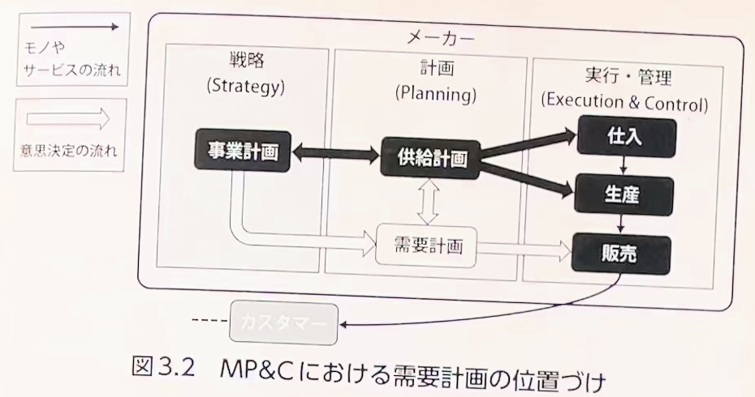

出典: 048_p051.jpg ／ 撮影順: 048 ／ 確認された印刷ページ: 51 ／ 動画時刻: 01:20.262（80.261667秒）


Mermaid再現図（コードID: 048_p051_1）

対応する原図: 図3.2 MP&Cにおける需要計画の位置づけ（[c048_f01](figures/c048_f01.png)）

```mermaid
flowchart LR
    subgraph maker["メーカー"]
        direction LR
        subgraph strategy["戦略<br/>(Strategy)"]
            business["事業計画"]
        end
        subgraph planning["計画<br/>(Planning)"]
            supply["供給計画"]
            demand["需要計画"]
        end
        subgraph execution["実行・管理<br/>(Execution & Control)"]
            purchase["仕入"]
            production["生産"]
            sales["販売"]
        end
        business <==> supply
        supply ==> purchase
        supply ==> production
        business --> demand
        supply <--> demand
        demand --> sales
        purchase --> production
        production --> sales
    end
    customer["カスタマー"]
    sales --> customer
    linkStyle 3,4,5 stroke:#aaa,stroke-width:3px
    classDef dark fill:#333,color:#fff,stroke:#333
    class business,supply,purchase,production,sales dark
    style demand fill:#fff,color:#222,stroke:#999
    style customer fill:#ddd,color:#fff,stroke:#999
```

[描画済みSVGを開く（048_p051_1）](mermaid_svg/048_p051_1.svg)


凡例：モノやサービスの流れ／意思決定の流れ

［変換上の注記］原図の「モノやサービスの流れ」は細い実線矢印、「意思決定の流れ」は白抜き矢印。Mermaidでは白抜き矢印を灰色線で代用した。原図で黒塗りの太い矢印になっている事業計画↔供給計画、供給計画→仕入、供給計画→生産は太線で区別した。カスタマーの左にある短い破線の続きは、接続先が描かれていないためノードを補わない。

### SCMにおける「需要計画」の位置づけ

#### 図3.3 デマンドマネジメントと供給計画の関係

原図切り出し: 図3.3 デマンドマネジメントと供給計画の関係（切り出しID: c048_f02）

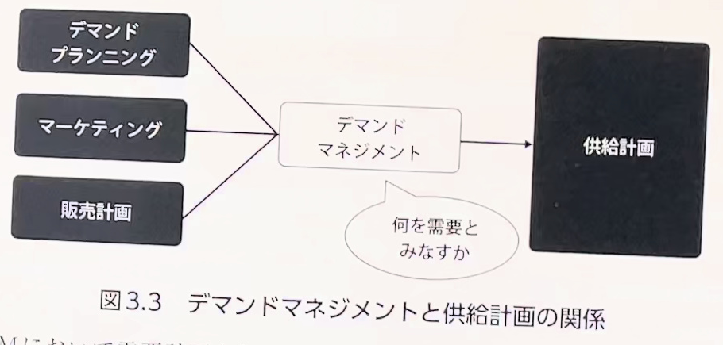

出典: 048_p051.jpg ／ 撮影順: 048 ／ 確認された印刷ページ: 51 ／ 動画時刻: 01:20.262（80.261667秒）


Mermaid再現図（コードID: 048_p051_2）

対応する原図: 図3.3 デマンドマネジメントと供給計画の関係（[c048_f02](figures/c048_f02.png)）

```mermaid
flowchart LR
    dp["デマンド<br/>プランニング"]
    marketing["マーケティング"]
    sales["販売計画"]
    dm["デマンド<br/>マネジメント"]
    supply["供給計画"]
    dp --- dm
    marketing --- dm
    sales --- dm
    dm --> supply
    classDef dark fill:#333,color:#fff,stroke:#333
    class dp,marketing,sales,supply dark
    style dm fill:#fff,color:#222,stroke:#999
```

[描画済みSVGを開く（048_p051_2）](mermaid_svg/048_p051_2.svg)


図中の吹き出し（デマンドマネジメントに対応）：何を需要とみなすか

［変換上の注記］左側3項目からデマンドマネジメントへの線は矢印のない接続線であり、供給計画への線のみ矢印がある。

SCMにおいて需要計画を起案する際は「デマンドマネジメント」が不可欠です。デマンドマネジメントとは、企業が供給活動を行うにあたりどのような需要情報をその対象とするのかという点について意思決定するための活動です。

世界標準のSCMにおいては「サプライチェーンはユーザーの需要が起点である」という世界観が重要と考えられています<sup>（3）</sup>。すなわち、供給者は、個々のユーザーが感じている欠乏感（ニーズ）を満たすための商品を供給する活動を行っている、という考え方です。

どのような商品がどれくらい必要とされているかという情報は、企業のマーケティング部門や販売部門を中心に「デマンドプランニング」「マーケティング」「販売管理（第8章）」といった活動を通じて集積されます。デマンドマネジメントではこれらの各部門が収集・整理した情報から「需要計画」をつくり、企業として供給活動に用いるための需要情報についての認識を統一します（図3.3）。


## 52ページ

<!-- capture_id: page_049; capture_order: 49; source: IMG_6677.MOV; source_time_seconds: 83.061667; image: 049_p052.jpg; transcription_method: direct_visual; status: transcribed -->

原画像: [049_p052.jpg](images/049_p052.jpg) · 動画時刻: 01:23.062


### 3-2 デマンドマネジメント① デマンドプランニング
### 独立需要と従属需要

#### 図3.4 需要予測は独立需要を対象として行う

原図切り出し: 図3.4 需要予測は独立需要を対象として行う（切り出しID: c049_f01）

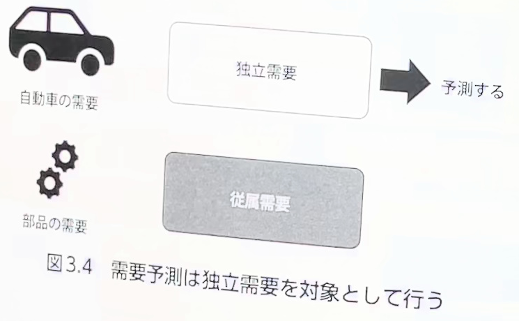

出典: 049_p052.jpg ／ 撮影順: 049 ／ 確認された印刷ページ: 52 ／ 動画時刻: 01:23.062（83.061667秒）


Mermaid再現図（コードID: 049_p052_1）

対応する原図: 図3.4 需要予測は独立需要を対象として行う（[c049_f01](figures/c049_f01.png)）

```mermaid
block-beta
    columns 3
    car["自動車［図像］<br/>自動車の需要"] independent["独立需要"] forecast["予測する"]
    parts["歯車［図像］<br/>部品の需要"] dependent["従属需要"] space
    independent --> forecast
    classDef textOnly fill:none,stroke:none,color:#222
    class car,parts,forecast textOnly
    style independent fill:#fff,color:#222,stroke:#999
    style dependent fill:#bbb,color:#fff,stroke:#999
```

[描画済みSVGを開く（049_p052_1）](mermaid_svg/049_p052_1.svg)


| 原図の行 | 図像と文字 | 需要の分類 | 右側の表示 |
|---|---|---|---|
| 上段 | 自動車［図像］／自動車の需要 | 独立需要 | 太い右向き矢印 →「予測する」 |
| 下段 | 歯車［図像］／部品の需要 | 従属需要 | なし |

［変換上の注記］原図は2行の対応づけによる分類図であり、工程の流れではない。上段の自動車の需要が独立需要、下段の部品の需要が従属需要に対応し、「予測する」への矢印は独立需要からだけ出ている。図像と分類の間には線がない。flowchartの自由配置ではなく、block-betaの固定3列で行の対応を保持する。図像はラベルで代用し、原画像も併記する。

### デマンドプランニングの対象は「独立需要」である

デマンドプランニングは、企業自身が持っている内部情報や企業を取り巻く外部環境に関する情報に基づいて将来の需要を予測し、その予見性を高めることでデマンドマネジメントに寄与することを目的とする活動です<sup>（4）</sup>。

SCMでは原材料の手配や生産・輸送に必要な人員の計画といった準備に時間を要する活動が多く含まれます。需要予測はこれらの活動を適切なタイミングで行うための前提となる情報を提供する役割を担っている点できわめて重要な活動といえます。

なお、需要は独立して変化する性質を持つ「独立需要」と、他の需要に従属して変化する性質を持つ「従属需要」とに整理することができます。前者は家電製品のように商品として店頭に並んでいる最終製品についての需要、後者はその最終製品を構成しているモーターや樹脂といった部品・部材のようなものについての需要がこれにあたります。デマンドプランニングでは、これらのうち特に「独立需要」を対象として需要予測を行います（図3.4）。


## 53ページ

<!-- capture_id: page_050; capture_order: 50; source: IMG_6677.MOV; source_time_seconds: 83.061667; image: 050_p053.jpg; transcription_method: direct_visual; status: transcribed -->

原画像: [050_p053.jpg](images/050_p053.jpg) · 動画時刻: 01:23.062


欄外：第3章 計画：デマンドマネジメント（需要計画）

### 需要計画の目的と対象期間

#### 図3.5 需要計画の種類と特徴

原図切り出し: 図3.5 需要計画の種類と特徴（切り出しID: c050_f01）

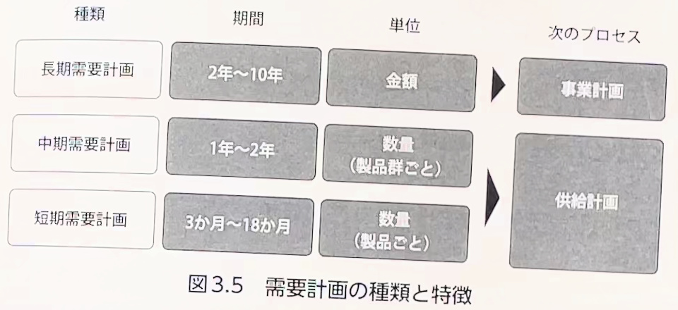

出典: 050_p053.jpg ／ 撮影順: 050 ／ 確認された印刷ページ: 53 ／ 動画時刻: 01:23.062（83.061667秒）

対照方法: この図はMermaidを追加せず、原図の切り出しと既存の文字・表・注記で保持しています。


| 種類 | 期間 | 単位 | 次のプロセス |
|---|---|---|---|
| 長期需要計画 | 2年～10年 | 金額 | 事業計画 |
| 中期需要計画 | 1年～2年 | 数量（製品群ごと） | 供給計画 |
| 短期需要計画 | 3か月～18か月 | 数量（製品ごと） | 供給計画 |


［変換上の注記］原図は「種類・期間・単位・次のプロセス」を対応づけた分類表。長期の行から事業計画へ黒い三角形が1つ、中期・短期の2行から共通の供給計画欄へ黒い三角形が1つある。中期と短期は別の行であり、1つの工程ノードではないため、Mermaidフロー図にまとめない。原図で供給計画欄が2行にまたがる関係は、上表では各行に供給計画と記すことで保持した。

デマンドマネジメントを通じて起案される「需要計画」には、長期・中期・短期のものがあります。そのため、需要予測についても同様の期間を対象として検討する必要があります。また、これらの需要計画はそれぞれ目的が異なりますので、需要予測はこれに資する単位をもって検討することが求められます<sup>（5）</sup>。

長期の需要計画は、設備投資など経営資源の配分についての意思決定をともなう供給方針を決める際に考慮されます。事業計画などがこれに該当します。中期および短期の需要計画は、製品やサービスを供給するための具体的な活動の内容として何を・いつ・どれくらい生産・調達する必要があるかという「供給計画」を立てる際に考慮されます。

長期需要計画は、事業計画に用いられることから2年以上の期間を対象として起案されます。また、事業計画では特に企業活動における財務面が考慮されることから、長期需要計画は金額ベースで起案することが適切であるといえます。他方、供給計画を起案する際にはその企業の供給能力（キャパシティ）を考慮する必要があります。そのため中期需要計画および短期需要計画は数量ベースで起案することが適切であるといえます。中期需要計画は18か月程度の期間を対象として、その企業の供給する製品やサービスを特徴ごとに整理した「製品群」ごとに起案されます。短期需要計画は、3か月程度の期間を対象として、製品ごとに起案されます（図3.5）。


## 54ページ

<!-- capture_id: page_051; capture_order: 51; source: IMG_6677.MOV; source_time_seconds: 86.795; image: 051_p054.jpg; transcription_method: direct_visual; status: transcribed -->

原画像: [051_p054.jpg](images/051_p054.jpg) · 動画時刻: 01:26.795

### 3-3 デマンドマネジメント① デマンドプランニング
### 需要予測の方法

### 需要予測の目的

需要予測は、企業の既存商品や新商品に対する需要（独立需要）が将来どのように変化するかということについて検討し、予見性を高めるための活動です。

SCMにおいて需要予測を行う際は、次の4つの原則<sup>（6）</sup>を念頭に置いて行うことが重要です。1つめの原則は「予測の『正確さ』が100%であることはきわめてまれである」というものです。2つめの原則は「予測の『精密さ』も100%であることはきわめてまれである」というものです。これらは、予測の「精度」は実績と比べることではじめて把握できるものであることを示しています。そのため、需要予測を行う際は必ず事後的に実績値との乖離の範囲を把握し、その分析を通じて精度向上に努めることが重要であるといえます。3つめの原則は「遠い未来よりも近い未来に関する予測の方が精密さが高くなりやすい」というものです。4つめの原則は「個々の商品よりも商品群に関する予測の方が正確さが高くなりやすい」というものです。図3.6は実績値が一定と仮定した場合の予測の精度について示しています。

#### 図3.6 予測の精度

図中の文字：

- 凡例：☆ 予測／● 実績
- 横軸：正確でない／正確である
- 縦軸：精密である／精密でない
- 右上の吹き出し：「精度」が高い

［変換上の注記］図3.6は、4つの象限に同心円の的、実績の黒丸、予測の星印を置き、散らばり方と中心からのずれを対比する図。横軸は左端・右端、縦軸は上端・下端のそれぞれに矢印がある。数値目盛りや座標は記載されていない。点の位置や円の形状をMermaidで忠実に表すことはできないため、座標や関係線を捏造せず原画像を参照する。

### 需要予測の手法

需要予測の手法は、根拠とする情報の特徴によって2種類に大別することが


## 55ページ

<!-- capture_id: page_052; capture_order: 52; source: IMG_6677.MOV; source_time_seconds: 86.795; image: 052_p055.jpg; transcription_method: direct_visual; status: transcribed -->

原画像: [052_p055.jpg](images/052_p055.jpg) · 動画時刻: 01:26.795


欄外：第3章 計画：デマンドマネジメント（需要計画）

#### 図3.7 用いる情報の種類による需要予測方法の整理

原図切り出し: 図3.7 用いる情報の種類による需要予測方法の整理（切り出しID: c052_f01）

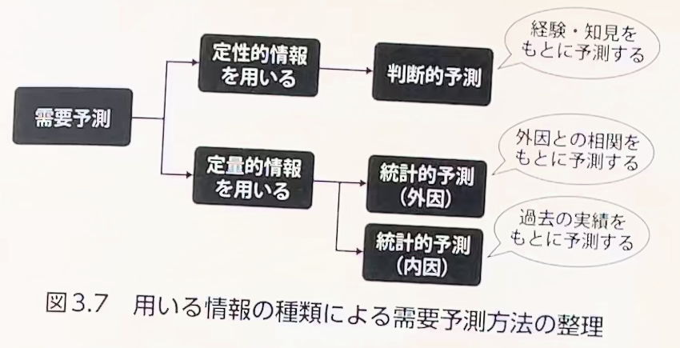

出典: 052_p055.jpg ／ 撮影順: 052 ／ 確認された印刷ページ: 55 ／ 動画時刻: 01:26.795（86.795秒）


Mermaid再現図（コードID: 052_p055_1）

対応する原図: 図3.7 用いる情報の種類による需要予測方法の整理（[c052_f01](figures/c052_f01.png)）

```mermaid
mindmap
  root[需要予測]
    qual[定性的情報を用いる]
      judgment[判断的予測]
    quant[定量的情報を用いる]
      extrinsic[統計的予測（外因）]
      intrinsic[統計的予測（内因）]
```

[描画済みSVGを開く（052_p055_1）](mermaid_svg/052_p055_1.svg)


［変換上の注記］原図の矢印は情報の種類による分類の枝を示す。処理順序と誤読されないよう、同じ親子関係を持つmindmapで表す。左右の配置や吹き出しの形は原画像を参照。

図中の吹き出し：

- 判断的予測：経験・知見をもとに予測する
- 統計的予測（外因）：外因との相関をもとに予測する
- 統計的予測（内因）：過去の実績をもとに予測する

できます。1つめが定量的な情報に基づく予測手法、もう1つが定性的な情報に基づく予測手法です（図3.7）。定量的な情報に基づく予測手法には、企業自身の過去の活動に関する実績データを用いる「内因的需要予測」と、パブリックデータなどの外部の情報を用いる「外因的需要予測」があります。なお、これらの定量的な情報に基づく予測手法は「統計的予測手法」とも呼ばれることがあります。定性的な情報に基づく予測手法は、専門性や経験による企業内外の知見を参考にして判断することを重視する手法（例えば3-7の「デルファイ法」）です。

統計的手法による需要予測では時系列データを用います。時系列データとは、一定の期間ごとに連続的に測定・蓄積されたデータのことです。需要予測において時系列データは時間の経過にともなう需要の変化の特徴を把握する目的で用いられます<sup>（7）</sup>。時間の経過にともなって需要が変化する要素は、比較的長期にわたって継続する減少または増加を表す「傾向（トレンド）」、一定の周期で起きる需要の変動を表す「季節性」、ランダムな需要の変化を表す「ばらつき」の3つに整理することができます（図3.8）。

#### 図3.8 需要を変化させる3つの要素

原図切り出し: 図3.8 需要を変化させる3つの要素（切り出しID: c052_f02）

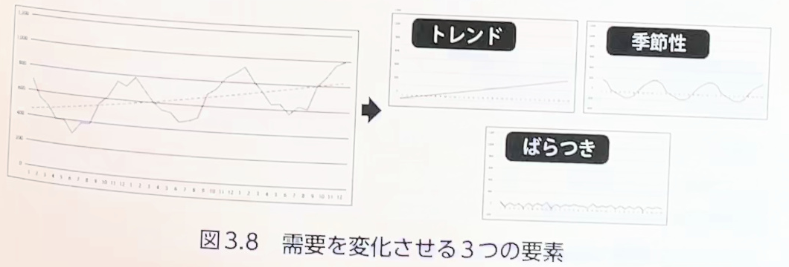

出典: 052_p055.jpg ／ 撮影順: 052 ／ 確認された印刷ページ: 55 ／ 動画時刻: 01:26.795（86.795秒）

対照方法: この図はMermaidを追加せず、原図の切り出しと既存の文字・表・注記で保持しています。


図中の文字：トレンド／季節性／ばらつき

左のグラフの縦軸（下から）：0、200、400、600、800、1,000、1,200

左のグラフの横軸（左から）：1、2、3、4、5、6、7、8、9、10、11、12、1、2、3、4、5、6、7、8、9、10、11、12、1、2、3、4、5、6、7、8、9、10、11、12

右側3グラフの細かい軸目盛り：[判読不能]


［変換上の注記］原図は左の時系列グラフを、右側の「トレンド」「季節性」「ばらつき」の3つのグラフへ分けて示す図。左から右側全体へ太い矢印がある。右上左のトレンドは右上がりの傾向、右上右の季節性は周期的な波、下のばらつきは細かい不規則な変動を示す。これらは3工程の順序ではなく、需要変動の構成要素である。曲線形状が意味を担い、各点の数値は印字されていないため、単なるフローや推定値のMermaidグラフには置き換えない。原画像と判読できた軸・ラベルを保持する。右側の細かい目盛りは [判読不能] のままとする。


## 56ページ

<!-- capture_id: page_053; capture_order: 53; source: IMG_6677.MOV; source_time_seconds: 89.595; image: 053_p056.jpg; transcription_method: direct_visual; status: transcribed -->

原画像: [053_p056.jpg](images/053_p056.jpg) · 動画時刻: 01:29.595


### 3-4 デマンドマネジメント① デマンドプランニング
### 定量的手法①：移動平均法

#### 図3.9 移動平均法による需要予測

原図切り出し: 図3.9 移動平均法による需要予測（切り出しID: c053_f01）

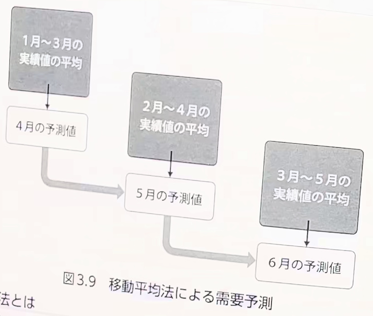

出典: 053_p056.jpg ／ 撮影順: 053 ／ 確認された印刷ページ: 56 ／ 動画時刻: 01:29.595（89.595秒）


Mermaid再現図（コードID: 053_p056_1）

対応する原図: 図3.9 移動平均法による需要予測（[c053_f01](figures/c053_f01.png)）

```mermaid
flowchart LR
    avg1["1月～3月の<br/>実績値の平均"]
    apr["4月の予測値"]
    avg2["2月～4月の<br/>実績値の平均"]
    may["5月の予測値"]
    avg3["3月～5月の<br/>実績値の平均"]
    jun["6月の予測値"]
    avg1 --> apr
    avg2 --> may
    avg3 --> jun
    apr ==> may
    may ==> jun
    linkStyle 3,4 stroke:#aaa,stroke-width:5px
```

[描画済みSVGを開く（053_p056_1）](mermaid_svg/053_p056_1.svg)


［変換上の注記］実績値の平均→各月の予測値は算出の対応、灰色の太い4月→5月→6月は毎月の更新順を表す。後者は前月の予測値を翌月の計算入力として用いるという意味ではない。2種類の線を区別して保持した。原図では3組が左上から右下へ階段状に配置されており、その配置は原画像を参照。

### 移動平均法とは

移動平均法は、実績値の時系列データについて、ある一定期間を対象として平均値を求めて直後の期の予測値として用い、かつこれを毎期更新する定量的需要予測手法の1つです。

実績が月ごとに記録されているようなケースでは、1月から3月までの3か月間の実績の平均値を4月の予測値とし、翌月は2月から4月までの実績の平均値を予測値とするといった手順を繰り返すことで「3か月移動平均」を求めることができます（図3.9）。

### 移動平均法による需要予測の特徴

移動平均法は、常に実需の変化に追随する形で変化が現れると同時に、特定の期にだけに生じた突発的な需要の変化の影響が希釈化されて緩やかな変化として現れる点に特徴があります（図3.10）。これらのことから、移動平均法は長期的なトレンドを把握するのに比較的適した需要予測の手法である一方、直近の変化を把握するのにはあまり向かない手法であるといえます。


## 57ページ

<!-- capture_id: page_054; capture_order: 54; source: IMG_6677.MOV; source_time_seconds: 89.595; image: 054_p057.jpg; transcription_method: direct_visual; status: transcribed -->

原画像: [054_p057.jpg](images/054_p057.jpg) · 動画時刻: 01:29.595

欄外：第3章 計画：デマンドマネジメント（需要計画）

#### 図3.10 移動平均法の特徴

図中の文字：

- 縦軸（下から）：0、100、200、300、400
- 横軸（左から）：1月、2月、3月、4月、5月、6月、7月、8月、9月、10月、11月、12月、1月、2月、3月、4月、5月、6月
- 凡例：実績／3か月移動平均
- 吹き出し：実績の変化に追随する／緩やかに変化する

［変換上の注記］図3.10は、破線の「実績」と実線の「3か月移動平均」を比較する折れ線グラフ。実績の山から右下の移動平均の山へ向かう灰色の太い矢印がある。各点の値は印字されておらず、折れ線の数値を推定してMermaidに入力すると原図にないデータを加えることになるため、曲線と位置関係は原画像を参照する。

前出の例では移動平均法の対象期間が3か月である場合について説明しました。もしこれを6か月に変更した場合、移動平均のグラフはよりなだらかなものに変化します。この際に短期的な需要の変化の影響はより少なくなり、長期的な傾向（トレンド）が強調されることになります。さらに対象期間を広くした場合、移動平均のグラフはより直線に近づくことになります（図3.11）。

#### 図3.11 対象期間の違いによる特徴の変化

図中の文字：

- 縦軸（下から）：0、50、100、150、200、250、300、350、400
- 横軸（左から）：1月、2月、3月、4月、5月、6月、7月、8月、9月、10月、11月、12月、1月、2月、3月、4月、5月、6月
- 吹き出し：3か月移動平均／6か月移動平均

［変換上の注記］図3.11は、実績の破線と2本の移動平均の実線を比較する折れ線グラフで、実績の山から3か月移動平均の山へ、さらに6か月移動平均の山へ向かう灰色の太い矢印がある。各点に値は印字されていないため、数値や座標を補わず原画像を参照する。


## 58ページ

<!-- capture_id: page_055; capture_order: 55; source: IMG_6677.MOV; source_time_seconds: 94.26; image: 055_p058.jpg; transcription_method: direct_visual; status: transcribed -->

原画像: [055_p058.jpg](images/055_p058.jpg) · 動画時刻: 01:34.260


### 3-5 デマンドマネジメント① デマンドプランニング
### 定量的手法②：指数平滑法

#### 図3.12 指数平滑法による予測値の求め方

原図切り出し: 図3.12 指数平滑法による予測値の求め方（切り出しID: c055_f01）

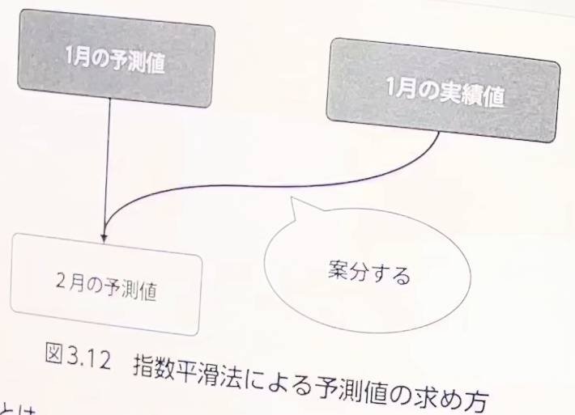

出典: 055_p058.jpg ／ 撮影順: 055 ／ 確認された印刷ページ: 58 ／ 動画時刻: 01:34.260（94.26秒）


Mermaid再現図（コードID: 055_p058_1）

対応する原図: 図3.12 指数平滑法による予測値の求め方（[c055_f01](figures/c055_f01.png)）

```mermaid
flowchart TB
    janforecast["1月の予測値"]
    janactual["1月の実績値"]
    junction@{ shape: f-circ }
    febforecast["2月の予測値"]
    janforecast --- junction
    janactual --- junction
    junction -->|案分する| febforecast
    style junction fill:#333,stroke:#333
```

[描画済みSVGを開く（055_p058_1）](mermaid_svg/055_p058_1.svg)


図中の吹き出し：案分する

［変換上の注記］2本の線が合流し、1つの矢印で「2月の予測値」に入る形を再現した。小さな黒い接続点は2本の線を途切れずに合流させるための描画上の記号であり、原図に追加の処理や項目はない。

### 指数平滑法とは

指数平滑法は、より新しいデータを用いるほど予測精度が向上すると考えられる場合に用いられる定量的予測手法の1つです。

指数平滑法では、直近の月の需要についての予測値と実績値を案分することで、その直後の月の予測値を求めます（図3.12）。この案分の際に用いられる実績値をどの程度考慮するか、という重みづけの値は「平滑化定数」と呼ばれ、通常α（アルファ）という記号で表されます。指数平滑法は、需要の比較的安定した商品などについての短期的な予測にはとても適しているといいます。その一方で、需要自体が少なかったり断続的であったりする商品の需要予測にはあまり適さない方法といえます。計算例は下図のとおりです（図3.13）。

#### 図3.13 指数平滑法による予測値の計算例

原図切り出し: 図3.13 指数平滑法による予測値の計算例（切り出しID: c055_f02）

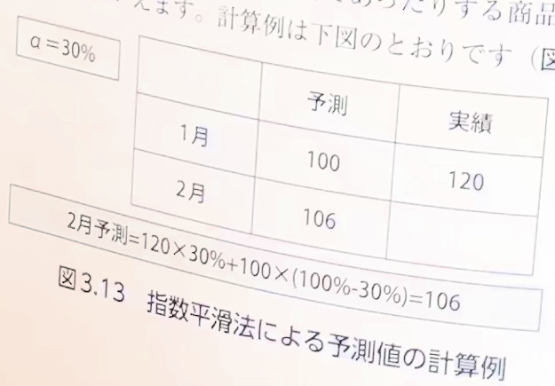

出典: 055_p058.jpg ／ 撮影順: 055 ／ 確認された印刷ページ: 58 ／ 動画時刻: 01:34.260（94.26秒）

対照方法: この図はMermaidを追加せず、原図の切り出しと既存の文字・表・注記で保持しています。


α＝30%

|  | 予測 | 実績 |
|---|---|---|
| 1月 | 100 | 120 |
| 2月 | 106 |  |

2月予測＝120×30%＋100×（100%−30%）＝106


## 59ページ

<!-- capture_id: page_056; capture_order: 56; source: IMG_6677.MOV; source_time_seconds: 94.26; image: 056_p059.jpg; transcription_method: direct_visual; status: transcribed -->

原画像: [056_p059.jpg](images/056_p059.jpg) · 動画時刻: 01:34.260


欄外：第3章 計画：デマンドマネジメント（需要計画）

### 指数平滑法による需要予測の特徴

指数平滑法における平滑化定数（α）は、0%から100%の範囲で表されます。このとき、平滑化定数が100%に近いほど実績を重視することになります。すなわち設定する平滑化定数の値が大きいほど予測と実績の乖離を強調して表現することができます。他方、平滑化定数が0%に近いほど、予測値を重視することになります。

平滑化定数はこのような特徴に鑑みて各企業の活動における判断に基づいて設定されますが、一般的に動的需要の予測に用いる場合については平滑化定数を大きくし、静的需要の予測に用いる場合については平滑化定数を小さくします。下図は、実績値が一定の場合に平滑化定数を30%、40%、50%としたときの予測値の変化を示したものです（図3.14）。

#### 図3.14 平滑化定数の変化をともなう予測値の変化

原図切り出し: 図3.14 平滑化定数の変化をともなう予測値の変化（切り出しID: c056_f01）

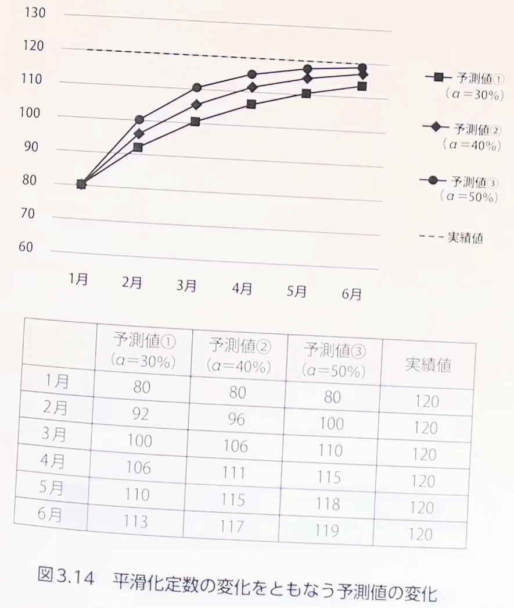

出典: 056_p059.jpg ／ 撮影順: 056 ／ 確認された印刷ページ: 59 ／ 動画時刻: 01:34.260（94.26秒）


Mermaid再現図（コードID: 056_p059_1）

対応する原図: 図3.14 平滑化定数の変化をともなう予測値の変化（[c056_f01](figures/c056_f01.png)）

```mermaid
%%{init: {"themeVariables": {"xyChart": {"plotColorPalette": "#1f77b4,#d95f02,#2ca02c,#777777"}}}}%%
xychart-beta
    x-axis ["1月", "2月", "3月", "4月", "5月", "6月"]
    y-axis 60 --> 130
    line [80, 92, 100, 106, 110, 113]
    line [80, 96, 106, 111, 115, 117]
    line [80, 100, 110, 115, 118, 119]
    line [120, 120, 120, 120, 120, 120]
```

[描画済みSVGを開く（056_p059_1）](mermaid_svg/056_p059_1.svg)


Mermaidでの系列対応：青＝予測値①、橙＝予測値②、緑＝予測値③、灰＝実績値。色は原図の線・点記号を区別するための置き換え。

原図の凡例（上記の線の記述順）：

- ■ 予測値①（α＝30%）
- ◆ 予測値②（α＝40%）
- ● 予測値③（α＝50%）
- 破線：実績値

縦軸（下から）：60、70、80、90、100、110、120、130

|  | 予測値①（α＝30%） | 予測値②（α＝40%） | 予測値③（α＝50%） | 実績値 |
|---|---|---|---|---|
| 1月 | 80 | 80 | 80 | 120 |
| 2月 | 92 | 96 | 100 | 120 |
| 3月 | 100 | 106 | 110 | 120 |
| 4月 | 106 | 111 | 115 | 120 |
| 5月 | 110 | 115 | 118 | 120 |
| 6月 | 113 | 117 | 119 | 120 |

［変換上の注記］数量と月順を表すためxychart-betaを用い、数値は原図に併記された表と照合した。原図の点形状（■・◆・●）と実績値の破線は色の違いに置き換えた。線の意味は上記の色対応と表で識別し、元の線種・点記号は原画像で保持する。数値の推定や計算による補完は行っていない。


## 60ページ

<!-- capture_id: page_057; capture_order: 57; source: IMG_6677.MOV; source_time_seconds: 97.06; image: 057_p060.jpg; transcription_method: direct_visual; status: transcribed -->

原画像: [057_p060.jpg](images/057_p060.jpg) · 動画時刻: 01:37.060


### 3-6 デマンドマネジメント① デマンドプランニング
### 定量的手法③：外因的予測手法

### 外因的予測手法とは

#### 図3.15 データ間に強い正の相関関係が存在する例

原図切り出し: 図3.15 データ間に強い正の相関関係が存在する例（切り出しID: c057_f01）

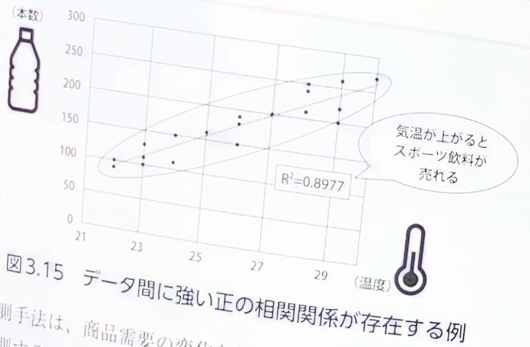

出典: 057_p060.jpg ／ 撮影順: 057 ／ 確認された印刷ページ: 60 ／ 動画時刻: 01:37.060（97.06秒）

対照方法: この図はMermaidを追加せず、原図の切り出しと既存の文字・表・注記で保持しています。


図中の文字：

- 縦軸：（本数）、0、50、100、150、200、250、300
- 横軸：21、23、25、27、29、（温度）
- R²＝0.8977
- 吹き出し：気温が上がるとスポーツ飲料が売れる

［変換上の注記］図3.15は散布図で、右上がりの点線と点群を囲む楕円が描かれている。縦軸の横にボトルの図像、横軸の横に温度計の図像がある。各点の数値・座標は記されていないため、推定値を作成せず原画像を参照する。Mermaidではこの散布図と楕円を忠実に再現できない。

外因的予測手法は、商品需要の変化と相関関係のある外部のデータから将来の需要を予測する定量的予測手法の1つです。この手法は前掲の内因的予測手法で用いた売上実績データのような企業の内部に蓄積されているデータではなく、外部のデータを用いて需要予測を行う点に特徴があります。

「相関」とは、一方が変化すると他方も変化する関係にある状態をいいます。たとえばあるスポーツ飲料の需要について、気温が高くなるほど大きくなることがわかっていたとします。この場合、両データの間には「（正の）相関がある」ということができます。そのため、気温についての予測をもとにス

#### 図3.16 データ間に相関関係が存在する組み合わせの例

原図切り出し: 図3.16 データ間に相関関係が存在する組み合わせの例（切り出しID: c057_f02）


出典: 057_p060.jpg ／ 撮影順: 057 ／ 確認された印刷ページ: 60 ／ 動画時刻: 01:37.060（97.06秒）


Mermaid再現図（コードID: 057_p060_1）

対応する原図: 図3.16 データ間に相関関係が存在する組み合わせの例（[c057_f02](figures/c057_f02.png)）

```mermaid
block-beta
    columns 3
    economic["経済指数など"] space product["商品の需要"]
    housing["住宅着工件数"] relation1["相関あり"] wood["木材の需要"]
    temperature["気温"] relation2["相関あり"] water["飲料水の需要"]
    classDef textOnly fill:none,stroke:none,color:#222
    class economic,product,relation1,relation2 textOnly
    classDef filled fill:#bbb,color:#fff,stroke:#999
    class housing,temperature,wood,water filled
```

[描画済みSVGを開く（057_p060_1）](mermaid_svg/057_p060_1.svg)


| 経済指数など | 関係の表示 | 商品の需要 |
|---|---|---|
| 住宅着工件数 | 相関あり | 木材の需要 |
| 気温 | 相関あり | 飲料水の需要 |

［変換上の注記］原図は相関する組み合わせを2行で対応づけた図。項目間に線や矢印はなく、因果方向や工程順序は示されていない。flowchartの独立ノードではなく、block-betaの固定3列で行の対応を保持する。矢印を追加せず、原画像と対応表も併記する。


## 61ページ

<!-- capture_id: page_058; capture_order: 58; source: IMG_6677.MOV; source_time_seconds: 97.06; image: 058_p061.jpg; transcription_method: direct_visual; status: transcribed -->

原画像: [058_p061.jpg](images/058_p061.jpg) · 動画時刻: 01:37.060

欄外：第3章 計画：デマンドマネジメント（需要計画）

ポーツ飲料の需要を想定することができます（図3.15）。その他にも木材需要と住宅着工件数などのデータ間にも相関があるといわれています<sup>（8）</sup>。このような情報は「経済指数」とも呼ばれます（図3.16）。

### 相関係数と需要予測

#### 図3.17 相関関係の強・弱

図中の文字（左から）：

- 強い相関がある（相関係数1.0）
- 強い相関がある（相関係数0.8）
- 弱い相関がある（相関係数0.5）
- 相関がない（相関係数0）

［変換上の注記］図3.17は、4つの座標枠に右上がりの細い線、細長い楕円、幅の広い楕円、円をそれぞれ配置した図。座標軸に数値目盛りはなく、図同士の間に矢印や接続線もない。傾きや縦横比が表す相関の広がりをMermaidで忠実に再現できないため、原画像を参照する。

ところで、商品の需要と何らかの経済指標との間に相関関係がある場合でも、その関係性が強い関係であるか弱い関係であるかによって需要予測の信頼性が異なります。2種類のデータの相互関係の程度を数字で表したものを「相関係数」と呼びます。相関係数は1に近づくほど「一方が増えれば他方も増える」という正の相関関係が強くなります。反対に、−1に近づくと「一方が増えれば他方が減る」という負の相関関係が強くなります。そして、ゼロに近いほど相関関係が弱くなります（図3.17）。

SCMにおいては、企業の商品の需要と「強い正の相関」または「強い負の相関」を有している経済指標などの外部環境を発見して、需要予測に用いることが重要であるといえます。

### column 清涼飲料と季節性

スポーツ飲料の需要は発汗量とも強い正の相関があることが知られています。このことから発汗量の多い夏季に年間需要が最大となると考えられています。他方、長い歴史を持つ炭酸飲料の中には、CMで目にする「夏」のイメージとは反対に、年間を通じて安定的な需要傾向を持つものもあります。


## 62ページ

<!-- capture_id: page_059; capture_order: 59; source: IMG_6677.MOV; source_time_seconds: 101.726667; image: 059_p062.jpg; transcription_method: direct_visual; status: transcribed -->

原画像: [059_p062.jpg](images/059_p062.jpg) · 動画時刻: 01:41.727

### 3-7 デマンドマネジメント① デマンドプランニング
### 定性的手法

#### 図3.18 統計的予測を行うことのできない場合

図中の文字：

- 左図：既存商品
  - 縦軸（下から）：0、100、200、300
  - 横軸（左から）：1月、2月、3月、4月、5月、6月、7月、8月、9月
  - 凡例：実績／予測
  - 吹き出し：統計的に予測できる
- 右図：新商品など
  - 縦軸（下から）：0、100、200
  - 横軸（左から）：1月、2月、3月、4月、5月、6月、7月、8月、9月
  - ？
  - 吹き出し：統計的に予測できない

［変換上の注記］左図は実績の実線と予測の破線が連続する波形グラフ。右図は前半が灰色で塗られ、後半に「？」を置いたグラフで、データ線は描かれていない。点の値や曲線の数式は示されていないため、数値を推定してMermaidに入力せず原画像を参照する。図同士をつなぐ線や矢印はない。

### 定性的予測手法とは

定性的手法は、前掲の時系列モデルとはやや異なるアプローチの需要予測方法です。新商品など時系列データがまったく存在しない場合、統計的な手法を用いて需要予測を行うことは難しいといわざるを得ません。定性的予測手法は、このような状況において用いられることの多い需要予測手法です（図3.18）。この際に考慮される情報は、専門家やベテラン担当者などの有識者の持つ知見です。

定性的需要予測を起案する際には、主観、すなわち何らかの意図を含む情報を考慮に入れることがあります。これらの情報を予測に用いる際はやや注意を要する場合があります。たとえば、販売部門はKPI（Key Performance Indicator：重要業績評価指標）としての販売予算を定期的に起案します。ここで起案される数字も一種の売上予測とみなすことが可能ですが、必ずしも供給計画に引き継がれて用いることを想定して起案されているわけではありません。そのため販売予算をデマンドマネジメントで考慮する場合は、案がどのような意図を含


## 63ページ

<!-- capture_id: page_060; capture_order: 60; source: IMG_6677.MOV; source_time_seconds: 101.726667; image: 060_p063.jpg; transcription_method: direct_visual; status: transcribed -->

原画像: [060_p063.jpg](images/060_p063.jpg) · 動画時刻: 01:41.727


欄外：第3章 計画：デマンドマネジメント（需要計画）

むものであるかを起案者に確認する必要があります。特に販売部門が販売予算を予想される需要よりも低く抑えたい意図をもって起案している場合、またはその逆の場合を想定する必要があります。なお、実務上の対応としては、下記のような加重平均を用いることでこのような主観の入った情報の影響を小さくすることができます。

加重平均＝｛楽観予測値＋悲観予測値＋（蓋然性の高い予測値×4）｝÷6

### 定性的予測手法の例：デルファイ法

複数の専門家の統一見解をもって予測値とする定性的予測手法の一つに「デルファイ法（Delphi method）」があります。この方法は、複数の専門家から得た見解のうち不一致がある部分について、その内容をもとに再度見解を求めることを繰り返すことで見解の統一をはかるものです<sup>（9）</sup>。このとき、集団心理による見解の同質化を避ける観点から、各専門家は匿名で回答することが求められます（図3.19）。

#### 図3.19 デルファイ法による予測

原図切り出し: 図3.19 デルファイ法による予測（切り出しID: c060_f01）


出典: 060_p063.jpg ／ 撮影順: 060 ／ 確認された印刷ページ: 63 ／ 動画時刻: 01:41.727（101.726667秒）


Mermaid再現図（コードID: 060_p063_1）

対応する原図: 図3.19 デルファイ法による予測（[c060_f01](figures/c060_f01.png)）

```mermaid
flowchart TB
    questionnaire["アンケート"]
    person1["［図像：左の人物］"]
    person2["［図像：中央の人物］"]
    person3["［図像：右の人物］"]
    disagreement["不一致"]
    agreement["一致"]
    questionnaire --> person1
    questionnaire --> person2
    questionnaire --> person3
    person1 --> disagreement
    person1 --> agreement
    person2 --> disagreement
    person2 --> agreement
    person3 --> disagreement
    person3 --> agreement
    disagreement -->|繰り返す| questionnaire
```

[描画済みSVGを開く（060_p063_1）](mermaid_svg/060_p063_1.svg)


図中の吹き出し（不一致からアンケートに戻る線に対応）：繰り返す

［変換上の注記］原図の3人の人物アイコンは文字で代用した。原図には各人物の名称は付されていない。各人物から「不一致」と「一致」の両方に向かう矢印を保持した。

### column 「デルファイ法」の由来

「デルファイ法」という呼称は、古代ギリシャにおける意思決定方法の1つである「神託」を執り行う中心地であったデルポイ（Δελφοι）の地名に由来するといわれています。古代デルポイの遺跡はユネスコの世界遺産（文化遺産）として登録されています。


## 64ページ

<!-- capture_id: page_061; capture_order: 61; source: IMG_6677.MOV; source_time_seconds: 106.393333; image: 061_p064.jpg; transcription_method: direct_visual; status: transcribed -->

原画像: [061_p064.jpg](images/061_p064.jpg) · 動画時刻: 01:46.393


### 3-8 デマンドマネジメント① デマンドプランニング
### 予実乖離の把握（MAD）

#### 図3.20 予測と実績の乖離

原図切り出し: 図3.20 予測と実績の乖離（切り出しID: c061_f01）


出典: 061_p064.jpg ／ 撮影順: 061 ／ 確認された印刷ページ: 64 ／ 動画時刻: 01:46.393（106.393333秒）

対照方法: この切り出しは以下の複数のMermaidブロックに共通する原図です。各ブロックの直前にも同じ図題と切り出しIDを記しています。


図中の文字：

- 左の折れ線グラフ
  - 縦軸（下から）：0、10、20、30、40、50、60、70
  - 横軸（左から）：1月、2月、3月、4月、5月、6月、7月、8月、9月、10月、11月、12月
  - 凡例：需要予測／実績
- 右の棒グラフ
  - 縦軸（下から）：0、10、20、30、40、50、60、70
  - 横軸（左から）：1月、2月、3月、4月、5月、6月、7月、8月、9月、10月、11月、12月
  - 凡例：■ 予実差の絶対値
- 需要予測はどれくらい「偏って」いるのか
- 需要予測はどれくらい「ばらついて」いるのか

下のフロー図は、左の比較グラフから右の絶対差グラフへの変換方向だけを示す。各グラフの月別の形状は続くxychart-betaで表す。


Mermaid再現図（コードID: 061_p064_1）

対応する原図: 図3.20 予測と実績の乖離（[c061_f01](figures/c061_f01.png)）

```mermaid
flowchart LR
    original["［折れ線グラフ］<br/>需要予測／実績"]
    difference["［棒グラフ］<br/>予実差の絶対値"]
    original ==> difference
```

[描画済みSVGを開く（061_p064_1）](mermaid_svg/061_p064_1.svg)


Mermaid再現図（コードID: 061_p064_2）

対応する原図: 図3.20 予測と実績の乖離（[c061_f01](figures/c061_f01.png)）

```mermaid
%%{init: {"themeVariables": {"xyChart": {"plotColorPalette": "#1f77b4,#d95f02"}}}}%%
xychart-beta
    title "需要予測／実績"
    x-axis ["1月", "2月", "3月", "4月", "5月", "6月", "7月", "8月", "9月", "10月", "11月", "12月"]
    y-axis 0 --> 70
    line [18, 18, 36, 42, 42, 18, 12, 66, 66, 36, 24, 24]
    line [24, 36, 36, 36, 24, 12, 48, 48, 30, 30, 30, 30]
```

[描画済みSVGを開く（061_p064_2）](mermaid_svg/061_p064_2.svg)


Mermaid再現図（コードID: 061_p064_3）

対応する原図: 図3.20 予測と実績の乖離（[c061_f01](figures/c061_f01.png)）

```mermaid
xychart-beta
    title "予実差の絶対値"
    x-axis ["1月", "2月", "3月", "4月", "5月", "6月", "7月", "8月", "9月", "10月", "11月", "12月"]
    y-axis 0 --> 70
    bar [6, 18, 0, 6, 18, 6, 36, 18, 36, 6, 6, 6]
```

[描画済みSVGを開く（061_p064_3）](mermaid_svg/061_p064_3.svg)


Mermaidの折れ線の系列対応：青＝需要予測、橙＝実績。原図の破線／実線の区別を色に置き換えている。

［変換上の注記］原図の折れ線グラフから棒グラフへ向かう灰色の太い矢印をフロー図で再現した。各点や棒には数値ラベルがないが、対応する数値は次の65ページの表3.1に明記されているため、上の2つのMermaidグラフにはその印字された数値を用いた（推定値ではない）。折れ線の記述順は需要予測、実績。原図では需要予測は破線、実績は実線であり、Mermaidでは上記の色対応で区別する。右側の2つの文は枠内の注記であり、グラフへの接続線はない。

### どのようなデータを異常値とみなすか

予測した需要と実績との差（予実乖離）を継続的に把握することは、予測に用いた方法が適切であったか否かについて吟味し、将来の予測方法をより適切なものにすることに寄与します。

需要予測は「当たらないものである」という特徴について3-3で触れました。しかし、より適切なデマンドマネジメントのためには、予測値の正確さ（偏り）と精密さ（ばらつき）を一定の範囲内に保つ努力が望まれます（図3.20）。実務では、これらを観測する簡便法として、過去の予測値と実績値の

#### 図3.21 MAD（Mean Absolute Deviation）

原図切り出し: 図3.21 MAD（Mean Absolute Deviation）（切り出しID: c061_f02）


出典: 061_p064.jpg ／ 撮影順: 061 ／ 確認された印刷ページ: 64 ／ 動画時刻: 01:46.393（106.393333秒）

対照方法: この図はMermaidを追加せず、原図の切り出しと既存の文字・表・注記で保持しています。


図中の文字：

- 横軸（左から）：−5、−4、−3、−2、−1、0、1、2、3、4、5
- 平均値
- 1 MAD
- 上部の括弧：98%
- 曲線の下の比率（左から）：4%、15%、30%、30%、15%、4%

［変換上の注記］図3.21は、0を中心とした釣鐘形の曲線と、−3から3までを括る「98%」の表示。「平均値」の吹き出しは中心の山に、「1 MAD」の吹き出しは1付近に向けられている。比率の6区間は−3～−2、−2～−1、−1～0、0～1、1～2、2～3に対応している。縦軸の値や曲線の式は示されていないため、Mermaid用の数値データを補わず原画像を参照する。


## 65ページ

<!-- capture_id: page_062; capture_order: 62; source: IMG_6677.MOV; source_time_seconds: 106.393333; image: 062_p065.jpg; transcription_method: direct_visual; status: transcribed -->

原画像: [062_p065.jpg](images/062_p065.jpg) · 動画時刻: 01:46.393

欄外：第3章 計画：デマンドマネジメント（需要計画）

差の絶対値の平均（平均絶対偏差＝MAD）を基準とする方法が用いられています。正確さについては、予実差のデータが一定の傾向をもって平均値から乖離している場合に、需要予測の修正、または予測方法を見直す必要がある状況とみなされます。精密さについては、±3MAD（これまでのデータの98%が含まれる範囲）を基準として、これを超えるデータを異常値とみなします（図3.21）。

### 平均絶対偏差（MAD）の計算方法

MADは下記の式で求めることができます。

1MAD＝予実差の絶対値の合計÷データの個数

この式を用いて、12か月の予測データと実績データからMADを求めてみましょう。表3.1では1MADが13.5と計算されました。「予実差の絶対値」の列を見ると、13.5以下の値が7件あり、全体12件の58%を占めています。このことから±1MADの範囲に全データの約60%（±30%）のデータが含まれることがわかります。さらに、±2MADの範囲には90%（±45%）、±3MADの範囲には98%（±49%）データが含まれます。

#### 表3.1 MADの計算例

|  | 需要予測 | 実績 | 予実差（Deviation） | 予実差の絶対値（Absolute Deviation） |
|---|---|---|---|---|
| 1月 | 18 | 24 | 6 | 6 |
| 2月 | 18 | 36 | 18 | 18 |
| 3月 | 36 | 36 | 0 | 0 |
| 4月 | 42 | 36 | −6 | 6 |
| 5月 | 42 | 24 | −18 | 18 |
| 6月 | 18 | 12 | −6 | 6 |
| 7月 | 12 | 48 | 36 | 36 |
| 8月 | 66 | 48 | −18 | 18 |
| 9月 | 66 | 30 | −36 | 36 |
| 10月 | 36 | 30 | −6 | 6 |
| 11月 | 24 | 30 | 6 | 6 |
| 12月 | 24 | 30 | 6 | 6 |

予実差の絶対値の平均（Mean Absolute Deviation＝1 MAD）　13.5


## 66ページ

<!-- capture_id: page_063; capture_order: 63; source: IMG_6677.MOV; source_time_seconds: 109.193333; image: 063_p066.jpg; transcription_method: direct_visual; status: transcribed -->

原画像: [063_p066.jpg](images/063_p066.jpg) · 動画時刻: 01:49.193


### 3-9 デマンドマネジメント② 需要情報の解釈
### 受注の条件

### 受注に基づく需要情報の特徴

#### 図3.22 受注の十分条件と必要条件の関係

原図切り出し: 図3.22 受注の十分条件と必要条件の関係（切り出しID: c063_f01）


出典: 063_p066.jpg ／ 撮影順: 063 ／ 確認された印刷ページ: 66 ／ 動画時刻: 01:49.193（109.193333秒）

対照方法: この切り出しは以下の複数のMermaidブロックに共通する原図です。各ブロックの直前にも同じ図題と切り出しIDを記しています。


Mermaid再現図（コードID: 063_p066_1）

対応する原図: 図3.22 受注の十分条件と必要条件の関係（[c063_f01](figures/c063_f01.png)）

```mermaid
flowchart TB
    subgraph maker["メーカー"]
        direction LR
        subgraph strategy["戦略<br/>(Strategy)"]
            business["事業計画"]
        end
        subgraph planning["計画<br/>(Planning)"]
            supply["供給計画"]
            demand["需要計画"]
        end
        subgraph execution["実行・管理<br/>(Execution & Control)"]
            production["生産"]
            sales["販売"]
        end
        business <--> supply
        supply --> production
        business --> demand
        supply <--> demand
        demand --> sales
        production --> sales
    end
    customer["カスタマー"]
    sales <-->|受注| customer
    sales --> customer
    linkStyle 0,1,2,3,4,6 stroke:#aaa,stroke-width:3px
    classDef pale fill:#bbb,color:#fff,stroke:#999
    class business,supply,production pale
    style demand fill:#fff,color:#222,stroke:#999
    style sales fill:#fff,color:#222,stroke:#999
```

[描画済みSVGを開く（063_p066_1）](mermaid_svg/063_p066_1.svg)


凡例：モノやサービスの流れ／意思決定の流れ

図中の吹き出し（販売とカスタマー間の白抜き両方向矢印に対応）：受注


Mermaid再現図（コードID: 063_p066_2）

対応する原図: 図3.22 受注の十分条件と必要条件の関係（[c063_f01](figures/c063_f01.png)）

```mermaid
flowchart TB
    subgraph necessary["受注の必要条件"]
        sufficient(("受注の<br/>十分条件"))
    end
    style necessary fill:#bbb,color:#fff,stroke:#555
    style sufficient fill:#fff,color:#222,stroke:#555
```

[描画済みSVGを開く（063_p066_2）](mermaid_svg/063_p066_2.svg)


図中の吹き出し：受注条件は商品ライフサイクルの段階によって異なる

［変換上の注記］原図の「モノやサービスの流れ」は黒い細線矢印、「意思決定の流れ」は白抜き矢印。Mermaidでは白抜き矢印を灰色線で代用した。カスタマーの左の短い破線と生産の上の短い縦線には描かれた接続先がないため、ノードを追加していない。右側の包含図は「受注の必要条件」の大きな円内に「受注の十分条件」の小さな円を配置した図であり、Mermaidでは包含関係を保持して外側の円を枠に置き換えた。この2つの条件の間にフローの矢印はない。外枠と内側の円は、必要条件の領域が十分条件の領域を含むという包含関係のみを表す。原図に円の面積の数値はない。円の形・相対位置は原画像を参照する。

企業の活動における需要情報のうち、実際の受注に基づく需要情報は取引先との契約に基づくコミットメントである点で予測情報とは性質を異にします。実際の受注に基づく需要情報は、需要予測に基づく需要情報と比べて不確実性が相対的に小さいといえます。

先に触れたようにSCMは不確実性の克服が極めて重要です。そのため、SCMを構成する要素である需要情報についても何らかの方法で確実性の高い状態にすることが望まれます。この観点より、企業が商品を販売するために顧客より注文を受ける行動は、売上金額に寄与することを目的とする営業部門の活動であるとともに、需要の不確実性を克服することを目的とするSCMの活動の一つとして捉えることが適切といえるでしょう。

なお、供給者としての企業が顧客からの受注を得るためには、顧客の欠乏感を充足する手段を提供すること（必要条件の充足）に加えて、同様の効果を伴う手段を提供する他の供給者との差別化（十分条件の充足）が必要です（図3.22）。


## 67ページ

<!-- capture_id: page_064; capture_order: 64; source: IMG_6677.MOV; source_time_seconds: 109.193333; image: 064_p067.jpg; transcription_method: direct_visual; status: transcribed -->

原画像: [064_p067.jpg](images/064_p067.jpg) · 動画時刻: 01:49.193

欄外：第3章 計画：デマンドマネジメント（需要計画）

この差別化要素については商品ライフサイクルの段階によって異なる点に特徴があります。

### 流通倉庫の補充発注にもとづく需要情報

また、受注により確定した需要以外の実現可能性が高い需要情報として、流通倉庫の補充発注に基づく需要情報が挙げられます。各地域倉庫が試算した在庫補充タイミングから補充すべき量（所要量）を計算し、上流工程に伝達します。この情報は一種の確定需要情報として、供給計画における短期供給計画であるマスタースケジューリング（第4章参照）のステップに直接伝達され、仕入・生産プロセスに組み込まれる点に特徴があります。このアプローチはDRP（Distribution Requirements Planning）とも呼ばれます。DRPは、地域倉庫が把握している個々の需要情報を供給計画と統合することで効果的・効率的に充足することを目的とする需要計画手法の1つとして位置づけられます（1-10「MP&Cの構成要素」参照）。

### 商品ライフサイクルと需要情報の解釈

企業が顧客より受注を得るための十分条件、すなわち市場競争における差別化要素となり得る特徴は、商品が「ライフサイクル」のどの段階にあるかによって異なります。商品ライフサイクルを「導入期」「成長期」「成熟期」「衰退期」の4段階に整理した場合、各段階において求められる特徴の例としては、「導入期」では商品の新奇性と入手性、「成長期」では「品質」、「成熟期」および「衰退期」では「価格」などが挙げられます（図3.23）。

#### 図3.23 商品ライフサイクル

図中の文字：

- 縦軸：需要
- 横軸：時間
- 段階（左から）：導入期／成長期／成熟期／衰退期
- 導入期付近の吹き出し：新奇性／入手性
- 成長期付近の吹き出し：品質／流通性
- 成熟期の初め付近の吹き出し：価格／流通性

［変換上の注記］図3.23は、4つの段階に縦線で区切られた時間軸上に需要曲線を描いたグラフ。曲線は導入期から上昇し、成熟期に山をつくり、衰退期へ向かって下降する。数値目盛りや各点の値は示されていないため、Mermaid用の数値を捏造せず原画像を参照する。段階間にフローを表す矢印はない。


## 68ページ

<!-- capture_id: page_065; capture_order: 65; source: IMG_6677.MOV; source_time_seconds: 115.726667; image: 065_p068.jpg; transcription_method: direct_visual; status: transcribed -->

原画像: [065_p068.jpg](images/065_p068.jpg) · 動画時刻: 01:55.727

### column ASCM／APICSのSCM普及活動

ASCMは、1957年に米国で設立されたAPICS（American Production & Inventory Control Society）を母体とする非営利団体で、その本部はシカゴにあります。

ASCMはSCMに関する知識体系の標準化推進と教育・資格認定を専門とする団体としては世界最大規模<sup>（10）</sup>であり、毎年開催される年次カンファレンスには50以上の国や地域からSCM実務家を中心に2,000人超が参加しています（図3.24）。また、ASCM／APICSの教育・資格認定を受けた実務家の数は全世界で10万人を超えており、この認定資格であるCPIM・CSCP・CLTDは、米国企業を中心にSCM人材の採用条件として広く用いられるなど、グローバルSCMに携わるプロフェッショナルとしての基礎知識を有していることを端的に示す基準として用いられています。米国のSCM関連業務従事者2,600人強を対象とした近時のサーベイでは対象者の約半数がこれらの資格を1つ以上取得していることからもその普及状況が伺えます<sup>（11）</sup>。

APICSは2019年にビル＆メリンダ・ゲイツ財団をはじめとする様々な企業・組織とのアライアンス強化することを目的としてASCMに改組するまでの間、多くのSCM関連団体をその傘下に受け入れることでも知識体系の標準化を主導してきました。その中には1996年に設立されグローバル・サプライチェーン標準参照モデル（SCOR®：Supply Chain Operations Reference Model）の開発と推進を行っていたSupply Chain Council（SCC）や、1946年よりロジスティクス分野のグローバル標準の策定・認証を推進していた団体であるAmerican Society of Transportation and Logistics（AST&L）が含まれます<sup>（12）</sup>。

2021年現在、ASCMは全世界に4万5千人超の法人・個人会員と約300のチャネルパートナーを擁しており<sup>（13）</sup>、日本地区では2011年より公益財団法人日本生産性本部が代表部、プレミアムチャネルパートナーとなり、世界標準のSCMの普及に努めています。

#### 図3.24 米国シカゴで開催されたAPICS全国大会の会場の様子（2018年10月 行本顕 撮影）

図の表現注: 原図は会場の写真であり、壇上・スクリーンと多数の着席した参加者が写っている。関係図ではないためMermaidへの置換は行わず、原画像の写真を参照する。


## 第4章 扉（撮影画像066・印刷ページ番号なし）

<!-- capture_id: page_066; capture_order: 66; source: IMG_6677.MOV; source_time_seconds: 115.726667; image: 066_spread_right.jpg; transcription_method: direct_visual; status: transcribed -->

原画像: [066_spread_right.jpg](images/066_spread_right.jpg) · 動画時刻: 01:55.727

### 第4章
### 計画：サプライプランニング

この章を読み終えると、以下の内容を理解することができます。

- サプライプランニングとは
- 中期計画・製品群レベル
- 短期計画・製品レベル
- 短期計画・構成部品レベル


## 70ページ

<!-- capture_id: page_067; capture_order: 67; source: IMG_6677.MOV; source_time_seconds: 118.525; image: 067_p070.jpg; transcription_method: direct_visual; status: transcribed -->

原画像: [067_p070.jpg](images/067_p070.jpg) · 動画時刻: 01:58.525


### 4-1 サプライプランニングとは
### サプライプランニングの構造

#### 図4.1 MP＆Cにおける供給計画の位置付け

原図切り出し: 図4.1 MP＆Cにおける供給計画の位置付け（切り出しID: c067_f01）


出典: 067_p070.jpg ／ 撮影順: 067 ／ 確認された印刷ページ: 70 ／ 動画時刻: 01:58.525（118.525秒）


Mermaid再現図（コードID: 067_p070_1）

対応する原図: 図4.1 MP＆Cにおける供給計画の位置付け（[c067_f01](figures/c067_f01.png)）

```mermaid
flowchart LR
    supplier["サプライヤー"]
    customer["カスタマー"]
    subgraph maker["メーカー"]
        subgraph strategy["戦略<br/>（Strategy）"]
            business["事業戦略<br/>（長期）"]
        end
        subgraph planning["計画<br/>（Planning）"]
            subgraph supply["供給計画"]
                direction TB
                capacity["供給能力計画<br/>（中期・短期）"] <==> priority["優先順位計画<br/>（中期・短期）"]
            end
            demand["需要計画"]
            supply <==> demand
        end
        subgraph control["実行・管理<br/>（Control）"]
            purchase["仕入"] --> production["生産"] --> sale["販売"]
        end
        business ==> supply
        business <==> supply
        business ==> demand
        supply ==> purchase
        supply ==> production
        demand ==> sale
    end
    supplier -->|供給| purchase
    sale -->|供給| customer
    classDef dark fill:#333,color:#fff,stroke:#333
    class business,demand,purchase,production,sale dark
```

[描画済みSVGを開く（067_p070_1）](mermaid_svg/067_p070_1.svg)


凡例: 白抜き矢印「意思決定の流れ」、細い実線矢印「モノやサービスの流れ」。

図の表現注: 原図の白抜き矢印を太い矢印で代用した。事業戦略から供給計画の左側境界に入る上側の一方向矢印と中央の双方向矢印を、2本の接続として残した。供給計画の囲みへの接続を、内部の特定ノードへの接続に変更していない。サプライヤー・カスタマーの左側の短い破線は、接続先が図中に示されていないため注記として残す。

### 優先順位計画と能力計画

供給計画は、メーカーが「製品をいつどれだけ作るのか」「そのための能力をどれだけ用意しておくか」に関して立案する計画です。そのインプットは「事業計画」と「需要計画」であり、アウトプットは続く「実行・管理」に関する諸活動のインプットとなります。

供給計画には、大別して2種類の計画が含まれます。1つめは需要計画に対する供給の優先順位について意思決定する活動である「優先順位計画」、2つめは企業が用意することのできる供給能力と需要計画との差異を把握してその対応方針について意思決定する活動である「供給能力計画」です（図4.1）。


## 71ページ

<!-- capture_id: page_068; capture_order: 68; source: IMG_6677.MOV; source_time_seconds: 118.525; image: 068_p071.jpg; transcription_method: direct_visual; status: transcribed -->

原画像: [068_p071.jpg](images/068_p071.jpg) · 動画時刻: 01:58.525


欄外: 第4章 計画：サプライプランニング

### 製品軸での階層的意思決定の機構

#### 図4.2 供給計画を構成する活動群

原図切り出し: 図4.2 供給計画を構成する活動群（切り出しID: c068_f01）


出典: 068_p071.jpg ／ 撮影順: 068 ／ 確認された印刷ページ: 71 ／ 動画時刻: 01:58.525（118.525秒）


Mermaid再現図（コードID: 068_p071_1）

対応する原図: 図4.2 供給計画を構成する活動群（[c068_f01](figures/c068_f01.png)）

```mermaid
block-beta
    columns 9
    strategy["戦略<br/>（Strategy）"] space
    block:planning:5
        columns 1
        pt["計画<br/>（Planning）"]
        block:supply
            columns 1
            st["供給計画"]
            block:capacity
                columns 5
                ct["供給能力計画"]:5
                rp["④リソース<br/>プランニング"] space rccp["⑤ RCCP"] space crp["⑥ CRP"]
            end
            space
            block:priority
                columns 5
                sop["① S＆OP"] space ms["②マスター<br/>スケジューリング"] space mrp["③ MRP"]
                prt["優先順位計画"]:5
            end
        end
        space
        demand["需要計画"]
    end
    space control["実行・管理<br/>（Execution ＆ Control）"]
    rp <==> sop
    rccp <==> ms
    crp <==> mrp
    sop ==> ms
    ms ==> mrp
    strategy ==> rp
    strategy <==> sop
    strategy ==> demand
    supply <==> demand
    mrp ==> control
    classDef label fill:transparent,stroke:transparent,color:#000
    classDef item fill:#fff,stroke:#999,color:#000
    class pt,st,ct,prt label
    class strategy,control,rp,rccp,crp,sop,ms,mrp item
    style demand fill:#333,stroke:#333,color:#fff
    style planning fill:transparent,stroke:#999
    style supply fill:transparent,stroke:#999
    style capacity fill:transparent,stroke:#777,stroke-dasharray:5 5
    style priority fill:transparent,stroke:#777,stroke-dasharray:5 5
```

[描画済みSVGを開く（068_p071_1）](mermaid_svg/068_p071_1.svg)


凡例: 白抜き矢印「意思決定の流れ」。

図の表現注: block-betaで供給能力計画を上段（④リソースプランニング、⑤RCCP、⑥CRP）、優先順位計画を下段（①S＆OP、②マスタースケジューリング、③MRP）に固定し、上下で対応する3対を双方向矢印で結んだ。2つの破線領域を供給計画の囲みに含め、需要計画をその下・計画の囲みの内側に置いた。供給計画と需要計画の矢印は領域間の双方向関係であり、特定の内部工程へ付け替えていない。太い矢印は原図の白抜きの意思決定矢印を表す。戦略から④と需要計画へは一方向、戦略と①は双方向、①から②から③へ、③から実行・管理へは一方向のまま保持した。原画像も併記し、矢印の細かい曲がり方はそこで確認できる。 Mermaidの自動寸法により外枠と余白は原図より縦長になるが、面積・長さ・縦横比に数値的な意味は持たせていない。原図の比率は併記した原画像で確認できる。

| 原図の行／左からの順 | 左 | 中央 | 右 |
|---|---|---|---|
| 上段：供給能力計画 | ④リソースプランニング | ⑤ RCCP | ⑥ CRP |
| 下段：優先順位計画 | ① S＆OP | ②マスタースケジューリング | ③ MRP |

同じ列の上段と下段はそれぞれ双方向の意思決定矢印で結ばれている。

供給計画の軸となるのは「優先順位計画」です。この活動は、需要情報の粒度に沿って「製品群」「製品」「構成部材」といった3段階で構成される階層的な意思決定の活動として実施される点に特徴があります。なお、各段階における意思決定の活動は、それぞれ①「Sales and Operations Planning（S＆OP）」②「Master Scheduling（マスター・スケジューリング）」③「Material Requirements Planning（MRP）」と呼ばれます<sup>（1）</sup>。

また、これら3つの活動は、それぞれの段階において供給能力のチェックを行います。中期的な供給計画を起案するS＆OPに対する供給能力を検討する活動は④「Resource Planning（リソースプランニング）」と呼ばれ、設備投資などの経営判断を視野に入れて実施します。マスター・スケジューリングに対する供給能力を検討する活動は⑤「Rough Cut Capacity Planning（RCCP）」と呼ばれ、完成品レベルの短期的な供給能力を概算する視点から実施します。そして、MRPにおいて部品レベルに展開された需要情報に対する供給能力を計算する活動は⑥「Capacity Requirements Planning（CRP）」と呼ばれます<sup>（2）</sup>。

このようにして、事業計画と需要計画はこれら6つの活動を経て実行計画に変換され、実行・管理を担当する現場へと連携されます（図4.2）。


## 72ページ

<!-- capture_id: page_069; capture_order: 69; source: IMG_6677.MOV; source_time_seconds: 122.258333; image: 069_p072.jpg; transcription_method: direct_visual; status: transcribed -->

原画像: [069_p072.jpg](images/069_p072.jpg) · 動画時刻: 02:02.258


### 4-2 中期・製品群レベル：優先順位計画
### S＆OP

#### 図4.3 MP＆CにおけるS＆OPの位置づけ

原図切り出し: 図4.3 MP＆CにおけるS＆OPの位置づけ（切り出しID: c069_f01）


出典: 069_p072.jpg ／ 撮影順: 069 ／ 確認された印刷ページ: 72 ／ 動画時刻: 02:02.258（122.258333秒）


Mermaid再現図（コードID: 069_p072_1）

対応する原図: 図4.3 MP＆CにおけるS＆OPの位置づけ（[c069_f01](figures/c069_f01.png)）

```mermaid
block-beta
    columns 9
    block:strategy
        columns 1
        st["戦略<br/>（Strategy）"]
        space
        space
        business["事業計画"]
        space
        space
    end
    space
    block:planning:5
        columns 1
        pt["計画（Planning）"]
        block:capacity
            columns 5
            ct["供給能力計画"]:5
            resource["リソース<br/>プランニング"] space rccp["RCCP"] space crp["CRP"]
        end
        block:documentrow
            columns 5
            space schedule["中期<br/>生産計画"] space:3
        end
        block:priority
            columns 5
            prt["優先順位計画"]:5
            sop["S＆OP"] space master["マスター<br/>スケジューリング"] space mrp["MRP"]
        end
        space
        block:demandplanning
            columns 5
            dt["需要計画"]:5
            demand["デマンド<br/>マネジメント"] space drp["DRP"] space:2
        end
    end
    space
    block:external
        columns 1
        supplier["サプライヤー"]
        space
        execution["実行・管理<br/>（Execution & Control）"]
        space
        customer["カスタマー"]
    end
    business <==> resource
    business <==> sop
    business <==> demand
    resource <==> sop
    rccp <==> master
    crp <==> mrp
    sop ==> master
    master ==> mrp
    sop <==> demand
    master <==> drp
    demand <==> drp
    mrp ==> execution
    supplier --> execution
    execution --> customer
    classDef core fill:#222,stroke:#444,color:#fff
    classDef title fill:transparent,stroke:transparent,color:#000
    classDef focus fill:#fff,stroke:#999,color:#000
    class business,resource,rccp,crp,sop,master,mrp,demand,drp core
    class st,pt,ct,prt,dt title
    class sop focus
    style capacity fill:transparent,stroke:#999,stroke-dasharray:5 5
    style priority fill:transparent,stroke:#999,stroke-dasharray:5 5
    style demandplanning fill:transparent,stroke:#999,stroke-dasharray:5 5
    style documentrow fill:transparent,stroke:transparent
    style schedule fill:#fff,stroke:#999,color:#000
    style external fill:transparent,stroke:transparent
    style strategy fill:transparent,stroke:#999
    style planning fill:transparent,stroke:#999
    style supplier fill:#ccc,stroke:#999,color:#fff
    style customer fill:#ccc,stroke:#999,color:#fff
    style execution fill:#fff,stroke:#999,color:#000
```

[描画済みSVGを開く（069_p072_1）](mermaid_svg/069_p072_1.svg)


凡例: 白抜き矢印「意思決定の流れ」、細い実線矢印「モノやサービスの流れ」。

図の表現注: block-betaで戦略・計画・実行管理の左右関係と、計画内の供給能力計画（上段）、優先順位計画（中段）、需要計画（下段）を固定した。左列はリソースプランニング／S＆OP／デマンドマネジメント、中列はRCCP／マスタースケジューリング／DRP、右列はCRP／MRPに対応する。原図で焦点となるS＆OPだけを白地に、その他の計画要素を濃色にした。白抜き矢印を太い矢印、モノやサービスの流れを細い矢印で表す。事業計画とリソースプランニング、事業計画とデマンドマネジメントの斜め矢印は、原図の両端の矢じりを確認し、双方向のままとした。「中期 生産計画」はS＆OPからマスタースケジューリングへ引き継ぐ計画を示す帳票であり、二段の間に独立して配置した。帳票へ新たな矢印は追加していない。サプライヤー上側・カスタマー下側の端点不明の短い破線は追加ノードに変換していない。線の細かい経路と帳票形状は原画像を参照。

### S＆OPとはどのような活動か

S＆OPは、需要計画をもとに製品群レベルの中期的な供給計画を起案する活動です。この活動を通じて起案される計画はプロダクション・プランとも呼ばれ、15か月から18か月の期間を対象として製品群別の数量および金額で示されます。また、S＆OPでは個々の製品を10種類程度のグループ（製品群）に分け、この製品群ごとにプロダクション・プランを起案します<sup>（3）</sup>。プロダクション・プランは需要サイドを担う販売部門、マーケティング部門、商品開発部門や、事業計画を担う経営層、実際に供給活動を担う生産部門、そしてこれらの活動を金額ベースで評価する財務部門の合意に基づいて決定されます。プロダクション・プランは最終的に数量ベースで起案され、後続のプロセスであるマスター・スケジューリングに引き継がれます（図4.3）。

S＆OPの目的は、経営層の意図する事業計画に寄与する供給計画を起案し、


## 73ページ

<!-- capture_id: page_070; capture_order: 70; source: IMG_6677.MOV; source_time_seconds: 122.258333; image: 070_p073.jpg; transcription_method: direct_visual; status: transcribed -->

原画像: [070_p073.jpg](images/070_p073.jpg) · 動画時刻: 02:02.258

欄外: 第4章 計画：サプライプランニング

かつその有効性を保証することにあります。これを実現するためには、ともすれば対立しがちな販売部門（需要サイド）と生産部門（供給サイド）の利害や、事業計画の意図と現場の実行環境の齟齬を克服する工夫が求められます。そのため、S＆OPの活動は大別して3種類の意思決定とこれらが相互に関連する意思決定のプロセスから構成され、月次のサイクルで継続的にその内容を見直す機会が設けられます。

- 意思決定1：需要に関する意思決定
- 意思決定2：供給能力に関する意思決定
- 意思決定3：事業計画に関する意思決定

これらの意思決定を経て起案されたプロダクション・プランは、その企業の商品群に関する中期的な需要傾向についての統一された認識が反映されているとともに、これに対する中期的な供給方針が反映されている点に特徴があります。中期的な需要傾向は、対象の商品群がおかれている商品ライフサイクルの段階についての認識を示したものということもできます。このような需要に関する解釈を経て検討される供給方針は、大別して3種類に整理することができます（図4.4）。

#### 図4.4 S＆OPにおいて検討される供給方針の例

原図のグラフ見出し:

- 「チェイス」
- 「レベル（平準化）」
- 「ハイブリッド」

3つのグラフに共通する表示:

- 縦軸目盛: 0、20、40、60
- 横軸目盛: Q1、Q2、Q3、Q4、Q1、Q2、Q3、Q4
- 破線: 需要
- 実線: 生産計画

図の表現注: 原図は3種類の生産計画と需要を比較する折れ線グラフ。各点の数値は印刷されていないため、線の見た目から数値を推定したMermaidグラフは作っていない。「チェイス」では生産計画が上下し、「レベル（平準化）」では生産計画がほぼ水平、「ハイブリッド」では生産計画が段階的に変化する。正確な線形状・位置は原画像を参照する。


## 74ページ

<!-- capture_id: page_071; capture_order: 71; source: IMG_6677.MOV; source_time_seconds: 125.991667; image: 071_p074.jpg; transcription_method: direct_visual; status: transcribed -->

原画像: [071_p074.jpg](images/071_p074.jpg) · 動画時刻: 02:05.992

1つめの供給方針は、需要の変化に追随するという考え方に基づいたものです。この方式は「チェイス」とも呼ばれます。2つめの供給方針は、需要の変化に関わらず一定数量を供給するという考え方に基づいたものです。この方式は「レベル」または「平準化生産」とも呼ばれます。3つめの供給方針は、レベル方針を維持する期間を長期ではなく短期とし、需要変化に応じてレベル方針のもとでの生産数量を上下する方針をもって需要変化に追随するという考え方に基づいたものです。この方式はチェイスとレベルの特徴を組み合わせた方式であることから「ハイブリッド」とも呼ばれます。

### S＆OPにおける意思決定の流れ

S＆OPを構成する3つの意思決定には複数の部署や人々が関与することから、情報共有の促進と認識の齟齬を回避する観点より共通のフォーマットが用いられます。本書ではこの書式を「需給試算表」と呼びます。3つの意思決定は段階的に行われ、それぞれの内容を反映する形でこの需給試算表が更新されていくことになります（図4.5）。

#### 図4.5 「需給試算表」の構成例（MTSの場合）

| 区分 | 項目 | 1 | 2 | 3 | 4 | 5 | 6 | 7 | 8 | 9 | 10 | 11 | 12 | 1 | 2 | 3 | 4 | 5 | 6 |
| --- | --- | --- | --- | --- | --- | --- | --- | --- | --- | --- | --- | --- | --- | --- | --- | --- | --- | --- | --- |
| 需要計画 | 計画 |  |  |  |  |  |  |  |  |  |  |  |  |  |  |  |  |  |  |
| 需要計画 | 実績 |  |  |  |  |  |  |  |  |  |  |  |  |  |  |  |  |  |  |
| 需要計画 | 乖離 |  |  |  |  |  |  |  |  |  |  |  |  |  |  |  |  |  |  |
| 供給計画 | 計画 |  |  |  |  |  |  |  |  |  |  |  |  |  |  |  |  |  |  |
| 供給計画 | 実績 |  |  |  |  |  |  |  |  |  |  |  |  |  |  |  |  |  |  |
| 供給計画 | 乖離 |  |  |  |  |  |  |  |  |  |  |  |  |  |  |  |  |  |  |
| 在庫計画 | 計画 |  |  |  |  |  |  |  |  |  |  |  |  |  |  |  |  |  |  |
| 在庫計画 | 実績 |  |  |  |  |  |  |  |  |  |  |  |  |  |  |  |  |  |  |
| 在庫計画 | 乖離 |  |  |  |  |  |  |  |  |  |  |  |  |  |  |  |  |  |  |

原図の注記・強調表示:

- 「当月」の矢印は、最初の「4」を指す。
- 最初の1–3の範囲: 「実績」。
- 最初の5と6の間の縦破線: 「タイムフェンス」。
- 最初の7から最後の6までの範囲: 「中期計画」。
- 吹き出し: 「翌期の活動を6か月以上含む」。

図の表現注: 原図は数値未記入の帳票例のため、セル内容を創作せずMarkdown表として転記した。網掛け・囲み・吹き出しの配置は上記注記に対応させ、原画像で確認できる。


## 75ページ

<!-- capture_id: page_072; capture_order: 72; source: IMG_6677.MOV; source_time_seconds: 125.991667; image: 072_p075.jpg; transcription_method: direct_visual; status: transcribed -->

原画像: [072_p075.jpg](images/072_p075.jpg) · 動画時刻: 02:05.992

欄外: 第4章 計画：サプライプランニング

### 意思決定1：需要に関する意思決定と1次需給試算表

S＆OPを構成する3つの意思決定プロセスのうち、需要に関する意思決定のプロセスでは販売部門やマーケティング部門といった需要サイドの部門がデマンドマネジメントを経て需要計画を起案し、希望する数量を基本として供給部門に提示します。このとき作成される試算表を1次需給試算表と呼びます。この試算表に含まれる主な情報は、以下のとおりです。

【定量的情報】

- 需要情報（直近の実績情報、確定需要情報、中期の需要予測）
- 供給計画（前月までに起案された供給計画）
- 在庫情報（上記の情報と期首在庫の実績値から計算される予測値）

【定性的情報】

- 販売部門やマーケティング部門が察知した需要の変化に関する兆候など。

### 意思決定2：供給に関する意思決定と2次需給試算表

1次需給試算表を受け取った供給部門は、内容が既存の供給能力の範疇にあるかを確認し、試算表上の供給計画とこれに連動する在庫計画を更新します。このとき新たに加えられる情報は、原材料の調達や自社工場・協力会社の生産能力に関する変化の兆候などの定性情報です。その後試算表は再び需要サイドに共有されます。このとき作成される試算表を2次需給試算表と呼びます。

### 意思決定3：3次需給試算表と事業計画

需要サイドと供給サイドとの間で試算表の内容が実行可能であることが合意された場合、この内容は経営会議の場に提出されます。このとき作成される試算表を3次需給試算表と呼びます。経営会議の場では主に試算表に記載された定性情報の事業計画に対する中長期的な影響が検討されます。試算表の内容について実行の妥当性が確認された場合、この試算表は正式なプロダクション・プランとして次のステップであるマスター・スケジューリングに引き継がれます。もしも2次需給試算表を起案する過程で供給能力が需要計画に対して大きすぎる、または小さすぎることが明らかになった場合は、供給能力の変更を検討する必要が生じます。この場合、3次需給試算表の内容は供給計画だけでなく、供給能力そのものの変更提案を含む内容になります。この変更計画を起案する活動は「リソースプランニング」と呼ばれます（S＆OPの実践方法については4-4のコラムを参照）。


## 76ページ

<!-- capture_id: page_073; capture_order: 73; source: IMG_6677.MOV; source_time_seconds: 130.658333; image: 073_p076.jpg; transcription_method: direct_visual; status: transcribed -->

原画像: [073_p076.jpg](images/073_p076.jpg) · 動画時刻: 02:10.658

### 4-3 中期・製品群レベル：供給能力計画
### リソースプランニング

#### 図4.6 製品群ごとのキーリソース使用状況

| リソース名 | 単位 | キャパ | 負荷計 | A群 | B群 | C群 | D群 |
| --- | --- | --- | --- | --- | --- | --- | --- |
| 共用装置X | h | 500 | 340 | 100 | 70 | 50 | 120 |
| 共用倉庫Y | m² | 1,000 | 1,100 | 350 | 200 | 150 | 400 |
| 希少な共通原材料Z | t | 100 | 90 | 50 | 10 | 20 | 10 |

図中吹き出し: 「能力不足」。

図の表現注: 原図は表であり、Markdown表として数値・単位・行列を保った。「共用倉庫Y」のキャパ1,000・負荷計1,100の2セルが一緒に囲まれている。吹き出しと囲みの位置は原画像で確認できる。

### リソースプランニングとは

リソースプランニングは、S＆OPを通じて起案された中期供給計画の実行可能性を確保することを目的とした活動です。この活動は、MP＆Cにおいて製品群レベルの供給能力（キャパシティ）についての計画を立案する役割を担います（図4.6）。その検討内容が経営資源の分配方法の変更をともなう場合は経営層に対する提案として検討されます<sup>（4）</sup>。経営資源の再分配をともなう提案の例として、既存工場への製造設備追加、高速製造設備への入れ替え、新工場の建設などが挙げられます。

リソースプランニングは、S＆OPの月次サイクルと連動する形で実施され、その内容は大別して次の3項目に整理することができます。

- 製品群ごとのキーリソースの供給能力・入手性に関する情報の更新
- 対象月における需要計画がキーリソースに与える負荷の程度の把握
- 上記情報に基づく供給能力過不足の判断、および対応案の提案

### キーリソースと3次需給試算表

リソースプランニングの過程で供給能力が需要計画を下回ることが判明した場合の対応としては、供給計画の対象とする需要を減らす方法と供給能力を拡大する方法とが考えられます。前者の方法において優先すべき製品群の選択を行うためには需要サイドの意思を含む必要があることから、前出の3次需給試


## 77ページ

<!-- capture_id: page_074; capture_order: 74; source: IMG_6677.MOV; source_time_seconds: 130.658333; image: 074_p077.jpg; transcription_method: direct_visual; status: transcribed -->

原画像: [074_p077.jpg](images/074_p077.jpg) · 動画時刻: 02:10.658


欄外: 第4章 計画：サプライプランニング

算表起案の過程において検討されます。また、後者の方法においてはもともと想定されていたキーリソースの供給能力のフレキシビリティで対応することが可能な場合は特段の手続きを要しませんが、この想定から極端に乖離する場合についてはキーリソースの供給能力自体を見直すことが必要になります。この場合、供給能力の増強または縮小には経営資源の分配をともなうことから、意思決定に際して必ず経営層の参加をともなうことになります。この際の手続は、3次需給試算表に変更提案として含めて経営判断の場に諮り、その結果をもって実施可否を決定することになります。また、いずれの方式においても変更内容が企業の事業目的に資するものであるか否かという点が判断の基準になります（図4.7）。

#### 図4.7 リソースプランニングにおいて検討すべき生産量の変更による影響の例

原図切り出し: 図4.7 リソースプランニングにおいて検討すべき生産量の変更による影響の例（切り出しID: c074_f01）


出典: 074_p077.jpg ／ 撮影順: 074 ／ 確認された印刷ページ: 77 ／ 動画時刻: 02:10.658（130.658333秒）

対照方法: この図はMermaidを追加せず、原図の切り出しと既存の文字・表・注記で保持しています。


|  |  | 3月 | 4月 | 5月 | 6月 | 7月 |
| --- | --- | --- | --- | --- | --- | --- |
| 需要計画 | 個 | — | 400 | 500 | 400 | 900 |
| 供給計画 | 個 | 500 | 600 | 600 | 600 | 600 |
| 在庫計画 | 個 | 900 | 1,100 | 1,200 | 1,400 | 1,100 |
| 生産変更 | 個 | — | ＋100 | — | — | — |
| 人員計画 | 人 | 10 | 11 | 11 | 11 | 11 |
| 人員計画 | 人 | — | ＋1 | [判読不能] | [判読不能] | — |
| 変更費用＠400千円 | 円 | — | 4,000 | — | [判読不能] | — |
| 賃金＠600千円 | 円 | 60,000 | 66,000 | 66,000 | 66,000 | 66,000 |
| 在庫コスト＠4千円 | 円 | 3,600 | 4,400 | 4,800 | 5,600 | 4,400 |

図中の囲みと矢印：

- 「生産変更」の4月「＋100」に小さな囲みがある。
- その囲みから、4月の「人員計画 11」「人員計画 ＋1」「変更費用 4,000」を囲む領域へ曲線矢印が向かう。この領域の吹き出しは「一時的なコスト増」。
- 4～7月の「賃金」と「在庫コスト」の8セルをひとつの横長の囲みが包む。この領域の吹き出しは「継続的なコスト増」。
- 一時的なコストの囲みから継続的なコストの囲みへ向かう矢印はない。

図の表現注: これは時間軸を持つ表の特定セルを囲み、単月と複数月に及ぶ費用の違いを示した図。囲みの行・月の範囲が意味を担うため、範囲を失うMermaidフロー図には置き換えない。原画像、表、囲みの対応記述で保持する。「人員計画」が2行続く行名と、費用の単位・金額は原図の印字どおり。5月・6月の一部セルは原図の吹き出し「一時的なコスト増」が重なっており、下に何が印刷されているかは [判読不能] とした。

なお、キーリソースの特徴をあらかじめ定量的に整理した資料を「資源表（Bill of Resources；BoR）」と呼びます。BoRは供給能力に関する情報を製品群単位で紐づけたものであり、次のような検討を経て起案されます。

- 各製品群の供給能力をもっとも左右する要素は何か
- 各製品群のキーリソースの測定に適した単位は何か

リソースプランニングを経て起案された3次需給試算表は、経営会議において承認された後、正式なプロダクション・プランとして以降のMP＆Cにおいて参照されます。そのため、S＆OPおよびリソースプランニングにおいて決定された製品群レベルの数量情報は、製品レベルおよびその構成部材レベルの供給計画と数量面において一致することが求められます。このことから、これらの情報は供給サイド、需要サイド、および経営層の齟齬のない認識に基づく一種のコミットメントとして機能します。


## 78ページ

<!-- capture_id: page_075; capture_order: 75; source: IMG_6677.MOV; source_time_seconds: 134.391667; image: 075_p078.jpg; transcription_method: direct_visual; status: transcribed -->

原画像: [075_p078.jpg](images/075_p078.jpg) · 動画時刻: 02:14.392

### 4-4 短期・製品レベル：優先順位計画
### マスター・スケジューリング

### マスター・スケジューリングとは

4-2「S&OP」で説明したS&OPで製品群別、月別の粒度で作られたプロダクション・プランを製品別、週または日別に分解することをマスター・スケジューリングと呼び、分解してできた計画を基準生産計画と呼びます。マスター・スケジューリングでは、製品別需要予測量やボトルネックとなる生産能力制約を考慮して、プロダクション・プランを細かく分解し、実行可能性の高い計画を作ります（図4.8）。

#### 図4.8 MP&Cでのマスター・スケジューリングの位置づけ

原図切り出し: 図4.8 MP&Cでのマスター・スケジューリングの位置づけ（切り出しID: c075_f01）


出典: 075_p078.jpg ／ 撮影順: 075 ／ 確認された印刷ページ: 78 ／ 動画時刻: 02:14.392（134.391667秒）


Mermaid再現図（コードID: 075_p078_1）

対応する原図: 図4.8 MP&Cでのマスター・スケジューリングの位置づけ（[c075_f01](figures/c075_f01.png)）

```mermaid
block-beta
    columns 9
    block:strategy
        columns 1
        st["戦略<br/>（Strategy）"]
        space
        space
        business["事業計画"]
        space
        space
    end
    space
    block:planning:5
        columns 1
        pt["計画（Planning）"]
        block:capacity
            columns 5
            ct["供給能力計画"]:5
            resource["リソース<br/>プランニング"] space rccp["RCCP"] space crp["CRP"]
        end
        block:documentrow
            columns 5
            space:3 schedule["マスター<br/>スケジュール"] space
        end
        block:priority
            columns 5
            prt["優先順位計画"]:5
            sop["S&OP"] space master["マスター<br/>スケジューリング"] space mrp["MRP"]
        end
        space
        block:demandplanning
            columns 5
            dt["需要計画"]:5
            demand["デマンド<br/>マネジメント"] space drp["DRP"] space:2
        end
    end
    space
    block:external
        columns 1
        supplier["サプライヤー"]
        space
        execution["実行・管理<br/>（Execution & Control）"]
        space
        customer["カスタマー"]
    end
    business <==> resource
    business <==> sop
    business <==> demand
    resource <==> sop
    rccp <==> master
    crp <==> mrp
    sop ==> master
    master ==> mrp
    sop <==> demand
    master <==> drp
    demand <==> drp
    mrp ==> execution
    supplier --> execution
    execution --> customer
    classDef core fill:#222,stroke:#444,color:#fff
    classDef title fill:transparent,stroke:transparent,color:#000
    classDef focus fill:#fff,stroke:#999,color:#000
    class business,resource,rccp,crp,sop,master,mrp,demand,drp core
    class st,pt,ct,prt,dt title
    class master focus
    style capacity fill:transparent,stroke:#999,stroke-dasharray:5 5
    style priority fill:transparent,stroke:#999,stroke-dasharray:5 5
    style demandplanning fill:transparent,stroke:#999,stroke-dasharray:5 5
    style documentrow fill:transparent,stroke:transparent
    style external fill:transparent,stroke:transparent
    style strategy fill:transparent,stroke:#999
    style planning fill:transparent,stroke:#999
    style supplier fill:#ccc,stroke:#999,color:#fff
    style customer fill:#ccc,stroke:#999,color:#fff
    style execution fill:#fff,stroke:#999,color:#000
```

[描画済みSVGを開く（075_p078_1）](mermaid_svg/075_p078_1.svg)


図の凡例: 白抜き矢印は「意思決定の流れ」、黒い細線の矢印は「モノやサービスの流れ」。サプライヤー→実行・管理→カスタマーが後者で、それ以外の矢印は前者。

図の表現注: block-betaで「戦略」「計画」「実行・管理」の左右関係と、計画内の供給能力計画・優先順位計画・需要計画の上下三段、各段の左から右の項目順を固定した。原図で白い対象項目を白、他の計画項目を黒にして位置づけを保持した。太線矢印は意思決定、細線矢印はモノやサービスの流れを表し、原図の白抜き矢印の形状だけを置き換えた。端点不明の続きの破線は追加ノードに変換していない。「マスター・スケジュール」は二段の間の独立した帳票で、矢印は付けていない。


## 79ページ

<!-- capture_id: page_076; capture_order: 76; source: IMG_6677.MOV; source_time_seconds: 134.391667; image: 076_p079.jpg; transcription_method: direct_visual; status: transcribed -->

原画像: [076_p079.jpg](images/076_p079.jpg) · 動画時刻: 02:14.392

欄外: 第4章 計画・サプライプランニング

### マスター・スケジュール

製品単位の需要・在庫・生産の計画が示されているのがマスター・スケジュール（基準計画）です。これは表形式で、製品ごとに需要量、在庫量、生産量が期別に示されています。このマスター・スケジュールを見れば、需要量の推移、在庫量の推移、どの製品がいつどれだけ生産される予定になっているかがわかります。マスター・スケジュールは、製造業での製品単位の販売・生産バランスの見通しを知るための、もっとも基本的な表です。

表4.1の中の「生産」と書かれた行に基準生産計画が示されています。同じ表で「有効在庫」と書かれた行に示されているのが、将来の週別の在庫残です。2週の有効在庫10個は、1週の有効在庫（12個）＋2週の生産（10個）−2週の需要（12個）と計算されます。期初在庫とは、現状の有効在庫のことです。

#### 表4.1 マスター・スケジュール（基準計画）

（単位：個）

| | 1週 | 2週 | 3週 | 4週 | 合計 |
|---|---:|---:|---:|---:|---:|
| 需要 | 8 | 12 | 10 | 5 | 35 |
| 有効在庫　期初在庫 10 | 12 | 10 | 10 | 10 | |
| 生産 | 10 | 10 | 10 | 5 | 35 |

### column S&OPにおける経営層の関与

本章で触れたS&OPにおける3つの意思決定を実践する方法については、様々なアプローチが提唱されています。それらのうち、よく知られたものとしてトム・ウォレスとボブ・ストールがその著書<sup>（5）</sup>で紹介した「5ステップモデル（エグゼクティブS&OP）」が挙げられます。このモデルはS&OPの活動を情報収集、需要計画の立案、供給計画の立案、需給調整会議、経営会議の5ステップに整理し、特に5番目の経営層による意思決定の重要性を強調する点に特徴があります。このモデルはAPICSの知識体系においても踏襲されており、本書のS&OPに関する立場と通底するものといえます。


## 80ページ

<!-- capture_id: page_077; capture_order: 77; source: IMG_6677.MOV; source_time_seconds: 140.925; image: 077_p080.jpg; transcription_method: direct_visual; status: transcribed -->

原画像: [077_p080.jpg](images/077_p080.jpg) · 動画時刻: 02:20.925

### 4-5 短期・製品レベル：優先順位計画
### マスター・スケジューリングの手順

マスター・スケジューリングは4つのステップで行われます。簡単な例で示します。製品群XとYを生産しているメーカーがあると仮定します。

ステップ1では、製品群単位のプロダクション・プランを製品単位に分解します。たとえば、アパレル製品であれば色・サイズ別に分解されます。プロダクション・プランでM月に80個生産される計画のある製品群Xを、製品AとBに分解します（図4.9）。以降では製品Aに着目して説明します。

#### 図4.9 マスター・スケジューリング ステップ1

原図切り出し: 図4.9 マスター・スケジューリング ステップ1（切り出しID: c077_f01）


出典: 077_p080.jpg ／ 撮影順: 077 ／ 確認された印刷ページ: 80 ／ 動画時刻: 02:20.925（140.925秒）

対照方法: この図はMermaidを追加せず、原図の切り出しと既存の文字・表・注記で保持しています。


プロダクション・プラン（単位：個）

| 製品群 | M月 | M＋1月 |
|---|---:|---:|
| X | 80 | 90 |
| Y | 200 | 200 |

原図の下向き矢印：上の製品群別計画を、下の製品別計画へ分解。

| 製品群 | 製品 | M月 | M＋1月 |
|---|---|---:|---:|
| X | **製品A** | **35** | **40** |
| X | 製品B | 45 | 50 |
| Y | 製品C | 120 | 110 |
| Y | 製品D | 80 | 90 |

図の表現注: 原図は二つの数表と、その間の下向き矢印である。表を一つの長い工程ラベルに押し込めるMermaidは使用せず、行・列の対応を保つMarkdown表と原画像を保持した。製品群X・Yは原図ではそれぞれ2行の結合セル。矢印は表の分解関係を示し、製品間の工程順を示すものではない。

ステップ2では、製品AのM月の計画35個を週で分解します。期初在庫が10個で、需要による在庫減、生産による在庫増をふまえた有効在庫を各週で算出します。週別の有効在庫がマイナスにならないよう、計35個を1週に10個、2週に10個、3週に5個、4週に10個と割り当てます（表4.2）。


## 81ページ

<!-- capture_id: page_078; capture_order: 78; source: IMG_6677.MOV; source_time_seconds: 140.925; image: 078_p081.jpg; transcription_method: direct_visual; status: transcribed -->

原画像: [078_p081.jpg](images/078_p081.jpg) · 動画時刻: 02:20.925

欄外: 第4章 計画・サプライプランニング

#### 表4.2 マスター・スケジューリング ステップ2

（単位：個）

| | M月：1週 | M月：2週 | M月：3週 | M月：4週 | 合計 |
|---|---:|---:|---:|---:|---:|
| 需要 | 8 | 12 | 10 | 5 | 35 |
| 有効在庫　期初在庫 10 | 12 | 10 | 5 | 10 | |
| 生産 | **10** | **10** | **5** | **10** | **35** |

ステップ3では、ボトルネック工程で生産数量＜生産能力（つまり、作れる）となっているかどうかを確かめます。これをラフカットキャパシティプランニングと呼びます。もし、生産数量が生産能力を上回ることが見込まれる場合は、能力不足を解決することが検討されます。これは次節で説明します。

ステップ4では、マスター・スケジュールを確定します。仮案では製品Aを3週に5個、4週に10個生産する計画でしたが、ラフカットキャパシティプランニングの結果、計画の一部が変更されます（図4.10）。製品Aは3週に10個、4週に5個が生産されることになります。M月の生産数量は35個で変化はありません。

#### 図4.10 マスター・スケジューリング ステップ4

原図切り出し: 図4.10 マスター・スケジューリング ステップ4（切り出しID: c078_f01）


出典: 078_p081.jpg ／ 撮影順: 078 ／ 確認された印刷ページ: 81 ／ 動画時刻: 02:20.925（140.925秒）

対照方法: この図はMermaidを追加せず、原図の切り出しと既存の文字・表・注記で保持しています。


製品Aのマスター・スケジュール仮案（単位：個）

| | M月：1週 | M月：2週 | M月：3週 | M月：4週 | 合計 |
|---|---:|---:|---:|---:|---:|
| 需要 | 8 | 12 | 10 | 5 | 35 |
| 有効在庫（期初在庫 10） | 12 | 10 | 5 | 10 | |
| 生産 | 10 | 10 | **5** | **10** | 35 |

原図の下向き矢印：仮案から確定へ。

製品Aのマスター・スケジュール確定（単位：個）

| | 1週 | 2週 | 3週 | 4週 | 合計 |
|---|---:|---:|---:|---:|---:|
| 需要 | 8 | 12 | 10 | 5 | 35 |
| 有効在庫（期初在庫 10） | 12 | 10 | 10 | 10 | |
| 生産 | 10 | 10 | **10** | **5** | 35 |

図の表現注: 原図は仮案と確定の数表を上下に比較する図。Mermaidの工程ラベルでは列対応と3週・4週の変更箇所を維持できないため、原画像とMarkdown表で保持した。両表の生産行の3週・4週は原図どおり太字。期初在庫の括弧は表構造を読みやすくするために付した。


## 82ページ

<!-- capture_id: page_079; capture_order: 79; source: IMG_6677.MOV; source_time_seconds: 144.656667; image: 079_p082.jpg; transcription_method: direct_visual; status: transcribed -->

原画像: [079_p082.jpg](images/079_p082.jpg) · 動画時刻: 02:24.657

### 4-6 短期・製品レベル：優先順位計画
### 基準生産計画

### 基準生産計画をどのレベルで立てるか？

前出の製品Aは基準生産計画を最終製品レベルで立てる想定でした。基準生産計画は、最終製品レベル以外で立てることもあります。一般的には、基準生産計画は、原材料～仕掛品（あるいは構成部品）～最終製品のうち、もっとも選択肢が少ないところで立てられます<sup>（6）</sup>。それは選択肢が少ないほど、1つの選択肢の需要量が多くなり、その予測不確実性が小さくなるからです。

基準生産計画を立てるレベルが生産形態で決まることを図を用いて説明します（図4.11）。下に台形1つあるいは2つの台形から成る図があります。上辺の長さは最終製品の品目数を、下辺の長さは原材料の品目数を示しています。

#### 図4.11 基準生産計画を立てるレベル

[図4.11の原画像](images/079_p082.jpg)

図内の文字:

- 見込生産品：上に「最終製品」、下に「原材料」。
- 受注生産品：上に「最終製品」、下に「原材料」。
- 受注組立生産品：上に「最終製品」、下に「原材料」。
- 凡例：「基準生産計画を立てるレベル」。

図の表現注: この図は品目数を辺の長さで示す幾何図であり、正確な台形の幅・共有する辺・横長の帯をMermaidで忠実に表せないため原画像を参照する。見込生産品は上辺が短く下辺が長い台形で、上辺付近に計画レベルの帯がある。受注生産品は上辺が長く下辺が短い台形で、下辺付近に帯がある。受注組立生産品は上側の下辺が短い台形と下側の上辺が短い台形を中央の狭い部分で接続し、接続部付近に帯がある。数値や矢印はない。

### ①見込生産品（MTS）

家庭で購入される家電製品、加工食品、洗剤などの日用雑貨といった消費財は見込生産品の代表例です。基準生産計画は最終製品レベルで立てます。


## 83ページ

<!-- capture_id: page_080; capture_order: 80; source: IMG_6677.MOV; source_time_seconds: 144.656667; image: 080_p083.jpg; transcription_method: direct_visual; status: transcribed -->

原画像: [080_p083.jpg](images/080_p083.jpg) · 動画時刻: 02:24.657

欄外: 第4章 計画・サプライプランニング

### ②受注生産品（MTO）

顧客の仕様に応じて製造するためアイテム数は多くなりますが、使用される構成部品・原材料のバラエティは相対的に小さくなります。基準生産計画は原材料レベルで立てます。

### ③受注組立生産品（ATO）

読者のうち多くの方は、勤務先でオフィスチェアを使っていると思います。オフィスチェアは受注組立生産品の代表例です。背もたれのタイプ、ひじ掛けの有無、色、素材の組み合わせがあり、最終製品のアイテム数は膨大になります。このような特徴を持つ最終製品の場合、中間にある構成部品単位で基準生産計画を作ります。

### 基準生産計画をどのくらいのスパンで立てるか？

基準生産計画のスパンは製品によってまちまちです。原材料の在庫がゼロである場合は、少なくとも原材料を調達してから最終製品ができるまでに要するリードタイムをカバーできないと、実行可能な計画を立てることが困難ですし、顧客に対して納期を約束することができません。

最終製品を作るために、どこから原材料を調達するか、どのように製造するかによってトータルのリードタイムが異なりますので、似たような製品を製造する企業同士でも基準生産計画のスパンは異なります。

### タイムフェンス

タイムフェンスとは、製造完了日までに残された期間が一定期間より短くなったら、基準生産計画の変更を認めないというルールです。

基準生産計画を変更すると、多くの場合、生産性が低下します。たとえば、加工手順を変える回数が増えたり、段取り替えが増えたりします。また、使う予定であった原材料や構成部品が余ったり、従業員のアイドル時間が増えたりします。したがって、製造現場での混乱や追加コストの発生を抑制するため、タイムフェンスを設けることが一般的です。

タイムフェンスは、基本的に基準生産計画の変更が認められない「確定期間」、状況に応じて基準生産計画の変更が認められる「半確定期間」、上位計画での制約条件を満たす範囲内で基準生産計画のいかなる変更も認められる「流動期間」の3つに分けられることが多いです。


## 84ページ

<!-- capture_id: page_081; capture_order: 81; source: IMG_6677.MOV; source_time_seconds: 148.39; image: 081_p084.jpg; transcription_method: direct_visual; status: transcribed -->

原画像: [081_p084.jpg](images/081_p084.jpg) · 動画時刻: 02:28.390

### 4-7 短期・製品レベル：供給能力計画
### ラフカットキャパシティプランニング（RCCP）

### ラフカットキャパシティプランニングとは

製品単位のマスター・スケジュールの仮案を全製品分で集計し、主要な生産工程で生産能力不足が起きる場合にマスター・スケジュールの仮案を修正し、生産能力不足を解決しようとする活動をラフカットキャパシティプランニング（RCCP）と呼びます（図4.12）。これにより、生産能力制約が考慮されたマスター・スケジュールが作られます。

#### 図4.12 MP&CでのRCCPの位置づけ

原図切り出し: 図4.12 MP&CでのRCCPの位置づけ（切り出しID: c081_f01）


出典: 081_p084.jpg ／ 撮影順: 081 ／ 確認された印刷ページ: 84 ／ 動画時刻: 02:28.390（148.39秒）


Mermaid再現図（コードID: 081_p084_1）

対応する原図: 図4.12 MP&CでのRCCPの位置づけ（[c081_f01](figures/c081_f01.png)）

```mermaid
block-beta
    columns 9
    block:strategy
        columns 1
        st["戦略<br/>（Strategy）"]
        space
        space
        business["事業計画"]
        space
        space
    end
    space
    block:planning:5
        columns 1
        pt["計画（Planning）"]
        block:capacity
            columns 5
            ct["供給能力計画"]:5
            resource["リソース<br/>プランニング"] space rccp["RCCP"] space crp["CRP"]
        end
        space
        block:priority
            columns 5
            prt["優先順位計画"]:5
            sop["S&OP"] space master["マスター<br/>スケジューリング"] space mrp["MRP"]
        end
        space
        block:demandplanning
            columns 5
            dt["需要計画"]:5
            demand["デマンド<br/>マネジメント"] space drp["DRP"] space:2
        end
    end
    space
    block:external
        columns 1
        supplier["サプライヤー"]
        space
        execution["実行・管理<br/>（Execution & Control）"]
        space
        customer["カスタマー"]
    end
    business <==> resource
    business <==> sop
    business <==> demand
    resource <==> sop
    rccp <==> master
    crp <==> mrp
    sop ==> master
    master ==> mrp
    sop <==> demand
    master <==> drp
    demand <==> drp
    mrp ==> execution
    supplier --> execution
    execution --> customer
    classDef core fill:#222,stroke:#444,color:#fff
    classDef title fill:transparent,stroke:transparent,color:#000
    classDef focus fill:#fff,stroke:#999,color:#000
    class business,resource,rccp,crp,sop,master,mrp,demand,drp core
    class st,pt,ct,prt,dt title
    class rccp focus
    style capacity fill:transparent,stroke:#999,stroke-dasharray:5 5
    style priority fill:transparent,stroke:#999,stroke-dasharray:5 5
    style demandplanning fill:transparent,stroke:#999,stroke-dasharray:5 5
    style external fill:transparent,stroke:transparent
    style strategy fill:transparent,stroke:#999
    style planning fill:transparent,stroke:#999
    style supplier fill:#ccc,stroke:#999,color:#fff
    style customer fill:#ccc,stroke:#999,color:#fff
    style execution fill:#fff,stroke:#999,color:#000
```

[描画済みSVGを開く（081_p084_1）](mermaid_svg/081_p084_1.svg)


図の凡例: 白抜き矢印は「意思決定の流れ」、黒い細線の矢印は「モノやサービスの流れ」。サプライヤー→実行・管理→カスタマーが後者で、それ以外の矢印は前者。

図の表現注: block-betaで「戦略」「計画」「実行・管理」の左右関係と、計画内の供給能力計画・優先順位計画・需要計画の上下三段、各段の左から右の項目順を固定した。原図で白い対象項目を白、他の計画項目を黒にして位置づけを保持した。太線矢印は意思決定、細線矢印はモノやサービスの流れを表し、原図の白抜き矢印の形状だけを置き換えた。端点不明の続きの破線は追加ノードに変換していない。

### ラフカットキャパシティプランニングの手順

生産能力は、一般的に単位時間でどれだけ生産できるかで測られます。ボトルネック工程で生産能力不足が起きないようにするために、全製品分のマスター・スケジュールを工程別に集計した生産数量（単位：個）を変換して資源所要量（単位：時間）が求められます<sup>（7）</sup>。具体的には、「製品をその数だけ作るために、どれだけの時間がかかるか」が算出されます。その方法はいくつか


## 85ページ

<!-- capture_id: page_082; capture_order: 82; source: IMG_6677.MOV; source_time_seconds: 148.39; image: 082_p085.jpg; transcription_method: direct_visual; status: transcribed -->

原画像: [082_p085.jpg](images/082_p085.jpg) · 動画時刻: 02:28.390

欄外: 第4章 計画・サプライプランニング

ありますが、もっともシンプルなのは「この製品1個を作るのにどれだけの時間がかかるか」を示した資源表（Bill of Resources）を用いて、生産数量（単位：個）を資源所要量（単位：時間）に変換する方法です。なお、ここで用いる資源表は製品単位のものです。先の4-3「リソースプランニング」で用いる資源表は製品群単位のものです。

#### 図4.13 ラフカットキャパシティプランニングの手順

原図切り出し: 図4.13 ラフカットキャパシティプランニングの手順（切り出しID: c082_f01）


出典: 082_p085.jpg ／ 撮影順: 082 ／ 確認された印刷ページ: 85 ／ 動画時刻: 02:28.390（148.39秒）


Mermaid再現図（コードID: 082_p085_1）

対応する原図: 図4.13 ラフカットキャパシティプランニングの手順（[c082_f01](figures/c082_f01.png)）

```mermaid
flowchart TB
    draft["マスター・スケジュール<br/>立案"] --> resources["資源所要量の算出"] --> enough["生産能力は十分か？"]
    enough -->|OK| confirmed["マスター・スケジュール<br/>確定"]
    enough -->|NG| expansion
    subgraph expansion["生産能力の増強は可能か？"]
        overtime["残業"]
        people["増員"]
        outsource["外注"]
    end
    expansion -->|NG| draft
    expansion -->|OK| confirmed
```

[描画済みSVGを開く（082_p085_1）](mermaid_svg/082_p085_1.svg)


図の表現注: 原図のOK・NGの吹き出しを対応する矢印のラベルとした。残業・増員・外注は原図と同じ囲み内の選択肢であり、相互の接続線はない。

生産のボトルネック工程での資源所要量と生産能力を比べた結果、ボトルネック工程での資源所要量が生産能力を超過することが見込まれたとします。ただ、いきなり生産数量を減らすことが決まるわけではありません。生産能力を増やすための選択肢（残業できるか、人員を増加できるか、外注に回せるかなど）が検討され、生産能力を増やせるかどうかが調べられます（図4.13）。

生産能力を増やす場合には、追加発生費用の大きさと納期を遵守できなかった場合の損失のバランスが考慮され、生産能力をどの程度増やすかが決まり、基準生産計画が確定されます。

他方、生産能力を増やせない場合は、基準生産計画を見直します。具体的には、特定の製品の生産数量を減らしたり、生産時期を先送りしたりします。この場合には、顧客に約束した納期を順守できなくなる可能性が高まるため、慎重な判断が必要です。


## 86ページ

<!-- capture_id: page_083; capture_order: 83; source: IMG_6677.MOV; source_time_seconds: 153.056667; image: 083_p086.jpg; transcription_method: direct_visual; status: transcribed -->

原画像: [083_p086.jpg](images/083_p086.jpg) · 動画時刻: 02:33.057

### 4-8 短期・製品レベル：供給能力計画
### ボトルネック工程での資源所要量の算出例

ボトルネック工程での資源所要量をどう計算するかを簡単な例で示します。製品A（大型）と製品B（小型）を生産しているメーカーがあると仮定します。

まず図4.14の①資源表を見てください。ボトルネック工程が組立工程だと仮定します。製品Aを1個組み立てるのに2時間、製品Bを1個組み立てるのに1時間かかるとします。これらの数値は資源表の中に示されています。

次に同図の②基準計画を見てください。ボトルネックの組立工程を通る製品のマスター・スケジュール仮案にある生産数量を集めます。週別の製品A、Bの生産数量が基準計画の表の中に示されます。

最後に同図の③資源所要量を見てください。資源表と基準計画を掛け合わせ、週別の組立必要時間、すなわち資源所要量が求められます。資源所要量は1週は25時間、2週は30時間、3週は20時間、4週は40時間となります。

#### 図4.14 資源所要量の算出手順

原図切り出し: 図4.14 資源所要量の算出手順（切り出しID: c083_f01）


出典: 083_p086.jpg ／ 撮影順: 083 ／ 確認された印刷ページ: 86 ／ 動画時刻: 02:33.057（153.056667秒）


Mermaid再現図（コードID: 083_p086_1）

対応する原図: 図4.14 資源所要量の算出手順（[c083_f01](figures/c083_f01.png)）

```mermaid
block-beta
    columns 3
    a["①資源表"] multiply["×"] b["②基準計画"]
    space down<[" "]>(down) space
    c["③資源所要量"]:3
    style multiply fill:transparent,stroke:transparent
    style down fill:#222,stroke:#222
```

[描画済みSVGを開く（083_p086_1）](mermaid_svg/083_p086_1.svg)


図の表現注: block-betaで①資源表と②基準計画を左右に置き、その間の×と下向き矢印、下段の③資源所要量を保持した。表名を見出しブロックとして示し、各表の行・列・全数値は以下のMarkdown表に転記した。×は乗算であり、工程間の因果矢印ではない。

①資源表

（単位：時間／個）

| 製品 | 組立時間 |
|---|---:|
| 製品A（大型） | 2 |
| 製品B（小型） | 1 |

②基準計画

（単位：個）

| 製品 | 1週 | 2週 | 3週 | 4週 |
|---|---:|---:|---:|---:|
| 製品A（大型） | 10 | 10 | 5 | 10 |
| 製品B（小型） | 5 | 10 | 10 | 20 |

③資源所要量

（単位：時間）

| 製品 | 1週 | 2週 | 3週 | 4週 |
|---|---:|---:|---:|---:|
| 製品A（大型） | 20 | 20 | 10 | 20 |
| 製品B（小型） | 5 | 10 | 10 | 20 |
| 合計 | 25 | 30 | 20 | 40 |


## 87ページ

<!-- capture_id: page_084; capture_order: 84; source: IMG_6677.MOV; source_time_seconds: 153.056667; image: 084_p087.jpg; transcription_method: direct_visual; status: transcribed -->

原画像: [084_p087.jpg](images/084_p087.jpg) · 動画時刻: 02:33.057

欄外: 第4章 計画・サプライプランニング

仮に1週あたりの組立工程の生産能力が30時間であるとすると、4週は資源所要量が40時間であり、生産能力を上回ります。「4週の生産能力を増強する」あるいは「4週に生産する製品A10個のうち、5個を3週に前倒しして生産する」といった代替案が検討されます。

### keyword

#### 計画オーダー（planned order）

期（週あるいは月）ごとにMRPを実行するたびに、計画オーダーが再計算されます。MRPグリッド（4-9「MRP」）では「計画オーダー発令」「計画オーダー受入」の2行に計画オーダーという言葉が登場しています。

計画オーダー発令とは、この期にこの部材をサプライヤーに注文するという計画を指します。計画オーダー受入とは、その注文に基づいて部材が自社に納品されるという計画を指します。いずれも計画であり確定したものではありません。

#### 発令済オーダー（released order, open order）

将来の期日に実行することがすでに決定されたが、その段階でまだ実行に至っていない状態のオーダーを発令済オーダーと呼びます。

オーダーが完了した状態を「クローズ」と呼びますが、オーダーが未完了である状態をクローズの逆で「オープン」と呼びます。発令済オーダーは製造、購買で使われます。購買の場合、サプライヤーに対して購買オーダーが届くことを意味します。

購買オーダーについては、発令によって、MRPグリッド上の計画オーダー受入に書かれた数字が、受入確定量に移されることになります。将来の、とある期日に部材が自社に入荷する予定が確定する、という意味です。

#### 確定計画オーダー（firm planned order）

MRP計算を行うたびに計画オーダーが再計算されることを避け、計画オーダーを確定したものを「確定計画オーダー」と呼びます。これは発令前の段階にあたります。確定計画オーダーを導入することによって、MRPシステムの過剰反応（nervousness）を抑制することができます。


## 88ページ

<!-- capture_id: page_085; capture_order: 85; source: IMG_6677.MOV; source_time_seconds: 156.79; image: 085_p088.jpg; transcription_method: direct_visual; status: transcribed -->

原画像: [085_p088.jpg](images/085_p088.jpg) · 動画時刻: 02:36.790

### 4-9 短期・構成部品レベル：優先順位計画
### MRP

### MRPとは

前節のマスター・スケジューリング活動の結果として作成される基準生産計画をインプットとして行われる業務がMRP（Material Requirements Planning）です（図4.15）。

#### 図4.15 MP&CでのMRPの位置づけ

原図切り出し: 図4.15 MP&CでのMRPの位置づけ（切り出しID: c085_f01）


出典: 085_p088.jpg ／ 撮影順: 085 ／ 確認された印刷ページ: 88 ／ 動画時刻: 02:36.790（156.79秒）


Mermaid再現図（コードID: 085_p088_1）

対応する原図: 図4.15 MP&CでのMRPの位置づけ（[c085_f01](figures/c085_f01.png)）

```mermaid
block-beta
    columns 9
    block:strategy
        columns 1
        st["戦略<br/>（Strategy）"]
        space
        space
        business["事業計画"]
        space
        space
    end
    space
    block:planning:5
        columns 1
        pt["計画（Planning）"]
        block:capacity
            columns 5
            ct["供給能力計画"]:5
            resource["リソース<br/>プランニング"] space rccp["RCCP"] space crp["CRP"]
        end
        space
        block:priority
            columns 5
            prt["優先順位計画"]:5
            sop["S&OP"] space master["マスター<br/>スケジューリング"] space mrp["MRP"]
        end
        space
        block:demandplanning
            columns 5
            dt["需要計画"]:5
            demand["デマンド<br/>マネジメント"] space drp["DRP"] space:2
        end
    end
    space
    block:external
        columns 1
        supplier["サプライヤー"]
        space
        execution["実行・管理<br/>（Execution & Control）"]
        space
        customer["カスタマー"]
    end
    business <==> resource
    business <==> sop
    business <==> demand
    resource <==> sop
    rccp <==> master
    crp <==> mrp
    sop ==> master
    master ==> mrp
    sop <==> demand
    master <==> drp
    demand <==> drp
    mrp ==> execution
    supplier --> execution
    execution --> customer
    classDef core fill:#222,stroke:#444,color:#fff
    classDef title fill:transparent,stroke:transparent,color:#000
    classDef focus fill:#fff,stroke:#999,color:#000
    class business,resource,rccp,crp,sop,master,mrp,demand,drp core
    class st,pt,ct,prt,dt title
    class mrp focus
    style capacity fill:transparent,stroke:#999,stroke-dasharray:5 5
    style priority fill:transparent,stroke:#999,stroke-dasharray:5 5
    style demandplanning fill:transparent,stroke:#999,stroke-dasharray:5 5
    style external fill:transparent,stroke:transparent
    style strategy fill:transparent,stroke:#999
    style planning fill:transparent,stroke:#999
    style supplier fill:#ccc,stroke:#999,color:#fff
    style customer fill:#ccc,stroke:#999,color:#fff
    style execution fill:#fff,stroke:#999,color:#000
```

[描画済みSVGを開く（085_p088_1）](mermaid_svg/085_p088_1.svg)


図の凡例: 白抜き矢印は「意思決定の流れ」、黒い細線の矢印は「モノやサービスの流れ」。サプライヤー→実行・管理→カスタマーが後者で、それ以外の矢印は前者。

図の表現注: block-betaで「戦略」「計画」「実行・管理」の左右関係と、計画内の供給能力計画・優先順位計画・需要計画の上下三段、各段の左から右の項目順を固定した。原図で白い対象項目を白、他の計画項目を黒にして位置づけを保持した。太線矢印は意思決定、細線矢印はモノやサービスの流れを表し、原図の白抜き矢印の形状だけを置き換えた。端点不明の続きの破線は追加ノードに変換していない。

MRPとは、基準生産計画を実行するために、いつどの工程でどんな資材をどれだけ消費するか、手持ち在庫を差し引くとどんな資材がいつどれだけ必要か、そしてサプライヤーにいつ発注すればよいかを決める業務プロセスのことを指します。ここで決定される需要情報は「従属需要」とも呼ばれます。


## 89ページ

<!-- capture_id: page_086; capture_order: 86; source: IMG_6677.MOV; source_time_seconds: 156.79; image: 086_p089.jpg; transcription_method: direct_visual; status: transcribed -->

原画像: [086_p089.jpg](images/086_p089.jpg) · 動画時刻: 02:36.790

欄外: 第4章 計画・サプライプランニング

加えて、資材の消費・入荷状況、製造設備の稼働状況、顧客からの要請に応じて「計画を実行可能な状態で維持すること」もMRPに含まれます。

MRPが実行可能なものとするためには、製造能力が足りていることを確認する必要があります。そのための業務をCRP（Capacity Requirements Planning）と呼びます。CRPは次節で説明します。

### マテリアル・リクワイアメント・プランとは

MRP処理の結果として出てくるアウトプットがマテリアル・リクワイアメント・プランです。マテリアル・リクワイアメント・プランは、部品別・期別に総所要量、発注残（受入確定量）、有効在庫、正味所要量、計画オーダー受入、計画オーダー発令が表形式で示されたものです。「MRPグリッド」とも呼ばれます（表4.3）。

#### 表4.3 マテリアル・リクワイアメント・プラン

| 製品・部品 | リードタイム | ロットサイズ | | | 1週 | 2週 | 3週 | 4週 | 5週 |
|---|---|---:|---|---:|---:|---:|---:|---:|---:|
| 製品A | 1週 | 20 | 総所要量 | | | | | | 50 |
| | | | 発注残 | | | | | | |
| | | | 有効在庫 | 20 | 20 | 20 | 20 | 20 | 10 |
| | | | 正味所要量 | | | | | | 30 |
| | | | 計画オーダー受入 | | | | | | 40 |
| | | | 計画オーダー発令 | | | | | 40 | |
| 部品B | 2週 | 20 | 総所要量 | | | | | | |
| | | | 発注残 | | | | | | |
| | | | 有効在庫 | 10 | 10 | 10 | 10 | 10 | 10 |
| | | | 正味所要量 | | | | | 30 | |
| | | | 計画オーダー受入 | | | | | 40 | |
| | | | 計画オーダー発令 | | | 40 | | | |
| 部品C | 1週 | 20 | 総所要量 | | | | | 40 | |
| | | | 発注残 | | | | | | |
| | | | 有効在庫 | 0 | 0 | 0 | 0 | 0 | 0 |
| | | | 正味所要量 | | | | | 40 | |
| | | | 計画オーダー受入 | | | | | 40 | |
| | | | 計画オーダー発令 | | | | 40 | | |
| 部品D | 1週 | 30 | 総所要量 | | | 40 | | | |
| | | | 発注残 | | | | | | |
| | | | 有効在庫 | 10 | 10 | 0 | 0 | 0 | 0 |
| | | | 正味所要量 | | | 30 | | | |
| | | | 計画オーダー受入 | | | 30 | | | |
| | | | 計画オーダー発令 | | 30 | | | | |
| 部品E | 1週 | 30 | 総所要量 | | | | | | |
| | | | 発注残 | | | | | | |
| | | | 有効在庫 | 20 | 20 | 10 | 10 | 10 | 10 |
| | | | 正味所要量 | | | 20 | | | |
| | | | 計画オーダー受入 | | | 30 | | | |
| | | | 計画オーダー発令 | | 30 | | | | |

表の表現注: 原表の製品・部品、リードタイム、ロットサイズは各6行にまたがる結合セル。項目名の右にある期初の数値は見出しのない列として区分した。部品B・部品Eの総所要量欄は原画像で空欄のため補っていない。


## 90ページ

<!-- capture_id: page_087; capture_order: 87; source: IMG_6677.MOV; source_time_seconds: 161.456667; image: 087_p090.jpg; transcription_method: direct_visual; status: transcribed -->

原画像: [087_p090.jpg](images/087_p090.jpg) · 動画時刻: 02:41.457

### 4-10 短期・構成部品レベル：優先順位計画
### MRP計算はどのように進められるのか？

### MRPに必要なインプット

MRPには3つのインプットがあります。それは、マスター・スケジュール（4-4参照）、部品表、在庫です。以降で部品表と在庫を説明します。

部品表とは、製品1単位を作るために必要な資材・部品の必要数・量を示したものです。すべての構成部品を並列に示した「シングルレベル部品表」と、親部品とそれを構成する子部品の関係を示した「マルチレベル部品表」があります。ある製品を製造するために、いつどの工程で何をどれだけ作るかを決めるMRPでは、「マルチレベル部品表」に各工程のリードタイムが付与された「リードタイム付き部品表」が使われます。

身近な製品を例にとって具体的に部品表をイメージしてみましょう。図4.16は詩人・谷川俊太郎の短編『いっぽんの鉛筆のむこうに』という、カリフォルニアの山林から日本の文具店に至る鉛筆のサプライチェーンを題材とした物語を参考に整理した、鉛筆のシングルレベルとマルチレベルの部品表です。両者を見比べた場合、マルチレベル部品表は鉛筆を作るために必要な部品の種類だけでなく、これらが使われる順番を併せて見て取ることができる点に特徴があります（鉛筆の製造工程についてはコラム「鉛筆の製造工程」参照）。

#### 図4.16 シングルレベル／マルチレベル部品表（鉛筆の場合）

原図切り出し: 図4.16 シングルレベル／マルチレベル部品表（鉛筆の場合）（切り出しID: c087_f01）


出典: 087_p090.jpg ／ 撮影順: 087 ／ 確認された印刷ページ: 90 ／ 動画時刻: 02:41.457（161.456667秒）


Mermaid再現図（コードID: 087_p090_1）

対応する原図: 図4.16 シングルレベル／マルチレベル部品表（鉛筆の場合）（[c087_f01](figures/c087_f01.png)）

```mermaid
flowchart BT
    subgraph single["シングルレベル部品表"]
        sgraphite["黒鉛［図像］"] --- sj((" "))
        sclay["粘土［図像］"] --- sj
        sslat["板（スラット）［図像］"] --- sj
        sj --> spencil["鉛筆（製品）［図像］"]
    end
    subgraph multi["マルチレベル部品表"]
        mgraphite["黒鉛［図像］<br/>子部品"] --- mj1((" "))
        mclay["粘土［図像］"] --- mj1
        mj1 --> lead["芯［図像］<br/>親部品"]
        lead --- mj2((" "))
        mslat["板（スラット）［図像］"] --- mj2
        mj2 --> mpencil["鉛筆（製品）［図像］"]
        wood["木材［図像］"] -.-> mslat
    end
    style sj fill:transparent,stroke:transparent
    style mj1 fill:transparent,stroke:transparent
    style mj2 fill:transparent,stroke:transparent
```

[描画済みSVGを開く（087_p090_1）](mermaid_svg/087_p090_1.svg)


図の表現注: 原図の図像は文字ノードに置き換えた。無文字の接続点は枝を合流させるためのもので、原図の部品ではない。原図は子側の接続を矢印のない枝線、合流点から親側を上向き矢印で描く。木材→板（スラット）だけは薄い破線矢印。「親部品」「子部品」はそれぞれ芯、黒鉛に向いた吹き出し。左右の囲みは配置上の区分であり、原図に囲み線はない。


## 91ページ

<!-- capture_id: page_088; capture_order: 88; source: IMG_6677.MOV; source_time_seconds: 161.456667; image: 088_p091.jpg; transcription_method: direct_visual; status: transcribed -->

原画像: [088_p091.jpg](images/088_p091.jpg) · 動画時刻: 02:41.457

欄外: 第4章 計画・サプライプランニング

「製品製造に必要な資材の量＝新たに調達が必要な資材の量」が常に成り立つわけではありません。継続生産品の場合、資材が工場に保管されている場合が多いため、「手持ち在庫および発注済みで入荷予定がある在庫」を考慮したうえで資材所要量が決められます。

### MRPの手順

製品を製造するために必要な原材料・部品を「いつ」「どれだけ」発注すればよいかを明らかにするために、MRPは以下の手順で行われます<sup>（8）</sup>。

### ①所要量展開

計画対象期間の計画バケット別（多くは月あるいは週）の製品所要量に、製品1個あたりの部品使用量を掛けて、部品ごとの所要量を算出します。

### ②正味所要量の算出

手元に利用可能在庫があれば、それを製品製造に充当することができます。計画バケット別に、総所要量から利用可能在庫を差し引いて正味所要量、すなわち製造あるいは調達が必要な部品の量を求めます。部品ごとにロットサイズが考慮された上で製造量あるいは調達量が決まり、その数量がMRPグリッドの計画オーダー受入行に記入されます。

### ③日程割り付け

②の計画オーダー受入量が記入された計画バケットから、工程別リードタイムを遡った計画バケットで、当該部品のオーダーを発令する必要があります。②の計画オーダー受入と同じ数量が、MRPグリッドの計画オーダー発令行に記入されます。この数量が下位部品の総所要量となります。

なお、②③は、最終製品から部品、部品から原材料に遡る形で、最も下位にある部品・原材料の計画オーダー発令が決まるまで繰り返されます。


## 92ページ

<!-- capture_id: page_089; capture_order: 89; source: IMG_6677.MOV; source_time_seconds: 165.19; image: 089_p092.jpg; transcription_method: direct_visual; status: transcribed -->

原画像: [089_p092.jpg](images/089_p092.jpg) · 動画時刻: 02:45.190

### 4-11 短期・構成部品レベル：優先順位計画
### MRP計算の具体例①（準備）

### MRP計算の前提条件

架空の製品Aを取り上げてMRPの計算例を示します。計画バケットは週です。

図4.17に示すように、製品Aを1単位作るには、部品Bと部品Cがそれぞれ1単位必要であり、部品Bを1単位作るには部品Dと部品Eがそれぞれ1単位必要であるとします。

製品Aの組み立てリードタイムは1週間、部品Bの製造リードタイムは2週間、部品C、D、Eの調達リードタイムは1週間と仮定します。

製品Aの組み立てロットサイズは20、部品Bの製造ロットサイズは20、部品C、D、Eの調達ロットサイズはそれぞれ20、30、30と仮定します。

ある時点で製品Aの在庫は20、部品B、C、D、Eの在庫はそれぞれ10、0、10、20と仮定します。

#### 図4.17 リードタイム付き部品表（マルチレベル）

原図切り出し: 図4.17 リードタイム付き部品表（マルチレベル）（切り出しID: c089_f01）


出典: 089_p092.jpg ／ 撮影順: 089 ／ 確認された印刷ページ: 92 ／ 動画時刻: 02:45.190（165.19秒）


Mermaid再現図（コードID: 089_p092_1）

対応する原図: 図4.17 リードタイム付き部品表（マルチレベル）（[c089_f01](figures/c089_f01.png)）

```mermaid
flowchart BT
    a["製品A<br/>ロットサイズ：20個　リードタイム：1週<br/>在庫：20個"]
    b["部品B<br/>必要数：1個<br/>ロットサイズ：20個　リードタイム：2週<br/>在庫：10個"]
    c["部品C<br/>必要数：1個<br/>ロットサイズ：20個　リードタイム：1週<br/>在庫：0個"]
    d["部品D<br/>必要数：1個<br/>ロットサイズ：30個　リードタイム：1週<br/>在庫：10個"]
    e["部品E<br/>必要数：1個<br/>ロットサイズ：30個　リードタイム：1週<br/>在庫：20個"]
    b --- j1((" "))
    c --- j1
    j1 --> a
    d --- j2((" "))
    e --- j2
    j2 --> b
    style j1 fill:transparent,stroke:transparent
    style j2 fill:transparent,stroke:transparent
```

[描画済みSVGを開く（089_p092_1）](mermaid_svg/089_p092_1.svg)


図の表現注: 原図の部品階層と上向きの親子関係をflowchartで保持した。原図の凡例は「製品・部品名／必要数／ロットサイズ／リードタイム」。在庫は各部品枠の右外に記載される属性であり、別の部品や工程ではない。対応を失わないようMermaidでは同じ製品・部品のラベル内に明示した。無文字の接続点は枝線の合流位置であって部品ではない。黒地の属性欄と在庫の枠外配置は原画像を参照。


## 93ページ

<!-- capture_id: page_090; capture_order: 90; source: IMG_6677.MOV; source_time_seconds: 165.19; image: 090_p093.jpg; transcription_method: direct_visual; status: transcribed -->

原画像: [090_p093.jpg](images/090_p093.jpg) · 動画時刻: 02:45.190

欄外: 第4章 計画・サプライプランニング

### ステップ0（MRP計算の開始前）

図4.18は製品Aとその構成部品B～EのMRPグリッドです。MRP計算の開始前のステップ0では、製品とその構成部品の有効在庫だけが書かれています。将来（1～5週）の在庫増減の計画がないため、有効在庫の行にはどの週にも同じ数字が入っています。製品Aの総所要量はゼロです（①）。次のステップで製品Aの需要が発生したとして、部品Bがいつどれだけ製造されるか、部品C、D、Eがいつどれだけ調達されるかを見てみましょう。

#### 図4.18 製品AのMRP計算例（ステップ0）

原図切り出し: 図4.18 製品AのMRP計算例（ステップ0）（切り出しID: c090_f01）


出典: 090_p093.jpg ／ 撮影順: 090 ／ 確認された印刷ページ: 93 ／ 動画時刻: 02:45.190（165.19秒）

対照方法: この図はMermaidを追加せず、原図の切り出しと既存の文字・表・注記で保持しています。


| 製品・部品 | リードタイム | ロットサイズ | | | 1週 | 2週 | 3週 | 4週 | 5週 |
|---|---|---:|---|---:|---:|---:|---:|---:|---:|
| 製品A | 1週 | 20 | 総所要量 |  |  |  |  |  |  |
|  |  |  | 発注残 |  |  |  |  |  |  |
|  |  |  | 有効在庫 | 20 | 20 | 20 | 20 | 20 | 10 |
|  |  |  | 正味所要量 |  |  |  |  |  |  |
|  |  |  | 計画オーダー受入 |  |  |  |  |  |  |
|  |  |  | 計画オーダー発令 |  |  |  |  |  |  |
| 部品B | 2週 | 20 | 総所要量 |  |  |  |  |  |  |
|  |  |  | 発注残 |  |  |  |  |  |  |
|  |  |  | 有効在庫 | 10 | 10 | 10 | 10 | 10 | 10 |
|  |  |  | 正味所要量 |  |  |  |  |  |  |
|  |  |  | 計画オーダー受入 |  |  |  |  |  |  |
|  |  |  | 計画オーダー発令 |  |  |  |  |  |  |
| 部品C | 1週 | 20 | 総所要量 |  |  |  |  |  |  |
|  |  |  | 発注残 |  |  |  |  |  |  |
|  |  |  | 有効在庫 | 0 | 0 | 0 | 0 | 0 | 0 |
|  |  |  | 正味所要量 |  |  |  |  |  |  |
|  |  |  | 計画オーダー受入 |  |  |  |  |  |  |
|  |  |  | 計画オーダー発令 |  |  |  |  |  |  |
| 部品D | 1週 | 30 | 総所要量 |  |  |  |  |  |  |
|  |  |  | 発注残 |  |  |  |  |  |  |
|  |  |  | 有効在庫 | 10 | 10 | 10 | 10 | 10 | 10 |
|  |  |  | 正味所要量 |  |  |  |  |  |  |
|  |  |  | 計画オーダー受入 |  |  |  |  |  |  |
|  |  |  | 計画オーダー発令 |  |  |  |  |  |  |
| 部品E | 1週 | 30 | 総所要量 |  |  |  |  |  |  |
|  |  |  | 発注残 |  |  |  |  |  |  |
|  |  |  | 有効在庫 | 20 | 20 | 10 | 10 | 10 | 10 |
|  |  |  | 正味所要量 |  |  |  |  |  |  |
|  |  |  | 計画オーダー受入 |  |  |  |  |  |  |
|  |  |  | 計画オーダー発令 |  |  |  |  |  |  |


図中の指示記号とセルの対応: ①は製品Aの総所要量行の1～5週の空欄をまとめて囲んだ横長の枠を指す。

図の表現注: 原図は週別MRPグリッドに指示記号と計算・展開の矢印を重ねた図で、独立した工程フローではない。Mermaidで矢印だけを切り離すと、製品・行・週の座標とリードタイムの前倒しが失われるため使用しない。原画像、全セルを転記した表、指示先の明記を一組として保持した。左側の製品・部品、リードタイム、ロットサイズ欄は各6行の結合セルで、期初在庫は見出しのない列。本文では各週が同じ数値と説明されるが、原画像の製品Aの5週は10、部品Eの2～5週は10と読めるため補正しない。


## 94ページ

<!-- capture_id: page_091; capture_order: 91; source: IMG_6677.MOV; source_time_seconds: 170.788333; image: 091_p094.jpg; transcription_method: direct_visual; status: transcribed -->

原画像: [091_p094.jpg](images/091_p094.jpg) · 動画時刻: 02:50.788

### 4-12 短期・構成部品レベル：優先順位計画
### MRP計算の具体例②（親品目の正味所要量計算）

### ステップ1

図4.19が示すとおり、5週に製品Aの注文を受け、製品Aの総所要量が50単位だけ発生したと仮定します（①）。4週末に製品Aの有効在庫は20単位（②）であるので、5週の製品Aの正味所要量が30単位（＝50単位−20単位：③）となります。

#### 図4.19 製品AのMRP計算例（ステップ1）

原図切り出し: 図4.19 製品AのMRP計算例（ステップ1）（切り出しID: c091_f01）


出典: 091_p094.jpg ／ 撮影順: 091 ／ 確認された印刷ページ: 94 ／ 動画時刻: 02:50.788（170.788333秒）

対照方法: この図はMermaidを追加せず、原図の切り出しと既存の文字・表・注記で保持しています。


| 製品・部品 | リードタイム | ロットサイズ | | | 1週 | 2週 | 3週 | 4週 | 5週 |
|---|---|---:|---|---:|---:|---:|---:|---:|---:|
| 製品A | 1週 | 20 | 総所要量 |  |  |  |  |  | 50 |
|  |  |  | 発注残 |  |  |  |  |  |  |
|  |  |  | 有効在庫 | 20 | 20 | 20 | 20 | 20 | -30 |
|  |  |  | 正味所要量 |  |  |  |  |  | 30 |
|  |  |  | 計画オーダー受入 |  |  |  |  |  |  |
|  |  |  | 計画オーダー発令 |  |  |  |  |  |  |
| 部品B | 2週 | 20 | 総所要量 |  |  |  |  |  |  |
|  |  |  | 発注残 |  |  |  |  |  |  |
|  |  |  | 有効在庫 | 10 | 10 | 10 | 10 | 10 | 10 |
|  |  |  | 正味所要量 |  |  |  |  |  |  |
|  |  |  | 計画オーダー受入 |  |  |  |  |  |  |
|  |  |  | 計画オーダー発令 |  |  |  |  |  |  |
| 部品C | 1週 | 20 | 総所要量 |  |  |  |  |  |  |
|  |  |  | 発注残 |  |  |  |  |  |  |
|  |  |  | 有効在庫 | 0 | 0 | 0 | 0 | 0 | 0 |
|  |  |  | 正味所要量 |  |  |  |  |  |  |
|  |  |  | 計画オーダー受入 |  |  |  |  |  |  |
|  |  |  | 計画オーダー発令 |  |  |  |  |  |  |
| 部品D | 1週 | 30 | 総所要量 |  |  |  |  |  |  |
|  |  |  | 発注残 |  |  |  |  |  |  |
|  |  |  | 有効在庫 | 10 | 10 | 10 | 10 | 10 | 10 |
|  |  |  | 正味所要量 |  |  |  |  |  |  |
|  |  |  | 計画オーダー受入 |  |  |  |  |  |  |
|  |  |  | 計画オーダー発令 |  |  |  |  |  |  |
| 部品E | 1週 | 30 | 総所要量 |  |  |  |  |  |  |
|  |  |  | 発注残 |  |  |  |  |  |  |
|  |  |  | 有効在庫 | 20 | 20 | 10 | 10 | 10 | 10 |
|  |  |  | 正味所要量 |  |  |  |  |  |  |
|  |  |  | 計画オーダー受入 |  |  |  |  |  |  |
|  |  |  | 計画オーダー発令 |  |  |  |  |  |  |


図中の指示記号とセルの対応: ①は製品A・5週の総所要量50、②は製品A・4週の有効在庫20、③は製品A・5週の正味所要量30を指す。5週の総所要量50から同週の有効在庫−30、正味所要量30へ、表のセル位置を結ぶ淡色の矢印がある。

図の表現注: 原図は週別MRPグリッドに指示記号と計算・展開の矢印を重ねた図で、独立した工程フローではない。Mermaidで矢印だけを切り離すと、製品・行・週の座標とリードタイムの前倒しが失われるため使用しない。原画像、全セルを転記した表、指示先の明記を一組として保持した。左側の製品・部品、リードタイム、ロットサイズ欄は各6行の結合セルで、期初在庫は見出しのない列。


## 95ページ

<!-- capture_id: page_092; capture_order: 92; source: IMG_6677.MOV; source_time_seconds: 170.788333; image: 092_p095.jpg; transcription_method: direct_visual; status: transcribed -->

原画像: [092_p095.jpg](images/092_p095.jpg) · 動画時刻: 02:50.788

欄外: 第4章 計画・サプライプランニング

### ステップ2

図4.20が示すとおり、製品Aの組み立てロットサイズは20単位ですので、正味所要量30単位（①）を上回る、20単位の最小倍数である40単位が組み立てられることになります。5週の計画オーダー受入が40単位となります（②）。5週の計画オーダー受入40単位のうち、正味所要量30単位を上回る10単位が5週の有効在庫となります。組み立てリードタイムが1週間なので、5週の1週前である4週に計画オーダー発令として40単位が入ります（③）。製品Aを1単位作るのに部品B、Cが1単位ずつ必要ですので、4週の部品B、Cの総所要量に40単位が入ります（④）。

#### 図4.20 製品AのMRP計算例（ステップ2）

原図切り出し: 図4.20 製品AのMRP計算例（ステップ2）（切り出しID: c092_f01）


出典: 092_p095.jpg ／ 撮影順: 092 ／ 確認された印刷ページ: 95 ／ 動画時刻: 02:50.788（170.788333秒）

対照方法: この図はMermaidを追加せず、原図の切り出しと既存の文字・表・注記で保持しています。


| 製品・部品 | リードタイム | ロットサイズ | | | 1週 | 2週 | 3週 | 4週 | 5週 |
|---|---|---:|---|---:|---:|---:|---:|---:|---:|
| 製品A | 1週 | 20 | 総所要量 |  |  |  |  |  | 50 |
|  |  |  | 発注残 |  |  |  |  |  |  |
|  |  |  | 有効在庫 | 20 | 20 | 20 | 20 | 20 | 10 |
|  |  |  | 正味所要量 |  |  |  |  |  | 30 |
|  |  |  | 計画オーダー受入 |  |  |  |  |  | 40 |
|  |  |  | 計画オーダー発令 |  |  |  |  | 40 |  |
| 部品B | 2週 | 20 | 総所要量 |  |  |  |  | 40 |  |
|  |  |  | 発注残 |  |  |  |  |  |  |
|  |  |  | 有効在庫 | 10 | 10 | 10 | 10 | -30 |  |
|  |  |  | 正味所要量 |  |  |  |  | 30 |  |
|  |  |  | 計画オーダー受入 |  |  |  |  |  |  |
|  |  |  | 計画オーダー発令 |  |  |  |  |  |  |
| 部品C | 1週 | 20 | 総所要量 |  |  |  |  | 40 |  |
|  |  |  | 発注残 |  |  |  |  |  |  |
|  |  |  | 有効在庫 | 0 | 0 | 0 | 0 | -40 |  |
|  |  |  | 正味所要量 |  |  |  |  | 40 |  |
|  |  |  | 計画オーダー受入 |  |  |  |  |  |  |
|  |  |  | 計画オーダー発令 |  |  |  |  |  |  |
| 部品D | 1週 | 30 | 総所要量 |  |  |  |  |  |  |
|  |  |  | 発注残 |  |  |  |  |  |  |
|  |  |  | 有効在庫 | 10 | 10 | 10 | 10 | 10 | 10 |
|  |  |  | 正味所要量 |  |  |  |  |  |  |
|  |  |  | 計画オーダー受入 |  |  |  |  |  |  |
|  |  |  | 計画オーダー発令 |  |  |  |  |  |  |
| 部品E | 1週 | 30 | 総所要量 |  |  |  |  |  |  |
|  |  |  | 発注残 |  |  |  |  |  |  |
|  |  |  | 有効在庫 | 20 | 20 | 20 | 20 | 20 | 20 |
|  |  |  | 正味所要量 |  |  |  |  |  |  |
|  |  |  | 計画オーダー受入 |  |  |  |  |  |  |
|  |  |  | 計画オーダー発令 |  |  |  |  |  |  |


図中の指示記号とセルの対応: ①は製品A・5週の正味所要量30、②は同週の計画オーダー受入40、③は4週の計画オーダー発令40を指す。④は部品Bと部品Cの4週の総所要量40をそれぞれ指す。淡色矢印は製品Aの5週の正味所要量→受入→4週の発令から、部品B・Cの4週の総所要量へ展開する。

図の表現注: 原図は週別MRPグリッドに指示記号と計算・展開の矢印を重ねた図で、独立した工程フローではない。Mermaidで矢印だけを切り離すと、製品・行・週の座標とリードタイムの前倒しが失われるため使用しない。原画像、全セルを転記した表、指示先の明記を一組として保持した。左側の製品・部品、リードタイム、ロットサイズ欄は各6行の結合セルで、期初在庫は見出しのない列。


## 96ページ

<!-- capture_id: page_093; capture_order: 93; source: IMG_6677.MOV; source_time_seconds: 177.321667; image: 093_p096.jpg; transcription_method: direct_visual; status: transcribed -->

原画像: [093_p096.jpg](images/093_p096.jpg) · 動画時刻: 02:57.322

### 4-13 短期・構成部品レベル：優先順位計画
### MRP計算の具体例③（子孫品目の正味所要量計算）

### ステップ3

図4.21が示すとおり、部品Bの3週末の有効在庫が10単位（①）であるため、部品Bの4週の正味所要量が30単位（＝40単位−10単位：②）となります。部品Bの製造ロットサイズは20単位ですので、正味所要量30単位を上回る、20単位の最小倍数である40単位が製造されることになります（③）。

部品Bを1単位作るのに部品D、Eが1単位ずつ必要ですので、2週の部品D、Eの総所要量に40単位が入ります（④）。

部品Cの3週末の有効在庫がゼロ（⑤）であるため、部品Cの4週の正味所要量が40単位（＝40単位−0単位：⑥）となります。部品Cの調達ロットサイズは20単位ですので、その2倍の40単位（⑦）が調達されます。

#### 図4.21 製品AのMRP計算例（ステップ3）

原図切り出し: 図4.21 製品AのMRP計算例（ステップ3）（切り出しID: c093_f01）


出典: 093_p096.jpg ／ 撮影順: 093 ／ 確認された印刷ページ: 96 ／ 動画時刻: 02:57.322（177.321667秒）

対照方法: この図はMermaidを追加せず、原図の切り出しと既存の文字・表・注記で保持しています。


| 製品・部品 | リードタイム | ロットサイズ | | | 1週 | 2週 | 3週 | 4週 | 5週 |
|---|---|---:|---|---:|---:|---:|---:|---:|---:|
| 製品A | 1週 | 20 | 総所要量 |  |  |  |  |  | 50 |
|  |  |  | 発注残 |  |  |  |  |  |  |
|  |  |  | 有効在庫 | 20 | 20 | 20 | 20 | 20 | 10 |
|  |  |  | 正味所要量 |  |  |  |  |  | 30 |
|  |  |  | 計画オーダー受入 |  |  |  |  |  | 40 |
|  |  |  | 計画オーダー発令 |  |  |  |  | 40 |  |
| 部品B | 2週 | 20 | 総所要量 |  |  |  |  | 40 |  |
|  |  |  | 発注残 |  |  |  |  |  |  |
|  |  |  | 有効在庫 | 10 | 10 | 10 | 10 | 10 | 10 |
|  |  |  | 正味所要量 |  |  |  |  | 30 |  |
|  |  |  | 計画オーダー受入 |  |  |  |  | 40 |  |
|  |  |  | 計画オーダー発令 |  |  | 40 |  |  |  |
| 部品C | 1週 | 20 | 総所要量 |  |  |  |  | 40 |  |
|  |  |  | 発注残 |  |  |  |  |  |  |
|  |  |  | 有効在庫 | 0 | 0 | 0 | 0 | 0 | 0 |
|  |  |  | 正味所要量 |  |  |  |  | 40 |  |
|  |  |  | 計画オーダー受入 |  |  |  |  | 40 |  |
|  |  |  | 計画オーダー発令 |  |  |  | 40 |  |  |
| 部品D | 1週 | 30 | 総所要量 |  |  | 40 |  |  |  |
|  |  |  | 発注残 |  |  |  |  |  |  |
|  |  |  | 有効在庫 | 10 | 10 | -30 |  |  |  |
|  |  |  | 正味所要量 |  |  | 30 |  |  |  |
|  |  |  | 計画オーダー受入 |  |  |  |  |  |  |
|  |  |  | 計画オーダー発令 |  |  |  |  |  |  |
| 部品E | 1週 | 30 | 総所要量 |  |  | 40 |  |  |  |
|  |  |  | 発注残 |  |  |  |  |  |  |
|  |  |  | 有効在庫 | 20 | 20 | -20 |  |  |  |
|  |  |  | 正味所要量 |  |  | 20 |  |  |  |
|  |  |  | 計画オーダー受入 |  |  |  |  |  |  |
|  |  |  | 計画オーダー発令 |  |  |  |  |  |  |


図中の指示記号とセルの対応: ①は部品B・3週の有効在庫10、②は4週の正味所要量30、③は4週の計画オーダー受入40を指す。④は部品D・Eの2週の総所要量40をそれぞれ指す。⑤は部品C・3週の有効在庫0、⑥は4週の正味所要量40、⑦は4週の計画オーダー受入40を指す。淡色矢印は各部品の週別セルを結び、部品Bの2週の発令40を部品D・Eの同週の総所要量へ展開する。部品D・Eの2週の有効在庫はそれぞれ−30、−20、正味所要量は30、20。部品Cの受入40は1週前の3週の発令40につながる。

図の表現注: 原図は週別MRPグリッドに指示記号と計算・展開の矢印を重ねた図で、独立した工程フローではない。Mermaidで矢印だけを切り離すと、製品・行・週の座標とリードタイムの前倒しが失われるため使用しない。原画像、全セルを転記した表、指示先の明記を一組として保持した。左側の製品・部品、リードタイム、ロットサイズ欄は各6行の結合セルで、期初在庫は見出しのない列。


## 97ページ

<!-- capture_id: page_094; capture_order: 94; source: IMG_6677.MOV; source_time_seconds: 177.321667; image: 094_p097.jpg; transcription_method: direct_visual; status: transcribed -->

原画像: [094_p097.jpg](images/094_p097.jpg) · 動画時刻: 02:57.322

欄外: 第4章 計画・サプライプランニング

### ステップ4

図4.22が示すとおり、部品Dの1週末の有効在庫が10単位（①）であるので、2週の正味所要量が30単位（＝40単位−10単位：②）となります。部品Dの調達ロットサイズは30単位ですので、30単位が調達されることになり、2週の計画オーダー受入が30単位となります（③）。調達リードタイムが1週間なので、2週の1週前である1週に計画オーダー発令として30単位が入ります（④）。

部品Eの1週末の有効在庫が20単位（⑤）であるので、2週の正味所要量が20単位（＝40単位−20単位：⑥）となります。部品Dの調達ロットサイズは30単位ですので、30単位が調達されることになり、2週の計画オーダー受入が30単位となります（⑦）。調達リードタイムが1週間なので、2週の1週前である1週に計画オーダー発令として30単位が入ります（⑧）。

#### 図4.22 製品AのMRP計算例（ステップ4）

原図切り出し: 図4.22 製品AのMRP計算例（ステップ4）（切り出しID: c094_f01）


出典: 094_p097.jpg ／ 撮影順: 094 ／ 確認された印刷ページ: 97 ／ 動画時刻: 02:57.322（177.321667秒）

対照方法: この図はMermaidを追加せず、原図の切り出しと既存の文字・表・注記で保持しています。


| 製品・部品 | リードタイム | ロットサイズ | | | 1週 | 2週 | 3週 | 4週 | 5週 |
|---|---|---:|---|---:|---:|---:|---:|---:|---:|
| 製品A | 1週 | 20 | 総所要量 |  |  |  |  |  | 50 |
|  |  |  | 発注残 |  |  |  |  |  |  |
|  |  |  | 有効在庫 | 20 | 20 | 20 | 20 | 20 | 10 |
|  |  |  | 正味所要量 |  |  |  |  |  | 30 |
|  |  |  | 計画オーダー受入 |  |  |  |  |  | 40 |
|  |  |  | 計画オーダー発令 |  |  |  |  | 40 |  |
| 部品B | 2週 | 20 | 総所要量 |  |  |  |  | 40 |  |
|  |  |  | 発注残 |  |  |  |  |  |  |
|  |  |  | 有効在庫 | 10 | 10 | 10 | 10 | 10 | 10 |
|  |  |  | 正味所要量 |  |  |  |  | 30 |  |
|  |  |  | 計画オーダー受入 |  |  |  |  | 40 |  |
|  |  |  | 計画オーダー発令 |  |  |  |  |  |  |
| 部品C | 1週 | 20 | 総所要量 |  |  |  |  | 40 |  |
|  |  |  | 発注残 |  |  |  |  |  |  |
|  |  |  | 有効在庫 | 0 | 0 | 0 | 0 | 0 | 0 |
|  |  |  | 正味所要量 |  |  |  |  | 40 |  |
|  |  |  | 計画オーダー受入 |  |  |  |  | 40 |  |
|  |  |  | 計画オーダー発令 |  |  |  | 40 |  |  |
| 部品D | 1週 | 30 | 総所要量 |  |  | 40 |  |  |  |
|  |  |  | 発注残 |  |  |  |  |  |  |
|  |  |  | 有効在庫 | 10 | 10 | 0 | 0 | 0 | 0 |
|  |  |  | 正味所要量 |  |  | 30 |  |  |  |
|  |  |  | 計画オーダー受入 |  |  | 30 |  |  |  |
|  |  |  | 計画オーダー発令 |  | 30 |  |  |  |  |
| 部品E | 1週 | 30 | 総所要量 |  |  | 40 |  |  |  |
|  |  |  | 発注残 |  |  |  |  |  |  |
|  |  |  | 有効在庫 | 20 | 20 | 10 | 10 | 10 | 10 |
|  |  |  | 正味所要量 |  |  | 20 |  |  |  |
|  |  |  | 計画オーダー受入 |  |  | 30 |  |  |  |
|  |  |  | 計画オーダー発令 |  | 30 |  |  |  |  |


図中の指示記号とセルの対応: ①は部品D・1週の有効在庫10、②は2週の正味所要量30、③は2週の計画オーダー受入30、④は1週の計画オーダー発令30を指す。⑤は部品E・1週の有効在庫20、⑥は2週の正味所要量20、⑦は2週の計画オーダー受入30、⑧は1週の計画オーダー発令30を指す。淡色矢印は各部品の正味所要量→受入→1週前の発令のセルを結ぶ。

図の表現注: 原図は週別MRPグリッドに指示記号と計算・展開の矢印を重ねた図で、独立した工程フローではない。Mermaidで矢印だけを切り離すと、製品・行・週の座標とリードタイムの前倒しが失われるため使用しない。原画像、全セルを転記した表、指示先の明記を一組として保持した。左側の製品・部品、リードタイム、ロットサイズ欄は各6行の結合セルで、期初在庫は見出しのない列。

転記注: 部品Eを説明する段落の「部品Dの調達ロットサイズ」は原文どおり。


## 98ページ

<!-- capture_id: page_095; capture_order: 95; source: IMG_6677.MOV; source_time_seconds: 183.855; image: 095_p098.jpg; transcription_method: direct_visual; status: transcribed -->

原画像: [095_p098.jpg](images/095_p098.jpg) · 動画時刻: 03:03.855

### 4-14 短期・構成部品レベル：優先順位計画
### マテリアル・リクワイアメント・プランの管理

計画どおりに物事が進まないのが常です。マテリアル・リクワイアメント・プランにおいても、立てた計画から発生した乖離に応じて、適切な対応が講じられる必要があります。

一般的なERPソフトウェアでMRP計算を行った後、納入遅延や在庫不足によって、マスター・スケジュールに示されたとおりに製造を実行できないことが見込まれる場合に、各種のアラートが出力されます（図4.23）。これを、アクションメッセージと呼びます。

その結果、自工場での残業、サプライヤーへの納期変更依頼（よくあるのは前倒し）、顧客への納期変更依頼（よくあるのは納期後ろ倒し、分納）などが行われます。MRPプランナーの重要な仕事の1つは、MRPを再計算するたびに出力される各種アラートを、対応優先順位に従ってつぶしていくことです。

#### 図4.23 アラートの例

| メッセージ名 | 内容 |
| --- | --- |
| リスケジュール・イン | 以下のオーダーの完了予定日が、親のオーダーの着手予定日以降になっています。親オーダー着手時に在庫が不足しますので、マニュアルで着手予定日を変更してください。<br/><br/>オーダー番号　O-000012<br/>完了予定日　2025/3/15<br/>親オーダー　O-000001<br/>着手予定日　2025/3/2 |
| キャンセル | 以下のオーダーは、親のオーダーがキャンセルされたため不要になりました。マニュアルでキャンセルしてください。<br/><br/>オーダー番号　O-000241<br/>親オーダー　O-0000001 |

図の表現注: 原図はメッセージを一覧した表のため、関係を追加せずMarkdown表で再現した。


## 99ページ

<!-- capture_id: page_096; capture_order: 96; source: IMG_6677.MOV; source_time_seconds: 183.855; image: 096_p099.jpg; transcription_method: direct_visual; status: transcribed -->

原画像: [096_p099.jpg](images/096_p099.jpg) · 動画時刻: 03:03.855

欄外: 第4章 計画：サプライプランニング

### column 鉛筆の製造工程

図4.16では、谷川俊太郎の短編を手がかりとして鉛筆を構成する材料群を整理しました。しかし、これらの材料が工場に届いたからといって、すぐに製品が完成するわけではありません。実際にどのような過程を経て鉛筆ができるのか、その製造工程を見てみましょう。

鉛筆のマルチレベル部品表（製品ツリー）を上から下に向かってたどると、芯と板（スラット）を材料として作られていることがわかります。鉛筆工場では、このスラット2枚の間に8本～9本程度の芯を挟んで固定し、芯と同じ数の鉛筆に切削加工します。そして、普段我々が店頭で目にするあのえび茶色の塗装や商標の箔押しといった表面加工を行った後、梱包・出荷されます<sup>（9）</sup>。

さらに製品ツリーを下に向かってたどると、芯は黒鉛と粘土で構成されていることがわかります。芯を製造する工場では黒鉛と粘土に水を加えて混練し、鉛筆の筆記性能の基礎となる加工を行います。なお、鉛筆の硬度はこのときの黒鉛と粘土の配合比率でコントロールされています。その後、この混合物を芯の形と長さに加工し、乾燥・焼成します。そして最後に、オイルに含浸させて書き心地の良い芯に仕上げます<sup>（10）</sup>。なお、これらの黒鉛や粘土についてはドイツをはじめとする様々な産出国から鉛筆に適したものが輸入され、用いられています<sup>（11）</sup>。

もう一つの材料である板（スラット）は、インセンスシダーと呼ばれる北米原産のヒノキの一種を板状に加工したものが多く用いられていました<sup>（12）</sup>が、近年は様々な材料が用いられるようになりました。その中には、端材を組み合わせて作られた地球環境により配慮した再生材料なども含まれています（図4.24）。このように、鉛筆のような身近な製品についてもサプライチェーンを遡ると、天然資源へと至るグローバルな（地球規模の）エコシステムを通じて供給されていることがわかります。

#### 図4.24 再生材料を用いて製造された製品の例（2021年2月筆者撮影）

[図4.24の写真は原画像を参照](images/096_p099.jpg)。

図の表現注: 鉛筆の写真であり、形状・材質の外観をMermaidで忠実に再現できないため原画像を保持した。写真内の鉛筆表面の微細な印字は[判読不能]（写真右上の各軸。縮小・ぼけにより全文を確定できない）。本文と写真キャプションには判読不能箇所はない。


## 100ページ

<!-- capture_id: page_097; capture_order: 97; source: IMG_6677.MOV; source_time_seconds: 187.588333; image: 097_p100.jpg; transcription_method: direct_visual; status: transcribed -->

原画像: [097_p100.jpg](images/097_p100.jpg) · 動画時刻: 03:07.588

### 4-15 短期・構成部品レベル：供給能力計画
### CRP

#### CRPとは

CRP（Capacity Requirements Planning）とは、4-14のマテリアル・リクワイアメント・プラン（計画③、部品）を前提として、いつ、どの工程で、どれくらいの製造能力が必要かを計画する業務プロセスです（図4.25）。

#### 図4.25 MP&CでのCRPの位置づけ

原図切り出し: 図4.25 MP&CでのCRPの位置づけ（切り出しID: c097_f01）


出典: 097_p100.jpg ／ 撮影順: 097 ／ 確認された印刷ページ: 100 ／ 動画時刻: 03:07.588（187.588333秒）


Mermaid再現図（コードID: 097_p100_1）

対応する原図: 図4.25 MP&CでのCRPの位置づけ（[c097_f01](figures/c097_f01.png)）

```mermaid
block-beta
    columns 9
    block:strategy
        columns 1
        st["戦略<br/>（Strategy）"]
        space
        space
        business["事業計画"]
        space
        space
    end
    space
    block:planning:5
        columns 1
        pt["計画（Planning）"]
        block:capacity
            columns 5
            ct["供給能力計画"]:5
            resource["リソース<br/>プランニング"] space rccp["RCCP"] space crp["CRP"]
        end
        space
        block:priority
            columns 5
            prt["優先順位計画"]:5
            sop["S&OP"] space master["マスター<br/>スケジューリング"] space mrp["MRP"]
        end
        space
        block:demandplanning
            columns 5
            dt["需要計画"]:5
            demand["デマンド<br/>マネジメント"] space drp["DRP"] space:2
        end
    end
    space
    block:external
        columns 1
        supplier["サプライヤー"]
        space
        execution["実行・管理<br/>（Execution & Control）"]
        space
        customer["カスタマー"]
    end
    business <==> resource
    business <==> sop
    business <==> demand
    resource <==> sop
    rccp <==> master
    crp <==> mrp
    sop ==> master
    master ==> mrp
    sop <==> demand
    master <==> drp
    demand <==> drp
    mrp ==> execution
    supplier --> execution
    execution --> customer
    classDef core fill:#222,stroke:#444,color:#fff
    classDef title fill:transparent,stroke:transparent,color:#000
    classDef focus fill:#fff,stroke:#999,color:#000
    class business,resource,rccp,crp,sop,master,mrp,demand,drp core
    class st,pt,ct,prt,dt title
    class crp focus
    style capacity fill:transparent,stroke:#999,stroke-dasharray:5 5
    style priority fill:transparent,stroke:#999,stroke-dasharray:5 5
    style demandplanning fill:transparent,stroke:#999,stroke-dasharray:5 5
    style external fill:transparent,stroke:transparent
    style strategy fill:transparent,stroke:#999
    style planning fill:transparent,stroke:#999
    style supplier fill:#ccc,stroke:#999,color:#fff
    style customer fill:#ccc,stroke:#999,color:#fff
    style execution fill:#fff,stroke:#999,color:#000
```

[描画済みSVGを開く（097_p100_1）](mermaid_svg/097_p100_1.svg)


図の凡例: 原図の白抜き矢印は「意思決定の流れ」であり、上のMermaidでは太線矢印で表した。細線矢印は「モノやサービスの流れ」。原図のサプライヤー上方・カスタマー下方には、図の外への連続を示す短い破線がある（端点の名称は記載なし）。CRPのみ白地で強調されている。

CRPの結果、インプットであったマテリアル・リクワイアメント・プランが修正されることがあります。つまり、「MRPに対し、計画の実行可能性を考慮したフィードバックを与えるのがCRP」といえます。

CRPと似ているのが、4-7のラフカット・キャパシティ・プランニングですが、違いがあります。ラフカット・キャパシティ・プランニングは主要な工程に着目して製品単位で製造能力が足りているか否かを判断しますが、CRPは各工程で部品単位で製造能力が足りているか否かを判断します。つまり、CRPでは製造の実行可能性が詳細なレベルで確認されることになります。


図の表現注: block-betaで「戦略」「計画」「実行・管理」の左右関係と、計画内の供給能力計画・優先順位計画・需要計画の上下三段、各段の左から右の項目順を固定した。原図で白い対象項目を白、他の計画項目を黒にして位置づけを保持した。太線矢印は意思決定、細線矢印はモノやサービスの流れを表し、原図の白抜き矢印の形状だけを置き換えた。端点不明の続きの破線は追加ノードに変換していない。


## 101ページ

<!-- capture_id: page_098; capture_order: 98; source: IMG_6677.MOV; source_time_seconds: 187.588333; image: 098_p101.jpg; transcription_method: direct_visual; status: transcribed -->

原画像: [098_p101.jpg](images/098_p101.jpg) · 動画時刻: 03:07.588

欄外: 第4章 計画：サプライプランニング

### CRPに必要なインプット

CRPは製造能力に関する計画のうち、もっとも粒度の細かいものであり、多種のインプットデータを必要とします。そのため、最初にインプットデータの準備を行います<sup>（13）</sup>（表4.4）。

#### 表4.4 CRPに必要なインプット

| メッセージ名：大区分 | メッセージ名：小区分 | 具体的内容 |
| --- | --- | --- |
| 能力所要量の計算に必要なインプット（ステップ1） | ①オープンオーダー | 将来の期日に実行することがすでに発令されたが、その段階で実行に至っていない状態にあるオーダー。発令済オーダーとも呼ばれる。 |
| 能力所要量の計算に必要なインプット（ステップ1） | ②計画オーダー | MRP計算で正味所要量に対してロジックに基づいて立案されるサプライヤーへの注文計画のこと。数量・発行日・納期が計画されている。MRP計算を行うたびに計画オーダーは再計算される。 |
| 能力所要量の計算に必要なインプット（ステップ1） | ③加工手順ファイル | 製品が出来上がるまでの作業の順序、各作業で経由するワークセンター、ワークセンターでの段取時間・1単位あたり作業時間、各作業での必要工具などが示された文書。 |
| 能力所要量の計算に必要なインプット（ステップ1） | ④ワークセンターファイル | ワークセンターの製造能力（単位時間あたり製造数量）、当該ワークセンターでの加工待ち時間、他ワークセンターへの移動時間、他ワークセンターへの移動までの待ち時間が示された文書。 |
| 利用可能能力の設定に必要なインプット（ステップ2） | ⑤稼働カレンダー | 工場稼働予定日が示されたカレンダーのこと。 |
| 利用可能能力の設定に必要なインプット（ステップ2） | ⑥稼働率 | 稼働時間÷利用可能時間の値。ワークセンターごとに設定される。 |
| 利用可能能力の設定に必要なインプット（ステップ2） | ⑦効率 | 生産した仕事の標準時間÷稼働時間の値。ワークセンターごとに設定される。 |

表の表現注: 原表では「メッセージ名」が「大区分」「小区分」の上にまたがる見出しで、大区分の同内容セルは結合されている。

### CRPの計算フロー

図4.26はCRPの計算フローを示した図です。表4.4に示したCRPに必要なインプット①～⑦を図中に記載しています。

#### 図4.26 CRPの計算フロー

原図切り出し: 図4.26 CRPの計算フロー（切り出しID: c098_f01）


出典: 098_p101.jpg ／ 撮影順: 098 ／ 確認された印刷ページ: 101 ／ 動画時刻: 03:07.588（187.588333秒）


Mermaid再現図（コードID: 098_p101_1）

対応する原図: 図4.26 CRPの計算フロー（[c098_f01](figures/c098_f01.png)）

```mermaid
flowchart TB
    a["能力所要量の計算<br/>（ステップ1）"] --- j((" "))
    b["利用可能能力の設定<br/>（ステップ2）"] --- j
    j --> c["能力所要量と利用可能<br/>能力のバランス調整<br/>（ステップ3）"]
    style j fill:#000,stroke:#000
```

[描画済みSVGを開く（098_p101_1）](mermaid_svg/098_p101_1.svg)


図中の記載（ステップ1側）:

〈インプット〉
- ①オープンオーダー
- ②計画オーダー
- ③加工手順ファイル
- ④ワークセンターファイル

図中の記載（ステップ2側）:

〈インプット〉
- ⑤稼働カレンダー
- ⑥稼働率
- ⑦効率

図の表現注: 原図ではステップ1・2からの矢印のない線が合流し、その合流線からステップ3に向けて1本の矢印が伸びる。Mermaidの小さな接点はその線の合流位置を表し、新たな工程ではない。左右のインプット欄には接続線がないため、線を追加せず別記した。


## 102ページ

<!-- capture_id: page_099; capture_order: 99; source: IMG_6677.MOV; source_time_seconds: 192.255; image: 099_p102.jpg; transcription_method: direct_visual; status: transcribed -->

原画像: [099_p102.jpg](images/099_p102.jpg) · 動画時刻: 03:12.255

### 4-16 短期・構成部品レベル：供給能力計画
### CRPの計算例①

CRPは「能力所要量の計算」「利用可能能力の設定」「能力所要量と利用可能能力のバランス調整」の3つのステップで行われます。以降に説明します。

#### ステップ1 能力所要量の計算

まず、ワークセンターごとに、各オーダー（オープンオーダーと計画オーダー）を処理するために必要となる製造能力を求めます。単位は時間です。たとえば、生産個数×標準時間＋段取時間で製造能力が算出されます。表4.5は、あるワークセンターで、とある1つの計画バケット（1週）を対象とした場合に、オーダー種別に数量、標準時間、段取時間および必要となる製造能力を示したものです。計算の結果、このワークセンターで1週に必要な製造能力が30時間＋15時間＝45時間であることがわかります。

#### 表4.5 必要な製造能力（対象は1週）

| 区分 | オーダー | 数量（個）a | 標準時間（時間／個）b | 段取時間（時間）c | 必要な製造能力（時間）a×b＋c |
| --- | --- | ---: | ---: | ---: | ---: |
| オーダー | 発令済オーダー ① | 100 | 0.25 | 5 | 30 |
| オーダー | 計画オーダー ② | 40 | 0.25 | 5 | 15 |

次に、ワークセンターごとに、個々のオーダーを処理するために必要な製造能力を期別に合計します。その合計値が能力所要量（負荷量）と呼ばれます。表4.6は能力所要量（③）が、1週に45時間、2週に55時間、3週に40時間、4週に50時間であることを示すワークセンター負荷表です。

#### 表4.6 ワークセンター負荷表

| 区分 | 項目 | 1週 | 2週 | 3週 | 4週 | 合計 |
| --- | --- | ---: | ---: | ---: | ---: | ---: |
| オーダー | 発令済オーダー ① | 30 | 30 | 20 | 15 | 95 |
| オーダー | 計画オーダー ② | 15 | 25 | 20 | 35 | 95 |
| 能力所要量 | ③＝①＋② | 45 | 55 | 40 | 50 | 190 |


## 103ページ

<!-- capture_id: page_100; capture_order: 100; source: IMG_6677.MOV; source_time_seconds: 192.255; image: 100_p103.jpg; transcription_method: direct_visual; status: transcribed -->

原画像: [100_p103.jpg](images/100_p103.jpg) · 動画時刻: 03:12.255

欄外: 第4章 計画：サプライプランニング

### ステップ2 利用可能能力の設定

ステップ1で需要サイドの検討を行いましたので、今度は供給サイドの検討を行います。

利用可能能力は、何を製造するか（製品仕様、製品種）、どれくらいの資源（製造設備、労働力）が投入されるかによって、左右されます。

製造品目数が多くなると段取り替え時間が増えます。段取り替え時間が増えると稼働率が低下し、利用可能能力が減少します。人が作業するか製造設備を使うかによって単位時間あたりの生産数量が異なります。また、同じ人であっても、経験の多寡で単位時間あたりの生産数量が異なります。

利用可能能力を算出する方法は2つあります。測定法と見積法です。測定法とは、過去の単位時間あたりの製造実績の平均値を利用可能能力とする方法です。もう1つの見積法とは、利用可能時間、稼働率、効率の3つを掛け合わせて算出する方法です。「利用能力を高める」とは、図4.27で外側にある長方形に対して、色がついた長方形の面積を大きくする、すなわち稼働時間をできるだけ長く、効率をできるだけ高くすることを指します。

#### 図4.27 見積法による利用可能能力の算出イメージ

[図4.27の面積図は原画像を参照](images/100_p103.jpg)。

図中の全ラベル・数値:
- 縦軸：効率
- 縦軸の目盛：100%
- 横軸：時間
- 内側の着色長方形の高さ：効率
- 内側の着色長方形の横幅：稼働時間
- 外側の長方形の横幅：利用可能時間
- 吹き出し：利用可能能力＝利用可能時間×稼働率×効率
- 右側の式：稼働率＝稼働時間÷利用可能時間

図の表現注: 原図は「時間」と「効率」の座標上で、外側の長方形と内側の着色長方形の幅・高さ・面積を比較する幾何図である。外側上辺は100%の補助破線に対応する。内外の左右の差、内側の高さ、および下部の2つの横幅は両端矢印で示される。Mermaidのフローチャートでは面積比と寸法線を忠実に表せないため、関係を創作せず原画像を保持した。100%以外の具体的な数値目盛はない。


## 104ページ

<!-- capture_id: page_101; capture_order: 101; source: IMG_6677.MOV; source_time_seconds: 199.72; image: 101_p104.jpg; transcription_method: direct_visual; status: transcribed -->

原画像: [101_p104.jpg](images/101_p104.jpg) · 動画時刻: 03:19.720

### 4-17 短期・構成部品レベル：供給能力計画
### CRPの計算例②

#### ステップ3 能力所要量と利用可能能力のバランス調整

表4.7に示すとおり、能力所要量（③）と利用可能能力（④）をワークセンター別・期別に比べ、過不足（⑤）がわかります。能力所要量と利用可能能力のバランスが取れない場合に、調整が必要となります。調整するのは、能力所要量を増減するか、利用可能能力を増減するかの2つです。

能力所要量を増減するということは、製造スケジュールを変更する、すなわちマスター・スケジュールを変更することを意味します。これは影響が広範囲におよぶおそれがあります。

他方、利用可能能力を増減する方法として、時間短縮や残業、稼働日の増減、シフト数の増減があります。

能力所要量と利用可能能力のアンバランスに対してどう対処するかは、アンバランスの規模がどれくらい大きいのか、アンバランスが起きるのが一時的にとどまるのか否かによって異なります。

表4.7は架空のワークセンター負荷表を示しています。2週に製造能力が5時間不足することが見込まれます（⑤行の2週を参照）。ただし、4週合計で見ると、利用可能能力は能力所要量を10時間上回っています。この場合、たとえば、当該ワークセンターの製造能力を2週に消費するオーダーを、前（1週）か後（3週）にずらすことで能力不足を解消できそうなことがわかります。

#### 表4.7 ワークセンター負荷表

（単位：時間）

| 区分 | 項目 | 1週 | 2週 | 3週 | 4週 | 合計 |
| --- | --- | ---: | ---: | ---: | ---: | ---: |
| オーダー | 発令済オーダー ① | 30 | 30 | 20 | 15 | 95 |
| オーダー | 計画オーダー ② | 15 | 25 | 20 | 35 | 95 |
| 能力所要量 | ③＝①＋② | 45 | 55 | 40 | 50 | 190 |
| 利用可能能力 | ④ | 50 | 50 | 50 | 50 | 200 |
| 過不足 | ⑤＝④－③ | 5 | -5 | 10 | 0 | 10 |


## 105ページ

<!-- capture_id: page_102; capture_order: 102; source: IMG_6677.MOV; source_time_seconds: 199.72; image: 102_p105.jpg; transcription_method: direct_visual; status: transcribed -->

原画像: [102_p105.jpg](images/102_p105.jpg) · 動画時刻: 03:19.720

欄外: 第4章 計画：サプライプランニング

### keyword

#### ワークセンター（work center）

似通った技能、機能、能力を持つ、1つ以上の作業員や機械装置で構成される製造区域を指します。能力所要量計画で使われます。

#### 能力所要量（capacity requirements）

要求された作業量（たとえば、10個の部品Aを研磨する）をこなすために、ワークセンターが持つ生産能力をどれだけ必要とするかを示したものです。時間で示されることが多いです。

#### 利用可能能力（capacity available）

特定の期間内に製造設備が産出できる数量を指します。単位時間あたり数量で示されることが多いです。

#### 稼働率（utilization）

「稼働時間÷利用可能時間」で算出されます。実際に製造に使われた時間が、製造設備を利用できる時間のどれくらいの割合を占めているかを数値で示したものです。大きいほど望ましいことを意味します。最大は100%です。

#### 効率（efficiency）

「実際の生産高÷ある期間に期待された標準の生産高」あるいは「生産した仕事の標準時間÷実稼働時間」で算出されます。実際の作業速度が標準より速い場合には、効率は100%より大きい値を示します。


## 106ページ

<!-- capture_id: page_103; capture_order: 103; source: IMG_6677.MOV; source_time_seconds: 204.386667; image: 103_p106.jpg; transcription_method: direct_visual; status: transcribed -->

原画像: [103_p106.jpg](images/103_p106.jpg) · 動画時刻: 03:24.387

### column MRPの社会実装①
### APICS／ASCMを通じたコンセプトの標準化

MP&Cを構成する要素のうち最も長い歴史を持つものの一つであるMRPは、IBMのエンジニアであるジョセフ＝オリッキーの著書*Material Requirements Planning*（1975）によって世に知られるようになったといわれています。しかし、このコンセプトが今日において数多の事業会社に採用され、爆発的ともいえる普及状況に至った背景には二つの重要な出来事があります。一つは、このコンセプトがビジネスの世界において多くの企業に採用され、普及の過程で一種のデファクト標準となったことです。そして、もう一つはコンピューティング技術の急速な進化を追い風として、このコンセプトの実用性を担保し得る性能を持ったソフトウェアが次々と生み出されたことです。

MRPのコンセプトの普及・社会実装については、1957年に米国で設立された、製造業に携わる実務家を中心とした組織であるAPICS=American Production and Inventory Control Societyが極めて重要な役割を担いました。MRPの祖ともいえるオリッキーは、前出の著書に先駆けて出版した*The Successful Computer System*（1969）においてMRPのコンセプトに触れています。その冒頭では1966年のAPICS年次カンファレンスにおけるディスカッションが同書執筆の直接的な動機となっていることが強調されています。このことからもAPICSがコンセプトの普及促進の場となっていた様子を窺うことができます。

APICSは著者らが所属するASCM=Association for Supply Chain Managementの前身であり、その年次カンファレンスは現在も全世界のSCM実務家が集い、互いの知見を交換する創発の場となっています。そこで集積された知見は体系的に整理されると同時に常時更新され、CPIM= Certified in Planning and Inventory Management、CSCP= Certified Supply Chain Professional、CLTD= Certified in Logistics, Transportation and Distributionといった資格試験と共に教育プログラムとして提供されています。

前出のオリッキー自身も、1970年代におけるAPICS試験委員としての活動についてその著書で触れています。MRPのコンセプトもまたこれらのプロセスを通じて10万人を超える有資格者、およびこれに続く実務家の間に浸透し、SCMの知識体系を構成する重要な要素としてデファクト標準となっていったのです。


## 無番号ページ（撮影画像104）

<!-- capture_id: page_104; capture_order: 104; source: IMG_6677.MOV; source_time_seconds: 203.32; image: 104_spread_right.jpg; transcription_method: direct_visual; status: transcribed -->

原画像: [104_spread_right.jpg](images/104_spread_right.jpg) · 動画時刻: 03:23.320

### 第5章
### SCMの観点から見た在庫

この章を読み終えると、以下の内容を理解することができます。

- 在庫管理とMP&Cの関係
- 主な在庫プランニング手法<br/>（在庫補充方式、安全在庫、経済的発注量、ABC在庫分析など）
- 主な在庫コントロール手法<br/>（在庫数量の測定方法、在庫金額の計算方法など）
- SCMにおける在庫の意義


## 108ページ

<!-- capture_id: page_105; capture_order: 105; source: IMG_6677.MOV; source_time_seconds: 208.12; image: 105_p108.jpg; transcription_method: direct_visual; status: transcribed -->

原画像: [105_p108.jpg](images/105_p108.jpg) · 動画時刻: 03:28.120

### 5-1 在庫管理とMP&Cの関係

SCMにおいて「在庫」とは、メーカーが、生産活動や販売活動など、企業内外の活動で生ずる需要を満たすために保有する「モノ」と位置付けることができます<sup>（1）</sup>。

SCMにおける「在庫管理」とは、メーカーが「欠品も過剰も起こらない」適切な在庫水準を見極め、その水準を維持する活動群と位置づけることができます。在庫管理は、在庫プランニング活動と在庫コントロール活動で構成されます<sup>（2）</sup>。

在庫プランニング活動とは、欠品も過剰も起こらない在庫水準を計画し、実現する方法を起案する活動群のことを指します。在庫コントロール活動とは、計画した在庫水準を安定的な状態に維持するために測定し、評価する活動群のことを指します。

図5.1ではSCM主要プロセスのうち在庫に関連する活動を例示して、それぞれ在庫プランニングに関連する活動か在庫コントロールのいずれに関連する

<!-- 本文は次の撮影画像106へ続く。 -->

#### 図5.1 MP&Cの諸活動と在庫管理の諸活動の比較

原図切り出し: 図5.1 MP&Cの諸活動と在庫管理の諸活動の比較（切り出しID: c105_f01）


出典: 105_p108.jpg ／ 撮影順: 105 ／ 確認された印刷ページ: 108 ／ 動画時刻: 03:28.120（208.12秒）


Mermaid再現図（コードID: 105_p108_1）

対応する原図: 図5.1 MP&Cの諸活動と在庫管理の諸活動の比較（[c105_f01](figures/c105_f01.png)）

```mermaid
block-beta
    columns 3
    mtitle["MP&C"] space ititle["在庫管理"]
    upper["戦略：事業計画<br/>計画：S&OP<br/>マスター スケジューリング<br/>MRP"] toplan<[" "]>(right) ip["在庫プランニング<br/>・在庫補充方式<br/>・安全在庫計算<br/>・経済的発注量計算<br/>・ABC分析"]
    lower["実行・管理<br/>仕入<br/>生産<br/>販売"] tocontrol<[" "]>(right) ic["在庫コントロール<br/>・在庫数量測定<br/>・在庫金額計算<br/>・在庫回転率計算"]
    classDef title fill:transparent,stroke:transparent
    class mtitle,ititle title
    style toplan fill:#222,stroke:#222
    style tocontrol fill:#222,stroke:#222
```

[描画済みSVGを開く（105_p108_1）](mermaid_svg/105_p108_1.svg)


図の表現注: block-betaで原図の二列・上下二段の比較対応を固定した。MP&Cの戦略・計画側が在庫プランニング、実行・管理側が在庫コントロールに対応する。右向き三角形は対応関係であって、上段から下段へ進む工程を意味しない。セルの細分線は省略したが、項目の所属はラベル内で明示した。


## 109ページ

<!-- capture_id: page_106; capture_order: 106; source: IMG_6677.MOV; source_time_seconds: 208.12; image: 106_p109.jpg; transcription_method: direct_visual; status: transcribed -->

原画像: [106_p109.jpg](images/106_p109.jpg) · 動画時刻: 03:28.120

欄外: 第5章 SCMの観点から見た在庫

活動かを分類しています。SCMの主要プロセスは在庫管理に関する活動に関わっているといえます。

欠品も過剰も起こらない在庫水準を見極めるにあたっては、サプライチェーンを構成する個別の活動が、その目的を果たしているかを考慮する必要があります。仕入活動、製造活動、販売活動を例に取り、活動の目的と、目的を達成する手段と、在庫に与える影響をそれぞれ確認してみましょう（表5.1）。

#### 表5.1 仕入、製造、販売活動の目的および手段と、在庫に与える影響<sup>（3）</sup>

| 活動 | 活動の目的 | 目的を達成する手段 | 影響 |
| --- | --- | --- | --- |
| 仕入 | 適切な数量・価格・品質・納期で調達する | サプライヤーから値引きを得るため、原材料をまとめて購入する。 | 在庫増加 |
| 製造 | 製造作業を効率的に実施する | 前工程の進捗に依存せず生産するために、原材料、仕掛品の在庫を保有する。 | 在庫増加 |
| 販売 | 顧客サービスレベルを高く保つ | 欠品を発生させないために、製品在庫を保有する。 | 在庫増加 |

在庫が増えれば、活動の目的を達成しやすくなります。仕入活動では、まとめて購入することで値引きを得やすくなるでしょう。製造活動では、前工程の進捗に依存せず、効率的に作業を進められるでしょう。販売活動では、欠品を気にせず活動できるため、顧客サービスレベルを高く保ちやすくなるでしょう。しかし、増えすぎた場合は、保管するための支出や、売れ残りの廃棄が生じるなど、財務状況が落ち込む傾向が見られます。

在庫が減れば、財務状況は上向く傾向があります。しかし減らし過ぎると活動に支障が出ます。仕入活動では、小ロットで購入しても値引きは得られにくいでしょう。製造活動では、前工程が遅れると製造作業に待ちが発生し、効率的に作業することが困難になるでしょう。販売活動では、納期の前倒し依頼や、急な受注への対応が困難になるでしょう。いずれも、在庫があれば不要な業務が生じます。これが続くと、結局、財務状況にも悪影響が出てしまいます。

よって、在庫プランニング、在庫コントロールを実施する目的は、サプライチェーンを構成する個別の活動がその目的を果たしながら、欠品も過剰も起こらない在庫水準を設定して維持すること、ということができます。次節からは主な在庫プランニング手法を説明します。


## 110ページ

<!-- capture_id: page_107; capture_order: 107; source: IMG_6677.MOV; source_time_seconds: 213.72; image: 107_p110.jpg; transcription_method: direct_visual; status: transcribed -->

原画像: [107_p110.jpg](images/107_p110.jpg) · 動画時刻: 03:33.720

### 5-2 主な在庫プランニング手法
### 在庫補充方式

本節からは、主な在庫プランニング手法として、在庫補充方式、安全在庫、経済的発注量について説明します。

#### 在庫補充方式の整理

在庫の補充方式には様々なものがあります。これらを補充するタイミングと補充する数量に注目して整理すると、それぞれが固定されているものとそうでないものとに大別することができます（図5.2）。本節では、これらの方式の特徴とSCMにおけるメリットとデメリットについて解説します。

#### 図5.2 タイミングと数量の異同による在庫補充方式の整理

原図切り出し: 図5.2 タイミングと数量の異同による在庫補充方式の整理（切り出しID: c107_f01）


出典: 107_p110.jpg ／ 撮影順: 107 ／ 確認された印刷ページ: 110 ／ 動画時刻: 03:33.720（213.72秒）


Mermaid再現図（コードID: 107_p110_1）

対応する原図: 図5.2 タイミングと数量の異同による在庫補充方式の整理（[c107_f01](figures/c107_f01.png)）

```mermaid
quadrantChart
    x-axis "補充タイミング：可変（V）" --> "固定（F）"
    y-axis "補充数量：可変（v）" --> "固定（f）"
    quadrant-1 "①定期定量方式（F-f）"
    quadrant-2 "②随時定量方式（V-f）"
    quadrant-3 "③随時変量方式（V-v）"
    quadrant-4 "④定期変量方式（F-v）"
```

[描画済みSVGを開く（107_p110_1）](mermaid_svg/107_p110_1.svg)


図中の吹き出し:
- ②随時定量方式（V-f）：発注点方式／ダブルビン方式／かんばん方式
- ③随時変量方式（V-v）：都度発注方式／資材所要量計画方式
- ④定期変量方式（F-v）：定期発注方式／補充点方式／資材所要量計画方式

図の表現注: 数値データのない分類図として四象限の配置を再現した。原図の横軸名は「補充タイミング」、縦軸名は「補充数量」。原図の軸は上下左右の4端に矢印があり、②③④の方式名には楕円形の吹き出しが添えられている。Mermaidでは軸名の位置・4端の矢印・吹き出し形状を同一にできないため、[原図](images/107_p110.jpg)を併せて保持し、吹き出しの全文を別記した。数値座標や方式間の因果関係は追加していない。

#### ① 定期定量方式（F-f）

この方式は、毎週金曜日に必ず100個発注するなど、定期、定量を基本としたポリシーで実施されます。SCMの観点からはそのシンプルな運用がメリットといえますが、柔軟性に乏しいことが需要の変化への対応を困難にするため、在庫過剰や欠品を起こしやすい点がデメリットといえます。需要が安定している品目に適した方式といえます。


## 111ページ

<!-- capture_id: page_108; capture_order: 108; source: IMG_6677.MOV; source_time_seconds: 213.72; image: 108_p111.jpg; transcription_method: direct_visual; status: transcribed -->

原画像: [108_p111.jpg](images/108_p111.jpg) · 動画時刻: 03:33.720

欄外: 第5章 SCMの観点から見た在庫

### ② 随時定量方式（V-f）

この方式は、補充のタイミングを可変としつつ、補充量については常に一定とする点に特徴があります。需要の変化に応じて発注頻度を調節できるため定期定量方式（F-f）に比べ在庫が過剰になりにくい点がメリットといえます。デメリットは、急激な需要の増加や供給の減少により欠品が起きやすいことです。代表的なものに発注点方式、ダブルビン方式、かんばん方式があります。

#### 【発注点方式】

在庫数量が所定の数量を下回ったタイミングで決まった数を発注する方式です（図5.3）。「所定の数量」を発注点と呼び、次の計算式で求めます。

#### 図5.3 発注点方式

[図5.3の在庫推移グラフは原画像を参照](images/108_p111.jpg)。

図中の全ラベル:
- 縦軸：数量
- 横軸：時間
- 水準線：発注点
- 左側の縦括弧（発注点から安全在庫上端まで）：リードタイム期間の需要
- 左側の縦括弧（安全在庫上端から横軸まで）：安全在庫
- 1回目の発注点上の黒丸：発注
- 1回目の発注から入荷までの横括弧：購買リードタイム
- 1回目の上昇線の下端：入荷
- 1回目の上昇線の吹き出し：数量一定
- 2回目の発注点上の黒丸：発注
- 2回目の発注から入荷までの横括弧：購買リードタイム
- 2回目の上昇線より手前、横軸上の区間：欠品
- 2回目の上昇線の下端：入荷
- 2回目の上昇線の吹き出し：数量一定

図の表現注: 原図は数値目盛のない連続的な在庫推移図である。在庫線が発注点を横切る2箇所に発注を示す黒丸があり、1回目は安全在庫の上端で入荷して垂直に増加する。2回目は消費の傾きが急で、在庫が横軸に達した後に欠品区間を経て入荷する。Mermaidでこの折れ線・水準線・括弧の位置関係を忠実に再現するには原図にない座標値を導入する必要があるため、数値を創作せず原画像を保持した。

発注点 ＝（1日の在庫消費量 × 購買リードタイム）＋安全在庫量

式の吹き出し: 「1日の在庫消費量 × 購買リードタイム」の部分を「リードタイム期間の需要」と示す。

発注してから商品が届くまでの購買リードタイムに相当する期間に消費される在庫量は、1日の在庫消費量×調達日数によって計算します。その結果にリードタイム期間分の消費量の不確実性を吸収するため安全在庫数量を加え、発注点とします。安全在庫については5-3「安全在庫」で後述します。発注数は5-5「経済的発注量」で後述する経済的発注量を計算して設定するか、経験則によって設定します。リードタイム期間の需要が発注点に設定した数を超えると、欠品します。


## 112ページ

<!-- capture_id: page_109; capture_order: 109; source: IMG_6677.MOV; source_time_seconds: 217.453333; image: 109_p112.jpg; transcription_method: direct_visual; status: transcribed -->

原画像: [109_p112.jpg](images/109_p112.jpg) · 動画時刻: 03:37.453

### 【ダブルビン方式】

商品を2つの入れ物に分けて片方だけを使用し、空になったタイミングで入れ物を満たす数量分の商品を発注する簡易的な発注方式です。

「空になる」という状態が視覚的に捉えやすいため運用がシンプルですが、入れ物の大きさが使用数と合わない場合は過剰や欠品が発生します。余分に在庫を保持しても保管スペースに余裕があり、かつ金額の小さいボルト・ナット類などに適用されることがあります。

### 【かんばん方式】

かんばんと呼ばれるカードを在庫に添付します。使い始める際にカードを取り外し、取り外されたタイミングで、かんばんに記載されている品目、数量を発注する方式です。

### ③ 随時変量方式（V-v）

この方式は、補充のタイミングと数量をいずれも固定しない点に特徴があります。SCMの視点からは柔軟に需要に追随することで在庫を少なくできる点がメリットになり得ますが、他方で必要な数量を把握する頻度が一定でないことにより煩雑な管理を要する点がデメリットになり得ます。流行期間が短い季節性の商品や、一品作りの受注生産品、高価で在庫を保有することが難しい品目などに適した方式といえます。代表的な手法には都度発注方式、資材所要量計算方式があります。

#### 【都度発注方式】

必要な都度、必要な量だけ発注する方式です。

#### 【資材所要量計画方式】

受注したタイミングなどで都度、資材所要量計算を実行し、その結果作成される計画オーダーに従って発注する方式です。

### ④ 定期変量方式（F-v）

この方式は、補充のタイミングを固定とし、補充量を可変とする点に特徴があります。SCMの視点から見た場合、随時変量方式（V-v）に比べ発注の頻度が安定していることで運用の煩雑さが軽減される点がメリットになり得ますが、必要数を発注の都度把握する手間を要する点については同様です。そのため継続的な需要があり、かつ比較的需要変動の大きい品目に適した方式といえます。代表的な手法には定期発注方式、補充点方式、資材所要量計画方式があります。


## 113ページ

<!-- capture_id: page_110; capture_order: 110; source: IMG_6677.MOV; source_time_seconds: 217.453333; image: 110_p113.jpg; transcription_method: direct_visual; status: transcribed -->

原画像: [110_p113.jpg](images/110_p113.jpg) · 動画時刻: 03:37.453

欄外: 第5章 SCMの観点から見た在庫

### 【定期発注方式】

一定の間隔で毎回数量を計算して発注する方式です（図5.4）。次の計算式で求めます。

目標水準 ＝（発注間隔 ＋ 購買リードタイム）× 平均使用量 ＋ 安全在庫量

発注量 ＝ 目標水準 －（手持ち在庫数 ＋ 発注残）

式の吹き出し: 「（発注間隔 ＋ 購買リードタイム）× 平均使用量」の部分を「発注間隔＋リードタイム期間の需要」と示す。

#### 図5.4 定期発注方式

[図5.4の在庫推移グラフは原画像を参照](images/110_p113.jpg)。

図中の全ラベル:
- 縦軸：数量
- 横軸：時間
- 上端の3つの区間：発注間隔／発注間隔／発注間隔
- 上側の水準線：目標水準
- 1回目の発注までの消費量を示す縦括弧：発注間隔期間の需要
- 1回目の黒丸の吹き出し：発注
- 1回目の発注から入荷までの消費量を示す縦括弧：リードタイム期間の需要
- 下側の水準線から横軸までの縦括弧：安全在庫
- 1回目の発注から入荷までの横括弧：購買リードタイム
- 1回目の在庫増加の吹き出し：目標水準に満たない数
- 2回目の黒丸の吹き出し：発注
- 2回目の在庫増加の吹き出し：目標水準に満たない数

図の表現注: 原図は数値目盛のない在庫推移グラフであり、在庫の減少線、2本の垂直な増加線、定期的な発注時点を通る縦破線、需要量・リードタイムを表す括弧、上端の発注間隔を示す両端矢印を重ねている。3つ目の発注間隔は右端まで描かれ、右端の矢尻はない。これらの相対的位置・長さをMermaidで忠実に再現できず、原図にも具体的な数量・時刻はないため、数値座標を創作せず原画像を保持した。

まず、目標水準となる在庫数を設定します。目標水準は発注間隔＋購買リードタイム期間分の需要に安全在庫を加えて計算します。発注の都度、目標水準に満たない数を発注量として計算し発注します。

### 【補充点方式】

使用した数だけ発注する簡易的な方式です。スーパーマーケットの商品補充などで用いられることがあります。

発注量 ＝ 補充点在庫数 － 手持ち在庫数

式の吹き出し: 「補充点在庫数」を「保持しておきたい数」と示す。

### 【資材所要量計画方式】

定期的に資材所要量計算を実行し、その結果作成される計画オーダーに従って発注する方式です。


## 114ページ

<!-- capture_id: page_111; capture_order: 111; source: IMG_6677.MOV; source_time_seconds: 225.851667; image: 111_p114.jpg; transcription_method: direct_visual; status: transcribed -->

原画像: [111_p114.jpg](images/111_p114.jpg) · 動画時刻: 03:45.852

### 5-3 主な在庫プランニング手法
### 安全在庫

#### 安全在庫とは

安全在庫とは、需要・供給の不確実性に対応するための在庫です（図5.5）。

#### 図5.5 需要変動による欠品発生とそれを防止する安全在庫のイメージ

原図切り出し: 図5.5 需要変動による欠品発生とそれを防止する安全在庫のイメージ（切り出しID: c111_f01）


出典: 111_p114.jpg ／ 撮影順: 111 ／ 確認された印刷ページ: 114 ／ 動画時刻: 03:45.852（225.851667秒）

対照方法: この図はMermaidを追加せず、原図の切り出しと既存の文字・表・注記で保持しています。


図の表現注: 原図は二段の在庫推移グラフで、縦軸は両方「数量」、横軸名・数値目盛はない。上段では鋸歯状の在庫推移上の「需要の変動」から黒線が横軸に達し「欠品」となる。白抜きの下向き矢印を挟んだ下段では安全在庫の帯が横軸と水準線の間に置かれ、「欠品を防ぐため安全在庫を保有」「安全在庫」「欠品回避」と示す。図の意味は線の高さ・水準線との位置関係にあるため、グラフを二つの工程ノードに置き換えない。数値のない曲線をMermaidの数値グラフにすることもせず、原画像と全ラベルを保持した。

安全在庫を保有することによって、顧客からの注文が予定よりも多い場合や、設備故障による生産の遅延、不良率が多く予定どおりの数量が供給できない場合でも、欠品や遅延発生確率を下げることができます。

安全在庫数は、ターゲットとする顧客サービスレベル、リードタイム中の需要変動、リードタイムの長さを考慮して決定します。それぞれの要素が欠品率に与える影響は表5.2のとおりです。欠品率を低くするためには、より多くの安全在庫が必要です。


## 115ページ

<!-- capture_id: page_112; capture_order: 112; source: IMG_6677.MOV; source_time_seconds: 225.851667; image: 112_p115.jpg; transcription_method: direct_visual; status: transcribed -->

原画像: [112_p115.jpg](images/112_p115.jpg) · 動画時刻: 03:45.852

欄外: 第5章 SCMの観点から見た在庫

### 表5.2 安全在庫数を決定する要素と欠品率に与える影響

| 安全在庫決定要素 | 欠品率に与える影響 |
| --- | --- |
| ターゲットとする顧客サービスレベル | 「欠品率＝1－サービスレベル」の関係があり、サービスレベルが低いと欠品率は高くなります。 |
| リードタイム中の需要変動 | 需要変動が多く発生する場合、欠品率は高くなります。 |
| リードタイムの長さ | リードタイムが長いと、需要変動による他工程への影響も大きくなり、欠品率は高くなります。現実にはありませんが、仮にリードタイムがゼロの場合は、欠品率もゼロとなります。 |

### 安全在庫数の計算方法

安全在庫数は、サービスレベルから導出する安全係数と、需要のばらつき度合い、および調達リードタイムを使用して次の式で計算できます。

安全在庫数 ＝ 安全係数 × 1日の需要ばらつき度合い × √（調達リードタイム）

（平均絶対偏差または標準偏差）

式の配置注: 原式では「安全係数」の上に①、「1日の需要ばらつき度合い」の上に②、平方根内の「調達リードタイム」の上に③がある。「（平均絶対偏差または標準偏差）」は②の因子の直下に添えられている。平方根は調達リードタイム全体にかかる。

#### ① 安全係数

安全係数は、目標とするサービスレベル、または欠品率より換算テーブルを使い決定します。表5.3を例にとると、仮にサービスレベルを90%（10回の出荷のうち9回は欠品なし）と設定する場合、安全係数は1.60（SDの場合は1.28）となります。MADは平均絶対偏差（Mean Absolute Deviation）の略で、SDは標準偏差（Standard Deviation）の略です。

#### 表5.3 安全係数テーブル

| サービスレベル | 欠品率（＝1－サービスレベル） | 安全係数 MAD | 安全係数 SD |
| --- | --- | ---: | ---: |
| 50.00% | 50.00% | 0.00 | 0.00 |
| 80.00% | 20.00% | 1.05 | 0.84 |
| 90.00% | 10.00% | 1.60 | 1.28 |
| 95.00% | 5.00% | 2.06 | 1.65 |
| 97.00% | 3.00% | 2.35 | 1.88 |
| 99.00% | 1.00% | 2.91 | 2.33 |
| 99.90% | 0.10% | 3.85 | 3.09 |
| 99.99% | 0.01% | 5.00 | 4.00 |


## 116ページ

<!-- capture_id: page_113; capture_order: 113; source: IMG_6677.MOV; source_time_seconds: 230.518333; image: 113_p116.jpg; transcription_method: direct_visual; status: transcribed -->

原画像: [113_p116.jpg](images/113_p116.jpg) · 動画時刻: 03:50.518

### ② 1日の需要のばらつき度合い

1日の需要のばらつき度合いは、平均絶対偏差（MAD）または標準偏差（SD）を計算して求めます。絶対平均偏差とは、過去の予測値と実績値の差の絶対値の平均のことです。詳細は第3章「デマンドマネジメント」に前述しています。標準偏差とは、過去の予測値と実績値の差の二乗平均のことです。いずれを使用してもかまいませんが、MADのほうが簡便といえます。

$$
\text{平均絶対偏差（MAD）} = \frac{\text{予実差の絶対値の合計}}{\text{データの個数}}
$$

$$
\text{標準偏差（SD）} = \sqrt{\frac{\text{予実差の二乗の合計}}{\text{データの個数}}}
$$

表5.4は、7日間それぞれの出荷予定数量と出荷実績数量の予実差を取得し、平均絶対偏差、標準偏差を計算した例です。Excelの関数を使用すると、「予実差」を利用して平均絶対偏差、標準偏差を自動で計算できます。絶対偏差の計算にはAVEDEV関数を、標準偏差の計算にはSTDEV関数を利用します。

#### 表5.4 出荷予定と出荷実績の差と絶対平均偏差、標準偏差

| 日付 | 出荷予定数量 | 出荷実績数量 | 予実差（Deviation） | 予実差の絶対値（Absolute Deviation） |
| --- | ---: | ---: | ---: | ---: |
| x月1日 | 20 | 10 | 10 | 10 |
| x月2日 | 30 | 20 | 10 | 10 |
| x月3日 | 40 | 50 | -10 | 10 |
| x月4日 | 30 | 50 | -20 | 20 |
| x月5日 | 20 | 30 | -10 | 10 |
| x月6日 | 10 | 20 | -10 | 10 |
| x月7日 | 40 | 10 | 30 | 30 |

予実差の絶対値の平均（平均絶対偏差MAD）　14.29

予実差の二乗の平均（標準偏差SD）　17.32


## 117ページ

<!-- capture_id: page_114; capture_order: 114; source: IMG_6677.MOV; source_time_seconds: 230.518333; image: 114_p117.jpg; transcription_method: direct_visual; status: transcribed -->

原画像: [114_p117.jpg](images/114_p117.jpg) · 動画時刻: 03:50.518

欄外: 第5章 SCMの観点から見た在庫

### ③ リードタイム

リードタイムには、調達に要するリードタイムの平方根を設定します。そのままの日数ではなく平方根としているのは、リードタイムが②で述べた絶対平均偏差または標準偏差の期間である1日より長くなる場合、予測する期間の偏差は単純に比例して大きくなるのではなく、期間の平方根に比例するという統計学上のルールがあるためです。

計算例に記載した安全係数1.60、MAD14.29を使用し、調達リードタイムを4日と仮定した場合の安全在庫数の計算例を下に示します。

$$
\begin{aligned}
\text{安全在庫数} &= \text{安全係数} \times \text{1日の需要ばらつき度合い} \times \sqrt{\text{調達リードタイム}} \\
&= 1.60 \times 14.29 \times \sqrt{4} \\
&= 45.73\text{（個）}
\end{aligned}
$$

### keyword

#### 顧客サービスレベル　customer service level<sup>（4）</sup>

顧客からの注文をスケジュールどおりに納品した割合を評価する指標。

特定期間において、スケジュールどおりに納品した数量または金額と、納品予定数量または金額の合計との比。パーセンテージで表す。

$$
\text{顧客サービスレベル（数量基準）} = \frac{\text{特定期間にスケジュールどおりに納品した数量}}{\text{特定期間の納品予定数量}}\quad\text{（%）}
$$

$$
\text{顧客サービスレベル（金額基準）} = \frac{\text{特定期間にスケジュールどおりに納品した金額}}{\text{特定期間の納品予定金額}}\quad\text{（%）}
$$


## 118ページ

<!-- capture_id: page_115; capture_order: 115; source: IMG_6677.MOV; source_time_seconds: 236.118333; image: 115_p118.jpg; transcription_method: direct_visual; status: transcribed -->

原画像: [115_p118.jpg](images/115_p118.jpg) · 動画時刻: 03:56.118

### 5-4 主な在庫プランニング手法 経済的発注量（EOQ）

経済的発注量（EOQ：Economic order quantity）とは、一定期間の発注に要する費用の総額と在庫保有に要する費用の総額を最小化する1回あたりの発注数量のことです。発注点方式において発注数量を設定する際に使用することがあります。以下、一定期間を1年間として、計算の方法を説明します。

### 経済的発注量の計算方法

まず、年間発注費用を求めます。発注費用には、郵便料金や書類作成のための消耗品費、材料受入に要する労務費を含みます。年間発注数量を一定と置いた場合、1回あたり発注数量と1回あたり発注費用は反比例の関係にあります。年間発注費用は以下の式で計算できます。

年間発注費用 ＝ 年間必要量／1回あたり発注数量 × 1回あたり発注費用 ・・・①

式中の吹き出し: 年間必要量／1回あたり発注数量 ＝ 年間の発注回数

次に、年間在庫保有費用を求めます。在庫保有費用には、在庫の保管料、保険料、倉庫設備の賃借料、減価償却費、在庫取得にともなう資金調達に要した金利、もしほかの事業に投資したとした場合に得られる利益の合計を含みます。在庫数量が増えれば在庫保有費用も増えるため、在庫保有費用と発注数量は比例関係にあります。年間在庫保有費用は以下の式で計算できます。

年間在庫保有費用 ＝ 1回あたり発注数量／2 × 1個あたり年間在庫保有費用 ・・・②

式中の吹き出し: 1回あたり発注数量／2 ＝ 年間平均在庫数

年間平均在庫数は、図5.6に示すグラフのグレー部分の面積を計算して求めます。在庫は一定の割合で使用されると仮定した場合、左のグラフを右側のように変形でき、年間平均在庫数は時間×1回あたり発注数量×1/2として計算できます。時間を1と置くと、②式のとおりとなります。


## 119ページ

<!-- capture_id: page_116; capture_order: 116; source: IMG_6677.MOV; source_time_seconds: 236.118333; image: 116_p119.jpg; transcription_method: direct_visual; status: transcribed -->

原画像: [116_p119.jpg](images/116_p119.jpg) · 動画時刻: 03:56.118

欄外: 第5章 SCMの観点から見た在庫

#### 図5.6 年間平均在庫数導出の考え方

図中の文字: 1回あたり発注数量、在庫数量、0、時間、変形、1/2、0、年間平均在庫数量、時間。

図の表現注: 原図は鋸歯状の在庫数量グラフを、上半分の三角形を回転して下半分に移すことで長方形に変形する幾何学図である。面積、補助線、同長記号、回転矢印はMermaidで忠実に表現できないため、[原画像の図5.6](images/116_p119.jpg)を参照。具体的な時間・数量の数値目盛は記載されていない。

年間発注費用と年間在庫保有費用が同額になる発注数量、すなわち図5.7の発注費用に関する曲線である式①と在庫保有費用に関する直線である式②の交点が、経済的発注量です。

#### 図5.7 発注費用、在庫保有費用、合計費用と経済的発注量の関係

図中の文字: 費用、0、数量、合計、②在庫保有費用、①発注費用、経済的発注量。

図の表現注: 原図は右下がりの発注費用曲線と右上がりの在庫保有費用直線、その合計の曲線を同じ座標上に描いている。交点に「経済的発注量」の吹き出しがある。曲線の形状と位置関係をMermaidで忠実に表現できないため、[原画像の図5.7](images/116_p119.jpg)を参照。原点0以外の数値目盛はない。

交点を求めるためにまず式①＝式②とします。1回あたり発注数量について解くことで式を変形すると、経済的発注量を計算することができます。

式①：年間必要量／1回あたり発注数量 × 1回あたり発注費用 ＝ 式②：1回あたり発注数量／2 × 1個あたり年間在庫保有費用

経済的発注量EOQ（1回あたり発注数量） ＝ √｛（2 × 1回あたり発注費用 × 年間必要量）／1個あたり年間在庫保有費用｝

経済的発注量の計算式は、需要が一定であること、バッチで生産、購入されていること、発注費用と在庫保管費用が把握できること、発注数は一括で納入され分割納入されないことを前提としています<sup>（5）</sup>。


## 120ページ

<!-- capture_id: page_117; capture_order: 117; source: IMG_6677.MOV; source_time_seconds: 240.785; image: 117_p120.jpg; transcription_method: direct_visual; status: transcribed -->

原画像: [117_p120.jpg](images/117_p120.jpg) · 動画時刻: 04:00.785

### 5-5 主な在庫プランニング手法 ABC在庫分析

ABC在庫分析とは、出荷した在庫金額や売上金額、粗利などから評価軸を決め、取扱品目を大きい順に並べてA、B、Cの3グループに分類し、グループごとに在庫コントロール方法を計画する手法です。（図5.8）。

#### 図5.8 ABC在庫分析のグラフ例

凡例: 売上金額、累積売上比率。

| 品目 | 売上金額 | 累積売上比率 |
|---|---:|---:|
| 機械時計 | 1,200 | 46.5% |
| クオーツ | 630 | 70.9% |
| スマートウォッチ | 300 | 82.6% |
| 懐中時計 | 120 | 87.2% |
| 電波時計 | 100 | 91.1% |
| 置き時計 | 80 | 94.2% |
| 掛け時計 | 60 | 96.5% |
| デジタル時計 | 50 | 98.4% |
| 目覚し時計 | 40 | 100% |

図中の吹き出し: グループA 欠品せずに／グループB 平均的に／グループC 手間をかけずに。

左縦軸目盛: 0、200、400、600、800、1,000、1,200、1,400。右縦軸目盛: 0%、10%、20%、30%、40%、50%、60%、70%、80%、90%、100%。

図の表現注: 原図は二軸の棒・折れ線複合グラフで、機械時計とクオーツをグループA、スマートウォッチから置き時計までをグループB、掛け時計から目覚し時計までをグループCとして囲んでいる。二軸、囲みの境界、吹き出しをMermaidで忠実に再現できないため、[原画像の図5.8](images/117_p120.jpg)を参照。上表は原図の数値の転記である。

A、B、Cの構成比は、評価軸とした金額全体のうち80%をグループA、次いで15%をグループB、残り5%をグループCとすることが目安とされています。売上金額を評価軸とした構成比、グループ別の在庫コントロール方針、発注方式の例を図5.9に記します。

グループAに属する品目は重点品目として扱い、なるべく欠品も過剰も起こらない入念なコントロールを計画します。発注方式の検討に加え、安全在庫数を少ない余裕で見積もる、少量のオーダーを多頻度で発行する、棚卸の頻度を増やす（5-6参照）、盗難防止のため物理的なセキュリティ対策を施す、需要予測を実施して頻繁に見直しする、などのコントロールを検討します。グループBに属する品目はグループAほど手間をかけずグループCほど簡略化しないコントロールを計画します。発注方式には発注点方式などを採用します。


## 121ページ

<!-- capture_id: page_118; capture_order: 118; source: IMG_6677.MOV; source_time_seconds: 240.785; image: 118_p121.jpg; transcription_method: direct_visual; status: transcribed -->

原画像: [118_p121.jpg](images/118_p121.jpg) · 動画時刻: 04:00.785

欄外: 第5章 SCMの観点から見た在庫

#### 図5.9 ABC構成比別の在庫コントロール方針、発注方式例

| グループ 重要度 | 構成比の目安：売上金額 | 構成比の目安：品目点数 | 在庫コントロールの方針 | 発注方式例 |
|---|---:|---:|---|---|
| A 重要度大 | 80% | 20% | 欠品も過剰も起こらないようにコントロールする。 | 資材所要量計画方式<br>定期発注方式<br>かんばん方式 |
| B 重要度中 | 15% | 30% | 平均的なコントロールとする。 | 発注点方式 |
| C 重要度小 | 5% | 50% | なるべく簡略化し、手間をかけずコントロールする。 | 補充点方式<br>ダブルビン方式 |

図の表現注: 構成比の目安の各セルに付された比率を示す長方形は省略し、数値を保持した。原図は[図5.9](images/118_p121.jpg)を参照。

グループCに属する品目はなるべく簡略化したコントロールを計画します。発注方式には補充点方式やダブルビン方式などを採用します。加えて、終売商品や流行の去った商品が含まれている場合は、取り扱いを継続するか止めるかを検討することもあります。グループAに分類した品目のように、大半の結果が少数の原因に起因していることを示す経験則をパレートの法則と呼びます。

ABCのグループへの分類は、図5.10に記した①〜⑤のステップで行います<sup>（6）</sup>。①売上金額、出荷金額、粗利などから評価軸を決めます。②品目別に関連する実績、または計画データを収集します。③評価軸の大きい品目順に並べ、④評価軸の累積値と、累積比率を計算します。最後に⑤累積比率の数値に基づき、各品目をABCの3グループに分類します。

#### 図5.10 ABC在庫分類リスト

| 品目 | 売上金額 | 累積売上金額 | 累積売上比率 | ABC分類 |
|---|---:|---:|---:|:---:|
| 機械時計 | 1,200 | 1,200 | 46.5% | A |
| クオーツ | 630 | 1,830 | 70.9% | A |
| スマートウォッチ | 300 | 2,130 | 82.6% | B |
| 懐中時計 | 120 | 2,250 | 87.2% | B |
| 電波時計 | 100 | 2,350 | 91.1% | B |
| 置き時計 | 80 | 2,430 | 94.2% | B |
| 掛け時計 | 60 | 2,490 | 96.5% | C |
| デジタル時計 | 50 | 2,540 | 98.4% | C |
| 目覚し時計 | 40 | 2,580 | 100.0% | C |
| 合計 | 2,580 | | | |

単位：百万円

図中の注記: ①は「売上金額」列を指す下向き矢印、②は「品目」「売上金額」の2列をまとめる括弧、③は品目列の横の下向き矢印、④は「累積売上金額」「累積売上比率」の2列をまとめる括弧、⑤は「ABC分類」列の上に付されている。これらは表の注記であり、列同士の因果関係や接続を表すものではない。


## 122ページ

<!-- capture_id: page_119; capture_order: 119; source: IMG_6677.MOV; source_time_seconds: 245.451667; image: 119_p122.jpg; transcription_method: direct_visual; status: transcribed -->

原画像: [119_p122.jpg](images/119_p122.jpg) · 動画時刻: 04:05.452

### 5-6 主な在庫コントロール手法 在庫数量の把握方法

本節からは主な在庫コントロール手法のうち在庫数量の把握方法、在庫金額の計算方法、在庫の評価方法について説明します。

### 棚卸

棚卸は、原材料・仕掛品・完成品などの在庫の状況を把握することを目的とする活動です。一般的に棚卸の記録は専用のソフトウェアなどを利用して行われており、さまざまな意思決定の前提となる基礎情報として参照されます。そのため、その内容が信頼に足るものであることは企業の活動において極めて重要な意味をもちます。棚卸計算法には、一定の期間ごとに在庫の状況を把握する定期棚卸法と、継続的に在庫の状況を把握する恒久棚卸法とがあります<sup>（7）</sup>。多くの企業では定期棚卸法を採用しており、その実施方法については実際の在庫をカウントする「実地棚卸」が用いられます。

### 実地棚卸の特徴：定期実地棚卸

実地棚卸の実施方法には「定期実地棚卸」と「循環棚卸」の2種類があります。日本の会計原則では、これらのうち「定期実地棚卸」のみが定期棚卸法によって在庫金額を把握する場合の実地棚卸の実施方法として認められています<sup>（8）</sup>。定期実地棚卸は、年度末などの決まったタイミングで工場や倉庫といった在庫を保有している施設全体の業務を中断し、在庫が変動しない状況を確保した上で実施する実地棚卸です。そのため、個々の在庫の状況だけでなく全体の状況を正確かつ同時に把握することができる点に特徴があります。しかし、定期実地棚卸はその名の示す通り実施される機会が多くとも年に数回に限られます。したがって、実施時から次の実施機会までの間に起きた在庫状況の変化の過程の把握・説明にはあまり寄与しないという特徴も併せ持ちます。

これらの特徴をSCMの観点から整理した場合、定期実地棚卸による実地棚卸の結果を在庫情報として用いることは、次のような問題状況を惹起する可能性を含むものといえます<sup>（9）</sup>。


## 123ページ

<!-- capture_id: page_120; capture_order: 120; source: IMG_6677.MOV; source_time_seconds: 245.451667; image: 120_p123.jpg; transcription_method: direct_visual; status: transcribed -->

原画像: [120_p123.jpg](images/120_p123.jpg) · 動画時刻: 04:05.452

欄外: 第5章 SCMの観点から見た在庫

・在庫記録の誤りを適時に検知・是正できず、誤情報に基づいた意思決定がなされることがある（適切な意思決定の連鎖が阻害されている状況）

・在庫差異が生じた原因を把握することができず、その再発の防止が困難なことがある（適切なモノやサービスの供給連鎖が阻害されている状況）

### 実地棚卸の特徴：循環棚卸

循環棚卸は、日次・週次など前出の定期実地棚卸に比べて高い頻度で在庫を実際に数えることで、在庫の変化を適時に把握することを目指す点に特徴のある実地棚卸方法です。また、実地棚卸の結果と帳簿残高との間で差異が出た場合は、その原因を把握して再発を防止することを目的とする点に特徴があります。もっとも、このような高い頻度で工場の設備などを止めて棚卸を実施することは現実的ではありませんので、一度に対象とする範囲を限定して実施されることが一般的です。なお、この方法は日本の会計原則では補助的な役割のみを認められた方法であるため、前述の定期実地棚卸を代替することはできません。必ず定期実地棚卸を併せて行う必要がある点に注意を要します。

SCMの観点から循環棚卸を捉えた場合、先述の問題状況が惹起される可能性を小さくする点で定期実地棚卸とは補完関係にあるといえます。すなわち、適時に在庫情報を把握できるようになることで、適切な意思決定の連鎖と適切なものやサービスの供給の連鎖を促進する点において、循環棚卸による棚卸はSCMに寄与する活動の一つといえます。

定期実地棚卸と循環棚卸の特徴を整理すると下表（表5.5）のようになります。

#### 表5.5 定期実地棚卸と循環棚卸の特徴

| | 定期実地棚卸 | 循環棚卸 |
|---|---|---|
| 主な目的 | 外部報告の観点から正確な在庫状況を把握する | SCMの観点から適時に在庫状況の変化を把握する |
| 実施頻度 | 低い（決算期のみ） | 高い |
| 実施対象 | 全品目を同時に対象とする | 一部の品目のみを対象とする |
| 実施義務 | あり | なし |


## 124ページ

<!-- capture_id: page_121; capture_order: 121; source: IMG_6677.MOV; source_time_seconds: 251.983333; image: 121_p124.jpg; transcription_method: direct_visual; status: transcribed -->

原画像: [121_p124.jpg](images/121_p124.jpg) · 動画時刻: 04:11.983

### 5-7 主な在庫コントロール手法 在庫金額の計算方法

### 主な在庫金額の計算方法

在庫金額を計算する方法には、先入先出法、後入先出法、加重平均法、移動平均法の4つの代表的な方法があります。図5.11を使って4つの計算方法をそれぞれ説明します。はじめに図の見方を説明します。①は在庫金額100円の期首在庫が1個あることを示しています。②は期中に120円で1個仕入れ、さらに1個140円で仕入れたことを示しています。③は1個売り上げたことを示し、④は期末在庫が2個残ったことを示しています。③と④の???円は、4つの計算方法でそれぞれ異なった値を取ります。ある期間において、取引前の残高、期中の増加分、期中の減少分、期末の残高を4つに分けて記載した図をボックス図と呼びます。

#### 図5.11 ボックス図

原図切り出し: 図5.11 ボックス図（切り出しID: c121_f01）


出典: 121_p124.jpg ／ 撮影順: 121 ／ 確認された印刷ページ: 124 ／ 動画時刻: 04:11.983（251.983333秒）


Mermaid再現図（コードID: 121_p124_1）

対応する原図: 図5.11 ボックス図（[c121_f01](figures/c121_f01.png)）

```mermaid
block-beta
    columns 2
    A["残　期首在庫　①<br>［箱の図像］100円"] B["減　売上原価　③<br>［箱の図像］???円"]
    C["増　期中仕入　②<br>［箱の図像］120円<br>［箱の図像］140円"] D["残　期末在庫　④<br>［箱の図像］???円<br>［箱の図像］???円"]
```

[描画済みSVGを開く（121_p124_1）](mermaid_svg/121_p124_1.svg)


図の表現注: 原図の4区画を2列のブロックで表した。区画間に矢印はない。箱の図像は文字で代用した。

先入先出法とは、先に購入した在庫を先に販売されると仮定して売上原価に計上し、残りを期末在庫金額とする計算方法です（図5.12）。

後入先出法とは、後に購入した在庫が先に販売されると仮定して売上原価に計上し、残りを期末在庫金額とする計算方法です（図5.13）。

加重平均法とは、期末の時点で期首在庫および当期中に購入した在庫数、在庫金額をすべて平均して平均単価を計算し、平均単価×数量を売上原価、および期末在庫金額とする計算方法です（図5.14）。

移動平均法とは、在庫を購入する都度、平均単価を計算して平均単価×在庫数量を在庫金額とする計算方法です（図5.15）。売上原価は、売上が発生した


## 125ページ

<!-- capture_id: page_122; capture_order: 122; source: IMG_6677.MOV; source_time_seconds: 251.983333; image: 122_p125.jpg; transcription_method: direct_visual; status: transcribed -->

原画像: [122_p125.jpg](images/122_p125.jpg) · 動画時刻: 04:11.983

欄外: 第5章 SCMの観点から見た在庫

#### 図5.12 先入先出法

原図切り出し: 図5.12 先入先出法（切り出しID: c122_f01）


出典: 122_p125.jpg ／ 撮影順: 122 ／ 確認された印刷ページ: 125 ／ 動画時刻: 04:11.983（251.983333秒）


Mermaid再現図（コードID: 122_p125_1）

対応する原図: 図5.12 先入先出法（[c122_f01](figures/c122_f01.png)）

```mermaid
block-beta
    columns 3
    block:opening
        columns 1
        ot["期首在庫"]
        a["［箱の図像］100円"]
    end
    space
    block:cost
        columns 1
        ct["売上原価"]
        b["［箱の図像］100円"]
    end
    block:purchases
        columns 1
        pt["期中仕入"]
        c["［箱の図像］120円"]
        d["［箱の図像］140円"]
    end
    space
    block:ending
        columns 1
        et["期末在庫"]
        e["［箱の図像］120円"]
        f["［箱の図像］140円"]
    end
    a --> b
    classDef unboxed fill:transparent,stroke:transparent
    class ot,a,ct,b,pt,c,d,et,e,f unboxed
```

[描画済みSVGを開く（122_p125_1）](mermaid_svg/122_p125_1.svg)


売上原価に付く吹き出し：「古い在庫」。

#### 図5.13 後入先出法

原図切り出し: 図5.13 後入先出法（切り出しID: c122_f02）


出典: 122_p125.jpg ／ 撮影順: 122 ／ 確認された印刷ページ: 125 ／ 動画時刻: 04:11.983（251.983333秒）


Mermaid再現図（コードID: 122_p125_2）

対応する原図: 図5.13 後入先出法（[c122_f02](figures/c122_f02.png)）

```mermaid
block-beta
    columns 3
    block:opening
        columns 1
        ot["期首在庫"]
        a["［箱の図像］100円"]
    end
    space
    block:cost
        columns 1
        ct["売上原価"]
        b["［箱の図像］140円"]
    end
    block:purchases
        columns 1
        pt["期中仕入"]
        c["［箱の図像］120円"]
        d["［箱の図像］140円"]
    end
    space
    block:ending
        columns 1
        et["期末在庫"]
        e["［箱の図像］120円"]
        f["［箱の図像］100円"]
    end
    d --> b
    classDef unboxed fill:transparent,stroke:transparent
    class ot,a,ct,b,pt,c,d,et,e,f unboxed
```

[描画済みSVGを開く（122_p125_2）](mermaid_svg/122_p125_2.svg)


売上原価に付く吹き出し：「最新の在庫」。

#### 図5.14 加重平均法

原図切り出し: 図5.14 加重平均法（切り出しID: c122_f03）


出典: 122_p125.jpg ／ 撮影順: 122 ／ 確認された印刷ページ: 125 ／ 動画時刻: 04:11.983（251.983333秒）

対照方法: この図はMermaidを追加せず、原図の切り出しと既存の文字・表・注記で保持しています。


図5.14の4区画と金額:

| 左側 | 右側 |
|---|---|
| 期首在庫：［箱の図像］100円 | 売上原価：［箱の図像］120円 |
| 期中仕入：［箱の図像］120円、［箱の図像］140円 | 期末在庫：［箱の図像］120円、［箱の図像］120円 |

吹き出し：「全部を平均」。左側の100円・120円・140円を一つの長方形でまとめ、その囲みの右辺から各行の右側の120円へ、3本の右向き矢印が出る。三つの購入単価をまとめて平均する範囲を示す囲みであり、100円だけを120円に換算する独立した処理ではない。

#### 図5.15 移動平均法

原図切り出し: 図5.15 移動平均法（切り出しID: c122_f04）


出典: 122_p125.jpg ／ 撮影順: 122 ／ 確認された印刷ページ: 125 ／ 動画時刻: 04:11.983（251.983333秒）

対照方法: この図はMermaidを追加せず、原図の切り出しと既存の文字・表・注記で保持しています。


図5.15の4区画と金額:

| 左側 | 右側 |
|---|---|
| 期首在庫：［箱の図像］100円 | 売上原価：［箱の図像］110円 |
| 期中仕入：［箱の図像］120円、［箱の図像］140円 | 期末在庫：［箱の図像］110円 → 125円、［箱の図像］140円 → 125円 |

吹き出し：「購入の都度平均」。左側では100円・120円を一つの長方形でまとめ、右側の売上原価110円と期末在庫110円へ右向き矢印が出る。右側では二つの110円を一つの長方形で囲む。左下の140円から右下の140円へ右向き矢印があり、期末在庫の110円・140円からそれぞれ125円へ右向き矢印がある。

図5.12〜5.15の表現注: 図5.12・5.13はblock-betaで期首在庫／期中仕入／売上原価／期末在庫の固定4区画と実在する矢印を保持した。共有罫線は区画間の余白に置き換え、箱の絵は文字で示す。図5.14・5.15は、平均する範囲を表す長方形が4区画の境界を横断する重なり図である。通常のMermaidの入れ子ではこの重なりと平均対象を忠実に保てないため、誤った1対1の工程図を作らず、原画像・金額表・囲みと矢印の説明で保持した。

時点の在庫金額を適用します。図5.15では、120円の在庫を購入した時点で、100円の在庫と120円の在庫の平均単価を110円と計算しています。その後、新たに140円の在庫を購入した時点で、その在庫と平均単価110円とした在庫との平均単価を再度計算しています。

### 4つの計算方法の特徴

それぞれの計算方法は、場合によっては実態と乖離した計算結果となることがあります。サプライチェーンの状態を正しく把握するためには、メーカーの運用に近い計算方法を選ぶことが望ましいといえます。4つの計算方法の特徴と、どのような品目にどの計算方法を適用すると計算結果がメーカーの運用に近くなるかを説明します。そのまとめを表5.6に記します。


## 126ページ

<!-- capture_id: page_123; capture_order: 123; source: IMG_6677.MOV; source_time_seconds: 256.65; image: 123_p126.jpg; transcription_method: direct_visual; status: transcribed -->

原画像: [123_p126.jpg](images/123_p126.jpg) · 動画時刻: 04:16.650

先入先出法（FIFO：First In, First Out）は、期末の在庫金額が最新の価格に近くなる一方、売上原価は、価格上昇局面においては過小評価され、価格下落局面においては過大評価されるなど、価格変動局面では実態と乖離する特徴があります。主に生鮮食品など、劣化しやすい品目に適用すると、売上原価の計算結果が現場の運用に近くなります。

後入先出法（LILO：Last In, Last Out）は、売上原価が最新の価格に近くなる一方、期末在庫金額は、価格上昇局面においては過小評価され、価格下落局面においては過大評価されるなど実態と乖離する特徴があります。ブロックなど、積み重ねた在庫の最下部の出荷が難しく、かつ劣化しにくい品目に適用すると、売上原価の計算結果が現場の運用に近くなります。

加重平均法（Weighted-average method）は、計算が簡便であるものの、期初在庫金額と期中の仕入すべてを平均するため、期末にならないと売上原価や在庫金額が計算できないという特徴があります。タンクに保管されている化学品など、一括で保管されていていつ仕入れたものが使用されたかの判断が難しい品目に適用すると、売上原価の計算結果が現場の運用に近くなります。

移動平均法（Moving-average method）は、在庫金額、売上原価とも最新の価格が反映されますが、記録に手間がかかるという特徴があります。貴金属類などの価格変動が大きな品目や、売上構成比率の大きい品目に適用されることがあります。

### 計算方法の変更

在庫金額の計算方法は変更することができます。ただし、変更する場合は、正当な理由であることを財務諸表に注記する必要があります<sup>（10）</sup>。というのは、財務諸表の在庫金額や売上原価が変更されること自体が、帳簿上の利益操作と解釈される場合があるからです。

### 後入先出法の使用制限

4つの在庫金額計算方法のうち、後入先出方法はIFRS（国際財務報告基準）および日本の会計基準において財務諸表に表記する棚卸資産の計算方法として認められていません<sup>（11）</sup>。企業の内部資料として使用する場合においては、この方法を使うことも可能です。

転記注: 「LILO：Last In, Last Out」「後入先出方法」は原画像の表記をそのまま保持した。


## 127ページ

<!-- capture_id: page_124; capture_order: 124; source: IMG_6677.MOV; source_time_seconds: 256.65; image: 124_p127.jpg; transcription_method: direct_visual; status: transcribed -->

原画像: [124_p127.jpg](images/124_p127.jpg) · 動画時刻: 04:16.650

欄外: 第5章 SCMの観点から見た在庫

#### 表5.6 4つの在庫金額計算方法と特徴<sup>（12）</sup>

| 名称 | 先入先出法 | 後入先出法 | 加重平均法 | 移動平均法 |
|---|---|---|---|---|
| 計算方法 | 先に購入した在庫が先に販売されたと仮定した方法。 | 後に購入した在庫が先に販売されたと仮定した方法。 | 期首および当期中に購入した在庫数の合計に対する平均単価を計算する方法。 | 在庫を購入する都度、平均単価を計算する方法。 |
| 価格上昇局面：在庫金額 | 最新の価格を反映 | 過小評価 | 期間分を平均 | 最新の価格を反映 |
| 価格上昇局面：売上原価 | 過小評価 | 最新の価格を反映 | 平均単価で計算 | 最新の価格を反映 |
| 価格下落局面：在庫金額 | 最新の価格を反映 | 過大評価 | 期間分を平均 | 最新の価格を反映 |
| 価格下落局面：売上原価 | 過大評価 | 最新の価格を反映 | 平均単価で計算 | 最新の価格を反映 |
| 特徴 | 最新の価格で在庫金額を記録できるが、価格変動局面では売上原価が実態と乖離する傾向がある。 | 最新の価格で売上原価を計算できるが、価格変動局面では在庫金額が実態と乖離する傾向がある。 | 計算が簡便であるが、期末になるまで在庫金額の計算ができない。 | 最新の価格で在庫金額、売上原価を計算できるが、記録に手間がかかる。 |
| 適用品目の目安 | 生鮮食品など、劣化しやすい品目。 | ブロックなど、積み重ねた在庫の最下部の出荷が難しく、劣化しない品目。 | タンクに保管されている化学品など、一括（バルク）で保管されている品目。 | 貴金属類などの価格変動が大きな品目や、売上構成比率の大きい品目。 |

### column 循環棚卸とABC分析

世界標準のSCMでは、在庫の重要性に応じて循環棚卸の実施頻度を検討することが効果的と考えられています。この重要度を決定する際には5-5「ABC在庫分析」で登場したABC分析を用いることがあります。棚卸におけるABC分析では評価軸として在庫金額や売上金額・粗利の他に在庫回転率や取引の頻度などが検討されます。そして、Aグループの品目は週に1回、Bグループの品目は月に1回、Cグループは定期棚卸のみとするなど、グループ別に実施頻度が決定されることになります。


## 128ページ

<!-- capture_id: page_125; capture_order: 125; source: IMG_6677.MOV; source_time_seconds: 260.383333; image: 125_p128.jpg; transcription_method: direct_visual; status: transcribed -->

原画像: [125_p128.jpg](images/125_p128.jpg) · 動画時刻: 04:20.383

### 5-8 主な在庫コントロール手法 在庫の評価方法

在庫の評価方法として在庫回転率と在庫回転期間、在庫日数について説明します。SCMにおける「在庫管理」（5-1参照）の説明で述べた「欠品も過剰も起こらない」適切な在庫水準を見極める手段として用いられることがあります。

### 在庫回転率

在庫回転率 ＝ 年間売上原価／年間平均在庫金額 （回）

式中の吹き出し（在庫回転率）: 1年間で何回在庫が入れ替わっているか

在庫回転率とは、在庫が1年間で何回入れ替わっていたかを示す指標です。その値が大きいほど在庫を効率的に使って販売していることを示し、上の式で計算されます。たとえば在庫回転率が12の場合、1か月に1回在庫が入れ替わっていることを意味します。

自社の在庫回転率が業界平均や他業種より高すぎる場合は、在庫効率が高い一方で欠品リスクも高まっている可能性があります。欠品しないように在庫を増やすか、精度の高い在庫コントロールが重要といえます。

他方、自社の在庫回転率が業界平均や他業種より低すぎる場合は、過剰に在庫を抱えている可能性が考えられます。売れ残りを廃棄したり、減損処理をしたりする必要が生じるリスクが高まるため、自社にとって適切な水準を見極めることが重要といえます。


## 129ページ

<!-- capture_id: page_126; capture_order: 126; source: IMG_6677.MOV; source_time_seconds: 260.383333; image: 126_p129.jpg; transcription_method: direct_visual; status: transcribed -->

原画像: [126_p129.jpg](images/126_p129.jpg) · 動画時刻: 04:20.383

欄外: 第5章 SCMの観点から見た在庫

### 在庫回転日数

在庫回転日数 ＝ 年間平均在庫金額／1日分の売上原価 （日）

式中の吹き出し（在庫回転日数）: 何日分の在庫を保持しているか？

在庫回転日数とは、何日分の売上に相当する在庫を保有しているのかを示す指標です。上に示す式で計算します。

ここでいう「1日分の売上原価」は、年間の売上原価を365で割って求められます。これを整理すると、次のように表すことができます。

在庫回転日数 ＝ 年間平均在庫金額 ÷ （年間売上原価／365）

＝ 365 ÷ （年間売上原価／年間平均在庫金額）

＝ 365 ÷ 在庫回転率

### 在庫日数

在庫日数 ＝ 手持ち在庫数／1日分の平均使用数 （日）

式中の吹き出し（在庫日数）: 何日分の在庫を保持しているか？

在庫日数とは、手持ちの在庫数量がなくなるまでの期間を示す指標です。

前項の在庫回転日数と同じ意味を持ちますが、前者が金額ベースであるのに対し、この在庫日数は数量ベースで計算する点に特徴があります。


## 130ページ

<!-- capture_id: page_127; capture_order: 127; source: IMG_6677.MOV; source_time_seconds: 264.116667; image: 127_p130.jpg; transcription_method: direct_visual; status: transcribed -->

原画像: [127_p130.jpg](images/127_p130.jpg) · 動画時刻: 04:24.117

### 5-9 SCMにおける在庫の意義

#### 図5.16 MP＆Cと在庫の関係

原図切り出し: 図5.16 MP＆Cと在庫の関係（切り出しID: c127_f01）


出典: 127_p130.jpg ／ 撮影順: 127 ／ 確認された印刷ページ: 130 ／ 動画時刻: 04:24.117（264.116667秒）


Mermaid再現図（コードID: 127_p130_1）

対応する原図: 図5.16 MP＆Cと在庫の関係（[c127_f01](figures/c127_f01.png)）

```mermaid
flowchart TB
    supplier["サプライヤー"]
    customer["カスタマー"]
    subgraph maker["メーカー"]
        strategy["戦略"]
        plan["計画"]
        subgraph execution["実行・管理"]
            subgraph purchase["仕入"]
                raw["原材料在庫"]
            end
            subgraph production["生産"]
                wip["仕掛品在庫"]
                finished["完成品在庫"]
            end
            subgraph sales["販売"]
                distribution["物流在庫"]
            end
            mro["［工具の図像］<br>保守・修理<br>作業用品在庫<br>（MRO）"]
        end
        strategy <==> plan
        plan ==> purchase
        plan ==> production
        plan ==> sales
        raw --> wip --> finished --> distribution
        mro --> purchase
        mro --> production
        mro --> sales
    end
    supplier --> raw
    supplier --> mro
    distribution --> customer
```

[描画済みSVGを開く（127_p130_1）](mermaid_svg/127_p130_1.svg)


図中の注記: 原材料・仕掛品は構成部品在庫とも呼ばれます

図の表現注: 原図の所属関係（メーカー内の戦略・計画・実行管理、および仕入・生産・販売内の在庫）をsubgraphで保持し、在庫間とMROからの供給を有向フローで示した。太線は戦略・計画間および計画から各実行部門への意思決定、細線はモノの供給を表す。原図の白抜き矢印の形状は置き換えた。工具の絵は文字で代用し、端点不明の続きの破線から接続先を捏造していない。

### SCMにおける在庫の位置づけ

SCMにおいて在庫を保有する意義とは何でしょうか。第1章で述べたSCMの目的「効率よく儲ける」を測る指標のROICを手がかりに考えてみましょう。

必要なモノを必要な時に供給できる在庫があれば売り逃しの可能性が最小化されますので、売上の増加が期待できます。その一方でこの在庫が多すぎると売れ残りが発生することもあります。売れ残りは売上も利益も生み出しませんので、この在庫に投下した資本はROICの向上に寄与しません。また、在庫を十分に持っていない場合は売り逃しのリスクが高まります。このとき、売り逃さなければ得られたであろう利益の多寡によってROICへの寄与の有無は変化します。つまり、SCMの観点からは、売上を媒介として把握される利益と投下資本のバランスを見極めつつ、「欠品も過剰も起こらない」適切な在庫の水準を判断する必要があります。

これらのことから、SCMにおいて在庫を保有することは、サプライチェーンの特徴である複雑さと不確実さを克服するための活動の一つと位置づけることができるのです。


## 131ページ

<!-- capture_id: page_128; capture_order: 128; source: IMG_6677.MOV; source_time_seconds: 264.116667; image: 128_p131.jpg; transcription_method: direct_visual; status: transcribed -->

原画像: [128_p131.jpg](images/128_p131.jpg) · 動画時刻: 04:24.117

欄外: 第5章 SCMの観点から見た在庫

在庫は「サプライチェーンを流れるモノの状態」および「在庫ができる理由」によって整理・分類できます。

### 「SCを流れるモノの状態」として整理した在庫の分類

在庫を「サプライチェーン（SC）を流れるモノの状態」として整理すると、原材料、仕掛品、完成品の3つに、物流在庫、構成部品、保守・修理・作業用品の3つを加えた6つに分類することができます<sup>（13）</sup>（図5.16）。6つの在庫についてそれぞれを説明します。

・原材料とは、未処理状態の購入品や購入せず採取した水や資源など、仕掛品や製品を製造するために使用される在庫のことです。

・仕掛品とは、原材料が初めの工程に投入された状態から完成品になるまでの製造途中の状態にある在庫のことです。

・完成品とは、すべての製造作業が完了して顧客に出荷できる状態にある在庫のことです。

・物流在庫とは、輸送中の在庫や物流センター倉庫にある在庫など、流通途中にある状態の在庫のことです。

・構成部品とは、上位レベルの品目に使用される原材料、仕掛品、および梱包材の総称を指します。

・保守・修理・作業用品とは、メンテナンス用品、予備部品、工具、潤滑油、清掃具、消耗品など、保守や修理、製造作業支援業務で使用される状態にある在庫のことです。MRO suppliesは正式名称をMaintenance, Repair and Operating suppliesと呼びます。

### 「在庫ができる理由」を手がかりとした在庫の特徴と種類

SCMにおける在庫の管理者にとって、在庫は積極的な意図をもって保有するものと、自ら意図することなく保有するものとに大別できます。このうち前者については需給に関する未知の変化、すなわちサプライチェーンにおける不確実性を克服することと、既知の制約条件である、「時間差」を克服することを目的としています。後者については克服困難な制約条件により生じます。

「不確実性を克服する」ために保有する在庫は、克服する不確実性の特徴によって安全在庫、見越し在庫、ヘッジ在庫の3つに分類されます。また「時間差を克服する」ために保有する在庫はデカップリング在庫（1-3参照）および


## 132ページ

<!-- capture_id: page_129; capture_order: 129; source: IMG_6677.MOV; source_time_seconds: 266.916667; image: 129_p132.jpg; transcription_method: direct_visual; status: transcribed -->

原画像: [129_p132.jpg](images/129_p132.jpg) · 動画時刻: 04:26.917

バッファー在庫の2つに大別されます。そして、自ら意図することなく生じる在庫の例としてはロットサイズ在庫と積送在庫の2つが挙げられます<sup>（14）</sup>（表5.7）

#### 表5.7 在庫ができる理由と在庫の分類

| できる理由 | 在庫の分類 | 説明 |
|---|---|---|
| 不確実性を克服するため | 安全在庫 | 想定外の注文や製造遅延など、不確実で予測不可能な需要や供給の変動を吸収するために保有する在庫。 |
| 不確実性を克服するため | 見越し在庫 | 販売促進、季節変動による需要増や、休暇やストライキなどによる供給減など、不確実だが予測可能な需要増や供給減を見越して保有する在庫。 |
| 不確実性を克服するため | ヘッジ在庫 | 自然災害、ストライキ、穀物相場変動など不確実な価格上昇の影響を減らすために調達価格を固定して保有する在庫。 |
| 時間差を克服するため | デカップリング在庫 | 待てる時間と供給に要する時間の差を吸収するために保有する在庫。 |
| 時間差を克服するため | バッファー在庫 | ボトルネック工程の作業が止まらないように、ボトルネック工程の直前に保有する在庫。ボトルネック工程については第7章を参照。 |
| 制約条件によるため | ロットサイズ在庫 | 必要数を超えてまとめて生産、発注することで保有する在庫。発注業者や製造設備の制約により在庫を持たざるを得ない場合と、効率化やコスト削減など、不確実性を吸収するために持つ場合があります。 |
| 制約条件によるため | 積送在庫 | ある場所からほかの場所への輸送に時間を要するという制約のために使用することができない在庫。 |

### column SKU（Stock Keeping Unit）

SKUとは、在庫をコントロールする最小単位のことです。同じモノを取り扱う場合でも包装形態や、サイズ違い、色違いがあるなどの場合にSKUを区別することがあります。配送システムにおいては、これらに加えて在庫が複数の異なるロケーションに所在する場合にもSKUを区別することもあります。

たとえば、時計という完成品が、サイズ違いで2種類、色違いで3種類を、2か所のロケーションで保管されていたとします。この場合のSKUは2（サイズ違い）×3（色違い）×2（ロケーション違い）＝12とカウントします。


## 無番号ページ（撮影画像130）

<!-- capture_id: page_130; capture_order: 130; source: IMG_6677.MOV; source_time_seconds: 266.916667; image: 130_chapter_title_spread_right.jpg; transcription_method: direct_visual; status: transcribed -->

原画像: [130_chapter_title_spread_right.jpg](images/130_chapter_title_spread_right.jpg) · 動画時刻: 04:26.917

### 第6章 実行と管理：仕入

この章を読み終えると、以下の内容を理解することができます。

・SCMにおけるプロキュアメントの役割

・プロキュアメントの計画

・プロキュアメントの実行


## 134ページ

<!-- capture_id: page_131; capture_order: 131; source: IMG_6677.MOV; source_time_seconds: 273.45; image: 131_p134.jpg; transcription_method: direct_visual; status: transcribed -->

原画像: [131_p134.jpg](images/131_p134.jpg) · 動画時刻: 04:33.450

### 6-1 SCMにおけるプロキュアメントの役割

#### 図6.1 MP＆Cにおける「仕入」の位置づけ

原図切り出し: 図6.1 MP＆Cにおける「仕入」の位置づけ（切り出しID: c131_f01）


出典: 131_p134.jpg ／ 撮影順: 131 ／ 確認された印刷ページ: 134 ／ 動画時刻: 04:33.450（273.45秒）


Mermaid再現図（コードID: 131_p134_1）

対応する原図: 図6.1 MP＆Cにおける「仕入」の位置づけ（[c131_f01](figures/c131_f01.png)）

```mermaid
flowchart TB
    strategy["戦略"]
    plan["計画"]
    supplier["サプライヤー"]
    subgraph execution["実行・管理"]
        purchase["仕入<br>（調達）"]
        production["生産"]
        sales["販売"]
    end
    customer["カスタマー"]
    strategy <==> plan
    plan ==> purchase
    plan ==> production
    supplier -->|供給| purchase
    purchase --> production --> sales --> customer
    classDef background fill:#222,stroke:#444,color:#fff
    class production,sales background
    style purchase fill:#fff,stroke:#999,color:#000
```

[描画済みSVGを開く（131_p134_1）](mermaid_svg/131_p134_1.svg)


図の凡例: 白抜き矢印＝意思決定の流れ。細い実線矢印＝モノやサービスの流れ。

図の表現注: 原図の白抜き矢印をMermaidでは太線矢印に置き換えた。「供給」の吹き出しはサプライヤーから仕入への矢印ラベルにした。サプライヤーの上とカスタマーの下にある端点の示されない破線は、接続先を追加せずこの注記に保持した。

### 「仕入」とは

外部から商品（原材料など）を購入して生産活動を担当する部署に供給する活動は「プロキュアメント（仕入）」と呼ばれます<sup>（1）</sup>。仕入は、MP＆Cにおいて直接的にモノやサービスの流れに関与する活動の一つです。（図6.1）。

仕入を担当する調達・購買部門は、適切な数量・価格・品質・納期で原材料などを入手することで、生産部門の活動効率や企業財務における資本効率に寄与することが求められます。また、安定かつ継続的に原材料などを入手し、当該企業自身のカスタマーに対する供給能力を維持することも求められます。さらにSCMにおいてはこれら2つの役割を同時に担うことでサプライチェーン全体の仕組みが効果的かつ効率的に機能することが求められます。

仕入の対象には樹脂ペレットや木材といった最終製品の形状と全く異なるもの


## 135ページ

<!-- capture_id: page_132; capture_order: 132; source: IMG_6677.MOV; source_time_seconds: 273.45; image: 132_p135.jpg; transcription_method: direct_visual; status: transcribed -->

原画像: [132_p135.jpg](images/132_p135.jpg) · 動画時刻: 04:33.450

欄外: 第6章 実行と管理：仕入

ばかりでなく、液晶パネルやねじといった加工されたパーツ類も含まれます（第1章参照）。このことは何を仕入の対象とし、何を内製するかという企業の生産活動の範囲についての意思決定と密接に関係しており、次のような観点から判断されます。

・適切な種類、量、タイミングで入手することが可能か

・仕入、生産、販売の各活動を通じて付加されるコストが低減されるか

・外部より仕入れることで企業の供給活動自体が滞るリスクを軽減できるか

・外部より仕入れることで企業が担うべき社会的責任に寄与するか

また、商品価値の観点から特に重要と考えられるパーツなどの仕入れを検討する場合は、それを採用することで期待される技術的進歩への対応コストが、内製した場合と比べて廉価であるかという観点が併せて求められます。このように、仕入は生産や販売の活動を含めた企業の供給活動全体が安定的に行われるよう、計画し実行・管理することが望まれるのです（図6.2）。

#### 図6.2 SCMにおける「仕入」の役割

原図切り出し: 図6.2 SCMにおける「仕入」の役割（切り出しID: c132_f01）


出典: 132_p135.jpg ／ 撮影順: 132 ／ 確認された印刷ページ: 135 ／ 動画時刻: 04:33.450（273.45秒）


Mermaid再現図（コードID: 132_p135_1）

対応する原図: 図6.2 SCMにおける「仕入」の役割（[c132_f01](figures/c132_f01.png)）

```mermaid
flowchart TB
    supplier["サプライヤー"]
    subgraph planning["計画"]
        mrp["MRP"]
        subgraph procurement_plan["仕入（計画）<br>（吹き出し：安定供給を保証する）"]
            specification["仕様の決定"]
            selection["サプライヤー<br>選定"]
        end
    end
    subgraph execution["実行・管理"]
        procurement["仕入<br>（実行）"]
        production["生産"]
        sales["販売"]
    end
    customer["カスタマー"]
    mrp ==> procurement
    procurement_plan ==> procurement
    supplier --> procurement --> production --> sales --> customer
    classDef background fill:#222,stroke:#444,color:#fff
    class mrp,production,sales background
    style procurement fill:#fff,stroke:#999,color:#000
```

[描画済みSVGを開く（132_p135_1）](mermaid_svg/132_p135_1.svg)


図の凡例: 白抜き矢印＝意思決定の流れ。細い実線矢印＝モノやサービスの流れ。

図の表現注: 原図の白抜き矢印をMermaidでは太線矢印に置き換えた。サプライヤーの上とカスタマーの下にある端点の示されない破線は、接続先を追加せずこの注記に保持した。


## 136ページ

<!-- capture_id: page_133; capture_order: 133; source: IMG_6677.MOV; source_time_seconds: 278.115; image: 133_p136.jpg; transcription_method: direct_visual; status: transcribed -->

原画像: [133_p136.jpg](images/133_p136.jpg) · 動画時刻: 04:38.115

### 6-2 プロキュアメントの計画 仕様の決定

#### 図6.3 仕入の計画

原図切り出し: 図6.3 仕入の計画（切り出しID: c133_f01）


出典: 133_p136.jpg ／ 撮影順: 133 ／ 確認された印刷ページ: 136 ／ 動画時刻: 04:38.115（278.115秒）


Mermaid再現図（コードID: 133_p136_1）

対応する原図: 図6.3 仕入の計画（[c133_f01](figures/c133_f01.png)）

```mermaid
flowchart TB
    supplier["サプライヤー"]
    subgraph planning["計画"]
        mrp["MRP"]
        subgraph procurement_plan["仕入（計画）"]
            specification["仕様の決定<br>（吹き出し：何を買うか）"]
            selection["サプライヤー選定<br>（吹き出し：誰から買うか）"]
        end
    end
    subgraph execution["実行・管理"]
        subgraph procurement["仕入（実行）"]
            order["発注"]
            monitor["モニタリング"]
            receipt["受入"]
        end
        production["生産"]
        sales["販売"]
    end
    customer["カスタマー"]
    mrp ==> order
    specification ==> procurement
    selection ==> procurement
    order <==> monitor
    monitor <==> receipt
    order ==> supplier
    supplier --> receipt --> production --> sales --> customer
    classDef background fill:#222,stroke:#444,color:#fff
    class mrp,order,monitor,receipt,production,sales background
    style specification fill:#fff,stroke:#999,color:#000
    style selection fill:#fff,stroke:#999,color:#000
```

[描画済みSVGを開く（133_p136_1）](mermaid_svg/133_p136_1.svg)


図の凡例: 白抜き矢印＝意思決定の流れ。細い実線矢印＝モノやサービスの流れ。

図の表現注: 白抜き矢印をMermaidでは太線矢印に置き換えた。仕様の決定とサプライヤー選定からの矢印は、原図どおり「仕入（実行）」の囲みに接続した。サプライヤーの上とカスタマーの下にある端点の示されない破線は、接続先を追加せずこの注記に保持した。

### 仕入の計画

企業の「仕入」に関する活動は、その前提として「何を買うか」という製品や原材料・部品の仕様を決定するための活動、およびそれらを「誰から買うか」というサプライヤーを選定する活動についての意思決定が必要です。世界標準のSCMにおいてこれらの活動は「計画」に属するものとして整理され、前掲のMRPとともに実行に関する活動へのインプット情報の1つとして位置づけられています（図6.3）。

### 仕様の決定

仕入の対象とする原材料などの仕様は、生産活動の主体となる企業が必要とする数量・価格・機能といった要素を考慮して起案されます。これらは仕様書


## 137ページ

<!-- capture_id: page_134; capture_order: 134; source: IMG_6677.MOV; source_time_seconds: 278.115; image: 134_p137.jpg; transcription_method: direct_visual; status: transcribed -->

原画像: [134_p137.jpg](images/134_p137.jpg) · 動画時刻: 04:38.115

欄外: 第6章 実行と管理：仕入

や図面として文書化され、サプライヤーに提示されます。これらの文書には物性・製造方法・要求性能など仕入の対象を特定し得る情報が具体的に記載されます。他方、サプライヤー側の供給能力や両者の関係性を考慮する過程で様々な制約も生じます。そのため、仕入の対象とする原材料などは調達が滞るリスク、すなわちサプライヤーから仕入れた企業自身のカスタマーに対する供給活動が滞るリスクと、これによって想定される当該企業の利益に対する影響の大きさによって、次の4種類に整理されます（図6.4）。

#### 図6.4 部材の特徴による整理と仕入方針の例

原図切り出し: 図6.4 部材の特徴による整理と仕入方針の例（切り出しID: c134_f01）


出典: 134_p137.jpg ／ 撮影順: 134 ／ 確認された印刷ページ: 137 ／ 動画時刻: 04:38.115（278.115秒）


Mermaid再現図（コードID: 134_p137_1）

対応する原図: 図6.4 部材の特徴による整理と仕入方針の例（[c134_f01](figures/c134_f01.png)）

```mermaid
quadrantChart
    x-axis "利益に与える影響　小" --> "大"
    y-axis "調達リスク　低" --> "高"
    quadrant-1 "戦略的部材"
    quadrant-2 "ボトルネック部材"
    quadrant-3 "コモディティ部材"
    quadrant-4 "レバレッジ部材"
```

[描画済みSVGを開く（134_p137_1）](mermaid_svg/134_p137_1.svg)


図の表現注: 原図の上下左右の4区画と軸の方向を保持した。原図に数値目盛やデータ点はない。軸名と両端の文字は、Mermaidの軸ラベルに併記した。

・戦略的部材：サプライヤーの選択肢が少なく、メーカーの供給活動においてきわめて重要な役割を担う部材。サプライヤーとの間では長期的な供給契約の締結によって調達リスクを低減することが望まれる。受注生産品を含む。

・ボトルネック部材：メーカーの供給活動における利益への影響は小さいが、サプライヤーの交渉力が勝っているため潜在的な調達リスクが存在する部材。

・レバレッジ部材：製造原価に占める割合が大きく、かつ複数のサプライヤーが存在する部材。取引量が多いことから、値引き交渉の影響が大きい。鉄、樹脂、小麦など。

・コモディティ部材：製造原価に占める割合がきわめて小さく、かつ多数のサプライヤーが存在する部材。これらの特徴より仕入に伴う諸費用を可能な限り低く抑えることが望まれる。包装材など。


## 138ページ

<!-- capture_id: page_135; capture_order: 135; source: IMG_6677.MOV; source_time_seconds: 281.848333; image: 135_p138.jpg; transcription_method: direct_visual; status: transcribed -->

原画像: [135_p138.jpg](images/135_p138.jpg) · 動画時刻: 04:41.848

### 6-3 プロキュアメントの計画
### サプライヤー選定とサプライヤーとの関係性

#### サプライヤー選定

仕入におけるサプライヤーの選定は、次の要素を中心に検討されます。

- 生産技術：仕様に適合した機能や品質の部材を生産する技術の有無、および改善提案についての期待可能性
- 生産能力：自社の供給活動に必要な数量の部材を供給することの可能な生産能力の有無、および需要の変化に対する柔軟性
- 財務状況：財務リスクに起因する部材の供給の継続性についての懸念の有無
- 供給体制：輸送体制など、部材の納期を左右する要素についての懸念の有無
- 価格：調達リスクに応じた価格設定の適切さ

#### 図6.5 仕入取引が利益に与える影響とサプライヤーとの関係

原図切り出し: 図6.5 仕入取引が利益に与える影響とサプライヤーとの関係（切り出しID: c135_f01）


出典: 135_p138.jpg ／ 撮影順: 135 ／ 確認された印刷ページ: 138 ／ 動画時刻: 04:41.848（281.848333秒）


Mermaid再現図（コードID: 135_p138_1）

対応する原図: 図6.5 仕入取引が利益に与える影響とサプライヤーとの関係（[c135_f01](figures/c135_f01.png)）

```mermaid
block-beta
    columns 4
    a["距離を保った関係<br/>（アームズレングス）<br/><br/>・サプライヤー認証<br/>・ベンダー"]:2
    b["緊密な連携関係<br/>（運命共同体）<br/><br/>・戦略的な協力関係<br/>・パートナーシップ"]:2
    small["小"] axis<["利益に与える影響"]>(x):2 big["大"]
    classDef unboxed fill:transparent,stroke:transparent
    class small,big unboxed
    style axis fill:#fff,stroke:#999
```

[描画済みSVGを開く（135_p138_1）](mermaid_svg/135_p138_1.svg)


図の表現注: block-betaで二つの関係を左右に固定し、その下に利益への影響が左の小から右の大へ変わる共通尺度を置いた。両矢印は尺度の方向を示すもので、二つの関係間の双方向取引・フィードバックではない。枠どうしの接続線は追加していない。


## 139ページ

<!-- capture_id: page_136; capture_order: 136; source: IMG_6677.MOV; source_time_seconds: 281.848333; image: 136_p139.jpg; transcription_method: direct_visual; status: transcribed -->

原画像: [136_p139.jpg](images/136_p139.jpg) · 動画時刻: 04:41.848

欄外: 第6章 実行と管理：仕入

#### 緊密な連携関係（運命共同体）

また、サプライヤーとの関係性は、仕入取引の利益に対する影響を基準として2つのタイプに整理されます（図6.5）。

仕入取引が利益に与える影響が大きい場合に求められるサプライヤーとの関係は、運命共同体ともいうべき緊密な連携関係です。この関係性は仕入取引に伴う付加価値が高い一方、相互の情報共有と信頼が求められます。この関係性が成立しやすい状況は大別して2つに整理することができます。

1つめは、両社が共通の、または相互補完的な目標を持っている場合で、たとえば共通のライバルが存在する場合などがこれに当たります。買い手はライバルよりも優位に立つために値下げを志向し、売り手は市場参入拡大を志向することから、両社の利害が一致します。このような関係は「パートナーシップ」とも呼ばれます。もう1つは、両社が戦略的目標を共有しており、事業計画の遂行について協力の合意のある場合です。両者が互いの技術を用いて共同開発を行うような場合がこれに該当します。このような関係は「戦略的協力関係」とも呼ばれます。

#### 距離を保った関係（アームズレングス）

他方、仕入取引が利益に与える影響が小さく付加価値に乏しい場合に求められるサプライヤーとの関係は、適切な距離を保った（アームズレングスの）関係です。このときの両者の関係は必ずしも継続的な取引関係を想定しない点に特徴があります。両者の関係が相互に利益を交換するものである場合、サプライヤーは「ベンダー」と呼ばれます。これらのサプライヤーとの仕入取引では取引そのものに付随する費用を最小化することが中心的な関心事となります。

以上を整理すると、プロキュアメントにおける「計画」の重要な役割の1つは、MRPの計画の実効性を担保することで安定供給を保証することといえます。この役割は、仕入に関する活動を実行する調達・購買部門だけでなく、社内の他部署や社外のサプライヤーとの関係性に大きく影響を受けるものであるといえます。


## 140ページ

<!-- capture_id: page_137; capture_order: 137; source: IMG_6677.MOV; source_time_seconds: 286.515; image: 137_p140.jpg; transcription_method: direct_visual; status: transcribed -->

原画像: [137_p140.jpg](images/137_p140.jpg) · 動画時刻: 04:46.515

### 6-4 プロキュアメントの実行

#### 図6.6 仕入の実行

原図切り出し: 図6.6 仕入の実行（切り出しID: c137_f01）


出典: 137_p140.jpg ／ 撮影順: 137 ／ 確認された印刷ページ: 140 ／ 動画時刻: 04:46.515（286.515秒）


Mermaid再現図（コードID: 137_p140_1）

対応する原図: 図6.6 仕入の実行（[c137_f01](figures/c137_f01.png)）

```mermaid
flowchart TB
    supplier["サプライヤー"]
    subgraph plan["計画"]
        mrp["MRP"]
        p["仕入<br/>（計画）"]
    end
    subgraph execute["実行・管理"]
        subgraph purchase["仕入（実行）"]
            order["発注"] <==> monitor["モニタリング"] <==> receipt["受入"]
        end
        make["生産"]
        sales["販売"]
    end
    customer["カスタマー"]
    mrp ==> purchase
    p ==> purchase
    order ==> supplier
    supplier --> receipt --> make --> sales --> customer
    classDef background fill:#222,stroke:#444,color:#fff
    class mrp,p,make,sales background
    classDef focus fill:#fff,stroke:#999,color:#000
    class order,monitor,receipt focus
```

[描画済みSVGを開く（137_p140_1）](mermaid_svg/137_p140_1.svg)


図中の吹き出し: 仕入（計画）に「安定供給を保証する」、モニタリングに「最適な効果と効率を維持する」。

図の表現注: 原図のMRPと仕入（計画）からの矢印は「仕入（実行）」の囲みの縁に達している。発注・モニタリング・受入は双方向の意思決定関係で、受入後の生産・販売と区別した。太線矢印は意思決定、細線矢印はモノやサービスの流れ。白い実行3項目と黒い背景項目の強調を保持し、供給の流れを示さない装飾的な続きの破線は追加接続にしていない。

仕入にはMRPにおいて起案された計画に従ってサプライヤーに調達すべき材料などの種類・数量・価格・必要なタイミングなどを伝える「発注」と、その発注内容に沿ってサプライヤーが用意した材料などを受領し、生産活動と担当する部門に引き渡す「受入」、さらにこれら2つの活動が計画どおりに実施されているかどうかを継続的に確認する「モニタリング」が含まれます（図6.6）。

「仕入」の実行に際しては、その対象となる原材料の数量・価格・性能・品質といった特徴に応じた方法を選択することが望まれます<sup>（2）</sup>。たとえば汎用部品を仕入れる場合、サプライヤーは複数存在することが期待でき、また入札によってもっとも安い金額を提示したサプライヤーから仕入れることが可能かもしれません。他方、特許で保護された技術を用いて作られる部品など特定の企業（ブランド）しか取り扱うことのできない原材料については、サプライ


## 141ページ

<!-- capture_id: page_138; capture_order: 138; source: IMG_6677.MOV; source_time_seconds: 286.515; image: 138_p141.jpg; transcription_method: direct_visual; status: transcribed -->

原画像: [138_p141.jpg](images/138_p141.jpg) · 動画時刻: 04:46.515

欄外: 第6章 実行と管理：仕入

ヤーの数は少なくなり、かつ単価も高価になりやすいといえます。このように、仕入れの対象となる原材料の特徴や入手環境を考慮する観点より、「仕入」の実行方法は大別して次の3種類に整理されます。

**戦略的調達：** サプライヤーとの長期的な取引関係に基づいて継続的に供給を受ける方法です。仕入の対象とする部品などを単に購買契約を通じて購入するだけでなく、サプライヤーと共同で開発するなど、緊密な関係性を構築して継続的に供給を受ける方法がとられる場合もあります。なお、この方法は高度な知的財産の共有を伴うことがあり、サプライヤーとの間に秘密保持契約などによって強化された信頼関係が存在することが前提となります。戦略部材のような供給可能なサプライヤーが限られており、かつ完成品の特徴を決定づけるようなキーコンポーネントの調達方法として適しているといえます。

**ソーシング：** 複数のサプライヤーが存在することを前提として、より有利な取引条件を得られるサプライヤーから継続的に仕入の対象となる部品などの供給を受ける方法です。レバレッジ部材のような自社にとっての重要性が高く、かつ入手経路の代替性が高い材料などの調達方法として適しているといえます。

**タクティカル・バイ：** 必ずしもサプライヤーを特定せず、市場取引などを通じて仕入の対象となる部品などを調達する方法です。コモディティ部材のような自社にとっての重要性が低く、かつ入手経路の代替性が高い材料などの調達方法として適しているといえます。

#### サプライヤー管理

上記のサプライヤーとの取引においてサプライヤーとの良好な取引関係を構築するうえで考慮すべき事項は次のとおりです。

- 信頼性（例：納期厳守）
- 柔軟性（例：ロットサイズ）
- 即応性（例：ジャストインタイム、納品リードタイム）。
- コンプライアンス（遵法性）

特に近年は、企業の社会的責任がより強く求められるようになっており、仕入れる側のメーカーにとっては自社だけでなく、サプライヤーとともに社会的な責任・倫理・ルールを遵守していることの重要性が増しています<sup>（3）</sup>。


## 142ページ

<!-- capture_id: page_139; capture_order: 139; source: IMG_6677.MOV; source_time_seconds: 289.315; image: 139_p142.jpg; transcription_method: direct_visual; status: transcribed -->

原画像: [139_p142.jpg](images/139_p142.jpg) · 動画時刻: 04:49.315

### column MRPの社会実装② コンピューティング技術の進歩

MRPが爆発的に普及したもうひとつの理由は、このコンセプトの実用性を担保し得る性能を持ったソフトウェアが次々と生み出されたことです。

MRPのコンセプトを現実の世界に適用する手段としてのソフトウェアについては、オリッキーの勤務先でもあるIBMが1960年代末頃に製品化した「PICS=Production Information Control System」という6モジュール構成のパッケージソフトがその最初期のものの一つとして知られています。PICSは、1960年代初頭に製品化された同社の製造業向け個別生産管理ソフトウェア群（CLASS=Capacity Loading and Sequencing System、BOM=Bill of Materials、他）と、MINCOS=Material and Inventory Control Systemと呼ばれるMRPの計算アルゴリズムを含むソフトウェアを統合したものであったとされます<sup>（4）</sup>。さらに、PICSは1970年台中ごろまでに12モジュール構成のパッケージソフトCOPICS=Communication-Oriented PICSとしてアップグレードされたのち、当時IBM出身のエンジニアらが中心となって創業した独SAP社に引き継がれたことでも知られています。

その後、オリッキーが提唱したMRPのコンセプトは1980年台にS&OP、マスタースケジューリング、RCCPといったより上位の意思決定を取り込む形でMRP Ⅱ= Manufacturing Resource Planningに拡張され、1990年代にはCRMなどの領域を加える形でERP=Enterprise Resource Planningと呼ばれるようになりました<sup>（5）</sup>。そしてこの、より広い領域を視野に捉えたコンセプトは、21世紀初頭における急速なコンピュータの高性能化と情報通信技術の進化によって実用化が促進されていったのです。

本書で紹介しているMP&Cは、このERPの領域を整理する概念としてもSCM実務家の間で広く用いられていますが、これにとどまるものではありません。MP&Cが視野に捉えるサプライチェーンのフロンティアは現在も拓かれ続けており、コンセプト群の標準化（コラム：MRPの社会実装① APICS／ASCMを通じたコンセプトの標準化 参照）と、実現手段としての技術の進歩・社会実装が両輪となってその普及を促進しているのです。


## 無番号ページ（撮影画像140）

<!-- capture_id: page_140; capture_order: 140; source: IMG_6677.MOV; source_time_seconds: 289.315; image: 140_chapter_title_spread_right.jpg; transcription_method: direct_visual; status: transcribed -->

原画像: [140_chapter_title_spread_right.jpg](images/140_chapter_title_spread_right.jpg) · 動画時刻: 04:49.315

### 第7章
### 実行と管理：製造活動と品質

この章を読み終えると、以下の内容を理解することができます。

- 製造活動、製造活動の実行と管理とは何か
- 製造活動を構成する「計画」「実行」「監視」「制御」プロセス
- 品質、品質管理とは何か
- 主な品質管理手法の概要


## 144ページ

<!-- capture_id: page_141; capture_order: 141; source: IMG_6677.MOV; source_time_seconds: 294.915; image: 141_p144.jpg; transcription_method: direct_visual; status: transcribed -->

原画像: [141_p144.jpg](images/141_p144.jpg) · 動画時刻: 04:54.915

### 7-1 製造活動の実行と管理

#### 図7.1 MP&Cプロセスと製造活動管理の関係

原図切り出し: 図7.1 MP&Cプロセスと製造活動管理の関係（切り出しID: c141_f01）


出典: 141_p144.jpg ／ 撮影順: 141 ／ 確認された印刷ページ: 144 ／ 動画時刻: 04:54.915（294.915秒）


図中の配置・文字:

- 左の領域：「戦略（Strategy）」「事業計画（長期）」。
- 中央の領域：「計画（Planning）」。左列は上から「供給能力計画（中期）」「優先順位計画（中期）」「需要計画（中期）」。右列は上から「供給[判読不能]」「優先順位計画（短期）」「需[判読不能]（短期）」。
- 右の領域：「実行・管理（Execution & Control）」。上から「仕入」「製造活動管理（生産）」「販売」。外部は上の「サプライヤー」、下の「カスタマー」。
- 目立つ接続：優先順位計画（短期）から製造活動管理（生産）への白抜き右向き矢印。仕入→製造活動管理（生産）→販売は下向きの細線矢印。
- 吹き出し：「スケジュールと生産性」「基準生産計画 製造オーダー」。

製造活動管理の右側にあるPDCAの配置（独立した工程への分解ではない）:


Mermaid再現図（コードID: 141_p144_1）

対応する原図: 図7.1 MP&Cプロセスと製造活動管理の関係（[c141_f01](figures/c141_f01.png)）

```mermaid
block-beta
    columns 3
    space P["P"] space
    D["D"] space A["A"]
    space C["C"] space
    classDef unboxed fill:transparent,stroke:transparent
    class P,D,C,A unboxed
```

[描画済みSVGを開く（141_p144_1）](mermaid_svg/141_p144_1.svg)


図中の吹き出し: 「スケジュールと生産性」「基準生産計画 製造オーダー」。

凡例: 細い矢印「モノやサービスの流れ」、白抜きの太い矢印「意思決定の流れ」。

図の表現注: 原図は淡いMP&C背景に製造活動管理の強調と複数の吹き出しを重ねており、一部の箱・接続線が隠れている。未確認の起点を空白の工程ノードにしたり、見えない接続を補って完全なフロー図にしたりしない。全体は原画像で保持し、判読できるラベルと位置を転記した。右側のP・D・C・Aはblock-betaで上・左・下・右の位置を保持した。原画像で明瞭に確認できない循環矢印は追加していない。

判読注: 計画領域の右上と右下の箱は吹き出しに覆われている。見えている「供給」「需」「（短期）」以外は補わず、[判読不能]とした。吹き出しに隠れた接続線も補っていない。

#### 製造活動

「製造活動」とは、仕入活動で得た原材料を使用して、基準生産計画と製造オーダーを実行し、完成品を作って後続の販売活動に供給する活動です。

#### 製造活動の実行と管理

「製造活動の実行と管理」とは、製造活動をスケジュール通りに実行し、同時に生産性も高い水準で維持することを目的とした活動群と位置付けることができます<sup>（1）</sup>。そのためには、材料、作業者、機械、情報などの資源を効果的に活用し、遅延の見込みを早期に察知して、「何を」「どうするか」の是正措置を迅速に決める仕組みを持つことが重要と言えます。この仕組みは計画（Plan）、実行（Do）、監視（Check）、制御（Action）の4つの基本プロセス群で構成されています。MP&Cプロセスとの関係を図7.1に記します。

計画プロセスでは、利用可能状況を考慮して、ヒト、モノ、設備を準備します。製造活動の実施状況が計画から大きく乖離した場合など、必要に応じて基準生産計画や製造オーダーの予定を見直すこともあります。実行プロセスでは、製造に必要な書類を準備し、必要な資源が揃っていることを確認し、製造


## 145ページ

<!-- capture_id: page_142; capture_order: 142; source: IMG_6677.MOV; source_time_seconds: 294.915; image: 142_p145.jpg; transcription_method: direct_visual; status: transcribed -->

原画像: [142_p145.jpg](images/142_p145.jpg) · 動画時刻: 04:54.915

欄外: 第7章 実行と管理：製造活動と品質

現場に対してオーダーをリリースして、計画を実行に移します。監視プロセスでは、計画と実績を比較して、差異が発生する場合は、その原因を調査します。制御プロセスでは、スケジュール変更や優先順位変更などの修正措置を必要に応じて提案、実施します。

#### 製造活動に要する時間の把握とリードタイム

#### 図7.2 リードタイムとその構成要素

原図切り出し: 図7.2 リードタイムとその構成要素（切り出しID: c142_f01）


出典: 142_p145.jpg ／ 撮影順: 142 ／ 確認された印刷ページ: 145 ／ 動画時刻: 04:54.915（294.915秒）

対照方法: この図はMermaidを追加せず、原図の切り出しと既存の文字・表・注記で保持しています。


原図のモノの流れ（左から右）：サプライヤー［工場の図像］→原材料［採掘機の図像］→仕掛品［歯車の図像］→製品［腕時計の図像］→カスタマー［店舗の図像］。原材料から仕掛品、仕掛品から製品のそれぞれの区間に「Q S R W M」が左から右に並ぶ。

原図の時間範囲を示す両矢印:

- リードタイム（供給リードタイム）：サプライヤーからカスタマーまで
- 購買リードタイム：サプライヤーから原材料まで
- 製造リードタイム：原材料から製品まで
- 出荷リードタイム：製品からカスタマーまで

原図の拡大帯（左から右に並ぶ枠。枠間に矢印はない）:

- Queue：作業待ち時間
- Setup：段取時間
- Run：実行時間
- Wait：移動待ち時間
- Move：移動時間

図中の吹き出し: Queue 作業待ち時間に「最も大きなウエイト」。

図中の両矢印: 「作業時間」はSetup 段取時間とRun 実行時間を合わせた範囲。

図の表現注: 原図はモノの流れに、複数の包含する時間範囲と、原材料→仕掛品のQ S R W Mを拡大した帯を重ねた図。全体のリードタイムが購買・製造・出荷に分かれ、製造内の作業時間はSetupとRunを合わせた範囲である。この範囲関係と帯の幅が本質のため、断片的なflowchartに置換しない。数値目盛はなく、帯の幅から時間や比率を捏造せず、原画像と全ラベル・範囲を保持した。

製造活動管理に関するキーワードとしてリードタイムについて説明します。

リードタイムとは、1-3「さまざまな供給体制」で触れたように原材料の発注から納品に至るまでの一連の作業を実行するのに必要な時間の合計のことです。これを本書では、供給リードタイムと呼んでいます。供給リードタイムは大別して購買リードタイム、製造リードタイム、出荷リードタイムの3つの要素により構成されます。これらのうち、製造リードタイムは、作業待ち時間、段取時間、実行時間、移動待ち時間、移動時間の5つの要素により構成されます<sup>（2）</sup>（図7.2）。製造リードタイムの構成要素のうち、一般的に作業待ち時間がもっとも大きなウェイトを占めるといわれています。製造活動を要素別に分解し、それぞれの活動時間を把握することで、製造活動の実行と管理を行ううえでの基礎情報とすることができます。


## 146ページ

<!-- capture_id: page_143; capture_order: 143; source: IMG_6677.MOV; source_time_seconds: 301.446667; image: 143_p146.jpg; transcription_method: direct_visual; status: transcribed -->

原画像: [143_p146.jpg](images/143_p146.jpg) · 動画時刻: 05:01.447

### 7-2 計画プロセス

#### 計画プロセスで実施すること

計画プロセスでは、基準生産計画、および資材所要量計画の結果作成される製造オーダーを実行するために、まず必要な人、モノ、設備を準備します。次に、所要量計算の結果作成されたオーダーに対してスケジューリングを行い、オーダーの実施順番を決定します。また、制御プロセスの結果により、スケジュール変更や優先順位を変更する必要が生じた場合は、既存の計画を変更します。

#### スケジューリング

所要量計算の結果として作成されるオーダーは、タイムバケットと呼ばれ、週や日で区切った単位でまとめて作成されます。オーダーに対して、日単位や時間単位で、実施順番を決定するプロセスのことをスケジューリングと呼びます<sup>（3）</sup>。納入日程を守り、人、モノ、設備などの資源を効率的に利用することがスケジューリングの目的です。

#### 図7.3 スケジューリング例

原図切り出し: 図7.3 スケジューリング例（切り出しID: c143_f01）


出典: 143_p146.jpg ／ 撮影順: 143 ／ 確認された印刷ページ: 146 ／ 動画時刻: 05:01.447（301.446667秒）


Mermaid再現図（コードID: 143_p146_1）

対応する原図: 図7.3 スケジューリング例（[c143_f01](figures/c143_f01.png)）

```mermaid
block-beta
    columns 3
    axis[" "] t1["N日 → N+1日"] t2["N+1日 → N+2日"]
    before["スケジューリング前<br/>工場［図像］<br/>直列で実行"] o1<["腕時計［図像］"]>(right) o2<["腕時計［図像］"]>(right)
    change["カスタマーからの納期前倒し要請"]:3
    after["スケジューリング後<br/>工場［図像］<br/>並列で実行"] a1<["腕時計［図像］"]>(right) space
    partner["社外の協力会社を活用<br/>作業者［図像］"] a2<["腕時計［図像］"]>(right) space
    classDef unboxed fill:transparent,stroke:transparent
    class axis,t1,t2,change unboxed
```

[描画済みSVGを開く（143_p146_1）](mermaid_svg/143_p146_1.svg)


図中の吹き出し: スケジューリング前は「直列で実行」。スケジューリング後は「並列で実行」、下段に「社外の協力会社を活用」。

図の表現注: block-betaの同じ時刻区間の列に作業を置き、変更前の直列2件（N日→N+1日、N+1日→N+2日）と変更後の並列2件（どちらもN日→N+1日）を区別した。原図の左右比較を上下比較に変えたが、二つの同時作業は必ず同じ時間列に揃える。最上段の区間表記は原図の時点を対応づけるための表示補助で、実在する日付や追加期間ではない。図像を文字に置き換えた。

図7.3を使ってスケジューリング例を説明します。左の図ではスケジューリング前は、着手予定日がN日とN+1日の製造オーダーが2件、直列で計画されているものとします。もっとも遅いオーダーの完了予定日はN+2日です。カスタマーからの納期前倒し要請があり、それに応えるため、社外の協力会社を


## 147ページ

<!-- capture_id: page_144; capture_order: 144; source: IMG_6677.MOV; source_time_seconds: 301.446667; image: 144_p147.jpg; transcription_method: direct_visual; status: transcribed -->

原画像: [144_p147.jpg](images/144_p147.jpg) · 動画時刻: 05:01.447

欄外: 第7章 実行と管理：製造活動と品質

活用してN+1日にはすべてのオーダーの製造活動を完了できるようスケジューリングしたのが右の図です。終了予定日を1日分短縮しています。

#### 基本的なスケジューリング手法

#### 図7.4 基本的スケジューリング手法と組み合わせ

原図切り出し: 図7.4 基本的スケジューリング手法と組み合わせ（切り出しID: c144_f01）


出典: 144_p147.jpg ／ 撮影順: 144 ／ 確認された印刷ページ: 147 ／ 動画時刻: 05:01.447（301.446667秒）


Mermaid再現図（コードID: 144_p147_1）

対応する原図: 図7.4 基本的スケジューリング手法と組み合わせ（[c144_f01](figures/c144_f01.png)）

```mermaid
block-beta
    columns 3
    block:p1
        columns 1
        title1["パラメータ1<br/>スケジュールを開始する<br/>起点をいつにするか"]
        f["フォーワード<br/>スケジューリング<br/><br/>注文受付した日を起点<br/>○ 最短で納品できる日を計算できる<br/>× 納品前に在庫が増える"]
        b["バックワード<br/>スケジューリング<br/><br/>カスタマーへの納期を起点<br/>○ 出荷待ち在庫数を減らせる<br/>× スケジュールに余裕がなく、遅延リスクがある<br/>× 過去納期でスケジュールが作成される可能性がある"]
    end
    multiply["×"]
    block:p2
        columns 1
        title2["パラメータ2<br/>十分な製造能力があるか"]
        i["無限負荷山積<br/><br/>製造能力は無限<br/>○ 計算手順が少ない<br/>× 現実的ではないスケジュール"]
        l["有限負荷山積<br/><br/>製造能力は有限<br/>○ 現実的な設備の負荷を考慮できる<br/>× 計算手順が複雑"]
    end
    classDef title fill:transparent,stroke:transparent
    class title1,title2,multiply title
```

[描画済みSVGを開く（144_p147_1）](mermaid_svg/144_p147_1.svg)


図の表現注: block-betaで左右のパラメータ群と中央の×を固定し、各群の選択肢を上下に配置した。×は二つの独立した選択の組合せで、前段から後段に流れる工程ではない。選択肢間には接続線を追加していない。見出しの黒地などの装飾は省略した。

スケジューリングには4つの基本的な手法があります。所要量計算の結果確定したオーダーを、実行現場の担当者が受付した日を起点としてスケジュールを立てる「フォワードスケジューリング」と、カスタマーへの納期から逆算してスケジュールを立てる「バックワードスケジューリング」があります。また、十分な製造能力があると仮定する「無限負荷山積」と、製造能力には限界があると仮定する「有限負荷山積」の2つがあります<sup>（4）</sup>。

スケジューリングするにあたっては、「フォワードスケジューリング」と「バックワードスケジューリング」から1つを選択し、「無限負荷山積」と「有限負荷山積」から1つを選択して組み合わせます。組み合わせのパターンは合


## 148ページ

<!-- capture_id: page_145; capture_order: 145; source: IMG_6677.MOV; source_time_seconds: 306.113333; image: 145_p148.jpg; transcription_method: direct_visual; status: transcribed -->

原画像: [145_p148.jpg](images/145_p148.jpg) · 動画時刻: 05:06.113

計2×2＝4とおりあります（図7.4）。それぞれの方式には長所と短所があり、スケジュールの目的に応じて使い分けます。図中に記した長所（○）と短所（×）を説明していきます。

#### フォワードスケジューリング

#### 図7.5 フォワードスケジューリング

原図切り出し: 図7.5 フォワードスケジューリング（切り出しID: c145_f01）


出典: 145_p148.jpg ／ 撮影順: 145 ／ 確認された印刷ページ: 148 ／ 動画時刻: 05:06.113（306.113333秒）


Mermaid再現図（コードID: 145_p148_1）

対応する原図: 図7.5 フォワードスケジューリング（[c145_f01](figures/c145_f01.png)）

```mermaid
block-beta
    columns 11
    d0["月→火"] d1["火→水"] d2["水→木"] d3["木→金"] d4["金→土"] d5["土→日"] d6["日→月"] d7["月→火"] d8["火→水"] d9["水→木"] d10["木→金"]
    raw<["原材料調達"]>(right):2 wip<["仕掛品製造"]>(right):2 product<["製品製造"]>(right):3 space:3 ship<["出荷"]>(right)
    classDef day fill:transparent,stroke:transparent
    class d0,d1,d2,d3,d4,d5,d6,d7,d8,d9,d10 day
```

[描画済みSVGを開く（145_p148_1）](mermaid_svg/145_p148_1.svg)


図中のラベル・図像:

- 最初の月：「注文受付日」の吹き出し。
- 最初の水の上：「原材料 在庫」（採掘機の図像）。
- 最初の金の上：「仕掛品 在庫」（歯車の図像）。
- 2回目の月の上：「製品 在庫」（腕時計の図像）。
- 2回目の火・水の上：箱の図像と「出荷待ち在庫」の吹き出し。
- 最後の金：「納期」の吹き出し、下に店舗の図像と「納品」。
- 原材料調達は書類、仕掛品製造と製品製造は工場、出荷はトラックの図像。

図の表現注: block-betaの各列を「曜日→次の曜日」の1日区間として、月→火から翌週の木→金まで11区間を順に並べた。作業の帯は対応する区間数を占める。右向き矢印は原材料調達（月→水）、仕掛品製造（水→金）、製品製造（金→翌週月）、出荷（翌週木→金）。製品完成から出荷までの空白も残した。「翌週」は同じ曜日名を区別する表示補助で、原図には実日付がない。図像と吹き出しは上記に全て別記した。

注文を受付した日を起点に、原材料調達、仕掛品製造、製品製造、出荷、納品の順番で前詰めしてスケジュールを立てる手法です（図7.5）。長所は、製品を最短でカスタマーに納入できる日が分かることです。短所は、製品が納期前に完成するため出荷待ち在庫が増加する傾向があることです。

#### バックワードスケジューリング

#### 図7.6 バックワードスケジューリング

原図切り出し: 図7.6 バックワードスケジューリング（切り出しID: c145_f02）


出典: 145_p148.jpg ／ 撮影順: 145 ／ 確認された印刷ページ: 148 ／ 動画時刻: 05:06.113（306.113333秒）


Mermaid再現図（コードID: 145_p148_2）

対応する原図: 図7.6 バックワードスケジューリング（[c145_f02](figures/c145_f02.png)）

```mermaid
block-beta
    columns 11
    d0["月→火"] d1["火→水"] d2["水→木"] d3["木→金"] d4["金→土"] d5["土→日"] d6["日→月"] d7["月→火"] d8["火→水"] d9["水→木"] d10["木→金"]
    space:2 raw<["原材料調達"]>(left):2 wip<["仕掛品製造"]>(left):3 product<["製品製造"]>(left):3 ship<["出荷"]>(left)
    classDef day fill:transparent,stroke:transparent
    class d0,d1,d2,d3,d4,d5,d6,d7,d8,d9,d10 day
```

[描画済みSVGを開く（145_p148_2）](mermaid_svg/145_p148_2.svg)


図中のラベル・図像:

- 最初の水付近：「過去日となる可能性」の吹き出し。
- 最初の金の上：「原材料 在庫」（採掘機の図像）。
- 2回目の月の上：「仕掛品 在庫」（歯車の図像）。
- 2回目の火付近：「余裕 少ない」の吹き出し。
- 2回目の木の上：「製品 在庫」（腕時計の図像）。
- 最後の金：「納期」の吹き出し、下に店舗の図像と「納品」。
- 原材料調達は書類、仕掛品製造と製品製造は工場、出荷はトラックの図像。

図の表現注: 同じ1日区間のグリッドに、納期から遡る左向きの計算矢印を置いた。原材料調達は金→水、仕掛品製造は翌週月→金、製品製造は翌週木→月、出荷は翌週金→木。区間の時刻は常に左から右へ進み、矢印だけが逆方向である。工程が逆流する意味ではない。「翌週」は同じ曜日名の区別のための表示補助。図像と吹き出しは上記に別記した。

カスタマーへの納期を起点に、製品製造、仕掛品製造、原材料調達の順番で遡ってスケジュールを立てる手法です（図7.6）。長所は、納期に間に合うために遅くともいつ開始すべきかを把握できることと、納期ギリギリに製品在庫を


## 149ページ

<!-- capture_id: page_146; capture_order: 146; source: IMG_6677.MOV; source_time_seconds: 306.113333; image: 146_p149.jpg; transcription_method: direct_visual; status: transcribed -->

原画像: [146_p149.jpg](images/146_p149.jpg) · 動画時刻: 05:06.113

欄外: 第7章 実行と管理：製造活動と品質

作るため、出荷待ち在庫を減らせることです。短所は、一部の工程に遅延が発生するとカスタマーへの納期遅延に直結することと、注文受付日から数えて総リードタイムに満たない無理な納期設定をした場合、実施不可能な過去日が予定日となるスケジュールが作成されてしまうことです。

#### 無限負荷山積、有限負荷山積

#### 図7.7 無限負荷山積

原図切り出し: 図7.7 無限負荷山積（切り出しID: c146_f01）


出典: 146_p149.jpg ／ 撮影順: 146 ／ 確認された印刷ページ: 149 ／ 動画時刻: 05:06.113（306.113333秒）


図中の文字: 「山積み」「製造能力」「オーダー」。横軸の表示は左から「月 火 水 木 金 土 日」。

図の表現注: block-betaで曜日列と実際に描かれた無文字のオーダー枠を固定した。図7.7の枠数は月3・火1・水2・木1・金4・土0・日0、製造能力線の上に月1枠・金2枠がある。図7.8は元の超過位置を破線、移動先を灰色にし、月→火、金→木、金→土の山崩しを保持した。移動後は月2・火2・水2・木2・金2・土1・日0。これらは原図の長方形の個数であり、数量・時間の単位や能力値を推定したものではない。製造能力の水平線は横長の見出し帯に置き換えたが、上下の区分は維持した。原図の吹き出しは「山積み」「オーダー」「山崩し」。

#### 図7.8 有限負荷山積

原図切り出し: 図7.8 有限負荷山積（切り出しID: c146_f02）


出典: 146_p149.jpg ／ 撮影順: 146 ／ 確認された印刷ページ: 149 ／ 動画時刻: 05:06.113（306.113333秒）


図中の文字: 「山崩し」「製造能力」。横軸の表示は左から「月 火 水 木 金 土 日」。


Mermaid再現図（コードID: 146_p149_1）

対応する原図: 図7.7 無限負荷山積（[c146_f01](figures/c146_f01.png)） ／ 図7.8 有限負荷山積（[c146_f02](figures/c146_f02.png)）

```mermaid
block-beta
    columns 3
    block:infinite
        columns 7
        title1["図7.7 無限負荷山積"]:7
        space:4 f4[" "] space:2
        m3[" "] space:3 f3[" "] space:2
        cap1["製造能力"]:7
        m2[" "] space w2[" "] space f2[" "] space:2
        m1[" "] t1[" "] w1[" "] th1[" "] f1[" "] space:2
        mon["月"] tue["火"] wed["水"] thu["木"] fri["金"] sat["土"] sun["日"]
    end
    space
    block:finite
        columns 7
        title2["図7.8 有限負荷山積"]:7
        space:4 oldf4[" "] space:2
        oldm3[" "] space:3 oldf3[" "] space:2
        cap2["製造能力"]:7
        am2[" "] at2[" "] aw2[" "] ath2[" "] af2[" "] space:2
        am1[" "] at1[" "] aw1[" "] ath1[" "] af1[" "] as1[" "] space
        amon["月"] atue["火"] awed["水"] athu["木"] afri["金"] asat["土"] asun["日"]
    end
    oldm3 --> at2
    oldf3 --> ath2
    oldf4 --> as1
    classDef moved fill:#aaa,stroke:#777
    classDef former fill:transparent,stroke:#aaa,stroke-dasharray:4 4
    classDef unboxed fill:transparent,stroke:transparent
    class at2,ath2,as1 moved
    class oldm3,oldf3,oldf4 former
    class title1,title2,mon,tue,wed,thu,fri,sat,sun,amon,atue,awed,athu,afri,asat,asun unboxed
    style cap1 fill:transparent,stroke:#666
    style cap2 fill:transparent,stroke:#666
    style infinite fill:transparent,stroke:transparent
    style finite fill:transparent,stroke:transparent
```

[描画済みSVGを開く（146_p149_1）](mermaid_svg/146_p149_1.svg)


図の表現注: Mermaidは原図の3本の山崩し矢印のみを抽出したもの。月の超過1枠から火へ、金の超過2枠からそれぞれ木と土へ矢印がある。移動元の枠は破線、移動先の枠は灰色。移動後の長方形の個数は、月2、火2、水2、木2、金2、土1、日0。これは原図中の長方形の数であり、数量や時間の単位は印刷されていない。積み上げ、製造能力の水平線、破線の元位置は原画像を参照。

無限負荷山積とは、製造能力が十分にあると仮定して、利用可能な製造能力は考慮せずに、特定の時間間隔ごとに必要とされる製造オーダーを割当するスケジューリング手法です（図7.7）。長所は、製造能力を考慮してオーダーを並べ替える手順が省略されているため、計算手順が少ないことです。短所は、製造能力を超えた場合に現実的ではないスケジュールとなる可能性があることです。残業をする余力や利用可能な設備が余分にある場合など、生産能力に十分余裕がある場合に使用します。時間間隔ごとに必要とされる負荷を積算することを「山積み」と呼びます。

有限負荷山積とは、製造能力以上には製造オーダーを割当しないスケジューリング手法です。特定の時間間隔ごとに必要とされる製造オーダーが製造能力を超えた場合、製造能力に余裕がある別の日に割り当てします（図7.8）。長所は現実的なスケジューリングができることです。短所は、計算が複雑になることです。製造能力を超えて計画されている製造オーダーを、製造能力に余裕のある別の日にずらし、ある一定の期間における負荷をならすことを「山崩し」と呼びます。

出典注: この撮影画像では印刷ページ番号が下端外にある。見出しの149は、source_manifest.jsonに記録された別の確認フレームによるページ番号を保持した。


## 150ページ

<!-- capture_id: page_147; capture_order: 147; source: IMG_6677.MOV; source_time_seconds: 310.78; image: 147_p150.jpg; transcription_method: direct_visual; status: transcribed -->

原画像: [147_p150.jpg](images/147_p150.jpg) · 動画時刻: 05:10.780

#### その他スケジューリング手法

その他のスケジューリング手法を3つ紹介します。1つめは、**ドラム・バッファー・ロープスケジューリング**です。製造能力が要求に満たない工程をボトルネック工程と呼び<sup>（5）</sup>、その工程に合わせて工程全体をスケジューリングします。制約理論を解説した小説「The Goal」では、ボトルネック工程を「ドラム」、ドラムが止まらないための余裕を「バッファー」、ドラムの進捗コントロール手段を「ロープ」に喩えています（図7.9）。

また同書では「一番ゆっくり歩く人のペースによって列全体のスループットが決まる」<sup>（6）</sup>と述べ、一番ゆっくり歩く人（ボトルネック）が休まないように全神経を集中しています。スループットとは、製造業のビジネスでいうと、販売を通じてお金を得る割合を意味します。第10章（原価）でも触れます。

#### 図7.9 ドラム・バッファー・ロープスケジューリング

原図切り出し: 図7.9 ドラム・バッファー・ロープスケジューリング（切り出しID: c147_f01）


出典: 147_p150.jpg ／ 撮影順: 147 ／ 確認された印刷ページ: 150 ／ 動画時刻: 05:10.780（310.78秒）


Mermaid再現図（コードID: 147_p150_1）

対応する原図: 図7.9 ドラム・バッファー・ロープスケジューリング（[c147_f01](figures/c147_f01.png)）

```mermaid
block-beta
    columns 11
    raw["原材料在庫<br/>［採掘機の<br/>図像］"] next<[" "]>(right) p1["工程<br/>［工場の図像］"] space p2["工程<br/>［工場の図像］"] space wip["仕掛品在庫<br/>［歯車の<br/>図像］<br/>② バッファー<br/>在庫を用意"] space bottleneck["ボトルネック<br/>工程<br/>［工場の図像］<br/>① ボトルネック<br/>工程のペースで<br/>製造"] space p3["工程<br/>［工場の図像］"]
    rope<["③ ボトルネック工程のペースで材料供給<br/>［ロープの図像］"]>(left):9 space:2
    space:6 improve["④ ボトルネック工程の能力向上に注力"]:5
    style next fill:#222,stroke:#222
    style rope fill:#fff,stroke:#555
    style improve fill:transparent,stroke:transparent
```

[描画済みSVGを開く（147_p150_1）](mermaid_svg/147_p150_1.svg)


図中の吹き出し:

- ① ボトルネック工程のペースで製造（ドラムの図像）
- ② バッファー 在庫を用意
- ③ ボトルネック工程のペースで材料供給（ロープの図像）
- ④ ボトルネック工程の能力向上に注力（話し合う人々、歯車の入った電球の図像）

図の表現注: block-betaで原材料在庫→工程、工程、仕掛品在庫、ボトルネック工程、工程の左から右の位置を固定した。仕掛品在庫はボトルネックの直前にあり、ロープを示す戻り矢印はボトルネック位置の下から原材料在庫へ左向きに置いた。工程の並びにない接続線は追加していない。①②④の吹き出しの文字は対応項目の位置にまとめ、図像は文字で代用した。戻り線はモノの逆流でなく材料供給のペース制御を意味する。

次の①～④の手順で進めます。

①ドラム：ボトルネック工程のペースで製造します。

②バッファー：ボトルネック工程の前に在庫を積み、ボトルネック工程がアイドルしないようにします。

③ロープ：ボトルネック工程の前に仕掛が溜まらないように、ボトルネック工程の能力に合わせて原材料を供給します。

④ボトルネック工程の能力向上に注力します。


## 無番号ページ（撮影画像148）

<!-- capture_id: page_148; capture_order: 148; source: IMG_6677.MOV; source_time_seconds: 310.78; image: 148_spread_right.jpg; transcription_method: direct_visual; status: transcribed -->

原画像: [148_spread_right.jpg](images/148_spread_right.jpg) · 動画時刻: 05:10.780

欄外: 第7章 実行と管理：製造活動と品質

2つめは**オーバーラッピング**です。あるオーダーの作業がすべて完了する前に次のオーダーの作業に着手することで、リードタイム短縮をねらうスケジューリング手法です。リードタイムは段取り時間、実行時間、移動待ち時間、移動時間など、要素別に分解します。

図7.10では、X月Y日にオーダー#001と#002が山積みされ、製造能力を超過しています。もしオーダー#002を山崩しして別の日に実行すると、オーダー#001と#002を完了するのに2日間を要することになります。そこで、リードタイムを段取時間、実行時間、移動待ち時間、移動時間に分解し、オーダー#001の作業がすべて終了する前にオーダー#002をオーバーラッピングすることにより、1日で2つのオーダーを完了できるようにしています。

#### 図7.10 オーバーラッピング

原図切り出し: 図7.10 オーバーラッピング（切り出しID: c148_f02）


出典: 148_spread_right.jpg ／ 撮影順: 148 ／ 確認された印刷ページ: 番号未確認／無番号（推測しない） ／ 動画時刻: 05:10.780（310.78秒）

対照方法: この図はMermaidを追加せず、原図の切り出しと既存の文字・表・注記で保持しています。


図7.10の文字と帯の対応:

- 上段：「X月Y日」。白い「オーダー#001」と灰色の「オーダー#002」が直列に並び、#002の途中を縦の「製造能力」線が通る。「別の日に山崩しする必要あり」。
- 中央の下向き白抜き矢印：「オーバーラッピング」。
- 下段：「X月Y日」。上から「段取り時間」「実行時間」「移動待ち時間」「移動時間」の4行。各行に#001の白い帯と#002の灰色の帯を開始位置をずらして配置し、二つのオーダーの作業が一部同時進行する。全ての帯の終点が製造能力線の左に収まる。「1日で実施可」。

図中のその他の文字: 「製造能力」「別の日に山崩しする必要あり」「1日で実施可」。

図の表現注: 図7.10の本質は要素別の帯の長さ・開始終了位置・重なりと製造能力線の位置にある。数値目盛がなく、ラベルだけのflowchartではオーバーラップを表せず、Mermaidの数値時間軸に任意の時間を入れると捏造になるため、原画像と全ラベル・位置関係を保持した。

3つめは**分割**です（図7.11）。1つのオーダーを分割して複数のワークセンターに分散して同時に実行し、ワークセンターあたりの製造数を減らすことでリードタイム短縮をねらうスケジューリング手法です。

#### 図7.11 分割

原図切り出し: 図7.11 分割（切り出しID: c148_f01）


出典: 148_spread_right.jpg ／ 撮影順: 148 ／ 確認された印刷ページ: 番号未確認／無番号（推測しない） ／ 動画時刻: 05:10.780（310.78秒）


Mermaid再現図（コードID: 148_spread_right_1）

対応する原図: 図7.11 分割（[c148_f01](figures/c148_f01.png)）

```mermaid
block-beta
    columns 5
    label[" "] mon["月→火"] tue["火→水"] wed["水→木"] thu["木→金"]
    before["分割前<br/>ワークセンターA<br/>［工場の図像］"] whole<["オーダー#001　4日"]>(right):4
    change["分割"]:5
    afterA["分割後<br/>ワークセンターA<br/>［工場の図像］"] partA<["オーダー#001-1　2日"]>(right):2 space:2
    afterB["分割後<br/>ワークセンターB<br/>［工場の図像］"] partB<["オーダー#001-2　2日"]>(right):2 space:2
    classDef unboxed fill:transparent,stroke:transparent
    class label,mon,tue,wed,thu,change unboxed
```

[描画済みSVGを開く（148_spread_right_1）](mermaid_svg/148_spread_right_1.svg)


図の表現注: 図7.11はblock-betaの各列を月→火・火→水・水→木・木→金の1日区間として、分割前の月→金の4日（4区間）と、分割後に二つのワークセンターが同じ月→水で並列に実行する2日（2区間）を保持した。原図の左右比較を上下比較にしたが、分割後の2本を同じ列に揃え、作業の直列化を避けた。完了位置の箱は分割前2個、分割後各1個。暦の日付は加えていない。


## 152ページ

<!-- capture_id: page_149; capture_order: 149; source: IMG_6677.MOV; source_time_seconds: 315.446667; image: 149_p152.jpg; transcription_method: direct_visual; status: transcribed -->

原画像: [149_p152.jpg](images/149_p152.jpg) · 動画時刻: 05:15.447

### 7-3 製造活動管理
### 実行プロセス

#### 実行プロセスで実施すること

実行プロセスでは、まず製造責任者が、製造を実行するために必要な書類一式を揃えます。続けて製造責任者が製造するために必要なヒト、モノ、設備が利用可能であるかをチェックし、利用可能であることを確認して製造担当者に対して製造の実施を許可します。製造担当者は、製造責任者から製造の実施許可を受けて製造作業を実施します。

#### 製造を実行するために必要な書類

製造現場の担当者が、製造作業の実施承認が取れたことを確認し、製造を実行するために必要な書類一式のことをショップパケットと呼びます<sup>（7）</sup>。ショッ

#### 表7.1 ショップパケットを構成する書類の一覧

| 目的 | 書類名 | 補足 |
|---|---|---|
| 製造全体を承認 | 製造指図書 | 製造指図番号、品名、説明、数量などを記載した帳票。 |
| 製造手順を確認 | 技術設計図 | 設計図面。 |
|  | 部品表 | 親の品目と子の品目の数量の関係を示した帳票。 |
|  | 加工手順書（工程表） | 実施すべき作業、使用する設備、使用する工具類、使用する材料、段取時間、作業時間を記載した帳票。 |
| 個別動作を承認 | 材料払出票（ピッキングリスト） | 倉庫から製造工程に材料を引き出すことを承認し、実施結果を記録するための帳票。 |
|  | 工具払出票 | 工具置き場から工具を引き出すことを承認し、実施結果を記録するための帳票。 |
|  | 作業記録票（ジョブチケット） | 作業の実行を承認し、製造作業別に着手予定日／実績日、完了予定日／実績日を記録するための帳票。 |
|  | 検査記録票 | 検査の実施を承認し、実施結果を記録するための帳票。 |
|  | 移動票 | 製造完了した品目の移動を承認し、記録するための帳票。 |

表の表現注: 原表の「製造手順を確認」は技術設計図から加工手順書まで、「個別動作を承認」は材料払出票から移動票までの結合セル。Markdown表では続く行の目的欄を空欄とした。


## 無番号ページ（撮影画像150）

<!-- capture_id: page_150; capture_order: 150; source: IMG_6677.MOV; source_time_seconds: 315.446667; image: 150_spread_right.jpg; transcription_method: direct_visual; status: transcribed -->

原画像: [150_spread_right.jpg](images/150_spread_right.jpg) · 動画時刻: 05:15.447

欄外: 第7章 実行と管理：製造活動と品質

プパケットを構成する書類には3つの目的があります。それは、製造全体の承認、製造手順の確認、個別動作の承認です。製造全体を承認するための書類には製造指図書があり、製造手順を確認するための書類には技術設計図、部品表、加工手順書があります。個別動作を承認するための書類には材料払出票、工具払出票、作業記録表、検査記録表、移動票があります（表7.1）。

#### 製造の実施を許可する手順

#### 図7.12 オーダーリリース（製造指図）手順

原図切り出し: 図7.12 オーダーリリース（製造指図）手順（切り出しID: c150_f01）


出典: 150_spread_right.jpg ／ 撮影順: 150 ／ 確認された印刷ページ: 番号未確認／無番号（推測しない） ／ 動画時刻: 05:15.447（315.446667秒）


Mermaid再現図（コードID: 150_spread_right_1）

対応する原図: 図7.12 オーダーリリース（製造指図）手順（[c150_f01](figures/c150_f01.png)）

```mermaid
flowchart TB
    s1["① ショップパケットが準備できているか？"] --> s2["② 材料と工具が利用可能か？"]
    s2 --> s3["③ 設備が製造可能な状態であるか？"]
    s3 --> s4["④ オーダーをリリース（製造指図）する"]
```

[描画済みSVGを開く（150_spread_right_1）](mermaid_svg/150_spread_right_1.svg)


図の表現注: 原図の段間は白抜きの下向き三角形。①の右に書類4枚、②の右に歯車とハンマー、③の右に工場の図像がある。

製造現場の担当者に対して製造の実施を許可することを、オーダーリリース、または製造指図と呼びます。オーダーをリリースするためには4つのステップを踏みます<sup>（8）</sup>。（図7.12）

ステップ1では、ショップパケットに必要な書類が揃っているかを確認します。ステップ2では、ショップパケットに記された材料と工具が利用可能かを確認します。ステップ3では、設備が利用可能な状態であるかを確認します。具体的には、設備の故障有無、およびその設備で着手されているオーダーが遅延しているかを調べます。故障や遅延が見られる場合は、スケジュール変更や作業中オーダーの残業や支援、オーダーの優先順位変更などの対応を取ります。1、2、3のすべてがOKであれば、ステップ4で製造指図を出します。


## 154ページ

<!-- capture_id: page_151; capture_order: 151; source: IMG_6677.MOV; source_time_seconds: 322.913333; image: 151_p154.jpg; transcription_method: direct_visual; status: transcribed -->

原画像: [151_p154.jpg](images/151_p154.jpg) · 動画時刻: 05:22.913

製造指図は、必要な材料や設備がすべて揃ってから出します。一部が揃っていない状態で製造指図すると、材料の到着待ちや設備の空き待ちなどにより工程内に仕掛として残る時間が増加して予定どおりのリードタイムで製造することができなくなる可能性が高くなります。そうすると、後に続くオーダーにも遅延が発生し、納期遅れとなるオーダーが増え、結果として顧客サービスレベルの低下につながる可能性があるからです。

#### 製造作業を実施する手順

#### 図7.13 製造実行手順

原図切り出し: 図7.13 製造実行手順（切り出しID: c151_f01）


出典: 151_p154.jpg ／ 撮影順: 151 ／ 確認された印刷ページ: 154 ／ 動画時刻: 05:22.913（322.913333秒）


Mermaid再現図（コードID: 151_p154_1）

対応する原図: 図7.13 製造実行手順（[c151_f01](figures/c151_f01.png)）

```mermaid
flowchart TB
    s1["① 材料を倉庫から製造工程に払出"] --> s2["② 工具を工具置き場から製造工程に払出"]
    s2 --> s3["③ 作業票に従って製造作業を実施"]
    s3 --> s4["④ 製造指図書に実施結果を記録"]
```

[描画済みSVGを開く（151_p154_1）](mermaid_svg/151_p154_1.svg)


図の表現注: 原図の段間は白抜きの下向き三角形。各段右側の図像は順に歯車、ハンマー、工場、書類。

オーダーがリリースされた後は、製造現場の担当者はショップパケットに記載されている指示に従い製造作業を実施します。製造作業を実施するには4つのステップを踏みます（図7.13）。

ステップ1では、材料払出票の記載に基づき、材料を倉庫から製造工程に払出します。実施後には品目、払出実績日、実績数を記録します。ステップ2では、工具払出票に基づき、工具を工具置き場から製造工程に払出します。実施後に工具名、払出実績日、実績数を記録します。工具の使用完了後に工具を工具置き場に戻し、その事実を工具払出票に記録します。ステップ3では、作業票に従い製造作業を実施します。実施後に作業実績日、作業名、作業時間を記録します。最後に、ステップ4では、製造が完了したら製造指図書に実施結果


## 155ページ

<!-- capture_id: page_152; capture_order: 152; source: IMG_6677.MOV; source_time_seconds: 322.913333; image: 152_p155.jpg; transcription_method: direct_visual; status: transcribed -->

原画像: [152_p155.jpg](images/152_p155.jpg) · 動画時刻: 05:22.913

欄外: 第7章 実行と管理：製造活動と品質

として着手実績日、終了実績日、製造数、不良数などを記録します。

もし製造作業が完了した時点で払出した材料が余った場合は、材料払出票に記録した後、余った材料を倉庫に戻します。

#### リードタイムの構成要素

7-1で触れたリードタイムの構成要素を表7.2で説明しています<sup>（9）</sup>。

#### 表7.2 リードタイムと構成要素の説明

| 構成要素 | 説明 |
|---|---|
| リードタイム<br/>Lead time | 一連の作業を実行するのに必要な時間の合計。総リードタイム（Total lead time）も同義。 |
| 製造リードタイム<br/>Manufacturing lead time | 購買リードタイムを除く、1つの品目を製造完了するまでの合計時間。受注生産においては製造指図を発行してから最終顧客に出荷するまでの時間を、見込生産においては製造指図を発行してから完成品在庫になるまでの時間を指す。 |
| 作業待ち時間<br/>Queue time | 段取や作業実施前の待ち時間。 |
| 作業時間<br/>Operation time | 段取時間と実行時間の合計。 |
| 段取時間<br/>Setup time | 特定の製造ラインにおいて、製造品をある品目から別の品目を生産するための切り替えに要する時間。 |
| 実行時間<br/>Run time | 1個あるいは1ロットを処理するのに要する時間。段取時間は含まない。 |
| 移動待ち時間<br/>Wait time | 作業完了後、次の作業工程に移るまでの待ち時間。 |
| 移動時間<br/>Move time | 作業工程から別の作業工程に移動するのに要する時間。 |
| 購買リードタイム<br/>Purchasing lead time | 購買品調達に要する時間の合計。注文準備、購買指示、サプライヤーの作業時間、輸送、入荷、検収、格納時間が含まれる。 |
| 出荷リードタイム<br/>Shipping lead time | 出荷地点から着荷地点まで商品を移動させるために要する時間と、着荷地点での検収に要する日数の合計。受注生産においては、製造リードタイムに含まれる。 |

表の表現注: 原表の構成要素欄は字下げと罫線の位置で階層を示している。製造リードタイムの下に作業待ち時間・作業時間・移動待ち時間・移動時間が入り、作業時間の下に段取時間・実行時間が入る。


## 156ページ

<!-- capture_id: page_153; capture_order: 153; source: IMG_6677.MOV; source_time_seconds: 328.511667; image: 153_p156.jpg; transcription_method: direct_visual; status: transcribed -->

原画像: [153_p156.jpg](images/153_p156.jpg) · 動画時刻: 05:28.512

### 7-4 製造活動管理
### 監視・制御プロセス

#### 監視・制御プロセスで実施すること

監視プロセスでは、製造実績を測定し、製造を計画したときの値と比較して差異が許容範囲内かどうかを判断します。制御プロセスでは、差異が許容範囲を超えた場合は原因を調査し、併せてスケジュールにおよぼす影響を小さくするための行動をとります。具体的な行動には3種類があります。（1）優先順位管理、（2）インプット／アウトプット管理、（3）フロー制御（ライン生産や連続プロセス生産の場合）です。

#### （1）優先順位管理

優先順位管理とは、状況に応じてオーダーを実行する優先順を変更して、オーダーを実行する順序の変更を製造担当者に伝えるプロセスのことです<sup>（10）</sup>。図7.14では優先順の変更が必要になる状況を例示しています。優先順の変更結果は、ディスパッチリストを用いて製造担当者に伝えます。

#### 図7.14 オーダーを実行する優先順の変更が必要になる状況例

原図切り出し: 図7.14 オーダーを実行する優先順の変更が必要になる状況例（切り出しID: c153_f01）


出典: 153_p156.jpg ／ 撮影順: 153 ／ 確認された印刷ページ: 156 ／ 動画時刻: 05:28.512（328.511667秒）


Mermaid再現図（コードID: 153_p156_1）

対応する原図: 図7.14 オーダーを実行する優先順の変更が必要になる状況例（[c153_f01](figures/c153_f01.png)）

```mermaid
block-beta
    columns 1
    a["カスタマーから納期、数量変更の連絡を受けた場合。"]
    b["製造に使用する材料がサプライヤーより納入される日が予定よりも早い場合、または遅い場合。"]
    c["製造プロセスの実施結果として不良の発生が予定よりも多い場合、または少ない場合。"]
    d["同じワークセンターに同じ納期のオーダーが複数発生した場合。"]
```

[描画済みSVGを開く（153_p156_1）](mermaid_svg/153_p156_1.svg)


図の表現注: block-betaの1列に原図どおり独立した四つの枠を上から順に置いた。四つは状況例の列挙であり、工程順・因果・階層ではない。接続線や矢印はない。


## 157ページ

<!-- capture_id: page_154; capture_order: 154; source: IMG_6677.MOV; source_time_seconds: 328.511667; image: 154_p157.jpg; transcription_method: direct_visual; status: transcribed -->

原画像: [154_p157.jpg](images/154_p157.jpg) · 動画時刻: 05:28.512

欄外: 第7章 実行と管理：製造活動と品質

#### ディスパッチング、ディスパッチリスト

#### 図7.15 ディスパッチリストイメージ

原図切り出し: 図7.15 ディスパッチリストイメージ（切り出しID: c154_f01）


出典: 154_p157.jpg ／ 撮影順: 154 ／ 確認された印刷ページ: 157 ／ 動画時刻: 05:28.512（328.511667秒）


ディスパッチリスト

着手中の製造指図

| #製造指図 | #部品 | 製造指図数（個） | ・・・ |
|---|---|---|---|
| #123 | 6443（ボルト） | 100 | |
| #121 | 4433（ナット） | 50 | |
| #143 | 6443（ボルト） | 200 | |
| | 4433（ナット） | | |


表の右側に重なる「5つのルール」の枠配置:


Mermaid再現図（コードID: 154_p157_1）

対応する原図: 図7.15 ディスパッチリストイメージ（[c154_f01](figures/c154_f01.png)）

```mermaid
block-beta
    columns 2
    fcfs["先着順法<br/>FCFS"] edd["最早納期法<br/>EDD"]
    odd["最早作業納期法<br/>ODD"] spt["加工時間最小法<br/>SPT"]
    cr["クリティカルレシオ法<br/>CR"] space
```

[描画済みSVGを開く（154_p157_1）](mermaid_svg/154_p157_1.svg)


図の表現注: 「順序」は表の左に重ねた下向きの白抜き矢印であり、独立した開始・終了ノード間のフローではない。全体の重なりは原画像で保持した。「5つのルール」は表右側の枠群を指す吹き出し。枠群のみblock-betaで上段FCFS／EDD、中段ODD／SPT、下段左CRに配置し、原図にない全体囲みや接続線を付けていない。表の#121と#143の間には横向き破線。最後の4433（ナット）行の製造指図と数量は原図どおり空欄。

作業すべき製造指図を優先順位づけする作業のことをディスパッチングと呼び、優先順位づけした結果を製造現場の作業者に伝えるための書類をディスパッチリストと呼びます<sup>（11）</sup>（図7.15）。日本語ではそれぞれ差立て、差立てリストと呼びます。製造責任者が毎日ディスパッチリストを更新して製造作業者に伝えます。ディスパッチングには5つの手法があります。それぞれ特徴があり、目的に応じて使い分けします<sup>（12）</sup>。（図7.16）

#### 図7.16 ディスパッチングルール

原図切り出し: 図7.16 ディスパッチングルール（切り出しID: c154_f02）


出典: 154_p157.jpg ／ 撮影順: 154 ／ 確認された印刷ページ: 157 ／ 動画時刻: 05:28.512（328.511667秒）

対照方法: この図はMermaidを追加せず、原図の切り出しと既存の文字・表・注記で保持しています。


| ルール | 実行方法 | 納期 | 作業時間 | 特徴 |
|---|---|---|---|---|
| 先着順法<br/>FCFS | 仕事を受け入れた順<br/>First come, first served | 無視 | 無視 | 計画精度が高く製造の進歩が安定しているとき効果あり。 |
| 最早納期法<br/>EDD | 顧客への納期が早い順<br/>Earliest job due date | 考慮 | 無視 | 基本的なMRPの出力結果。長時間を要する製造が遅れやすい。 |
| 最早作業納期法<br/>ODD | 作業終了予定が早い順<br/>Earliest operation due date | 考慮 | 考慮 | 作業の納期が製造現場にわかりやすい。 |
| 加工時間最小法<br/>SPT | 作業時間が短い順に実行<br/>Shortest process time | 無視 | 考慮 | もっとも多くの件数を処理可。長時間を要する製造が遅れやすい。 |
| クリティカルレシオ法<br/>CR | 納期までの残／必要な時間の小さい順 Critical ratio | 考慮 | 考慮 | 納期が遅れているオーダーを可視化できる。 |

図の表現注: 図7.16は各セルを独立した枠で描いた表形式のため、Markdown表で転記した。「考慮」のセルは原図では黒地に白文字。


## 158ページ

<!-- capture_id: page_155; capture_order: 155; source: IMG_6677.MOV; source_time_seconds: 332.245; image: 155_p158.jpg; transcription_method: direct_visual; status: transcribed -->

原画像: [155_p158.jpg](images/155_p158.jpg) · 動画時刻: 05:32.245

- 先着順法（FCFS）：製造指図を受け入れた順に実行します。納期、作業時間いずれも考慮されません。計画精度が高く製造の進捗が安定しているときに効果があります。
- 最早納期法（EDD）：カスタマーに対する納期が早い順に実行します。納期は考慮し、作業時間は考慮されません。作業時間を考慮しないため、長時間を要する製造が遅れやすい特徴があります。
- 最早作業納期法（ODD）：作業を実行するワークセンターでの作業終了予定日が早い製造指図から順に実行します。納期、作業時間、いずれも考慮します。作業の納期が製造現場にわかりやすい特徴があります。
- 加工時間最小法（SPT）：作業時間が短い順に実行します。納期は考慮されず、作業時間を考慮します。他の方法と比べると、実行できる製造指図の件数が最大になります。長時間を要する製造が遅れやすい特徴があります。
- クリティカルレシオ法（CR）：カスタマーへの納期までに残された日数÷納品までの残作業を完了するために必要な日数をクリティカルレシオ（CR）と呼びます。CRが小さい順に実行します。CR値とスケジュール進捗状況の関係は表7.3に記します。

CR ＝ 納期までに残された日数 ／ 納品までの残作業を完了するために必要な日数

#### 表7.3 CR値とスケジュール進捗状況の関係

| CR | スケジュールとの関係 |
|---|---|
| 0以下 | カスタマーへの納期遅れが確定しています。 |
| 0より大きく1未満 | スケジュールから遅れています。 |
| 1 | スケジュールどおりです。 |
| 1より大きい | スケジュールより早く進捗中です。 |


## 159ページ

<!-- capture_id: page_156; capture_order: 156; source: IMG_6677.MOV; source_time_seconds: 332.245; image: 156_p159.jpg; transcription_method: direct_visual; status: transcribed -->

原画像: [156_p159.jpg](images/156_p159.jpg) · 動画時刻: 05:32.245

欄外: 第7章 実行と管理・製造活動と品質

表7.4では、4つの製造指図に対して5種類のディスパッチングルールをそれぞれ適用した場合の優先順位シミュレーション結果をまとめています。どのディスパッチングルールを採用するかによって、製造指図を実行する優先順位は大きく変わります。FCFSでは、もっとも早く製造指図を受け入れた＃121が最優先になっています。EDDでは顧客に対する納期がもっとも早い＃123が、ODDでは作業終了予定日がもっとも早い＃123が、SPTでは作業リードタイムがもっとも短い＃144が、CR法ではもっとも値が小さい＃123が最優先になっています。

#### 表7.4 ディスパッチングシミュレーション結果

（今日の日付：3/18）

| ＃製造指図 | ワークセンターへの到着日 | 作業リードタイム | 作業終了予定日 | オーダーの納期 | 残作業に必要な日数 | CR | 優先順位シミュレーション結果 FCFS | EDD | ODD | SPT | CR |
|---|---|---|---|---|---|---|---|---|---|---|---|
| ＃123 | 3/11 | 5 | 3/16 | 3/17 | 2 | -0.5 | 2 | 1 | 1 | 2 | 1 |
| ＃121 | 3/10 | 10 | 3/20 | 4/1 | 15 | 0.9 | 1 | 4 | 3 | 4 | 2 |
| ＃143 | 3/14 | 7 | 3/21 | 3/26 | 8 | 1.0 | 3 | 2 | 4 | 3 | 3 |
| ＃144 | 3/18 | 1 | 3/19 | 3/28 | 1 | 10 | 4 | 3 | 2 | 1 | 4 |

CR法の計算式、進捗状況は表7.5に補足します。

#### 表7.5 製造指図番号別のCR法の計算結果と進捗状況一覧

| ＃製造指図 | CR計算式、結果 | 進捗状況 |
|---|---|---|
| ＃123 | (3/17-3/18)/2＝-0.5 | カスタマーへの納期遅れが確定しています。 |
| ＃121 | (4/1-3/18)/15＝0.9 | スケジュールから遅れています。 |
| ＃143 | (3/26-3/18)/8＝1.0 | スケジュールどおりです。 |
| ＃144 | (3/28-3/18)/1＝10 | スケジュールより早く進捗中です。 |

転記注: 表7.4の各ルールで優先順位1のセルは原表で黒地に白文字。


## 160ページ

<!-- capture_id: page_157; capture_order: 157; source: IMG_6677.MOV; source_time_seconds: 335.045; image: 157_p160.jpg; transcription_method: direct_visual; status: transcribed -->

原画像: [157_p160.jpg](images/157_p160.jpg) · 動画時刻: 05:35.045

### （2）インプット／アウトプット管理

製造設備へ原材料を投入する量と、製造設備から完成品が産出される量をモニタリングし、投入量と産出量のバランスが取れた状態を維持できるようコントロールする手法をインプット／アウトプット管理と呼びます<sup>（13）</sup>。目的は、加工待ち時間を一定のレベルに保ち、リードタイムの変動を最小限にすることです。

投入速度は、それを上げすぎて仕掛在庫が増えすぎないように、逆に下げすぎてワークセンターがアイドルしないように、製造オーダーのリリースタイミング変更や、スケジュールを変更することにより制御します。産出速度は、作業員の追加・削減、設備の増強・削減など、ワークセンターの製造能力を増減することにより制御します。

投入量と産出量のバランスはインプット／アウトプットレポートを作成して把握します。インプット／アウトプットレポートは、投入量、産出量、注文残、それぞれの計画値と実績値を「時間」に換算して、差異を比較したレポートです（図7.17）。

①では注文残を徐々に減らし3月5日に0にする計画を立てています。しかし②では投入量の実績値が常に計画値を超過し、③では産出量の実績値が常に計画値を下回り、その結果、④では注文残は増加したことを示しています。注文残＝前日注文残＋投入量－産出量で、累積差異＝実績－計画で計算しています。

#### 図7.17 インプット／アウトプットレポート

原図切り出し: 図7.17 インプット／アウトプットレポート（切り出しID: c157_f01）


出典: 157_p160.jpg ／ 撮影順: 157 ／ 確認された印刷ページ: 160 ／ 動画時刻: 05:35.045（335.045秒）

対照方法: この図はMermaidを追加せず、原図の切り出しと既存の文字・表・注記で保持しています。


インプット／アウトプットレポート

ワークセンター：富岡工場

見積処理能力：10標準時間/日

単位：時間

| 項目 | 区分 | 月初 | 3/1 | 3/2 | 3/3 | 3/4 | 3/5 | 合計 |
|---|---|---|---|---|---|---|---|---|
| 投入量 | 計画 | | 10 | 10 | 8 | 6 | 6 | 40 |
| 投入量 | 実績 | | 10 | 12 | 10 | 10 | 10 | 54 |
| 投入量 | 累積差異 | | 0 | 2 | 4 | 8 | 12 | 12 |
| 産出量 | 計画 | | 10 | 10 | 10 | 10 | 10 | 50 |
| 産出量 | 実績 | | 10 | 8 | 8 | 8 | 9 | 43 |
| 産出量 | 累積差異 | | 0 | -2 | -4 | -6 | -7 | -7 |
| 注文残 | 計画 | 10 | 10 | 10 | 8 | 4 | 0 | |
| 注文残 | 実績 | 10 | 10 | 14 | 16 | 18 | 19 | |


図中の指示: ①は注文残・計画の3/2～3/5、②は投入量・計画と実績の3/2～3/5、③は産出量・計画と実績の3/2～3/5、④は注文残・実績の3/2～3/5の囲みを指す。

図の表現上の制約: 指示矢印は表のセルを指す注釈であり、処理の流れではないためフローチャート化しない。表の数値は上に転記し、囲みと指示矢印の位置は原図を保持した。


## 161ページ

<!-- capture_id: page_158; capture_order: 158; source: IMG_6677.MOV; source_time_seconds: 335.045; image: 158_p161.jpg; transcription_method: direct_visual; status: transcribed -->

原画像: [158_p161.jpg](images/158_p161.jpg) · 動画時刻: 05:35.045

欄外: 第7章 実行と管理・製造活動と品質

### （3）フロー制御（ライン生産方式や連続プロセス生産方式の場合）

ベルトコンベアなどで運ばれてくる原材料や構成部品を使って流れ作業により製品を組み立てるライン生産方式や、化学薬品や石油など、粉体や液体を原料としてプラントで連続的に処理して製品を作る連続プロセス生産方式では、製造ラインが最大の能力で動作することを前提にプロセスが設計されている場合があります。この場合は投入速度を増減することも産出速度を増減することも難しく、本章で示すインプット／アウトプット管理を適用することができません。そのため、投入量、産出量をコントロールするには製造プロセス全体を再設計するか、製造ラインを追加／廃止する必要があります<sup>（14）</sup>。

### 実施結果の報告、フィードバック

製造活動管理プロセスの結果として作成される主な報告書を表7.6にまとめます<sup>（15）</sup>。これらの報告書を用いて、作業の進捗や製造完了数、不良数などの実績と、製造開始前の想定に差異があるかを把握します。必要に応じてスケジュール変更や優先順位変更など、修正措置を提案、実施します。

#### 表7.6 主な製造活動報告書の一覧

| 報告書 | 主な報告内容 |
|---|---|
| オーダーステータス | ワークセンターごと、または部門別に、製造指図番号ごとの製造開始日と製造完了日の差異。 |
| 例外報告書 | 製造完了数、不良数、再加工（リワーク）数の計画数との差異。作業の遅延件数、時間。材料不足による待ちの発生件数、時間。 |
| 在庫ステータス | 製造指図数、完成数と、手持ち在庫、仕掛在庫数、完成品在庫数の推移。 |
| 作業報告書 | 製造に要した労働時間、および給与計算に使う労働時間。 |
| 設備稼働報告書 | 機械別の稼働率と休止時間（ダウンタイム）。 |
| 財務会計報告書 | 仕掛品数量、完成品数量、間接費配賦のための労働時間、発注費用など。 |


## 162ページ

<!-- capture_id: page_159; capture_order: 159; source: IMG_6677.MOV; source_time_seconds: 337.845; image: 159_p162.jpg; transcription_method: direct_visual; status: transcribed -->

原画像: [159_p162.jpg](images/159_p162.jpg) · 動画時刻: 05:37.845

### 7-5 品質管理
### 品質とは

#### 品質とは

品質（Quality）とは、モノやサービスの特性が要求事項を満たす度合いのことです。主な要求事項は製品視点、利用者視点、製造視点、価値視点の4つに分類できます<sup>（16）</sup>。製品視点では、製品の特性が要求事項に適合している度合いを指します。利用者視点では利用目的に適合しているか、製造視点では製造要件に適合しているか、価値視点では価格に見合った価値があるかの度合いを指します。（表7.7）

#### 表7.7 品質に関する4つの主な要求事項

| 要求事項の分類 | 説明 |
|---|---|
| 製品視点 | 製品の特性に適合しているか |
| 利用者視点 | 利用目的に適合しているか |
| 製造視点 | 製造要件に適合しているか |
| 価値視点 | 価格に見合った価値があるか |

### 品質管理とは

品質管理（Quality control）とは、モノやサービスが品質要求を満たしているかを測定、評価するプロセスのことです<sup>（17）</sup>。計画（Plan）、実行（Do）、監視（Check）、制御（Action）の4つのプロセス群で構成されます。計画プロセスでは要求される品質の特性標準を決定し、実行プロセスでは実績を測定し、監視プロセスでは品質の特性標準の実績値と計画値を比較し、許容範囲を超える差異が見られる場合は原因を調査します。制御プロセスでは必要に応じて修正措置を実施、提案します。これらプロセスを繰り返すことで継続的に改善する手法はPDCAサイクルとして知られています。

なお、モノやサービスが品質の要件を確実に満たすことができるようにするための計画的かつ体系的な一連の活動を品質保証（Quality assurance）と呼ぶことがありますが、世界標準のSCMにおいては品質管理と品質保証は区別せずに用いられていることもあり<sup>（18）</sup>、本書では品質管理、および品質保証に相当する表現を品質管理に統一しています。


## 163ページ

<!-- capture_id: page_160; capture_order: 160; source: IMG_6677.MOV; source_time_seconds: 337.845; image: 160_p163.jpg; transcription_method: direct_visual; status: transcribed -->

原画像: [160_p163.jpg](images/160_p163.jpg) · 動画時刻: 05:37.845

欄外: 第7章 実行と管理・製造活動と品質

### 品質のループ

#### 図7.18 SCMプロセスのサイクルと品質のループ

原図切り出し: 図7.18 SCMプロセスのサイクルと品質のループ（切り出しID: c160_f01）


出典: 160_p163.jpg ／ 撮影順: 160 ／ 確認された印刷ページ: 163 ／ 動画時刻: 05:37.845（337.845秒）

対照方法: この図はMermaidを追加せず、原図の切り出しと既存の文字・表・注記で保持しています。


図中の主循環: 市場調査 → 設計 → 仕入 → 製造 → 検査 → 販売 → 市場調査。

図中の小循環: P → D → C → A → P が6か所にある。各小循環の文字位置は上がP、左がD、下がC、右がA。配置は、市場調査と販売の間、市場調査と設計の間、設計と仕入の間、仕入と製造の間、製造と検査の間、検査と販売の間。

図の表現上の制約: 大きな循環の周囲に小さな循環を重ねる構造が意味を持つ。独立した7個のフローチャートに分解すると関連を失い、小循環を特定の工程に接続すると原図にない関係を加えるため、原図を保持した。

市場調査によりカスタマーの要件を把握し、製品を設計し、仕入、製造、検査、販売プロセスを経てカスタマーに届け、カスタマーからのフィードバックを得て新しい製品の設計や製品の改善に組み込む、これら一連のSCMのプロセス群を1つのサイクルとしてとらえ、各プロセスで品質管理PDCAサイクルを繰り返すことを品質のループと呼びます<sup>（19）</sup>（図7.18）。SCMにおけるすべてのプロセスで品質管理が必要であるという考え方に基づいています。品質というと、製造完了後の検査（Inspection）を意識しがちですが、検査だけでは品質管理の効果は限定的といえます。


## 164ページ

<!-- capture_id: page_161; capture_order: 161; source: IMG_6677.MOV; source_time_seconds: 340.645; image: 161_p164.jpg; transcription_method: direct_visual; status: transcribed -->

原画像: [161_p164.jpg](images/161_p164.jpg) · 動画時刻: 05:40.645

### 7-6 品質管理
### 主な品質管理手法の概要

本節では、主な品質管理の手法として、カイゼンとTQM、QFD、およびQC7つ道具としてチェックシート、パレート図、特性要因図、フローチャート、ヒストグラム、管理図、散布図について概要を説明します。

### カイゼンとTQM

#### 図7.19 カイゼンのイメージ

原図切り出し: 図7.19 カイゼンのイメージ（切り出しID: c161_f01）


出典: 161_p164.jpg ／ 撮影順: 161 ／ 確認された印刷ページ: 164 ／ 動画時刻: 05:40.645（340.645秒）


カイゼン


Mermaid再現図（コードID: 161_p164_1）

対応する原図: 図7.19 カイゼンのイメージ（[c161_f01](figures/c161_f01.png)）

```mermaid
flowchart BT
    a["現場の気づき"] -->|ボトムアップ| b["品質目標"]
```

[描画済みSVGを開く（161_p164_1）](mermaid_svg/161_p164_1.svg)


#### 図7.20 TQMのイメージ

原図切り出し: 図7.20 TQMのイメージ（切り出しID: c161_f02）


出典: 161_p164.jpg ／ 撮影順: 161 ／ 確認された印刷ページ: 164 ／ 動画時刻: 05:40.645（340.645秒）


TQM


Mermaid再現図（コードID: 161_p164_2）

対応する原図: 図7.20 TQMのイメージ（[c161_f02](figures/c161_f02.png)）

```mermaid
flowchart TB
    a["経営戦略"] -->|トップダウン| b["品質目標"]
```

[描画済みSVGを開く（161_p164_2）](mermaid_svg/161_p164_2.svg)


カイゼンとは、ボトムアップ型のアプローチによる継続的品質管理手法のことです（図7.19）。製造業においては、主に機械や作業者や生産方法のムダを発見し除外することを目的としています。カイゼンは、まず改善すべきプロセスを発見し、次いで現状のデータを収集、分析することであるべき姿を設定し、実施し、それを続ける、というステップで進めます。

TQMとは、顧客満足を通じて長期的な成功を収めるため、企業のトップが制定した経営戦略をブレイクダウンして品質目標、顧客満足度目標まで落とし込んで全社的に展開する、トップダウン型のアプローチによる品質管理手法のことです（図7.20）。ボトムアップ手法でカイゼンし続ける考え方を参考に、アメリカの風土に合うようにトップダウン型の意思決定プロセスを取り入れています。製造プロセス、製品、サービス、職場の文化など、すべてのプロセスにおいて全従業員が品質管理活動に参加することを基本としています。正式名称をTotal Quality Managementと呼び、日本語では総合的品質管理と呼びます。


## 165ページ

<!-- capture_id: page_162; capture_order: 162; source: IMG_6677.MOV; source_time_seconds: 340.645; image: 162_p165.jpg; transcription_method: direct_visual; status: transcribed -->

原画像: [162_p165.jpg](images/162_p165.jpg) · 動画時刻: 05:40.645

欄外: 第7章 実行と管理・製造活動と品質

### QFD

QFDとは、新製品を開発するにあたって、カスタマーの要求をもとに、どうすればカスタマーの要求する品質を実現できるかを明確化し、設計、製造プロセスの要求品質を設定することを目的とした品質管理手法です。正式名称をQuality Function Deploymentと呼び、日本語では品質機能展開と呼びます。品質機能展開は3つのステップで進めます（図7.21）。

#### 図7.21 品質機能展開表QFD

原図切り出し: 図7.21 品質機能展開表QFD（切り出しID: c162_f01）


出典: 162_p165.jpg ／ 撮影順: 162 ／ 確認された印刷ページ: 165 ／ 動画時刻: 05:40.645（340.645秒）


① 品質特性と要求機能のマトリクス

| 要求機能／品質特性 | 材料投入速度 | 撹拌速度 | 最大粉砕可能量 | 粉砕速度 | 最大溶解可能量 | 溶解速度 | 濃度測定誤差 | 重要度 | 自社製品 | A社製品 | B社製品 | 企画品質 |
|---|---|---|---|---|---|---|---|---|---|---|---|---|
| 取り込む | ◎ | | | | | | | 3 | 3 | 3 | 4 | 3 |
| 拡散する | | ◎ | | | | | | 4 | 4 | 4 | 2 | 4 |
| すりつぶす | | | ◎ | △ | | | | 5 | 2 | 3 | 2 | 4 |
| 溶解する | | | | | ◎ | ○ | | 3 | 3 | 3 | 5 | 3 |
| 濃度を一定に保つ | | | | | | | ◎ | 3 | 3 | 3 | 2 | 3 |


Mermaid再現図（コードID: 162_p165_1）

対応する原図: 図7.21 品質機能展開表QFD（[c162_f01](figures/c162_f01.png)）

```mermaid
flowchart LR
    a["①　要求機能・品質特性の表<br/>②　重要度・自社製品・A社製品・B社製品・企画品質の表"] --> b["③<br/>設計・製造<br/>プロセス<br/>設計・見直し"]
```

[描画済みSVGを開く（162_p165_1）](mermaid_svg/162_p165_1.svg)


図の表現注: 原図の①の括弧は要求機能・品質特性部分、②の括弧は重要度から企画品質までを示す。表の右から③へ向かう1本の太い矢印をMermaidで表した。表中の企画品質「すりつぶす」の4は原表で太字。

ステップ1では、カスタマーの要求から展開した要求機能と品質特性をマトリクス化します。「要求機能」の項目では、カスタマーが期待する機能を抽出します。「品質特性」の項目では、カスタマーが期待する機能を実現するために必要な要件を抽出します。両者の関係性の強弱を◎○△などで表現します。

ステップ2では、まず要求機能の重要度を数値化します。重要度の右側に、自社製品と競合製品の現状の技術レベルを数値化します。「企画品質」欄には、重要度、および自社製品、影向製品の技術レベルを参考にして目指すべき品質を設定します。上図の例では「すりつぶす」機能を競合他社との差別化要因としてとらえ、重要度を高く設定し、競合よりも高い品質目標を設定しています。

ステップ3では、企画品質を実現するため、設計や製造工程プロセスの設計、見直しを行います。

転記注: 本文の「影向製品」は原画像の表記どおり。


## 166ページ

<!-- capture_id: page_163; capture_order: 163; source: IMG_6677.MOV; source_time_seconds: 343.445; image: 163_p166.jpg; transcription_method: direct_visual; status: transcribed -->

原画像: [163_p166.jpg](images/163_p166.jpg) · 動画時刻: 05:43.445

### QC7つ道具

組織のプロセスを理解し、改善を助けることを目的として活用される7つの手法の総称をQC7つ道具と呼びます。QCとは、Quality Controlの略です。

チェックシートとは、分類した項目ごとに調査結果の記録や、特定の種類のイベントが発生した回数や、所定の状態を満たしているかを点検するための手法です（図7.22）。項目を一覧化し、誰が見ても同じように点検、記録でき、作業の漏れがないかを確認できる表現にすることが重要といえます。

パレート図とは、多数の事項の中から、大きな影響を占める少数の重要な問題を明確にするための手法です（図7.23）。評価軸を決め、その出現頻度の大きい順に棒グラフを並べ、累積和を折れ線グラフで表示します。詳細な作成手順や活用例は第5章「SCMの観点から見た在庫」のABC在庫分析を参考にしてください。

#### 図7.22 チェックシート

| 受注番号 | J-002 | J-022 |
|---|---|---|
| 得意先名 | 東京電機 | 東京電機 |
| 製品コード | A001 | A011 |
| 出荷指定数量 | 5 | 2 |
| バーコード読込回数 | ［5本の集計線］ | / |
| 得意先名が受注情報と一致 | ✓ | ✓ |
| 出荷数量が受注数量と一致 | ✓ | ✓ |
| 有効成分測定結果が添付 | ✓ | |
| 出荷判定 | OK | NG |

転記注: 集計線は原図で斜線を交差させて5回分を示しているため、その図像を角括弧で表記した。

#### 図7.23 パレート図

[原図のグラフ](images/163_p166.jpg)

図中の文字・数値:
- 吹き出し: 累積和、出現頻度順
- 左軸: 0、200、400、600、800、1,000、1,200、1,400
- 右軸: 0%、10%、20%、30%、40%、50%、60%、70%、80%、90%、100%
- 上部の凡例: [判読不能]

| 横軸の品目（左から順） | 棒上の数値 | 折れ線の表示値 |
|---|---|---|
| 機械時計 | 1,200 | 46.5% |
| クォーツ | 630 | 70.9% |
| スマートウォッチ | ［吹き出しで隠れている］ | 82.6% |
| 懐中時計 | 120 | 87.2% |
| 電波時計 | 100 | 91.1% |
| 置時計 | 80 | 94.2% |
| 掛時計 | 60 | 96.5% |
| デジタル時計 | 50 | 98.4% |
| 日時計 | 40 | ［右軸100%の表示と重なる］ |

図の表現上の制約: 低コントラストの棒グラフ・累積折れ線を、数値を補完せず忠実なMermaidに変換することはできないため原画像を残した。上部凡例は文字が小さく薄いため判読不能。スマートウォッチの棒上の数値は吹き出しに隠れており、推定していない。棒の高さから数値を生成していない。

### keyword

パレートの法則（Pareto’s law）

全体のごく一部の要素が全体の大きな割合を占めているという状態を示す経験則。イタリアの経済学者Vilfredo Paretoによって考案された。在庫に適用した場合、約20%の品目が在庫金額の80%を占めるとされている。


## 167ページ

<!-- capture_id: page_164; capture_order: 164; source: IMG_6677.MOV; source_time_seconds: 343.445; image: 164_p167.jpg; transcription_method: direct_visual; status: transcribed -->

原画像: [164_p167.jpg](images/164_p167.jpg) · 動画時刻: 05:43.445


欄外: 第7章 実行と管理・製造活動と品質

#### 図7.24 特性要因図

原図切り出し: 図7.24 特性要因図（切り出しID: c164_f01）


出典: 164_p167.jpg ／ 撮影順: 164 ／ 確認された印刷ページ: 167 ／ 動画時刻: 05:43.445（343.445秒）


Mermaid再現図（コードID: 164_p167_1）

対応する原図: 図7.24 特性要因図（[c164_f01](figures/c164_f01.png)）

```mermaid
ishikawa-beta
    高い製造不良率
    材料
        劣化が早い
        不安定な成分
    機械
        ・・・
        ・・・
    ヒト
        未習熟
        注意散漫
    手段
        ・・・
        ・・・
    環境
        ・・・
        ・・・
    測定
        ・・・
        ・・・
```

[描画済みSVGを開く（164_p167_1）](mermaid_svg/164_p167_1.svg)


図の表現注: 「要因」は環境・測定・ヒト・手段・材料・機械とその下位要因、「特性」は高い製造不良率。特性要因図専用のIshikawa記法を用い、原図の上側の左から環境・ヒト・材料、下側の左から測定・手段・機械の配置を保持する。専用記法の描画では要因から幹へ小さな矢印が付くが、これは要因と特性の因果関係を示すもので、工程の順序ではない。原図の線自体には矢印端はない。

#### 図7.25 フローチャート

原図切り出し: 図7.25 フローチャート（切り出しID: c164_f02）


出典: 164_p167.jpg ／ 撮影順: 164 ／ 確認された印刷ページ: 167 ／ 動画時刻: 05:43.445（343.445秒）


Mermaid再現図（コードID: 164_p167_2）

対応する原図: 図7.25 フローチャート（[c164_f02](figures/c164_f02.png)）

```mermaid
flowchart LR
    receive["受入"] --> obtain["梱包材入手"] --> pack["包装"] --> check{"破れ確認"}
    check -->|無し| ship["出荷"]
    check -->|有り| repack["再包装"]
    repack --> obtain
```

[描画済みSVGを開く（164_p167_2）](mermaid_svg/164_p167_2.svg)


図の表現注: 受入の上の時計、梱包材入手の上の資材、包装の上の箱、出荷の上のトラックの図像は省略し、文字・分岐と矢印を再現した。

特性要因図とは、問題になっている特性に対して、その結果に影響していると思われる要因を洗い出すための手法です（図7.24）。

まず右端の「特性」欄に解決すべき問題を記載します。次に、左側の上下の欄に大きな原因と考えられる「要因」を追加します。続けて、根本原因を調査するため、結果から原因につながる線を枝分かれさせ、関連する要因を記載し、根本的な原因が見つかるまで続けます。魚の骨の形に似ているところから、フィッシュボーン・チャートとも呼ばれています。またこの図法の考案者である石川馨にちなんでIshikawa diagramとも呼ばれています。漏れを減らすことを目的としたブレーンストーミングのツールとして使われることもあります。

フローチャートとは、プロセスを把握し、改善すべき箇所を明らかにしたり、欠陥が発生する可能性が高いポイントを確認したりするための手法です（図7.25）。

日本ではQC7つ道具として、フローチャートの代わりにグラフが含まれていることがあります<sup>（20）</sup>。目的はデータを視覚でわかりやすく説明するためで、例として、内訳を表す円グラフや帯グラフ、大小を比較する棒グラフ、推移を表す折れ線グラフ、レーダーチャートなどがあります。


## 168ページ

<!-- capture_id: page_165; capture_order: 165; source: IMG_6677.MOV; source_time_seconds: 346.245; image: 165_p168.jpg; transcription_method: direct_visual; status: transcribed -->

原画像: [165_p168.jpg](images/165_p168.jpg) · 動画時刻: 05:46.245

#### 図7.26 ヒストグラム

原図切り出し: 図7.26 ヒストグラム（切り出しID: c165_f01）


出典: 165_p168.jpg ／ 撮影順: 165 ／ 確認された印刷ページ: 168 ／ 動画時刻: 05:46.245（346.245秒）


Mermaid再現図（コードID: 165_p168_1）

対応する原図: 図7.26 ヒストグラム（[c165_f01](figures/c165_f01.png)）

```mermaid
xychart-beta
    title "製造実績件数と歩留まり率分布"
    x-axis "歩留まり率(%)" ["～95", "95～96", "96～97", "97～98", "98～99", "99～100", "100%"]
    y-axis "軸製造実績件数（件）" 0 --> 80
    bar [2, 24, 67, 43, 4, 2, 1]
```

[描画済みSVGを開く（165_p168_1）](mermaid_svg/165_p168_1.svg)


図中表示: 平均 96.7%。縦軸の目盛り: 0、20、40、60、80。棒上の件数（左から）: 2、24、67、43、4、2、1。

図の表現上の制約: 原図の平均96.7%の縦線と吹き出しの幾何学的位置はMermaidでは再現していない。[原図](images/165_p168.jpg)を参照。

#### 図7.27 管理図

原図切り出し: 図7.27 管理図（切り出しID: c165_f02）


出典: 165_p168.jpg ／ 撮影順: 165 ／ 確認された印刷ページ: 168 ／ 動画時刻: 05:46.245（346.245秒）

対照方法: この図はMermaidを追加せず、原図の切り出しと既存の文字・表・注記で保持しています。


[原図の管理図](images/165_p168.jpg)

- 題名: ステンレス軸 曜日別平均直径
- 横軸: 月曜、火曜、水曜、木曜、金曜、土曜
- 縦軸: 5.98、5.99、6、6.01、6.02、6.03、6.04
- 破線の表示: 上方管理限界点(UCL)、平均(Mean)、下方管理限界点(LCL)

図の表現上の制約: 各曜日のプロット点の数値は原図に明記されていない。座標を推定せず原画像を保持したため、折れ線および管理限界の幾何学的配置はMermaid化していない。

#### 図7.28 散布図

原図切り出し: 図7.28 散布図（切り出しID: c165_f03）


出典: 165_p168.jpg ／ 撮影順: 165 ／ 確認された印刷ページ: 168 ／ 動画時刻: 05:46.245（346.245秒）

対照方法: この図はMermaidを追加せず、原図の切り出しと既存の文字・表・注記で保持しています。


[原図の散布図](images/165_p168.jpg)

- 題名: 残業時間と不良率の関係
- 縦軸: 不良率 Y(%)。目盛り: 5.9、6、6.1、6.2、6.3
- 横軸: 残業時間X(h)。目盛り: 0、1、2、3、4、5、6、7

図の表現上の制約: 散布点と直線には個別の数値ラベルがないため、数値を推定せず原画像を保持した。散布点の位置および直線の傾きはMermaid化していない。

ヒストグラムとは、測定データが存在する範囲をいくつかの区間に分けて積み上げたもので、偏りやばらつきを認識するための手法です。工程で発生した異常値の把握や、規格や標準値との適合状態を把握するために用いられることがあります（図7.26）。

管理図とは、製造工程が安定した状態を維持しているかどうかを判断するために、時系列で製造工程での実績値を測定して製造工程の傾向や、異常値を検知する手法です。（図7.27）。測定値には上限と下限を設定して正常か異常かを判断します。上限を上方管理限界点：UCL（Upper Control Limit）、下限を下方管理限界点：LCL（Lower Control Limit）と呼びます。管理限界点は任意の値ではなく統計的に設定し、通常、上限と下限の間に全体の99.7%が収まる範囲で設定します。この範囲を「±3シグマ」と呼ぶこともあります。シグマについては次のページで説明します。

散布図とは、対になった2つのデータをX軸とY軸にプロットし、相互の関係を把握することで問題点を抽出したり、傾向をつかんだりする手法です（図7.28）。


## 169ページ

<!-- capture_id: page_166; capture_order: 166; source: IMG_6677.MOV; source_time_seconds: 346.245; image: 166_p169.jpg; transcription_method: direct_visual; status: transcribed -->

原画像: [166_p169.jpg](images/166_p169.jpg) · 動画時刻: 05:46.245

欄外: 第7章 実行と管理・製造活動と品質

### シックスシグマ（Six sigma）

シックスシグマとは、事業経営の中で起こるミスやエラー、欠陥品の発生確率を100万分の3.4（3.4/1,000,000）以下に抑え、その結果として高い顧客満足度を獲得することを目的とした、継続的な品質改革活動のことを指します<sup>（21）</sup>。

ここでいう品質とは、顧客に提供する個別の製品・サービスだけでなく、製造プロセス、組織、人、システム、およびそれらの組み合わせまで含めた経営の全領域における活動の品質のことを指します。1980年代に米国モトローラ社によって体系化された手法です。

#### 図7.29 シグマ値と全体に占めるデータ割合

[原図の分布曲線](images/166_p169.jpg)

| 図中の範囲 | 表示された割合 |
|---|---|
| ±1σ | 全体の68% |
| ±2σ | 全体の95.44% |
| ±6σ | 全体の99.9997% |

図の表現上の制約: 原図は分布曲線、縦の補助線、各範囲を示す両端矢印による幾何学的な図。曲線の座標値は印刷されていないため、数値を生成したMermaidには置換せず原画像と全ラベルを保持した。

#### 表7.8 シグマレベルとエラー回数

| シグマレベル | 100万回あたりエラー回数 |
|---|---|
| 1 | 690,000 |
| 2 | 308,537 |
| 3 | 66,807 |
| 4 | 6,210 |
| 5 | 233 |
| 6 | 3.4 |

シックスシグマという言葉は、統計学上でばらつきを表現する標準偏差「σ（シグマ）」が起源となっています。データが正規分布している場合、±1σの中に全体の68.26%、±2σの中に全体の95.44%、±3σの中に全体の99.73%のデータが、±6σの中に全体の99.9997%のデータが収まります（図7.29）。

良品率の計算にはシグマレベルという値を使用します。実際のシグマ値と製品管理におけるシグマレベルには乖離があり、シグマレベルと100万件あたりのエラー件数の関係はおおむね表7.8のとおりです。シグマレベルが6の場合は、100万回あたりのエラー回数が3.4回以下となる必要があります。


## 170ページ

<!-- capture_id: page_167; capture_order: 167; source: IMG_6677.MOV; source_time_seconds: 348.111667; image: 167_p170.jpg; transcription_method: direct_visual; status: transcribed -->

原画像: [167_p170.jpg](images/167_p170.jpg) · 動画時刻: 05:48.112

シグマレベルを使って良品率を計算してみます。たとえば、5つの工程を経て完成する製品があったとします。シグマレベルが3（99.73%）と6（99.9997%）の場合の、良品率は以下の計算により求まります。

- シグマレベルが3の場合

  （0.997×0.997×0.997×0.997×0.997）＝98.5%

- シグマレベルが6の場合

  （0.999997×0.999997×0.999997×0.999997×0.999997）＝99.9985%

最後に、DMAICという、シックスシグマの基本活動サイクルを説明します。「ディマイク」と呼びます。定義（Define）、測定（Measure）、分析（Analyze）、改善（Improve）、管理（Control）の5つの活動により構成されます。各活動の説明は、表7.9のとおりです<sup>（22）</sup>。

#### 表7.9 DMAIC基本活動と説明

| 用語 | 説明 |
|---|---|
| Define（定義） | 顧客の声を起点としてスタートします。メール返信の遅さなど、顧客が不満を感じている点を欠陥とみなします。取り組む課題を明確にし、数値目標を定めます。 |
| Measure（測定） | 現状を把握するため、プロセスを測定し、データを収集します。 |
| Analyze（分析） | 定義した問題がなぜ発生しているのか、データを使って分析します。必要に応じて、QC7つ道具など使用します。 |
| Improve（改善） | 定義内容と分析結果を基に、費用対効果なども踏まえた変更案を作成します。試験的に運用して効果があるかどうかを検証します。 |
| Control（管理） | 実際に活動し、定義した問題が解決に向かっているかを確認します。また活動が維持できているかも確認します。 |


## 無番号ページ（撮影画像168）

<!-- capture_id: page_168; capture_order: 168; source: IMG_6677.MOV; source_time_seconds: 348.111667; image: 168_chapter_title_spread_right.jpg; transcription_method: direct_visual; status: transcribed -->

原画像: [168_chapter_title_spread_right.jpg](images/168_chapter_title_spread_right.jpg) · 動画時刻: 05:48.112

### 第8章
### 実行と管理：販売

この章を読み終えると、以下の内容を理解することができます。

- 販売、販売活動とは何か
- 販売管理とは何か
- 販売管理におけるデザイン活動、スケジューリング活動、コントロール活動


## 172ページ

<!-- capture_id: page_169; capture_order: 169; source: IMG_6677.MOV; source_time_seconds: 350.911667; image: 169_p172.jpg; transcription_method: direct_visual; status: transcribed -->

原画像: [169_p172.jpg](images/169_p172.jpg) · 動画時刻: 05:50.912

### 8-1 販売と販売管理

#### 図8.1 MP&Cプロセスと販売活動の関係

原図切り出し: 図8.1 MP&Cプロセスと販売活動の関係（切り出しID: c169_f01）


出典: 169_p172.jpg ／ 撮影順: 169 ／ 確認された印刷ページ: 172 ／ 動画時刻: 05:50.912（350.911667秒）

対照方法: この切り出しは以下の複数のMermaidブロックに共通する原図です。各ブロックの直前にも同じ図題と切り出しIDを記しています。


Mermaid再現図（コードID: 169_p172_1）

対応する原図: 図8.1 MP&Cプロセスと販売活動の関係（[c169_f01](figures/c169_f01.png)）

```mermaid
flowchart TB
    supplier["サプライヤー"]
    subgraph planning["計画（Planning）"]
        resource["リソース<br/>プランニング"] <--> sop["S&OP"]
        sop --> mrp["MRP"]
        crp["CRP"] <--> mrp
        sop <--> demand["デマンド<br/>マネジメント"]
        mrp <--> drp["物流所要量計画<br/>DRP"]
        demand <--> drp
    end
    subgraph control["実行・管理（Control）"]
        purchase["仕入"] --> production["生産"] --> sale["販売"]
    end
    supplier --> purchase
    mrp --> purchase
    mrp --> production
    drp --> sale
    customer["カスタマー"] -->|注文| sale
    sale -->|履行| customer
```

[描画済みSVGを開く（169_p172_1）](mermaid_svg/169_p172_1.svg)


図中の吹き出し: デマンドマネジメント付近「予測」、物流所要量計画DRP付近「予測」、販売「サービスレベルを高く保つ」。サプライヤーとカスタマーの左には、図外に続く短い破線がある。


Mermaid再現図（コードID: 169_p172_2）

対応する原図: 図8.1 MP&Cプロセスと販売活動の関係（[c169_f01](figures/c169_f01.png)）

```mermaid
flowchart TB
    subgraph activity["販売活動"]
        subgraph conditions["条件取り決め"]
            quote["見積"] --> order["受注"]
        end
        subgraph execute["実行"]
            allocation["引当"] --> shipment["出荷"] --> delivery["納品"]
        end
        subgraph receive["受領"]
            invoice["請求"] --> collection["回収"]
        end
        order --> allocation
        delivery --> invoice
    end
```

[描画済みSVGを開く（169_p172_2）](mermaid_svg/169_p172_2.svg)


図の表現注: 右の販売活動は左の「販売」を括弧で拡大したもの。条件取り決めに見積・受注、実行に引当・出荷・納品、受領に請求・回収が対応するため、各段階内に該当工程をまとめた。段階と詳細工程を無関係な2本の流れとしては扱わない。

### 「販売」とは

「販売」とは、メーカーが、カスタマーとの合意に基づいてモノやサービスをカスタマーに提供して、対価として金銭債権を得ることとして整理できます。メーカーとカスタマーは、見積依頼または注文を起点として取引を開始し、「いつ、誰に、何を、いくつ、いくら」で販売するかなど、履行するための条件について合意を形成します。そして、この合意内容を相互に履行することで完了します。

### 販売活動とは

「販売活動」とは、メーカーがカスタマーとモノやサービスを売買するための諸条件を合意し、これを提供して金銭債権を得るまでの一連の活動のことを指します。主な活動として、条件の取り決めに関連する活動には「見積」と「受注」が、実行に関する活動には「引当」と「出荷」と「納品」が、受領に


## 173ページ

<!-- capture_id: page_170; capture_order: 170; source: IMG_6677.MOV; source_time_seconds: 350.911667; image: 170_p173.jpg; transcription_method: direct_visual; status: transcribed -->

原画像: [170_p173.jpg](images/170_p173.jpg) · 動画時刻: 05:50.912

欄外: 第8章 実行と管理・販売

関連する活動には「請求」と「回収」があります。

また、販売活動は2つのプロセスにより予測を立てています。1つめはデマンドマネジメントプロセスです。いつ、誰に、何を、いくつ、いくらで販売するかを予測しています。2つめは物流所要量計画（DRP）プロセスです。地域倉庫が把握している需要情報に基づく補充依頼を予測しています。これらは第3章でも説明しています。MP&Cプロセスと販売活動の関係を図8.1に示しています。

### 販売管理とは

販売部門にとって「販売管理」とは、メーカーが「顧客サービスレベルを高く保つ」ための活動群と位置づけることができます。しかし、SCMの観点からはROIC向上に寄与するサービスレベルを維持するための一連の活動として整理されます。販売管理は、デザイン活動とスケジューリング活動、およびコントロール活動という3つの活動群から構成されます（図8.2）。

#### 図8.2 販売管理とは

原図切り出し: 図8.2 販売管理とは（切り出しID: c170_f01）


出典: 170_p173.jpg ／ 撮影順: 170 ／ 確認された印刷ページ: 173 ／ 動画時刻: 05:50.912（350.911667秒）


Mermaid再現図（コードID: 170_p173_1）

対応する原図: 図8.2 販売管理とは（[c170_f01](figures/c170_f01.png)）

```mermaid
block-beta
    columns 6
    eq["販売管理＝"] design["デザイン活動"] plus1["＋"] schedule["スケジューリング活動"] plus2["＋"] control["コントロール活動"]
    space d["販売活動<br/>プロセスの設計"] space s["販売活動の<br/>実施タイミング決定"] space c["販売活動の<br/>実施・評価・是正"]
    classDef text fill:transparent,stroke:transparent
    class eq,design,plus1,schedule,plus2,control,d,s,c text
```

[描画済みSVGを開く（170_p173_1）](mermaid_svg/170_p173_1.svg)


図の表現注: 加算の式と、その各項の直下に置かれた説明を固定列のブロック図で表す。矢印・工程・因果関係は追加していない。

販売管理におけるデザイン活動とは、販売活動のプロセスを設計する活動のことを指します。スケジューリング活動とは、見積から始まり回収に至るまでのそれぞれの販売活動を実施するタイミングを決める活動のことを指します。コントロール活動とは、スケジューリングした結果に従い販売活動を実行し、結果を評価し、必要に応じて是正する一連の活動のことを指します。次節からは、それぞれの活動を掘り下げて説明します。


## 174ページ

<!-- capture_id: page_171; capture_order: 171; source: IMG_6677.MOV; source_time_seconds: 354.643333; image: 171_p174.jpg; transcription_method: direct_visual; status: transcribed -->

原画像: [171_p174.jpg](images/171_p174.jpg) · 動画時刻: 05:54.643


### 8-2 販売管理におけるデザイン活動

販売管理におけるデザイン活動では、販売活動の特徴に応じて、いつ、誰が、どうやって実施するかを決定します。

デザイン活動において考慮すべき要素は、生産形態の違い、カスタマーに直販するか代理店を経由するかなどの販売チャネルの違い、生産、物流拠点の配置、すなわちサプライチェーンネットワーク、輸送形態の違いなどが例として挙げられます。本節では、生産形態と販売活動のプロセスの関係について説明します。

#### 図8.3 生産形態の違いによる販売活動の分類

原図切り出し: 図8.3 生産形態の違いによる販売活動の分類（切り出しID: c171_f01）


出典: 171_p174.jpg ／ 撮影順: 171 ／ 確認された印刷ページ: 174 ／ 動画時刻: 05:54.643（354.643333秒）


Mermaid再現図（コードID: 171_p174_1）

対応する原図: 図8.3 生産形態の違いによる販売活動の分類（[c171_f01](figures/c171_f01.png)）

```mermaid
block-beta
    columns 4
    mts["見込生産<br/>MTS"] ato["受注組立生産<br/>ATO"] mto["受注生産<br/>MTO"] eto["受注設計生産<br/>ETO"]
    quote["見積・受注"]:4
    t0_0["▼"] t0_1["▼"] t0_2["▼"] t0_3["▼"]
    space space space design["設計"]
    t1_0["▼"] t1_1["▼"] t1_2["▼"] t1_3["▼"]
    space space space bom["BOM作成"]
    t2_0["▼"] t2_1["▼"] t2_2["▼"] t2_3["▼"]
    space am["基準生産計画"] mm["基準生産計画"] em["基準生産計画"]
    t3_0["▼"] t3_1["▼"] t3_2["▼"] t3_3["▼"]
    space space mo["発注計画"] eo["発注計画"]
    t4_0["▼"] t4_1["▼"] t4_2["▼"] t4_3["▼"]
    space ap["製造計画"] mp["製造計画"] ep["製造計画"]
    t5_0["▼"] t5_1["▼"] t5_2["▼"] t5_3["▼"]
    ss["出荷"] as["出荷"] ms["出荷"] es["出荷"]
    t6_0["▼"] t6_1["▼"] t6_2["▼"] t6_3["▼"]
    sd["納品"] ad["納品"] md["納品"] ed["納品"]
    t7_0["▼"] t7_1["▼"] t7_2["▼"] t7_3["▼"]
    collect["請求・回収"]:4
    classDef symbol fill:transparent,stroke:transparent
    class t0_0,t0_1,t0_2,t0_3,t1_0,t1_1,t1_2,t1_3,t2_0,t2_1,t2_2,t2_3,t3_0,t3_1,t3_2,t3_3,t4_0,t4_1,t4_2,t4_3,t5_0,t5_1,t5_2,t5_3,t6_0,t6_1,t6_2,t6_3,t7_0,t7_1,t7_2,t7_3,mts,ato,mto,eto symbol
```

[描画済みSVGを開く（171_p174_1）](mermaid_svg/171_p174_1.svg)


図の表現注: 固定4列で生産形態を並べ、同じ工程を同じ行にそろえた。上端の見積・受注と下端の請求・回収は4列共通。原図どおり空欄にも下向き三角印を置き、空欄を追加工程にはしていない。三角印の数と各段階の位置を保持した。


## 175ページ

<!-- capture_id: page_172; capture_order: 172; source: IMG_6677.MOV; source_time_seconds: 354.643333; image: 172_p175.jpg; transcription_method: direct_visual; status: transcribed -->

原画像: [172_p175.jpg](images/172_p175.jpg) · 動画時刻: 05:54.643

欄外: 第8章 実行と管理・販売

### 生産形態の違いによる販売活動の分類

生産形態の違い（2-2「サプライチェーンの戦略的意思決定の例（社内）」）により、販売活動のプロセスは大きく4つのパターンに分類することができます（図8.3）。

#### （1）見込生産（MTS）

1つめのパターンは見込生産（MTS）の場合です。標準的な販売活動プロセスは次のとおりです。まず見積、注文を受付します。次にあらかじめ定められた出荷・納品リードタイムをふまえて出荷予定日を決めます。その日が到来したら出荷作業を開始し、納品します。履行条件を満たした後、代金を請求して回収します。これらプロセスをいつ、誰が、どのように実施するかを設計します。

#### （2）受注組立生産（ATO）

2つめのパターンは受注組立生産（ATO）の場合です。標準的な販売活動プロセスは次のとおりです。まず見積、注文を受付します。次に受注した製品の基準生産計画を起案します。続けて、製品の製造リードタイムを加味して製品の完成予定日を把握します。製品が揃ったら出荷作業を開始し、納品します。履行条件を満たした後、代金を請求して回収します。これらプロセスをいつ、誰が、どのように実施するかを設計します。

#### （3）受注生産（MTO）

3つめのパターンは受注生産（MTO）の場合です。標準的な販売活動プロセスは次のとおりです。まず見積、注文を受付します。次に受注した製品の基準生産計画を起案します。続けて、受注に対応する原材料の発注計画、および仕掛品、製品の製造計画を起案します。必要に応じてMRPを実行します。原材料の購入リードタイム、仕掛品、製品の製造リードタイムを合算して、製品の完成予定日を把握します。製品が揃ったら出荷作業を開始し、納品します。履行条件を満たした後、代金を請求して回収します。これらプロセスをいつ、誰が、どのように実施するかを設計します。

#### （4）受注設計生産（ETO）

4つめのパターンは受注設計生産（ETO）の場合です。見積、注文を受付した後、製品の個別仕様を設計し、BOMを作成します。以降は受注生産（MTO）と同様です。


## 176ページ

<!-- capture_id: page_173; capture_order: 173; source: IMG_6677.MOV; source_time_seconds: 357.443333; image: 173_p176.jpg; transcription_method: direct_visual; status: transcribed -->

原画像: [173_p176.jpg](images/173_p176.jpg) · 動画時刻: 05:57.443

### 8-3 販売管理におけるスケジューリング活動

販売管理におけるスケジューリング活動では、デザイン活動で決定した販売活動のそれぞれを実施する予定日・時刻を決定します。スケジューリング活動は、カスタマーから注文または見積依頼を受けた時点で実施します。

ERPなどのソフトウェアを利用すると、MTS、ATO、MTOにおいては、あらかじめソフトウェアに設定したリードタイムにより実施予定日や時刻は人手を介さずに自動で決められることが多い場合もありますが、ETOにおいては、リードタイムなどがソフトウェアに設定されていないことが多く、マニュアルで実施予定日や時刻を決めることのほうが多いようです。

いつ納品するかをスケジュールした時点で顧客に納期を回答することがあります。納期回答に関連する概念としてATP、CTPを説明します。

### ATPとは

ATPとは、注文を受付したときに引当可能な在庫数のことを指す概念です。正式名称はAvailable-to-Promise<sup>（2）</sup>です。日本語では、納期回答または引当可能在庫数など、書籍によりいろいろな訳され方をしています。直訳すると納期回答可能数なのですが、計算式は引当可能在庫数を意味しています（図8.4）。和訳が難しい概念でもあり、和訳せずにそのままエーティーピーと呼ぶこともあります。

#### 図8.4 ATP

原図切り出し: 図8.4 ATP（切り出しID: c173_f01）


出典: 173_p176.jpg ／ 撮影順: 173 ／ 確認された印刷ページ: 176 ／ 動画時刻: 05:57.443（357.443333秒）


Mermaid再現図（コードID: 173_p176_1）

対応する原図: 図8.4 ATP（[c173_f01](figures/c173_f01.png)）

```mermaid
block-beta
    formula["ATP<br/>(Available-to-Promise)　＝　手持ち在庫数　＋　入庫予定数　－　受注引当済数"]
```

[描画済みSVGを開く（173_p176_1）](mermaid_svg/173_p176_1.svg)


図の表現注: 枠内の等式を1個のブロックとして表示する。＋・－は演算子であり、矢印や工程ではない。

ATPは、品目別、および在庫引当可能な範囲別に計算します。たとえば、カスタマーから注文を受け付けた際に、引当可能な範囲内にある拠点には注文を満たす数量の在庫が無かったとします。そのとき、仮に引当可能な範囲とは別の拠点に在庫があったとしても、その在庫はATPには含まれません。


## 177ページ

<!-- capture_id: page_174; capture_order: 174; source: IMG_6677.MOV; source_time_seconds: 357.443333; image: 174_p177.jpg; transcription_method: direct_visual; status: transcribed -->

原画像: [174_p177.jpg](images/174_p177.jpg) · 動画時刻: 05:57.443

欄外: 第8章 実行と管理・販売

### CTPとは

CTPとは、注文を受付したときに、新たに基準生産計画を作成するか、既存の生産計画を変更することにより製品が完成する予定日、予定数を指す概念です。正式名称はCapable-to-Promise<sup>（2）</sup>です。日本語では、生産可能在庫量、または引当可能計画数と訳されることがありますが、ATPと同様な理由でそのままシーティーピーと呼ぶことがあります。

CTPは注文を受付したときに引当可能在庫がない場合に求めます。たとえば、カスタマーから注文を受け付けした後に引当可能在庫がないことがわかり、注文に対応する基準生産計画を作成したとします。MRPを実行し、原材料の購買リードタイム、仕掛品、製品の製造リードタイムを加味して完成品在庫ができる予定日および予定数を把握したとします。これをCTPと呼びます。ATPと異なり、CTPに特定の計算式はありません（図8.5）。

#### 図8.5 CTP

原図切り出し: 図8.5 CTP（切り出しID: c174_f01）


出典: 174_p177.jpg ／ 撮影順: 174 ／ 確認された印刷ページ: 177 ／ 動画時刻: 05:57.443（357.443333秒）


Mermaid再現図（コードID: 174_p177_1）

対応する原図: 図8.5 CTP（[c174_f01](figures/c174_f01.png)）

```mermaid
block-beta
    formula["CTP<br/>(Capable-to-Promise)　＝　生産計画の新規作成、変更による完成予定数量・日付"]
```

[描画済みSVGを開く（174_p177_1）](mermaid_svg/174_p177_1.svg)


図の表現注: 枠内の定義を1個のブロックとして表示する。等号の左右は定義の対応であり、矢印や工程ではない。

### keyword

#### プランニング（planning）

目標を設定し、それを実現するための方法を起案し、実行するために有限の資源を何に配分するかを選択するプロセスのこと。（例：ストラテジックプランニング：2章、デマンドプランニング：3章、サプライプランニング：4章）

#### スケジューリング（scheduling）

プランニングによって定められた活動の日程や時間割を作成する行為のこと。（例：マスタースケジューリング：4章、フォーワードスケジューリング、バックワードスケジューリング：7章）

planningとschedulingは、市販の辞書や翻訳サイトではいずれも「予定」や「計画」と訳される場合があり、日本語に訳す場合は混同しないように注意が必要です。


## 178ページ

<!-- capture_id: page_175; capture_order: 175; source: IMG_6677.MOV; source_time_seconds: 360.243333; image: 175_p178.jpg; transcription_method: direct_visual; status: transcribed -->

原画像: [175_p178.jpg](images/175_p178.jpg) · 動画時刻: 06:00.243

### 8-4 販売管理におけるコントロール活動

### コントロール活動とは

販売管理におけるコントロール活動では、スケジューリングした結果に従い販売活動を実行し、結果を評価し、必要に応じて是正措置を提案、実施します。コントロール活動は実行活動、評価活動、是正活動の3つに分類することができます。それぞれを説明します。

### 実行活動

実行活動では、スケジューリングされた販売活動を実行し、いつ、何を実施したかの事実を記録します。基本的な販売活動と説明を表8.1に記載します。

#### 表8.1 基本的な販売活動と説明

| 販売活動 | 説明 |
| --- | --- |
| 見積 | 購入を検討している人が正式に発注するかどうかを判断するために、商品の価格、数量、納期などを概算する行為です。正式注文前に購入見込み者に対して提示します。 |
| 受注 | 申し込みと承諾（表示意思の合致）により売買契約を成立させる行為です。 |
| 引当 | 特定のオーダーのために在庫を確保する行為です。 |
| 出荷 | 在庫を倉庫から顧客に向かって出す行為です。いつ、どの在庫をピッキングし、どのように梱包（パッキング）し、どの配送業者を使って、誰に出荷するかを出荷担当者へ伝え、その内容に基づいて出荷作業を実施します。 |
| 納品 | あらかじめ取り決めした場所に注文を受けた商品または製品を届ける行為です。 |
| 請求 | 履行完了した注文について、代金の決済を求める行為です。 |
| 回収 | 請求した代金を受領する行為です。 |


## 179ページ

<!-- capture_id: page_176; capture_order: 176; source: IMG_6677.MOV; source_time_seconds: 360.243333; image: 176_p179.jpg; transcription_method: direct_visual; status: transcribed -->

原画像: [176_p179.jpg](images/176_p179.jpg) · 動画時刻: 06:00.243

欄外: 第8章 実行と管理：販売

### 評価活動

評価活動では、スケジュールどおりに実行されたかという点で実行結果を評価します。視野の違いにより評価活動は2つに整理できます。1つめは、個別のオペレーションを見て、それぞれの活動がスケジュールどおりに実行されたかを評価する方法です。2つめは工場、会社、サプライチェーン全体を見て評価する方法です。後者に関連する指標を表8.2に記載します<sup>（3）</sup>。

#### 表8.2 主な評価指標

| パフォーマンス評価指標 | 測定・評価の対象 |
| --- | --- |
| 変更オーダー件数／金額<br>numbers (amount) of changeorders | 特定期間の変更オーダー件数または変更オーダー金額。スケジューリングの精度を評価するのに用いることがある。 |
| 返品率<br>rate of return | 特定期間の受注件数または受注金額に対する返品件数または返品金額。返品によって減少する売上高を見積もる場合に使用することがある。 |
| 顧客サービスレベル<br>customer service level<br>顧客サービス率<br>customer service ratio | 顧客からの注文をスケジュールどおりに納品した割合を評価する指標。特定期間において、スケジュールどおりに納品した数量または金額と、納品予定数量または金額の合計との比。<br>顧客サービスレベル（数量基準）＝（特定期間にスケジュールどおりに納品した数量）／（特定期間の納品予定数量）（%）<br>顧客サービスレベル（金額基準）＝（特定期間にスケジュールどおりに納品した金額）／（特定期間の納品予定金額）（%） |
| オーダー充足率<br>order fill rate | 見込生産品の場合は、特定期間において手持ち在庫から充足された顧客注文の割合。受注生産品の場合は、特定期間において納品予定どおりに納品した顧客注文の割合。 |
| 受注残<br>backlog | 受注登録済で顧客に納入していないオーダー件数。 |
| バックオーダー<br>backorder | 受注登録済で顧客に納入していないオーダー件数のうち、在庫切れが理由で待ちになっているオーダー件数。 |
| 注文履行リードタイム<br>order fulfillment lead time | 受注登録から原材料購買、製造などのステップを経て顧客が注文品を受け取るまでの平均時間。 |


## 180ページ

<!-- capture_id: page_177; capture_order: 177; source: IMG_6677.MOV; source_time_seconds: 362.31; image: 177_p180.jpg; transcription_method: direct_visual; status: transcribed -->

原画像: [177_p180.jpg](images/177_p180.jpg) · 動画時刻: 06:02.310

### 是正活動

是正活動では、評価活動の結果より必要に応じ是正措置を提案、実施します。評価方法と同様、視野の違いにより是正活動は2つに整理できます。1つめは、個別オペレーションを是正する方法です。スケジュールどおり進めるための活動と、スケジュールどおりに実施できないと判明した場合に、顧客満足度の低下を最小限に抑える活動に分類できます。2つめは、工場、会社、サプライチェーン全体で活動を是正する方法です。主な是正活動を表8.3に記載します。

#### 表8.3 主な是正活動

| 視野 | 分類 | 主な是正活動 |
| --- | --- | --- |
| 個別オペレーション | スケジュールどおり進める活動 | 優先順位の変更<br>残業<br>外注<br>分割出荷・生産 |
| 個別オペレーション | スケジュールどおりに実行できないと判明した場合の活動 | スケジュールの変更<br>納期回答の変更連絡<br>値引き<br>ペナルティ支払 |
| 工場、会社、サプライチェーン全体 | 管理者、経営者にフィードバックする活動 | 待ち時間分析と活用提案<br>リードタイム見直し提案<br>BOM見直し提案<br>担当者のトレーニング提案<br>新規採用の提案 |

### keyword

パーフェクトオーダー（perfect order）

注文時に取り決めした履行条件のうち、以下7つの条件が全て満たされたオーダー：正しい品物、正しい数量、正しい梱包状態、正しい納品場所、正しい日時、正しいカスタマー、正しい価格。

企業がパーフェクトオーダーを実施する能力を測定する指標として、全体のオーダーのち7つの条件が全て満たされたオーダーの割合を、パーフェクトオーダー履行率（perfect order fulfillment）と呼ぶ。


## 無番号ページ（撮影画像178）

<!-- capture_id: page_178; capture_order: 178; source: IMG_6677.MOV; source_time_seconds: 362.31; image: 178_chapter_title_spread_right.jpg; transcription_method: direct_visual; status: transcribed -->

原画像: [178_chapter_title_spread_right.jpg](images/178_chapter_title_spread_right.jpg) · 動画時刻: 06:02.310

### 第9章 ロジスティクス

この章を読み終えると、以下の内容を理解することができます。

- ロジスティクスとは
- ロジスティクスの設計
- ロジスティクスの計画
- ロジスティクスの実行・管理


## 182ページ

<!-- capture_id: page_179; capture_order: 179; source: IMG_6677.MOV; source_time_seconds: 365.843333; image: 179_p182.jpg; transcription_method: direct_visual; status: transcribed -->

原画像: [179_p182.jpg](images/179_p182.jpg) · 動画時刻: 06:05.843

### 9-1 ロジスティクスとは

### ロジスティクス

私たちは日常、モノを消費しています。モノを作るための原材料を採取できる場所、モノが作られる場所、消費される場所に空間的な隔たりがあることがほとんどです。そのため、かならずモノの移動が発生します。先の6章で仕入を、8章で販売を説明した通り、原材料・部品・製品といったモノが移動するのです。本章で扱うロジスティクスとは、サプライチェーン上を動くモノの入出荷、入出庫、保管、流通加工（梱包、組立、小分け、タグ付けなど）をコントロールする機能を指します<sup>（1）</sup>。

### ロジスティクスとMP&Cの関係

MP&Cの枠組みを用いて、ロジスティクスをとらえてみましょう。MP&Cの実行・管理の領域のうち、仕入と販売でモノの移動が発生しますが、ロジスティクスが関係するのは実行・管理の領域だけでありません（図9.1）。戦略、計画、実行・管理の3つに分けて説明します。

まず、戦略の領域では、事業計画を立てる際に検討されるサプライチェーンネットワーク設計を前提として、ロジスティクス設計が行われます。ロジスティクス設計を9-2「ロジスティクスの設計」で詳述しますが、それにはロジスティクスの活動配置、輸送手段、ロジスティクスサービスの調達方法が含まれます。

次に、計画の領域では需要計画をインプットとして輸送需要計画、物流リソースプラニングが行われます。輸送需要計画は発着地別・品目別・荷姿別の輸送量を計画するものです。計画される内容は、たとえば、何月何日に地点Aから地点BまでパレットX枚分の製品を輸送するといったものです。その輸送需要計画に基づいて、物流リソースプラニングが行われます。物流リソースプランニングでは輸送需要を満たすために、たとえば、「積載能力10トンのトラックを来月に何台借りるか」といったことが計画されます。

さらに、実行・管理の領域ではあらかじめ調達した物流資源を前提として


## 183ページ

<!-- capture_id: page_180; capture_order: 180; source: IMG_6677.MOV; source_time_seconds: 365.843333; image: 180_p183.jpg; transcription_method: direct_visual; status: transcribed -->

原画像: [180_p183.jpg](images/180_p183.jpg) · 動画時刻: 06:05.843

欄外: 第9章 ロジスティクス

オーダー割当計画、実行、評価が行われます。オーダー割当計画とは、物流資源（トラック・鉄道コンテナ・海上コンテナなどの輸送手段、パレット・カゴ車などの輸送容器）に輸送オーダーを割り当てる計画を指します。

#### 図9.1 ロジスティクスとMP&Cの関係

原図切り出し: 図9.1 ロジスティクスとMP&Cの関係（切り出しID: c180_f01）


出典: 180_p183.jpg ／ 撮影順: 180 ／ 確認された印刷ページ: 183 ／ 動画時刻: 06:05.843（365.843333秒）


Mermaid再現図（コードID: 180_p183_1）

対応する原図: 図9.1 ロジスティクスとMP&Cの関係（[c180_f01](figures/c180_f01.png)）

```mermaid
flowchart TB
    subgraph mpc["MP&C"]
        direction LR
        subgraph ms["戦略"]
            subgraph business["事業計画"]
                network["サプライチェーン<br>ネットワーク設計"]
            end
        end
        subgraph mp["計画"]
            subgraph supply["供給計画"]
                capacity["供給能力計画"]
                priority["優先順位計画"]
                capacity <--> priority
            end
            demand["需要計画"]
            supply <--> demand
        end
        subgraph me["実行・管理"]
            purchase["仕入"]
            production["生産"]
            sales["販売"]
            purchase --> production --> sales
        end
        supplier["サプライヤー"]
        customer["カスタマー"]
        supplier --> me
        me -->|物流| customer
        ms <--> mp
        supply --> me
        supply --> me
    end
    subgraph logistics["ロジスティクスの設計、計画、実行・管理"]
        direction LR
        subgraph ls["戦略"]
            design["ロジスティクス<br>設計"]
        end
        subgraph lp["計画"]
            resource["物流リソース<br>プランニング"]
            transport["輸送需要計画"]
            resource <--> transport
        end
        subgraph le["実行・管理"]
            allocation["オーダー<br>割当計画"]
            execution["オーダー実行"]
            evaluation["評価"]
            allocation --> execution --> evaluation
        end
        design <--> lp
        lp --> le
    end
    network --> design
    demand --> transport
    style network stroke-dasharray: 5 5
```

[描画済みSVGを開く（180_p183_1）](mermaid_svg/180_p183_1.svg)


図の表現注: 原図の二重線・太い白抜き矢印、斜線入りの長い下向き矢印は通常のMermaid矢印で代用した。各枠とラベル、双方向・片方向の区別を保持した。枠に接する矢印は枠全体に接続し、供給計画から実行・管理の枠へ向かう2本の分岐矢印を2本の辺として表した。


## 184ページ

<!-- capture_id: page_181; capture_order: 181; source: IMG_6677.MOV; source_time_seconds: 368.643333; image: 181_p184.jpg; transcription_method: direct_visual; status: transcribed -->

原画像: [181_p184.jpg](images/181_p184.jpg) · 動画時刻: 06:08.643

### 9-2 ロジスティクスの設計

### サプライチェーンネットワーク設計との関係

サプライチェーンネットワーク設計という業務領域があります。それは①生産・保管・出荷の能力配置、②拠点間のネットワーク、③ロジスティクスの活動配置、④輸送手段、⑤ロジスティクスサービスの調達方法の5つで構成されます（表9.1）。本項では③④⑤を取り上げます。

#### 表9.1 サプライチェーンネットワーク設計とロジスティクス設計の関係

| サプライチェーンネットワーク設計で決める事項 | 具体的内容 |
| --- | --- |
| ①生産・保管・出荷の能力配置 | どの能力をどこにどれだけ配置するか |
| ②拠点間のネットワーク | 生産拠点と保管・出荷拠点をどのように結ぶか |
| ③ロジスティクスの活動配置 | 保管・仕分け・梱包・返品処理などの倉庫内活動をどの拠点で行うか、どの拠点間で輸送するか |
| ④輸送手段 | トラック、鉄道、海上、航空のどれを使うか |
| ⑤ロジスティクスサービスの調達方法 | ロジスティクスサービスをどこから調達するか |

表の括弧書き（③④⑤に対応）: ロジスティクス設計で取り扱う

### ロジスティクスの活動配置

ロジスティクスの活動は大きく2つに分かれます。1つは異なるノード間でモノを運ぶ活動で輸送と呼ばれます。もう1つは倉庫の中で行われる活動です。図9.2は、在庫を持つ倉庫の中で行われる活動を時間順に示したものです<sup>（2）</sup>。上段は保管型センターでの活動の流れ、下段は通過型センター（クロスドック）での活動の流れを図示したものです。保管棚に格納することを入庫、保管棚から取り出すことを出庫（ピッキング）と呼びます。図9.2には記載していませんが、インターネットを利用しての購入の増加にともなって返品処理という活動が増えています。


## 185ページ

<!-- capture_id: page_182; capture_order: 182; source: IMG_6677.MOV; source_time_seconds: 368.643333; image: 182_p185.jpg; transcription_method: direct_visual; status: transcribed -->

原画像: [182_p185.jpg](images/182_p185.jpg) · 動画時刻: 06:08.643


欄外: 第9章 ロジスティクス

#### 図9.2 倉庫の中で行われる活動

原図切り出し: 図9.2 倉庫の中で行われる活動（切り出しID: c182_f01）


出典: 182_p185.jpg ／ 撮影順: 182 ／ 確認された印刷ページ: 185 ／ 動画時刻: 06:08.643（368.643333秒）


Mermaid再現図（コードID: 182_p185_1）

対応する原図: 図9.2 倉庫の中で行われる活動（[c182_f01](figures/c182_f01.png)）

```mermaid
block-beta
    columns 15
    a["入荷"] space b["入庫"] space c["出庫"] space d["仕分"] space e["梱包"] space f["出荷"] s["保管型センター"]:4
    g["入荷"] space:5 h["仕分"] space i["梱包"] space j["出荷"] x["通過型センター<br/>（クロスドック）"]:4
    a --- b
    b --- c
    c --- d
    d --- e
    e --> f
    g --- h
    h --- i
    i --> j
    classDef text fill:transparent,stroke:transparent
    class s,x text
```

[描画済みSVGを開く（182_p185_1）](mermaid_svg/182_p185_1.svg)


図の表現注: 上段と下段の共通工程を同じ列にそろえ、通過型センターの入庫・出庫の位置は空欄にした。原図では途中は無向線、梱包から出荷の間だけ右向き矢印。

### ロジスティクスの活動配置のオプション

米国で物的流通という言葉が認知され始めた1900年代初頭は、今のロジスティクスは輸送、倉庫活動という「活動」としてとらえられ別々に管理されていました<sup>（3）</sup>。しかし、荷主からスピード、幅広い品揃え、コスト削減が要求されたことで、輸送と倉庫活動を組み合わせてロジスティクスが設計されるようになりました。図9.3にロジスティクスの活動配置のオプションの代表例を示しています<sup>（4）</sup>。代表例が混載仕分（breakbulk）、通過型センター（クロス

#### 図9.3 ロジスティクスの活動配置のオプションの代表例

原図切り出し: 図9.3 ロジスティクスの活動配置のオプションの代表例（切り出しID: c182_f02）


出典: 182_p185.jpg ／ 撮影順: 182 ／ 確認された印刷ページ: 185 ／ 動画時刻: 06:08.643（368.643333秒）

対照方法: この切り出しは以下の複数のMermaidブロックに共通する原図です。各ブロックの直前にも同じ図題と切り出しIDを記しています。


凡例: ○ 出荷元　○ 出荷先

##### 基本形


Mermaid再現図（コードID: 182_p185_2）

対応する原図: 図9.3 ロジスティクスの活動配置のオプションの代表例（[c182_f02](figures/c182_f02.png)）

```mermaid
block-beta
    columns 3
    title["直接出荷（基本形）"]:3
    a((" ")) space b((" "))
    a --- b
    style title fill:transparent,stroke:transparent
```

[描画済みSVGを開く（182_p185_2）](mermaid_svg/182_p185_2.svg)


##### 調達ミルクランとの対比


Mermaid再現図（コードID: 182_p185_3）

対応する原図: 図9.3 ロジスティクスの活動配置のオプションの代表例（[c182_f02](figures/c182_f02.png)）

```mermaid
block-beta
    columns 7
    leftTitle["直接出荷×3"]:3 space rightTitle["調達ミルクラン"]:3
    s1((" ")) space:3 m1((" ")) space:2
    s2((" ")) space factory((" ")) compare<[" "]>(right) m2((" ")) space:2
    s3((" ")) space:3 m3((" ")) space mf((" "))
    sl["サプライヤー"] space fl["工場"] space ml["サプライヤー"] space mfl["工場"]
    s1 --- factory
    s2 --- factory
    s3 --- factory
    m1 --- m2
    m2 --- m3
    m3 --- mf
    classDef text fill:transparent,stroke:transparent
    class leftTitle,rightTitle,sl,fl,ml,mfl text
```

[描画済みSVGを開く（182_p185_3）](mermaid_svg/182_p185_3.svg)


##### 混載仕分との対比


Mermaid再現図（コードID: 182_p185_4）

対応する原図: 図9.3 ロジスティクスの活動配置のオプションの代表例（[c182_f02](figures/c182_f02.png)）

```mermaid
block-beta
    columns 7
    leftTitle["直接出荷×3"]:3 space rightTitle["混載仕分（breakbulk）"]:3
    space:2 c1((" ")) space:3 d1((" "))
    stock((" ")) space c2((" ")) compare<[" "]>(right) supply((" ")) split[" "] d2((" "))
    space:2 c3((" ")) space:3 d3((" "))
    sl["在庫拠点"] space cl["カスタマー"] space pl["在庫拠点"] space dl["カスタマー"]
    stock --- c1
    stock --- c2
    stock --- c3
    supply --- split
    split --- d1
    split --- d2
    split --- d3
    classDef text fill:transparent,stroke:transparent
    class leftTitle,rightTitle,sl,cl,pl,dl text
```

[描画済みSVGを開く（182_p185_4）](mermaid_svg/182_p185_4.svg)


配置の対比: 直接出荷×9に対する代替案は、保管型センターと通過型センター（クロスドック）の2つ。原図の2本の太い矢印はこの比較関係を示し、両センターを順次通過する流れではない。

##### 直接出荷×9


Mermaid再現図（コードID: 182_p185_5）

対応する原図: 図9.3 ロジスティクスの活動配置のオプションの代表例（[c182_f02](figures/c182_f02.png)）

```mermaid
block-beta
    columns 5
    title["直接出荷×9"]:5
    s1((" ")) space:3 d1((" "))
    s2((" ")) space:3 d2((" "))
    s3((" ")) space:3 d3((" "))
    sl["サプライヤー"] space:3 dl["カスタマー"]
    s1 --- d1
    s1 --- d2
    s1 --- d3
    s2 --- d1
    s2 --- d2
    s2 --- d3
    s3 --- d1
    s3 --- d2
    s3 --- d3
    classDef text fill:transparent,stroke:transparent
    class title,sl,dl text
```

[描画済みSVGを開く（182_p185_5）](mermaid_svg/182_p185_5.svg)


##### 保管型センター


Mermaid再現図（コードID: 182_p185_6）

対応する原図: 図9.3 ロジスティクスの活動配置のオプションの代表例（[c182_f02](figures/c182_f02.png)）

```mermaid
block-beta
    columns 15
    sl["サプライヤー"]:3 space title["保管型センター"]:7 space dl["カスタマー"]:3
    s1((" ")) space:13 d1((" "))
    s2((" ")) space a3["入荷"] space a5["入庫"] space a7["出庫"] space a9["仕分"] space a11["梱包"] space a13["出荷"] space d2((" "))
    s3((" ")) space:13 d3((" "))
    s1 --- a3
    s2 --- a3
    s3 --- a3
    a3 --- a5
    a5 --- a7
    a7 --- a9
    a9 --- a11
    a11 --- a13
    a13 --- d1
    a13 --- d2
    a13 --- d3
    classDef text fill:transparent,stroke:transparent
    class title,sl,dl text
```

[描画済みSVGを開く（182_p185_6）](mermaid_svg/182_p185_6.svg)


##### 通過型センター（クロスドック）


Mermaid再現図（コードID: 182_p185_7）

対応する原図: 図9.3 ロジスティクスの活動配置のオプションの代表例（[c182_f02](figures/c182_f02.png)）

```mermaid
block-beta
    columns 15
    sl["サプライヤー"]:3 space title["通過型センター（クロスドック）"]:7 space dl["カスタマー"]:3
    s1((" ")) space:13 d1((" "))
    s2((" ")) space a3["入荷"] space space space space space a9["仕分"] space a11["梱包"] space a13["出荷"] space d2((" "))
    s3((" ")) space:13 d3((" "))
    s1 --- a3
    s2 --- a3
    s3 --- a3
    a3 --- a9
    a9 --- a11
    a11 --- a13
    a13 --- d1
    a13 --- d2
    a13 --- d3
    classDef text fill:transparent,stroke:transparent
    class title,sl,dl text
```

[描画済みSVGを開く（182_p185_7）](mermaid_svg/182_p185_7.svg)


図の表現注: 読める大きさを保つため、原図の各比較を分割した。基本形、直接出荷×3と調達ミルクラン、直接出荷×3と混載仕分、直接出荷×9と2種類のセンターの対応を保持している。各方式内の円・小四角と無向線は出荷元・出荷先・中継点・経路を表し、太い矢印は方式の対比を表す。センターでは入荷から出荷までが原図の枠内の活動に対応する。曲線は接続先を変えず直線で表した。


## 186ページ

<!-- capture_id: page_183; capture_order: 183; source: IMG_6677.MOV; source_time_seconds: 371.443333; image: 183_p186.jpg; transcription_method: direct_visual; status: transcribed -->

原画像: [183_p186.jpg](images/183_p186.jpg) · 動画時刻: 06:11.443


ドック）です。基本的には、長距離かつ少積載量の直接出荷を抑制する方向で、ロジスティクスが設計されることが多いと思われます。

混載仕分では、混載輸送により輸送費を削減できる一方、混載仕分ターミナルの費用が発生します。通過型センターでは、在庫（流動資産）を減らせる一方、仕分け設備などの固定資産が増えます。このようなトレードオフをふまえ、ロジスティクスを設計する必要があります。

### 輸送手段

モノを輸送するには時間と費用がかかります。長時間にわたる輸送中の振動によって荷痛みが発生する場合もあります。輸送の品質（Q）、費用（C）、時間（D）が考慮され、適切な輸送手段が選ばれます。海上輸送・航空輸送・陸上輸送（トラック、鉄道）のほか、原油やガスを運ぶパイプライン輸送も選択肢に含まれます。

海上輸送は港湾間、航空輸送では空港間、鉄道輸送は貨物ターミナル間しか運べません。出荷元から港湾の区間や貨物ターミナルから出荷先の区間ではトラックが使われます。

### ロジスティクスサービスの調達方法

自社で物流資源を調達するか社外にそれを委託するか、すなわち、「ロジスティクスサービスをどのように調達するか」は商取引の条件により異なります。国際物流の場合、輸出者と輸入者の間で費用と保険の責任範囲を定義した

#### 図9.4 ロジスティクスサービスの調達方法

原図切り出し: 図9.4 ロジスティクスサービスの調達方法（切り出しID: c183_f01）


出典: 183_p186.jpg ／ 撮影順: 183 ／ 確認された印刷ページ: 186 ／ 動画時刻: 06:11.443（371.443333秒）


Mermaid再現図（コードID: 183_p186_1）

対応する原図: 図9.4 ロジスティクスサービスの調達方法（[c183_f01](figures/c183_f01.png)）

```mermaid
mindmap
    root((ロジスティクスサービスの調達方法))
        a[① 物流資源調達を自ら実施]
            b[② 物流資源を占用]
                c[③ 物流資源を所有]
                    cex[自家輸送／自社倉庫]
                d[③ 物流資源を非所有]
                    dex[FTL/FCL／倉庫賃借]
            e[② 物流資源を非占用]
                eex[LTL/LCL／倉庫シェアリング]
        f[① 物流資源調達を社外へ委託]
            fex[3PL、宅配便、路線便]
```

[描画済みSVGを開く（183_p186_1）](mermaid_svg/183_p186_1.svg)


図の表現注: フローではなく調達方法の分類木なのでmindmapを用いる。①②③は原図の破線の列囲みの番号。末端の自家輸送／自社倉庫、FTL/FCL／倉庫賃借、LTL/LCL／倉庫シェアリング、3PL・宅配便・路線便は各分類に対応する例であり、次の工程ではない。根の題名は図題による。


## 187ページ

<!-- capture_id: page_184; capture_order: 184; source: IMG_6677.MOV; source_time_seconds: 371.443333; image: 184_p187.jpg; transcription_method: direct_visual; status: transcribed -->

原画像: [184_p187.jpg](images/184_p187.jpg) · 動画時刻: 06:11.443

欄外: 第9章 ロジスティクス

INCOTERMSと呼ばれる貿易条件に準拠することが一般的です。FOB（Free On Board；本船積込み渡し）やCIF（Cost, Insurance and Freight；運賃保険料込み）はINCOTERMSで定められた11種類の貿易条件に含まれています<sup>（5）</sup>。他方、国内物流では、商取引の受注者側がロジスティクスサービスを調達することが一般的です。

荷主がロジスティクスサービスを調達するにあたって、3つの選択肢があります（図9.4）。①物流資源調達を自ら実施するか社外へ委託するか、②調達する物流資源を占用（独占的に使用すること）するか否か、③占用する物流資源を所有するか否かです。物流資源とは、輸送手段だけでなく、輸送容器（コンテナ、カゴ車）、倉庫スペース、マテハン機器、各種活動に携わる人（トラック運転手、ドライバー、倉庫内作業要員）などを指します。

荷主は、ロジスティクスサービスを市場で調達できなければ、物流資源を所有し、自らロジスティクスサービスを生み出し、消費することになります。取扱物量が多い場合には、占用した物流資源を使い切ることで経済性を生み出せます。他方、取扱物量が少ない場合には、割高になりますが、物流資源を占用せず混載を選択することが適切です。

自社で物流資源を調達する場合を例示します。まず、海外など遠距離に製品を輸出する製造業で考えます。コンテナを満載できる程度に輸出量が多い場合は、製造業企業自らがコンテナを借り、コンテナに輸出貨物を積み付けます（バンニングと呼びます）。この調達形態をFull Container Load（FCL）と呼びます。他方、コンテナを満載できるほど輸出量が多くない場合は、他の荷主との混載を選びます。その調達形態をLess than Container Load（LCL）と呼びます。この場合、荷主は港湾近傍のコンテナヤードに輸出貨物を持ち込みます。

次に、国内など近距離に製品を出荷する場合、主にトラックが使われます。トラック1台を借り切る場合の調達形態をFull Truckload（FTL）、他の荷主と混載する場合をLess than Truckload（LTL）と呼びます。LTLは、パレット、段ボールや通い箱などの輸送単位1箱あたりの運賃が決められています。

自社で物流資源を調達せず、社外に任せる場合があります。3PL（サードパーティ・ロジスティクス）への委託、宅配便、路線便がこれに該当します。宅配便や路線便を使う場合は、そのサービス提供会社が定めた輸送スケジュールに従う必要があります。


## 188ページ

<!-- capture_id: page_185; capture_order: 185; source: IMG_6677.MOV; source_time_seconds: 374.243333; image: 185_p188.jpg; transcription_method: direct_visual; status: transcribed -->

原画像: [185_p188.jpg](images/185_p188.jpg) · 動画時刻: 06:14.243

### 9-3 ロジスティクスの計画

サプライチェーンネットワーク設計およびロジスティクス設計を前提として、計画が2種類あります（図9.5）。それは輸送需要計画と物流リソースプランニングです。

### 輸送需要計画

#### 図9.5 ロジスティクスの計画

原図切り出し: 図9.5 ロジスティクスの計画（切り出しID: c185_f01）


出典: 185_p188.jpg ／ 撮影順: 185 ／ 確認された印刷ページ: 188 ／ 動画時刻: 06:14.243（374.243333秒）


Mermaid再現図（コードID: 185_p188_1）

対応する原図: 図9.5 ロジスティクスの計画（[c185_f01](figures/c185_f01.png)）

```mermaid
flowchart LR
    subgraph strategy["戦略"]
        design["ロジスティクス<br>設計"]
    end
    subgraph plan["計画"]
        resources["物流リソース<br>プランニング"]
        demand["輸送需要計画"]
        resources <--> demand
    end
    subgraph control["実行・管理"]
        allocation["オーダー<br>割当計画"]
        execution["オーダー実行"]
        evaluation["評価"]
        allocation --> execution --> evaluation
    end
    strategy <--> plan
    plan --> control
```

[描画済みSVGを開く（185_p188_1）](mermaid_svg/185_p188_1.svg)


図の表現注: 原図の白抜き太矢印は通常のMermaid矢印で代用した。枠同士の矢印は枠全体に接続している。

輸送需要計画は、MP&Cの需要計画（品目別）をもとに作成されます。その単位は発着地別の荷姿別輸送量です。荷姿とはパレット、ケース、オリコン（折りたたみコンテナ）などです。輸送需要計画で用いる輸送量は、必ずしも品目別まで細分化されている必要はありません。

輸送需要計画をもとに物流リソースプラニングが行われます。物流リソースを占用する荷主は、これらの計画を立てる必要があります。


## 189ページ

<!-- capture_id: page_186; capture_order: 186; source: IMG_6677.MOV; source_time_seconds: 374.243333; image: 186_p189.jpg; transcription_method: direct_visual; status: transcribed -->

原画像: [186_p189.jpg](images/186_p189.jpg) · 動画時刻: 06:14.243

欄外: 第9章 ロジスティクス

### 物流リソースプランニング

物流リソースプランニングとは、ロジスティクスの諸活動に必要となる物流資源をどれだけ調達するかを計画することを指します。物流リソースプランニングは主に月次サイクルの計画です。具体例を挙げると、来月の輸出に備えて40フィートコンテナを何本借りるか、積載能力10トンのトラックを来月に何台借りるか、倉庫内作業要員を来月に何人雇うか、といったものです。調達リードタイムとして1～数か月を要するため、需要予測に基づいて物流資源の調達量を決める必要があります。この物流リソースプランニングで決めることがロジスティクス関連費用に直結します。

モノが動く量は年間を通じて一定ではないことがあります。そのような場合には、需要の変動見通しに応じてコンテナ、トラック、倉庫内作業要員の調達量を増減することが一般的です。短期間だけ需要が急増する場合には、その期間だけ物流資源がスポットで調達されることもあります。スポット調達の単価は割高であるため、通年で量を固定して調達する物流資源と、スポット調達をどう組み合わせるかを決める必要があります。

物流リソースプランニングから輸送需要計画にフィードバックが起きることがあります。昨今、トラック運転手不足が深刻化し、モノを運べない状態が起きています。ボトルネックである物流資源にあわせて、輸送需要計画を見直すという動きもあります。具体的には、使用するトラック台数を曜日別に平準化するために、出荷日を前後に調整することが行われています（図9.6）。

#### 図9.6 使用トラック台数の平準化（イメージ）

原図参照: [186_p189.jpg](images/186_p189.jpg)

図中の文字:
- 左の縦軸: 使用トラック台数
- 左の横軸: 月　火　水　木　金
- 右の縦軸: 使用トラック台数
- 右の横軸: 月　火　水　木　金

図の表現上の制約: 左右の棒グラフ、左から右への太矢印、右図の水曜日の棒上部から火曜日・木曜日へ向かう2本の曲線矢印が描かれている。原図には台数の数値目盛りがないため、数値を推定したグラフには変換していない。棒の高さ、網掛け、点線部分はMermaidでは忠実に再現できないため原画像を保持する。


## 190ページ

<!-- capture_id: page_187; capture_order: 187; source: IMG_6677.MOV; source_time_seconds: 377.043333; image: 187_p190.jpg; transcription_method: direct_visual; status: transcribed -->

原画像: [187_p190.jpg](images/187_p190.jpg) · 動画時刻: 06:17.043

### 9-4 ロジスティクスの実行・管理

### 物流資源へのオーダー割当計画

7-2「計画プロセス」でスケジューリングを解説しました。それは製造資源にオーダーをどのような順次で割り当てるかという計画でした（図9.7）。本項で扱う物流資源へのオーダー割当計画とは、ロジスティクスにおけるスケジューリングととらえてください（図9.8）。

#### 図9.7 製造資源への製造オーダー割当（イメージ）

原図参照: [187_p190.jpg](images/187_p190.jpg)

図中の文字: 製造オーダー、ワークセンターA、ワークセンターB、ワークセンターC、時間。

図の表現上の制約: 各ワークセンターの横長の時間帯に、無文字の製造オーダーの長方形が配置されている。時間軸は右向き矢印で、数値目盛りはない。個々の開始・終了時刻や長さを捏造せずにMermaidのガントチャートとして忠実に再現することができないため、原画像を保持する。

#### 図9.8 物流資源への輸送オーダー割当（イメージ）

原図参照: [187_p190.jpg](images/187_p190.jpg)

図中の文字: 輸送オーダー、トラックX、トラックY、トラックZ、時間。

図の表現上の制約: 各トラックの横長の時間帯に、無文字の輸送オーダーの長方形が配置されている。時間軸は右向き矢印で、数値目盛りはない。個々の開始・終了時刻や長さを捏造せずにMermaidのガントチャートとして忠実に再現することができないため、原画像を保持する。

占有した物流資源に対してオーダーを割り当てる計画は、計画立案から実行までの時間が1時間～数日と、非常に短いです。物流資源へのオーダー割当計画の具体例を2つ説明します。

1つは輸送手段（トラック、鉄道コンテナ、海上コンテナ）・輸送容器（パレット、カゴ車など）といった物流資源に輸送オーダーを割り当てる計画です。A地点からB地点へモノを運ぶだけならば話は簡単ですが、現実はそうではありません。たとえば、使うトラック台数を減らすため、出発地や目的地が異なる荷物をトラック1台に混載することがあります。

もう1つは、倉庫内作業員に各種オーダーを割り当てる計画です。倉庫内作業員も物流資源の一種といえます。代表例はピッキング指示に使われる計画です。ピッキングの生産性（例：単位時間あたりピッキングを何件行ったか）を高めるために、どの作業員に対して、どの出荷オーダーをひとまとめにし、どんな順序でピッキングさせるとよいかが計画されます。


## 191ページ

<!-- capture_id: page_188; capture_order: 188; source: IMG_6677.MOV; source_time_seconds: 377.043333; image: 188_p191.jpg; transcription_method: direct_visual; status: transcribed -->

原画像: [188_p191.jpg](images/188_p191.jpg) · 動画時刻: 06:17.043

欄外: 第9章 ロジスティクス

### オーダーの実行

物流資源へのオーダー割当計画が発令されることで、ロジスティクスの諸活動（輸送、出庫、仕分、梱包など）が実行されます。基本的には計画どおり実行されますが、自社でコントロールできない理由で、計画どおり実行できない場合があります。たとえば、自然災害による輸送網遮断です。遅延を受け入れて当初計画の実行を継続するのか、代替案を実行するのかを適切に判断するため、平常時からロジスティクスの諸活動の可視性を高めておくことが重要です。

### ロジスティクスの評価

ロジスティクスは、輸送と倉庫活動を組み合わせて設計されており、それら2種を共通の尺度で評価する必要があります。共通の尺度となるのはコストです。コストを用いてロジスティクスを評価するための代表的な指標は「売上高物流コスト比率」「数量・重量あたり物流コスト」です（表9.2）<sup>（6）</sup>。

物流資源を占用する企業において、物流資源へのオーダー割当が適切に行われないと、そのキャパシティを使い切れず、結果として物流コストが嵩みます。たとえば、トラックを占用する場合は、実働率・実車率・積載率・運行効率を測定し、時系列での変動や業界平均値と自社の値の差を把握し、「どこに改善余地があるか」を知る手がかりが得られます。倉庫を占用する場合は、保管効率、スペース効率、ピッキング生産性を測定し、改善を図ります。

ロジスティクスのサービスレベルを示す指標である誤出荷率、遅配率、荷痛み発生率が高い水準にあると、既存顧客からのリピートオーダーや、新規顧客からの新たな注文を獲得することが困難になる可能性があります。これらの指標の値を改善するために、物流資源を追加調達が必要な場合があります。

#### 表9.2 ロジスティクスの評価指標

| 区分 | 代表例 |
| --- | --- |
| 全体 | 売上高物流コスト比率<br>数量・重量あたり物流コスト |
| サービスレベル | 誤出荷率、遅配率、荷痛み発生率 |
| オペレーション指標（輸送） | 実働率（延べ実働車両数÷延べ実在車両数）<br>実車率（実車キロ数÷総走行キロ数）<br>積載率（輸送トン÷最大積載能力トン）<br>運行効率（＝実働率×実車率×積載率） |
| オペレーション指標（倉庫内活動） | 保管効率（保管量÷保管能力）<br>スペース効率（保管量÷面積）<br>ピッキング生産性（ピッキング件数÷時間） |


## 192ページ

<!-- capture_id: page_189; capture_order: 189; source: IMG_6677.MOV; source_time_seconds: 380.775; image: 189_p192.jpg; transcription_method: direct_visual; status: transcribed -->

原画像: [189_p192.jpg](images/189_p192.jpg) · 動画時刻: 06:20.775

### 9-5 ロジスティクスを取り巻く外部環境変化

ロジスティクスは様々な外部環境に取り巻かれています。まず、企業・消費者の購買行動がロジスティクスに影響を及ぼします。また、労働集約的であることから、ロジスティクスサービス従業者の雇用市場環境の影響もあります。さらにロジスティクスは社会規範からも影響を受けます。具体的な例を3つ説明します<sup>（7）</sup>。

### ①輸送需要の増加

店頭購入からインターネットを利用した購入への転換により宅配需要が増加し、2020年の新型コロナウイルス感染症の拡大を契機としてそれが加速しています。

アパレルや靴は試着が必要とされる商品です。従来、試着は店舗で行われていましたが、試着を自宅で行えるサービスが登場しています。インターネットで複数のサイズを注文し、自宅で試着した後に不要なサイズを返却するという買い方が生まれ、輸送需要が増えています。

### ②輸送能力の縮小

日本国内ではトラック運転手不足が深刻化し、モノを運べなくなりつつあります。①の輸送需要の増加の影響もあり、深刻さが一層増えることが見込まれます。今や物流会社が荷主を選ぶような状況に至っています。

### ③環境負荷軽減への意識の高まり

運輸部門は、主要な温暖化ガス排出源の1つです。ゼロエミッションに向けて、トラックの積載率向上、モーダルシフト（トラックから鉄道・海運へ）、電気自動車の導入などの取り組みが求められています。

リサイクルやリユースなど、地球資源を有効に利用しようとする活動に取り組む企業が増えています。その結果、いわゆる静脈物流が増えています。


## 無番号ページ（撮影画像190）

<!-- capture_id: page_190; capture_order: 190; source: IMG_6677.MOV; source_time_seconds: 380.775; image: 190_chapter_title_spread_right.jpg; transcription_method: direct_visual; status: transcribed -->

原画像: [190_chapter_title_spread_right.jpg](images/190_chapter_title_spread_right.jpg) · 動画時刻: 06:20.775

### 第10章 SCMの観点から見た原価

この章を読み終えると、以下の内容を理解することができます。

- 原価とは何か
- 製造品原価計算の概要
- 基本的な製品原価計算方法のパターンと特徴
- SCMに関連した原価分析方法
- ROICを使ったSCMの評価、分析手法


## 194ページ

<!-- capture_id: page_191; capture_order: 191; source: IMG_6677.MOV; source_time_seconds: 383.575; image: 191_p194.jpg; transcription_method: direct_visual; status: transcribed -->

原画像: [191_p194.jpg](images/191_p194.jpg) · 動画時刻: 06:23.575

### 10-1 原価とは

#### 図10.1 MP&Cプロセスと原価の関係

原図切り出し: 図10.1 MP&Cプロセスと原価の関係（切り出しID: c191_f01）


出典: 191_p194.jpg ／ 撮影順: 191 ／ 確認された印刷ページ: 194 ／ 動画時刻: 06:23.575（383.575秒）

対照方法: この図はMermaidを追加せず、原図の切り出しと既存の文字・表・注記で保持しています。


図中ラベル: サプライヤー、メーカー、戦略、計画、実行・管理、仕入、生産、販売、カスタマー、原価、材料費（2か所）、労務費、経費、原価（製造原価）、売上原価、棚卸資産。吹き出し: 原価という側面から実行活動を評価。

判読できる関係: 仕入 → 上段の材料費 → 下段の材料費 → 原価（製造原価）。生産 → 下段の材料費。労務費・経費 → 原価（製造原価）。販売 → 原価（製造原価）。原価（製造原価） → 売上原価・棚卸資産。メーカーの内側に戦略・計画・実行・管理・原価があり、売上原価と棚卸資産は下方に配置される。

図の表現上の制約: 左側の淡い結線／矢印の方向は白飛びにより[判読不能]。これを消した部分グラフを原図全体の代替とはしない。原図を保持し、確認できない矢印を推測で補わない。

### 原価とは何か？

原価とは、一言でいうと、製品を製造するために要した支出のことを指します<sup>（1）</sup>。支出は材料費、労務費、経費の3つに分類されます。材料費とは製造するために使用したモノに要する支出を、労務費とは加工に要した支出などを、経費とは電力や水道料金など、材料費や労務費以外の支出を指します。

MP&Cプロセスと原価の関係を図10.1に示します。まず仕入活動により材料費が計上され、生産活動により労務費と経費が加算されます。材料費、労務費、経費を合計した結果を製造原価と呼びます。製造原価のうち、販売活動により売れた分に対応する原価を売上原価と呼び、残った分を棚卸資産として区別します。

SCMにおいて原価を把握する活動は、実行活動が想定通り回っているのかどうかについて確認することによって、現場の諸活動がROICに代表される財務的指標に与える影響を把握し、もって効果的な経営判断をするための活動と言えます。本章では、この原価を把握する活動とその手法について整理・考察しています。


## 195ページ

<!-- capture_id: page_192; capture_order: 192; source: IMG_6677.MOV; source_time_seconds: 383.575; image: 192_p195.jpg; transcription_method: direct_visual; status: transcribed -->

原画像: [192_p195.jpg](images/192_p195.jpg) · 動画時刻: 06:23.575


欄外: 第10章 SCMの観点から見た原価

### 原価計算とは

#### 図10.2 原価計算とは

原図切り出し: 図10.2 原価計算とは（切り出しID: c192_f01）


出典: 192_p195.jpg ／ 撮影順: 192 ／ 確認された印刷ページ: 195 ／ 動画時刻: 06:23.575（383.575秒）


Mermaid再現図（コードID: 192_p195_1）

対応する原図: 図10.2 原価計算とは（[c192_f01](figures/c192_f01.png)）

```mermaid
block-beta
    columns 5
    block:inputs
        columns 1
        mat["材料費<br/>500,000円"]
        plus1["＋"]
        labor["労務費<br/>250,000円"]
        plus2["＋"]
        exp["経費<br/>50,000円"]
    end
    space
    made["製造原価<br/>800,000円<br/>作った分"]
    space
    block:reports
        columns 1
        block:profit
            columns 1
            rev["売上高<br/>1,000,000円"]
            sold["売上原価<br/>600,000円<br/>売れた分"]
            gross["────────<br/>売上総利益<br/>400,000円"]
            profitTitle["利益を報告<br/>（損益計算書）"]
        end
        block:balance
            columns 2
            assets["資産<br/>棚卸資産<br/>200,000円<br/>残った分"]
            block:right
                columns 1
                debt["負債"]
                equity["純資産"]
            end
            balanceTitle["在庫金額を報告<br/>（貸借対照表）"]:2
        end
    end
    measurement["原価の実績を測定"]:3 space:2
    inputs --> made
    made --> sold
    made --> assets
    classDef noframe fill:transparent,stroke:transparent
    class inputs,reports,profit,plus1,plus2,rev,gross noframe
```

[描画済みSVGを開く（192_p195_1）](mermaid_svg/192_p195_1.svg)


図の表現注: ブロック図で、左の費用の加算、中央の製造原価、右上の損益計算書、右下の貸借対照表の位置関係を保持した。売上高・売上原価・売上総利益は計算書の行であり、順次実行する工程ではない。貸借対照表は資産が左、負債・純資産が右。吹き出しは対応項目に併記し、図像は省略した。原図の区画の厳密な寸法は数値として推定していない。

原価計算とは、原価の実績を測定し、報告を行う一連の手続きを指します<sup>（2）</sup>。目的はいくつかあります<sup>（3）</sup>が、SCMにおいては「利益を把握するため」と、「在庫金額を把握するため」の2つがあると理解してください。

原価計算の流れを示したイメージを図10.2に記載します。この図では、まず材料費、労務費、経費を合計した800,000円を製造原価として計上しています。次に、製造原価のうち、売れた分の600,000円を売上原価として分類し、在庫として残った分の200,000円を棚卸資産として分類しています。原価計算した結果は、損益計算書や貸借対照表など、財務諸表と呼ばれる報告書に記録されます。


## 196ページ

<!-- capture_id: page_193; capture_order: 193; source: IMG_6677.MOV; source_time_seconds: 387.308333; image: 193_p196.jpg; transcription_method: direct_visual; status: transcribed -->

原画像: [193_p196.jpg](images/193_p196.jpg) · 動画時刻: 06:27.308


### 原価管理とは

#### 図10.3 原価管理の例

原図切り出し: 図10.3 原価管理の例（切り出しID: c193_f01）


出典: 193_p196.jpg ／ 撮影順: 193 ／ 確認された印刷ページ: 196 ／ 動画時刻: 06:27.308（387.308333秒）


|  | 計画 P | 実行 D | 監視 C | 監視 C | 制御 A |
| --- | --- | --- | --- | --- | --- |
|  | 計画値 | 実績値 | 差異 | 原因 | 対策 |
| 材料費 | 500千円 | 490千円 | 10千円 不足 | 歩留まり改善 | BOMマスタの設定変更 |
| 労務費 | 250千円 | 265千円 | 15千円 超過 | 作業ミスによる残業 | ミスを誘発する手順がないかを確認 |
| 経費 | 50千円 | 56千円 | 6千円 超過 | 電力料金値上げ | 許容範囲のため対策不要 |
| 原価 | 800千円 | 811千円 | 11千円 超過 |  |  |


Mermaid再現図（コードID: 193_p196_1）

対応する原図: 図10.3 原価管理の例（[c193_f01](figures/c193_f01.png)）

```mermaid
block-beta
    columns 6
    space ph["計画<br/>P"] dh["実行<br/>D"] ch["監視<br/>C"]:2 ah["制御<br/>A"]
    space pv["計画値"] dv["実績値"] diff["差異"] reason["原因"] action["対策"]
    m["材料費"] mp["500千円"] md["490千円"] mx["10千円<br/>不足"] mr["歩留まり<br/>改善"] ma["BOMマスタの<br/>設定変更"]
    l["労務費"] lp["250千円"] ld["265千円"] lx["15千円<br/>超過"] lr["作業ミスに<br/>よる残業"] la["ミスを誘発する<br/>手順がないかを<br/>確認"]
    e["経費"] ep["50千円"] ed["56千円"] ex["6千円<br/>超過"] er["電力料金<br/>値上げ"] ea["許容範囲のため<br/>対策不要"]
    cost["原価"] cp["800千円"] cd["811千円"] cx["11千円<br/>超過"] space:2
    classDef data fill:transparent,stroke:transparent
    class mp,md,mx,mr,ma,lp,ld,lx,lr,la,ep,ed,ex,er,ea,cp,cd,cx data
```

[描画済みSVGを開く（193_p196_1）](mermaid_svg/193_p196_1.svg)


図の表現注: 工程の矢印ではなく、費目×計画値・実績値・差異・原因・対策の行列を固定列のブロック図で表した。「監視 C」は差異・原因の2列をまたぐ。原価行の原因・対策は原図どおり空欄。材料費・労務費・経費に添えられた図像は省略した。

原価管理とは、一定の品質や規格を保った製品を生産することを前提としたうえで、原価の発生を一定の範囲内に抑えるための管理手法のことです<sup>（4）</sup>。計画（Plan）、実行（Do）、監視（Check）、制御（Action）という4つのプロセス群により構成されます。原価管理の手法にはいくつかありますが、ここでは差異分析による原価管理の例を図10.3に示します。

- 計画プロセス（Plan）では、製造作業を実行する前に想定している原価情報を決めます。
- 実行プロセス（Do）では、製造作業が完了した後に実績値としての原価情報を測定します。
- 監視プロセス（Check）では、原価情報の実績値と計画値に差異があるかどうかを確認します。もし差異を認識した場合は、差異が許容できる範囲かどうかを判断します。許容範囲を超える差異がみられる場合は原因を調査します。
- 制御プロセス（Action）では、必要に応じて対策を講じて、提案・実施します。


## 197ページ

<!-- capture_id: page_194; capture_order: 194; source: IMG_6677.MOV; source_time_seconds: 387.308333; image: 194_p197.jpg; transcription_method: direct_visual; status: transcribed -->

原画像: [194_p197.jpg](images/194_p197.jpg) · 動画時刻: 06:27.308


欄外: 第10章 SCMの観点から見た原価

### サプライチェーン上の諸活動と原価の関係

#### 図10.4 サプライチェーン上の諸活動と原価の関係

原図切り出し: 図10.4 サプライチェーン上の諸活動と原価の関係（切り出しID: c194_f01）


出典: 194_p197.jpg ／ 撮影順: 194 ／ 確認された印刷ページ: 197 ／ 動画時刻: 06:27.308（387.308333秒）


Mermaid再現図（コードID: 194_p197_1）

対応する原図: 図10.4 サプライチェーン上の諸活動と原価の関係（[c194_f01](figures/c194_f01.png)）

```mermaid
block-beta
    columns 20
    ih["① 在庫に関連する原価"]:12 space:8
    item["モノ"]:2 storage["保管"]:2 order["発注"]:2 shortage["欠品"]:3 capacity["能力"]:3 space:8
    material["材料費"]:2 space:2 start["製造開始"]:2 space:2 complete["製造完了"]:2 space:2 shipment["出荷"]:2 space:2 delivery["納品"]:2 space:2
    labor["労務費"]:2 space:18
    expense["経費"]:2 space:18
    mh["② 製造に関連する原価（製造原価）"]:12 lh["③ ロジスティクスに関連する原価"]:8
    mc["材料費"]:4 lc["労務費"]:4 ec["経費"]:4 dc["納品"]:2 tc["輸送"]:2 fc["設備"]:2 sc["保管"]:2
    qh["④ 品質に関連する原価"]:20
    prevention["予防原価"]:5 appraisal["評価原価"]:5 internal["内部失敗原価"]:5 external["外部失敗原価"]:5
    material --> start
    labor --> start
    expense --> start
    start --> complete
    complete --> shipment
    shipment --> delivery
```

[描画済みSVGを開く（194_p197_1）](mermaid_svg/194_p197_1.svg)


図の表現注: 中央の活動は左から右への流れ、周辺の①～④は原価の分類である。上方の①、下方左の②・右の③、最下部全体にまたがる④の配置を固定した。原図の分類枠は、横幅をそろえた見出しとその直下の項目で示す。分類内の項目間や分類から活動への矢印は追加していない。製造・出荷等の図像は文字で示した。

図10.4が示すように、サプライチェーン上の諸活動の実行結果と原価計算の結果は対応しています。サプライチェーン上の活動でどこかに異常が発生している場合は、原価計算の結果にも想定外の結果が表れることがあります。原価計算の結果を分析することにより、サプライチェーン上のどこで問題が発生しているかを特定するヒントを得ることができます。

サプライチェーン上の活動に関連する原価は4つに分類することができます。「①在庫に関連する原価」、「②製造に関連する原価（製造原価）」、「③ロジスティクスに関連する原価」、「④品質に関連する原価」<sup>（5）</sup>です。それぞれを説明します。


## 198ページ

<!-- capture_id: page_195; capture_order: 195; source: IMG_6677.MOV; source_time_seconds: 390.108333; image: 195_p198.jpg; transcription_method: direct_visual; status: transcribed -->

原画像: [195_p198.jpg](images/195_p198.jpg) · 動画時刻: 06:30.108

①「在庫に関連する原価」とは、原材料の購入や在庫の保管などに要した原価のことを指し、5つの要素で構成されます。

- 1つめは「モノ」にかかる支出です。購買品そのモノに要する支出に加え輸送、税金、保険などが含まれます。
- 2つめは「保管」するための支出です。資金調達にともなう利子などを意味する資本コストと、保管場所、設備、労働力を意味する保管コストと、老朽化や損傷、盗難や陳腐化に伴う廃棄などを加味したリスクが含まれます。
- 3つめは「発注」するための支出です。5-5「経済的発注量」でも触れていますが、サプライヤーに注文を出す際に必要な郵便料金や書類作成のための消耗品費や材料受入に要する労務費が含まれます。
- 4つめは「欠品」を防ぐための支出です。在庫切れにならないために余分に持つ在庫に伴う支出が含まれます。
- 5つめは「能力」に関連する支出です。残業や雇用、訓練などに要する支出が含まれます。

②「製造に関連する原価」とは、製造活動に要した原価のことを指し、材料費、労務費、経費の3つの要素で構成されます。説明は前述しているため割愛します。

③「ロジスティクスに関連する原価」とは、仕入・販売に伴うモノの移動に要した原価のことを指し、4つの要素で構成されます。

- 1つめはカスタマーへ「納品」するための支出です。倉庫からカスタマーに納品するのに要する労務費や燃料代などの経費を含みます。
- 2つめは倉庫間の「輸送」に要する支出です。
- 3つめは倉庫の設備を「維持」するための支出です。
- 4つめは在庫「保管」するための支出です。①「在庫に関連する原価」の「保管」するための支出に類似しますが、完成品倉庫を対象としています。


## 199ページ

<!-- capture_id: page_196; capture_order: 196; source: IMG_6677.MOV; source_time_seconds: 390.108333; image: 196_p199.jpg; transcription_method: direct_visual; status: transcribed -->

原画像: [196_p199.jpg](images/196_p199.jpg) · 動画時刻: 06:30.108

④「品質に関連する原価」とは、品質管理に関連する原価です。4つの要素で構成されます。

- 1つめは「予防原価」です。生産開始前の、品質を維持するための活動に要する支出です。QCサークルや、従業員トレーニング、設計レビュー、サプライヤーの評価などに要する支出が含まれます。
- 2つめは「評価原価」です。生産開始～終了時の品質測定に要する支出です。製造後のインスペクションなどに要する支出が含まれます。
- 3つめは「内部失敗原価」です。製造が完了して出荷する前に発見された品質不良に起因する支出です。スクラップや再加工、設備停止などに要する支出が含まれます。
- 4つめは「外部失敗原価」です。出荷された後に発見された品質不良に起因する支出です。リコール、返品、値引きなどに要する支出が含まれます。

### column ロジスティクス原価は低ければ低いほどよいのか

ロジスティクスの原価に関連する話題として、日本国内に複数の工場を持つ消費財メーカーの例を紹介します。その企業は同一製品を複数の工場で製造することができ、製品ごとに「集中生産し、遠距離輸送する」か「分散生産し、短距離輸送する」かを常に決めていました。これは製造部門からみると、どの品目をどこで生産するかの問題と言えます。この企業のサプライチェーンの重要指標の1つが、ケースあたりの供給コストでした。ここでの供給コストとは製造費と物流費の合計とします。

同一製品を集中生産すれば、製造ロットサイズが大きくなり、段取替時間が縮小する結果、製造単価が下がります。一方、工場からの遠距離輸送が増え輸送費単価が上がります。他方、同一製品を分散生産すれば、製造ロットサイズが小さくなり、段取替時間が拡大する結果、製造単価が上がります。一方、工場から遠距離輸送が減り輸送費単価が下がります。

つまり、製造部門だけ、物流部門だけで意思決定していては全社での利益最大化ができず、ROIC向上にはつながりません。「ロジスティクス費用は低ければ低いほどよい」のではなく、適切な目標を設定する必要があると言えます。

欄外: 第10章／SCMの観点から見た原価


## 200ページ

<!-- capture_id: page_197; capture_order: 197; source: IMG_6677.MOV; source_time_seconds: 392.908333; image: 197_p200.jpg; transcription_method: direct_visual; status: transcribed -->

原画像: [197_p200.jpg](images/197_p200.jpg) · 動画時刻: 06:32.908


### 10-2 製造品原価計算の概要

前節では、サプライチェーン上の活動に関連する原価を4つに分類できることを説明しました。ここでは、仕入、生産、販売からなる実行・管理機能に密接に関わっている製造品の原価計算方法について説明します。

#### 直接費と間接費


原図切り出し: 図10.5 直接費と間接費（切り出しID: c197_f01）


出典: 197_p200.jpg ／ 撮影順: 197 ／ 確認された印刷ページ: 200 ／ 動画時刻: 06:32.908（392.908333秒）


Mermaid再現図（コードID: 197_p200_1）

対応する原図: 図10.5 直接費と間接費（[c197_f01](figures/c197_f01.png)）

```mermaid
block-beta
    columns 6
    M["材料費"]:2 L["労務費"]:2 E["経費"]:2
    MD["直接材料費"] MI["間接材料費"] LD["直接労務費"] LI["間接労務費"] ED["直接経費"] EI["間接経費"]
```

[描画済みSVGを開く（197_p200_1）](mermaid_svg/197_p200_1.svg)


図の表現注: 材料費・労務費・経費がそれぞれ下段2枠に対応する分類図である。固定6列で上段を各2列幅にし、直接費が左・間接費が右の対応を保持した。接続線・矢印はない。歯車・作業者・電球の図像は省略した。

図10.5 直接費と間接費

製造品の原価計算方法を説明する前に、直接費と間接費について説明します。直接費とは、特定の製造指図に使用することを指定された材料など、製造品目を直接特定できる支出を指します。間接費とは、光熱費など製造品目を直接特定できない支出を指します。材料費、労務費、経費は、それぞれ直接費と間接費の2つに分類されます（図10.5）。

#### 基本的な製造品原価計算のステップ

製造品の原価は、直接費と、間接費を配賦した結果を合計することで求めることができます。図10.6を使って具体的な手順を説明します。

①まず、発生した原価を、材料費・労務費・経費に分類します。さらにそれぞれを直接費と間接費に分類します。製造指図番号に紐付く材料投入や組立作業など、直接製造に紐付けられる費用は直接費に、光熱費など、直接製造に紐付けられない費用は間接費に分類します。

②直接費に分類された費用は、そのまま合計します。これを直課と呼びま


## 201ページ

<!-- capture_id: page_198; capture_order: 198; source: IMG_6677.MOV; source_time_seconds: 392.908333; image: 198_p201.jpg; transcription_method: direct_visual; status: transcribed -->

原画像: [198_p201.jpg](images/198_p201.jpg) · 動画時刻: 06:32.908


す。図10.6では、直接材料費400千円と直接労務費200千円が仕掛品Aに直課されています。

③間接費に分類された費用はいったん「製造間接費」という括りで合計します。左図では、間接材料費100千円と間接労務費50千円、間接経費50千円の合計200千円を「製造間接費」に括って合計しています。

④「製造間接費」に分類された200千円は、所定のルールに基づいて製造した製品に配分します。配分するための所定のルールを「配賦基準」と呼びます。製造数量の大きさなどを基準とすることがあります。ここでは、何らかの配賦基準により製造間接費の合計200千円を製品Aに対する仕掛品に10千円を、製品Bに対する仕掛品に80千円を、製品Cに対する仕掛品に110千円を配賦しています。

⑤最後に、仕掛品Aに直課された直接材料費400千円と直接労務費200千円と、配賦された製造間接費10千円を足した610千円が製品Aの製造原価です。


原図切り出し: 図10.6 基本的な製造品原価計算のステップ（切り出しID: c198_f01）


出典: 198_p201.jpg ／ 撮影順: 198 ／ 確認された印刷ページ: 201 ／ 動画時刻: 06:32.908（392.908333秒）


Mermaid再現図（コードID: 198_p201_1）

対応する原図: 図10.6 基本的な製造品原価計算のステップ（[c198_f01](figures/c198_f01.png)）

```mermaid
flowchart LR
  subgraph S1["①"]
    direction TB
    subgraph M["材料費"]
      MD["直接材料費 400千円"]
      MI["間接材料費 100千円"]
    end
    subgraph L["労務費"]
      LD["直接労務費 200千円"]
      LI["間接労務費 50千円"]
    end
    subgraph E["経費"]
      ED["直接経費 0円"]
      EI["間接経費 50千円"]
    end
  end
  subgraph W["② 仕掛品A"]
    WMD["直接材料費 400千円"]
    WLD["直接労務費 200千円"]
    WED["直接経費"]
    WO["製造間接費 10千円"]
  end
  subgraph O["③ 製造間接費"]
    OMI["間接材料費 100千円"]
    OLI["間接労務費 50千円"]
    OEI["間接経費 50千円"]
    subgraph AL["④"]
      A["製品A 10千円"]
      B["製品B 80千円"]
      C["製品C 110千円"]
    end
  end
  P["⑤ 製品A 610千円"]
  MD -->|直課| WMD
  LD --> WLD
  ED --> WED
  MI -.-> OMI
  LI -.-> OLI
  EI -.-> OEI
  A -. 配賦 .-> WO
  B -.-> AB["配賦"]
  C -.-> AC["配賦"]
  W --> P
```

[描画済みSVGを開く（198_p201_1）](mermaid_svg/198_p201_1.svg)


図10.6 基本的な製造品原価計算のステップ

図の表現注: 実線の直課と破線の配賦・間接費の移動を区別した。原図の③の間接費3行と④の製品別金額3行は、同じ「製造間接費」見出しの下に左右に並び、その間に個別の接続線はないため、Mermaidでも線を追加していない。製品B・Cの矢印は原図でも「配賦」という文字までで配賦先を描いていない。仕掛品Aの金額をまとめる右括弧と、その先の610千円への矢印は、仕掛品Aの囲みから製品Aへの1本の矢印として表した。歯車・作業者・電球・工具・時計の図像、厳密な配置は原画像を参照。

欄外: 第10章／SCMの観点から見た原価


## 202ページ

<!-- capture_id: page_199; capture_order: 199; source: IMG_6677.MOV; source_time_seconds: 395.708333; image: 199_p202.jpg; transcription_method: direct_visual; status: transcribed -->

原画像: [199_p202.jpg](images/199_p202.jpg) · 動画時刻: 06:35.708


### 10-3 基本的な製造品原価計算方法のパターンと特徴


原図切り出し: 図10.7 製造品原価計算パターン（切り出しID: c199_f01）


出典: 199_p202.jpg ／ 撮影順: 199 ／ 確認された印刷ページ: 202 ／ 動画時刻: 06:35.708（395.708333秒）


Mermaid再現図（コードID: 199_p202_1）

対応する原図: 図10.7 製造品原価計算パターン（[c199_f01](figures/c199_f01.png)）

```mermaid
block-beta
    columns 5
    A["全部原価計算"] space C["実際原価計算"] space E["総合原価計算"]
    O1["OR"] X1["×"] O2["OR"] X2["×"] O3["OR"]
    B["直接原価計算"] space D["標準原価計算"] space F["個別原価計算"]
    P1["パラメータ1"] space P2["パラメータ2"] space P3["パラメータ3"]
    D1["固定費を<br/>原価に含めるか否か"] space D2["実際価格か<br/>標準価格か"] space D3["ざっくり全体か<br/>細かく指図別か"]
    classDef text fill:transparent,stroke:transparent
    class O1,O2,O3,X1,X2,D1,D2,D3 text
```

[描画済みSVGを開く（199_p202_1）](mermaid_svg/199_p202_1.svg)


図の表現注: 各列内のORは二者択一、列間の×は組み合わせを意味する。固定列のブロック図で上下の選択肢と演算記号の位置を保持し、工程や因果の矢印を付けていない。

図10.7 製造品原価計算パターン

基本的な製造品原価計算の方法は、「全部原価計算」または「直接原価計算」、「実際原価計算」または「標準原価計算」、「総合原価計算」または「個別原価計算」の組み合わせで決まります。組み合わせパターンは2×2×2＝8通りあります。何を目的として原価管理をするかによって、パラメータ1、パラメータ2、パラメータ3からそれぞれ1つを選択します（図10.7）。また原価計算の組み合わせ例と主な目的を表10.1にまとめています。

表10.1 原価計算の組み合わせと主な目的

| 組み合わせ例 | 主な目的 |
|---|---|
| 全部原価計算×実際原価計算×総合原価計算 | 全体で実際原価を把握 |
| 全部原価計算×標準原価計算×個別原価計算 | 製品別に原価差異を把握 |
| 直接原価計算×実際原価計算×個別原価計算 | 製品別に損益分岐点を把握 |

前頁「基本的な製造品原価計算のステップ」では、全部原価計算×標準原価計算×個別原価計算のパターンをイメージして計算しています。次のページからは、それぞれのパターンについて説明します。


## 203ページ

<!-- capture_id: page_200; capture_order: 200; source: IMG_6677.MOV; source_time_seconds: 395.708333; image: 200_p203.jpg; transcription_method: direct_visual; status: transcribed -->

原画像: [200_p203.jpg](images/200_p203.jpg) · 動画時刻: 06:35.708


### パラメータ1 全部原価計算と直接原価計算


原図切り出し: 図10.8 全部原価計算（切り出しID: c200_f01）


出典: 200_p203.jpg ／ 撮影順: 200 ／ 確認された印刷ページ: 203 ／ 動画時刻: 06:35.708（395.708333秒）


Mermaid再現図（コードID: 200_p203_1）

対応する原図: 図10.8 全部原価計算（[c200_f01](figures/c200_f01.png)）

```mermaid
block-beta
    columns 3
    title["全部原価計算"]:3
    block:inputs
        columns 2
        cost["材料費 労務費 経費"]:2
        variable["変動費<br/>20,000円/個"] va["→"]
        fixed["固定費<br/>1,000,000円"] fa["→"]
    end
    block:cases:2
        columns 3
        one["1個製造した場合"] p1["製品"] value1["原価の合計1,020,000円<br/>1個あたり1,020,000円"]
        hundred["100個製造した場合"] p2["製品"] value2["原価の合計3,000,000円<br/>1個あたり30,000円"]
    end
    classDef text fill:transparent,stroke:transparent
    class inputs,cases,va,one,hundred,value1,value2,fa text
```

[描画済みSVGを開く（200_p203_1）](mermaid_svg/200_p203_1.svg)


図の表現注: 左は両ケース共通の費用、右は1個製造／100個製造の比較であり、上下の行を費用ごとの対応とはしない。短い右向き矢印は独立した矢印記号として保持し、特定のケースへ架空の接続を加えていない。変動費と固定費の両方を使用する計算である。図像は省略した。

図10.8 全部原価計算

全部原価計算<sup>（6）</sup>とは、発生した費用を全部使用して原価を計算する方法です。変動費は製造数に比例して増加しますが、固定費は一定のため、作れば作るほど1個あたりの固定費が小さくなり、結果として1個あたりの原価が低くなる特徴があります。特に大型の設備を使用する固定費の大きい業種でその傾向が強くなります（図10.8）。全部原価計算は、財務会計という、企業外部へ公表する目的で使用します。


原図切り出し: 図10.9 直接原価計算（切り出しID: c200_f02）


出典: 200_p203.jpg ／ 撮影順: 200 ／ 確認された印刷ページ: 203 ／ 動画時刻: 06:35.708（395.708333秒）


Mermaid再現図（コードID: 200_p203_2）

対応する原図: 図10.9 直接原価計算（[c200_f02](figures/c200_f02.png)）

```mermaid
block-beta
    columns 3
    title["直接原価計算"]:3
    block:inputs
        columns 2
        cost["材料費 労務費 経費"]:2
        variable["変動費<br/>20,000円/個"] va["→"]
        fixed["固定費<br/>1,000,000円"] space
        space:2
        separate["製造原価と<br/>別枠で計上"] space
    end
    block:cases:2
        columns 3
        one["1個製造した場合"] p1["製品"] value1["原価の合計20,000円<br/>1個あたり20,000円"]
        hundred["100個製造した場合"] p2["製品"] value2["原価の合計2,000,000円<br/>1個あたり20,000円"]
    end
    fixed -.-> separate
    classDef text fill:transparent,stroke:transparent
    class inputs,cases,va,one,hundred,value1,value2 text
```

[描画済みSVGを開く（200_p203_2）](mermaid_svg/200_p203_2.svg)


図の表現注: 左は両ケース共通の費用、右は1個製造／100個製造の比較であり、上下の行を費用ごとの対応とはしない。短い右向き矢印は独立した矢印記号として保持し、特定のケースへ架空の接続を加えていない。固定費から別枠計上への下向き破線矢印も保持した。図像は省略した。

図10.9 直接原価計算

直接原価計算<sup>（7）</sup>とは、発生した費用のうち変動費のみを使用して原価を計算する方法です。変動費は製造数に比例するため、製造する数量が多くても少なくても、1個あたりの原価は変動しません。直接原価計算の詳細は後述しますが、ここでは多く作るほど原価が低くなるのが全部原価計算、変わらないのが直接原価計算、という大きな特徴をつかんでください（図10.9）。直接原価計算は、管理会計という、企業内部で分析する目的で使用します。

欄外: 第10章／SCMの観点から見た原価


## 204ページ

<!-- capture_id: page_201; capture_order: 201; source: IMG_6677.MOV; source_time_seconds: 398.508333; image: 201_p204.jpg; transcription_method: direct_visual; status: transcribed -->

原画像: [201_p204.jpg](images/201_p204.jpg) · 動画時刻: 06:38.508

### パラメータ2 実際原価計算と標準原価計算


原図切り出し: 図10.10 実際原価計算（切り出しID: c201_f01）


出典: 201_p204.jpg ／ 撮影順: 201 ／ 確認された印刷ページ: 204 ／ 動画時刻: 06:38.508（398.508333秒）


Mermaid再現図（コードID: 201_p204_1）

対応する原図: 図10.10 実際原価計算（[c201_f01](figures/c201_f01.png)）

```mermaid
flowchart LR
  subgraph ACTUAL["実際原価計算"]
    M["材料費"] -->|集計| COST["原価"]
    L["労務費"] -->|集計| COST
    E["経費"] -->|集計| COST
    COST -->|配分| P["製品"]
    COST -->|配分| W["仕掛品"]
  end
```

[描画済みSVGを開く（201_p204_1）](mermaid_svg/201_p204_1.svg)


図10.10 実際原価計算

図の表現注: 原図の5本の実線矢印とラベルを保持した。材料費・労務費・経費・製品・仕掛品に添えられた歯車・作業者・電球・時計・工具の図像は省略した。

実際原価計算<sup>（8）</sup>とは、実際に発生した材料費、労務費、経費などの費用や生産実績や作業実績などの各種実績に基づいて原価を計算する方法です。計算するためには実績値をすべて入手する必要があります。また、費用はいったんすべて集計した後、製品と仕掛品に原価を配分します（図10.10）。


原図切り出し: 図10.11 標準原価計算（切り出しID: c201_f02）


出典: 201_p204.jpg ／ 撮影順: 201 ／ 確認された印刷ページ: 204 ／ 動画時刻: 06:38.508（398.508333秒）


Mermaid再現図（コードID: 201_p204_2）

対応する原図: 図10.11 標準原価計算（[c201_f02](figures/c201_f02.png)）

```mermaid
flowchart LR
  subgraph STANDARD["標準原価計算"]
    M["1個あたりの値<br/>材料費"] --> COST["1個あたりの原価"]
    L["1個あたりの値<br/>労務費"] --> COST
    E["1個あたりの値<br/>経費"] --> COST
    COST -->|×生産数量| P["製品"]
    COST -->|×生産数量| W["仕掛品"]
    P --> GAP["実際原価との差異を把握"]
    W --> GAP
  end
```

[描画済みSVGを開く（201_p204_2）](mermaid_svg/201_p204_2.svg)


図10.11 標準原価計算

図の表現注: 原図の7本の実線矢印と全ラベルを保持した。図像と厳密な配置は原画像を参照。

標準原価計算<sup>（9）</sup>とは、期の初めにあらかじめ目標となる標準的な1単位あたりの原価＊を決めておき、1個あたりの標準原価に実際の生産数量を乗算して原価を計算する方法です。製造数量だけわかれば計算できるので迅速に計算できます。また、併せて実際原価を計算し、目標値と実績値との差異を導出するプロセスも標準原価計算に含まれており、目標値との差異を明らかにすることができます（図10.11）。

＊製品1単位を生産するのに見込まれる標準的な原価を原価標準と呼びます。


## 205ページ

<!-- capture_id: page_202; capture_order: 202; source: IMG_6677.MOV; source_time_seconds: 398.508333; image: 202_p205.jpg; transcription_method: direct_visual; status: transcribed -->

原画像: [202_p205.jpg](images/202_p205.jpg) · 動画時刻: 06:38.508

### パラメータ3 個別原価計算と総合原価計算

#### 個別原価計算

| 項目 | 製品A #001 | 製品A #002 |
|---|---:|---:|
| 製品 | 製品A | 製品A |
| #製造指図 | #001 | #002 |
| 数量 | 4個 | 4個 |
| 直接材料費 | 1,000円 | 1,200円 |
| 直接労務費 | 800円 | 900円 |
| 直接経費 | 2,400円 | 2,400円 |
| 製造間接費 | 0円 | 200円 |
| ⋮ | ⋮ | ⋮ |
| 原価 | 4,200円 | 4,700円 |

図10.12 個別原価計算の例

図の表現注: 原図は項目列と製造指図別の金額列を並べた帳票形式であり、接続図ではないためMarkdown表として保持した。省略を示す縦の点列も残した。

個別原価計算<sup>（10）</sup>とは、製造指図書ごとに原価を計算する方法です。船やプラントなど、受注生産方式や受注設計生産方式をとっている業種などで採用されています（図10.12）。製造間接費には、間接材料費、間接労務費、間接経費の合計を含めます。

#### 総合原価計算

| 項目 | 値 |
|---|---:|
| 製品 | - |
| #製造指図 | - |
| 数量 | - |
| 直接材料費 | 2,200円 |
| 加工費 | 6,700円 |
| ⋮ | ⋮ |
| 原価 | 8,900円 |

図10.13 総合原価計算の例

図の表現注: 原図の帳票形式をMarkdown表にした。原図の「-」と省略点を保持した。

総合原価計算<sup>（11）</sup>とは、材料費、加工費の単位で捉えた原価を全て集計して全体の原価を把握する方法です。大量生産をしている業種などで採用されています（図10.13）。加工費には、直接労務費、直接経費、間接材料費、間接労務費、間接経費の合計を含めます。

欄外: 第10章／SCMの観点から見た原価


## 206ページ

<!-- capture_id: page_203; capture_order: 203; source: IMG_6677.MOV; source_time_seconds: 401.308333; image: 203_p206.jpg; transcription_method: direct_visual; status: transcribed -->

原画像: [203_p206.jpg](images/203_p206.jpg) · 動画時刻: 06:41.308

### 10-4 SCMに関連した原価分析手法

ここでは、SCMとの関連が高い原価分析手法として「標準原価計算を使った原価差異分析」、「損益分岐点分析（CVP分析）」、「直接原価計算を使った利益分析」の3つを説明します。

#### 標準原価計算を使った原価差異分析


原図切り出し: 図10.14 標準原価計算を使った原価差異分析の流れ（切り出しID: c203_f01）


出典: 203_p206.jpg ／ 撮影順: 203 ／ 確認された印刷ページ: 206 ／ 動画時刻: 06:41.308（401.308333秒）


Mermaid再現図（コードID: 203_p206_1）

対応する原図: 図10.14 標準原価計算を使った原価差異分析の流れ（[c203_f01](figures/c203_f01.png)）

```mermaid
flowchart TD
  A["①1個あたりの標準原価設定（原価標準）"]
  B["②標準原価を計算（原価標準×実際製造数）"]
  C["③実際原価を計算（実際価格×実際製造数）"]
  D["④標準原価と実際原価を比較（価格・数量・賃率・時間など）"]
  E["⑤差異の原因を分析"]
  F["⑥改善策を検討、翌年度の原価標準見直し"]
  A --> B --> C --> D --> E --> F
  F --> A
```

[描画済みSVGを開く（203_p206_1）](mermaid_svg/203_p206_1.svg)


図10.14 標準原価計算を使った原価差異分析の流れ

図の表現注: 原図の①から⑥への順序は下向きの三角印で表されており、Mermaidでは下向き矢印にした。⑥から①へ戻る実線矢印も保持した。

前節でも簡単に触れましたが、標準原価計算の結果を使った差異分析の流れが図10.14です。標準原価計算の目的はいくつかありますが、SCMにおいては、実行業務が一定の幅に収まっているかを原価という側面で検知するためと、繰り返し改善策を検討することで原価を低減するため、ということができます。


## 207ページ

<!-- capture_id: page_204; capture_order: 204; source: IMG_6677.MOV; source_time_seconds: 401.308333; image: 204_p207.jpg; transcription_method: direct_visual; status: transcribed -->

原画像: [204_p207.jpg](images/204_p207.jpg) · 動画時刻: 06:41.308

①まず製品1単位あたりの標準原価（原価標準）を設定します。

②標準原価を計算します。1個あたりの原価である原価標準に実際の製造数を乗算することで求めます。

③実際原価を計算します。実際の価格（購入価格や、賃率）に実際の数量（材料の使用数、製造実績数や、作業時間）を乗算して求めます。

④標準原価と実際原価の結果を比較します。

⑤比較の結果、差異が発生している場合は、差異の原因を調べます。

⑥改善策を検討します。必要に応じて翌年度の原価標準を見直します。

|  | 計画値 | 実績値 | 差異 | 原因 | 対策 |
|---|---:|---:|---|---|---|
| 材料費 | 500千円 | 490千円 | 10千円 不足 | 歩留まり改善 | BOMマスタの設定変更 |
| 労務費 | 250千円 | 265千円 | 15千円 超過 | 作業ミスによる残業 | ミスを誘発する手順がないかを確認 |
| 経費 | 50千円 | 56千円 | 6千円 超過 | 電力料金値上げ | 許容範囲のため対策不要 |
| 原価 | 800千円 | 811千円 | 11千円 超過 |  |  |

図10.15 原価管理例（原価差異分析）

図の表現注: 原図は行・列で対応する比較表であり、矢印のない図なのでMarkdown表として保持した。材料費・労務費・経費に添えられた歯車・作業者・電球の図像は省略した。

図10.15は原価差異を求め、原因を調べ、対策案を立てた例です。原価差異がみられた場合、どのような対策をとるかは、SCMプロセス全体を俯瞰した総合的な判断が必要です。たとえば、上図の材料費は実績値が10千円低いですが、図に例示した原因のほか、次ページの理由も考えられます。

欄外: 第10章／SCMの観点から見た原価


## 208ページ

<!-- capture_id: page_205; capture_order: 205; source: IMG_6677.MOV; source_time_seconds: 404.106667; image: 205_p208.jpg; transcription_method: direct_visual; status: transcribed -->

原画像: [205_p208.jpg](images/205_p208.jpg) · 動画時刻: 06:44.107

- もともとのBOMの設定が間違っていた。（設計部門）
- 作業手順が漏れており、使うべき材料を使っていなかった。後にリコールとなる可能性が高い。（製造部門）
- 発注先と長期契約を結び、材料を安く買うことができた。（購買部門）
- 全社的なコストダウン要請を満たすため、安く大量購入した。しかし在庫の山となっており、一部を廃棄する予定である。（計画部門）
- 相見積もりを取った結果、安い材料を買ったが、品質が低く、製品検査で多数不良が発生した。（購買部門）
- 販売部門から強いコストダウン要請があり、安い原材料を買わざるを得なかった。後に不良が発覚した。（販売部門）
- 度重なる仕様変更によって生産部門が混乱し、労務費超過の原因となった。（販売部門）

括弧内は、原価差異の原因と考えられる部門です。上記のとおり、原価差異の原因がどの部門となるかは一律に特定できないことが多く、原価差異分析においては、組織を横断して問題の原因を調査できる部門が調査を担うことが重要といえます。

### 損益分岐点分析（CVP分析）

損益分岐点分析とは、原価を変動費、固定費に分解することにより、原価・売上高・利益の関係を把握する手法です。目標とした利益を得るためには「どれだけコストを削ればよいのか、どれだけ販売数量を増やせばよいのか、販売単価をいくらに設定すればよいのか」などを分析するために用いられます（図10.16）。CVP分析とも呼ばれ、Cost-Volume-Profit Analysisが正式名称です。原価、売上高、利益の関係は以下の式により把握することができます。

原価 ＝ 変動費 × 販売数量 ＋ 固定費 ……①  
売上高 ＝ 販売単価 × 販売数量 ……②  
利益 ＝ 売上高 − 原価 ……③

利益が0円となるときの販売数量が損益分岐点です。


## 209ページ

<!-- capture_id: page_206; capture_order: 206; source: IMG_6677.MOV; source_time_seconds: 404.106667; image: 206_p209.jpg; transcription_method: direct_visual; status: transcribed -->

原画像: [206_p209.jpg](images/206_p209.jpg) · 動画時刻: 06:44.107

### 凡例

| 原価情報 | 値 |
|---|---:|
| 変動費 | 500円／個 |
| 固定費 | 10,000円 |

| 販売情報 | 値 |
|---|---:|
| 販売単価 | 2,000円／個 |

#### 図10.16 損益分岐点分析

[図10.16の損益分岐点グラフは原画像を参照](images/206_p209.jpg)。

図中の全ラベル・表示値:

- 原点の縦軸: 0円
- 原点の横軸: 0個
- 縦軸の表示値: 10,000円、14,000円
- 原点から上昇する直線: 売上高
- 縦軸10,000円から上昇する直線: 原価
- 10,000円を通る水平破線: 固定費
- 売上高線と原価線の交点から横軸に下ろした破線: 損益分岐点 6.66・・・個
- 交点左側で2直線に挟まれた斜線領域: 損失
- 交点右側で2直線に挟まれた斜線領域: 利益

図の表現注: 原図は交点・破線・斜線領域で損失と利益を示す幾何的なグラフである。Mermaidでは原図と同じ線・領域・注記の配置を忠実に保てないため原画像を保持した。原図では交点への水平破線に「14,000円」、垂線の下に「6.66・・・個」と印刷されている。これらの表記は計算結果に合わせて修正せず、そのまま転記した。

損益分岐点の計算例を説明します。式①に凡例の変動費500円と固定費10,000円を当てはめ、式②に凡例の販売単価2,000円を当てはめてみます。

原価 ＝ 500 × 販売数量 ＋ 10,000 ……①  
売上高 ＝ 2,000 × 販売数量 ……②

損益分岐点を求めるため、式③の利益を0と置き、①と②を代入します。

0 ＝ 2,000 × 販売数量 −（500×販売数量 ＋ 10,000）

これを販売数量について解くと、販売数量≒6.66となります。端数を切り上げした7個が損益分岐点となる販売数量です。また7個に販売単価2,000円を乗算した14,000円が損益分岐点となる売上高です。

欄外: 第10章／SCMの観点から見た原価


## 210ページ

<!-- capture_id: page_207; capture_order: 207; source: IMG_6677.MOV; source_time_seconds: 407.84; image: 207_p210.jpg; transcription_method: direct_visual; status: transcribed -->

原画像: [207_p210.jpg](images/207_p210.jpg) · 動画時刻: 06:47.840


### 直接原価計算を使った利益分析

#### 原価情報、販売情報

| 原価情報 | 金額 |
|---|---:|
| 変動費 | 500円 |
| 固定費 | 10,000円 |

| 販売情報 | 金額 |
|---|---:|
| 販売単価 | 2,000円 |


原図切り出し: 図10.17 全部原価計算を使った利益計算例（切り出しID: c207_f01）


出典: 207_p210.jpg ／ 撮影順: 207 ／ 確認された印刷ページ: 210 ／ 動画時刻: 06:47.840（407.84秒）


Mermaid再現図（コードID: 207_p210_1）

対応する原図: 図10.17 全部原価計算を使った利益計算例（[c207_f01](figures/c207_f01.png)）

```mermaid
block-beta
    columns 3
    title["全部原価計算の計算例"]:3
    p1["パターン①：10個作って10個販売した場合"]:3
    c1["原価情報<br/>変動費 5,000円<br/>固定費 10,000円<br/>合計 15,000円<br/>1個あたり 1,500円"] a1<[" "]>(right) s1["損益計算書<br/>売上高 20,000円<br/>売上原価 15,000円<br/>売上総利益 5,000円"]
    p2["パターン②：100個作って10個販売した場合"]:3
    c2["原価情報<br/>変動費 50,000円<br/>固定費 10,000円<br/>合計 60,000円<br/>1個あたり 600円"] a2<[" "]>(right) s2["損益計算書<br/>売上高 20,000円<br/>売上原価 6,000円<br/>売上総利益 14,000円"]
    classDef text fill:transparent,stroke:transparent
    class p1,p2 text
```

[描画済みSVGを開く（207_p210_1）](mermaid_svg/207_p210_1.svg)


図の表現注: 2つのパターンは上下の比較であり、相互に接続される工程ではない。固定列のブロック図で各パターンの原価情報を左、損益計算書を右に置き、両者の間の太い右向き矢印を保持した。原図にないパターン全体の外枠は設けていない。吹き出しの文字と対象は別記した。

パターン②の原価情報に対する吹き出し: 作れば作るほど安くなる  
パターン②の損益計算書に対する吹き出し: 利益が増えたように見える

図10.17 全部原価計算を使った利益計算例

直接原価計算の活用方法を具体例を使って説明します。まず、図10.17の全部原価計算を使った計算例を見てください。パターン①の10個作って10個すべて販売した場合と、パターン②の100個作ったが10個しか販売しなかった場合の1個あたり原価を比較します。パターン①の1個あたり原価1,500円に対してパターン②が600円となっています。全部原価計算では、作れば作るほど固定費が多くの品目に配分されて、1個あたり原価が下がるためです。売上原価には、売れた分の原価しか計上できないため、損益計算書を見ると、結果として多くの売れ残りがあるパターン②の方が利益が多くなっています。全部原価計算の結果を使って原価低減目標を設定すると、まったく売れない可能性があったとしても、たくさん作るのが目標となり、利益が出ている錯覚に陥り、業績の判断を誤る可能性があります。


## 211ページ

<!-- capture_id: page_208; capture_order: 208; source: IMG_6677.MOV; source_time_seconds: 407.84; image: 208_p211.jpg; transcription_method: direct_visual; status: transcribed -->

原画像: [208_p211.jpg](images/208_p211.jpg) · 動画時刻: 06:47.840


### 原価情報、販売情報

| 原価情報 | 金額 |
|---|---:|
| 変動費 | 500円 |
| 固定費 | 10,000円 |

| 販売情報 | 金額 |
|---|---:|
| 販売単価 | 2,000円 |


原図切り出し: 図10.18 直接原価計算を使った利益計算例（切り出しID: c208_f01）


出典: 208_p211.jpg ／ 撮影順: 208 ／ 確認された印刷ページ: 211 ／ 動画時刻: 06:47.840（407.84秒）


Mermaid再現図（コードID: 208_p211_1）

対応する原図: 図10.18 直接原価計算を使った利益計算例（[c208_f01](figures/c208_f01.png)）

```mermaid
block-beta
    columns 3
    title["直接原価計算の計算例"]:3
    p1["パターン①：10個作って10個販売した場合"]:3
    c1["原価情報<br/>変動費 5,000円<br/>合計 5,000円<br/>1個あたり 500円"] a1<[" "]>(right) s1["損益計算書<br/>売上高 20,000円<br/>変動売上原価 5,000円<br/>限界利益 15,000円"]
    p2["パターン②：100個作って10個販売した場合"]:3
    c2["原価情報<br/>変動費 50,000円<br/>合計 50,000円<br/>1個あたり 500円"] a2<[" "]>(right) s2["損益計算書<br/>売上高 20,000円<br/>変動売上原価 5,000円<br/>限界利益 15,000円"]
    classDef text fill:transparent,stroke:transparent
    class p1,p2 text
```

[描画済みSVGを開く（208_p211_1）](mermaid_svg/208_p211_1.svg)


図の表現注: 2つのパターンは上下の比較であり、相互に接続される工程ではない。固定列のブロック図で各パターンの原価情報を左、損益計算書を右に置き、両者の間の太い右向き矢印を保持した。原図にないパターン全体の外枠は設けていない。吹き出しの文字と対象は別記した。

パターン②の原価情報に対する吹き出し: 原価は変わらず  
パターン②の損益計算書に対する吹き出し: 利益も変わらず

図10.18 直接原価計算を使った利益計算例

次に、図10.18の直接原価計算を使った計算例を見てください。原価情報や販売情報は全部原価計算のときと同じです。パターン①もパターン②も1個あたり原価は同じです。損益計算書を見ると、利益も両者が同じになっています。理由は、計算にあたって固定費を使わないためです。直接原価計算は、在庫の著しい変動にも影響を受けない原価管理手法として活用することができます。

直接原価計算の考え方をさらに推し進めたのがスループット会計です。直接材料費のみを真の変動費と捉えます。売上高−直接材料費はスループットと呼び、その増加をねらいます。在庫やほかの費用はムダなものととらえます。直接原価計算では直接費に含めていた直接労働費や直接経費は、製造数に比例して変動しない場合もあるため、真の変動費に含めません<sup>（12）</sup>。

欄外: 第10章／SCMの観点から見た原価


## 212ページ

<!-- capture_id: page_209; capture_order: 209; source: IMG_6677.MOV; source_time_seconds: 411.573333; image: 209_p212.jpg; transcription_method: direct_visual; status: transcribed -->

原画像: [209_p212.jpg](images/209_p212.jpg) · 動画時刻: 06:51.573

### 10-5 ROICを使ったSCMの評価・分析

ROICは、投下した資本に対してどれだけの利益を得たのかという観点から企業の活動を評価することのできる指標の一つです。

第1章でも触れたように、ROICには、2つの異なる側面からSCMを評価・分析し、かつこれらを統合的に評価することができる特徴があります。「2つの異なる側面」とは、SCMの収益性と、SCMの効率性です。これらに関連する要素は、SCMの諸活動と密接に関わっています。

#### 「収益性」の側面でSCMを評価・分析する

まずは、SCMを収益性の側面から見てみましょう。サプライチェーンを構成する企業の収益は、部門や、セグメント、製品群など、特徴によって整理された活動群ごとの収益を合算したものといえます。収益性の側面でSCMを評価するために、まず、活動群別に単年度のROICと、複数年度のROIC成長率を求めます（図10.19）。次に、それぞれの結果を、縦軸を単年度ROIC、横軸を複数年度のROIC成長率と置いたグラフにプロットします（図10.20）。単年度のROICでは現在における収益性、複数年度のROIC成長率では、過去の成長性を評価しています。

SCMの戦略を立案する責任者は、プロットされた結果を参考にして各活動群の将来における収益性を分析し、「現状維持」、「投資を増やす」、「撤退」などを意思決定し、ROICの目標値を設定します。これが収益性の側面でSCMを評価、分析する手法です。

2つの軸で各活動の位置づけを把握して意思決定の判断材料とする手法は、プロダクトポートフォリオマネジメントと呼ばれ、図10.20はプロダクト・ポートフォリオ・マトリックス（PPM）と呼ばれます。図10.20は、スマートウォッチ製品を、現時点でのROICは低いが高い成長が見込めると分析し、投資を増やす意思決定をした例です。


## 213ページ

<!-- capture_id: page_210; capture_order: 210; source: IMG_6677.MOV; source_time_seconds: 411.573333; image: 210_p213.jpg; transcription_method: direct_visual; status: transcribed -->

原画像: [210_p213.jpg](images/210_p213.jpg) · 動画時刻: 06:51.573

| 活動群 | ROIC | ROIC成長率 |
|---|---:|---:|
| 機械式時計 | 5.0% | 1.0% |
| スマートウォッチ | **0.6%** | **25.0%** |
| 置き時計 | 0.9% | 0.2% |

図10.19 活動群別のROIC、ROIC成長率

図の表現注: 原図の表をMarkdown表として保持した。スマートウォッチの行の値は原図では黒地に白字で強調されている。各活動群の時計図像は原画像を参照。スマートウォッチの画面には「10:10」と記されている。

↓

#### 図10.20 PPMの例

[図10.20の座標配置と時計図像は原画像を参照](images/210_p213.jpg)。

図中の全ラベル:

- 縦軸: 単年度のROIC（上が「高」、下が「低」）
- 横軸: 複数年度のROIC成長率（左が「低」、右が「高」）
- 左上の機械式時計の吹き出し: 現状維持
- 左下の置き時計の吹き出し: 撤退
- 右下のスマートウォッチの吹き出し: 投資を増やし 高いROIC目標を設定
- スマートウォッチの画面: 10:10

図の表現注: 原図は数値目盛のない座標平面に時計図像と吹き出しを置いた散布図である。図10.19からこの図への変換を示す下向き矢印は上に保持した。各時計の厳密な座標や吹き出し位置を表す数値は原図にないため、Mermaidのための座標を創作せず、原画像・全ラベルと相対的位置を保持した。活動群間のフローを示す接続線は原図にない。

欄外: 第10章／SCMの観点から見た原価


## 214ページ

<!-- capture_id: page_211; capture_order: 211; source: IMG_6677.MOV; source_time_seconds: 416.24; image: 211_p214.jpg; transcription_method: direct_visual; status: transcribed -->

原画像: [211_p214.jpg](images/211_p214.jpg) · 動画時刻: 06:56.240


### 「効率性」の側面でSCMを評価・分析する

次にSCMを効率性の側面から見てみましょう。サプライチェーン全体の効率は、これを構成する要素である「仕入」「生産」「販売」の効率を個々に向上させるだけでは必ずしも向上しません。これらの要素は相互に関連しながらROICに影響を与えますので、それぞれの特徴と要素間の関係性を俯瞰的な観点から整理する必要があります。

ROICの計算式（利益÷投下資本）は売上高を考慮にいれることで売上高営業利益率と投下資本回転率の掛け算とみることができます。さらに、これらが影響を受ける要素についてそれぞれ整理すると図10.21のようなツリー構造で捉えることができます。つまり、ROICは個々の活動の効率性をサプライチェーン全体の効率性への寄与の観点から評価することができる点にも特徴があるのです。


原図切り出し: 図10.21 SCMの観点からのROICの整理（切り出しID: c211_f01）


出典: 211_p214.jpg ／ 撮影順: 211 ／ 確認された印刷ページ: 214 ／ 動画時刻: 06:56.240（416.24秒）


Mermaid再現図（コードID: 211_p214_1）

対応する原図: 図10.21 SCMの観点からのROICの整理（[c211_f01](figures/c211_f01.png)）

```mermaid
mindmap
    r[ROIC<br/>利益／投下資本]
        m[売上高利益率<br/>利益／売上高]
            c[売上高原価率<br/>売上原価／売上高]
            s[売上高販管費比率<br/>販管費／売上高]
        t[投下資本回転率<br/>売上高／投下資本]
            w[運転資本回転率<br/>売上高／運転資本]
            f[固定資産回転率<br/>売上高／固定資産]
```

[描画済みSVGを開く（211_p214_1）](mermaid_svg/211_p214_1.svg)


図の表現注: 工程ではなく指標の分解木であるためmindmapを用いる。ROICの下に売上高利益率・投下資本回転率、それぞれの下に対応する2指標を置く。「／」は原図の分数線。ROICと直下の2指標は「戦略・計画」、末端の4指標は「実行・管理」の区分に属する。原図の左側の分岐線にはROIC・売上高利益率・投下資本回転率へ向かう矢印端があり、右側の分岐線には矢印端がない。ここでは計算指標の階層関係として表し、工程の流れや架空の接続点には置き換えない。下部括弧・分数内の売上高の黒地強調・分岐線の原配置は上掲の原図に保持した。

図10.21 SCMの観点からのROICの整理


## 無番号ページ（撮影画像212）

<!-- capture_id: page_212; capture_order: 212; source: IMG_6677.MOV; source_time_seconds: 416.24; image: 212_chapter_title_spread_right.jpg; transcription_method: direct_visual; status: transcribed -->

原画像: [212_chapter_title_spread_right.jpg](images/212_chapter_title_spread_right.jpg) · 動画時刻: 06:56.240

### 第11章

### 世界標準のSCMを学ぶことの重要性

この章を読み終えると、以下の内容を理解することができます。

- SCMにおける共通言語の重要性
- SCM世界標準


## 216ページ

<!-- capture_id: page_213; capture_order: 213; source: IMG_6677.MOV; source_time_seconds: 420.906667; image: 213_p216.jpg; transcription_method: direct_visual; status: transcribed -->

原画像: [213_p216.jpg](images/213_p216.jpg) · 動画時刻: 07:00.907

### 11-1 なぜSCMに標準が必要なのか

#### ボルティモア大火にみるSCMの課題

1904年に米国東部のボルティモアで、1500戸以上の建物が焼失する大火災が起きました。この火災の被害が甚大なものになったのは、消火のための放水が適切なタイミングと適切な量をもって行われなかったためであることが、その後の調査・研究により明らかになっています。

当時のボルティモアには消火用の水栓が配置されており、消防隊は持参したポンプを最寄りの水栓に接続することで直ちに消火活動に当たることができる体制が整備されていました。しかし、1904年の火災では延焼速度に対してこれを食い止めるためのポンプの台数が不足する状況であったとされます。

このとき、周辺の都市であるニューヨークやワシントンDCの消防隊がポンプとホースを持って応援に駆け付けたため、消火機材の不足は解消したかに思われましたが、当時の米国では消火用水栓をポンプに接続するためのホースの接続部の規格が地域ごとに異なっていたため、これら応援に駆け付けた周辺都市の消防隊の機材はボルティモアでの消火活動に使うことができなかったとされます<sup>（1）</sup>。


原図切り出し: 図11.1 SCMの観点より整理したボルティモア大火の例（切り出しID: c213_f01）


出典: 213_p216.jpg ／ 撮影順: 213 ／ 確認された印刷ページ: 216 ／ 動画時刻: 07:00.907（420.906667秒）


Mermaid再現図（コードID: 213_p216_1）

対応する原図: 図11.1 SCMの観点より整理したボルティモア大火の例（[c213_f01](figures/c213_f01.png)）

```mermaid
flowchart LR
  W["[図像] 水滴"] --> H["[図像] 消火栓"]
  H -->|"×　仕入（Source）"| P["[図像] 圧力計と水滴群<br/>生産（Make）"]
  P -->|"供給（Deliver）"| F["[図像] 炎"]
```

[描画済みSVGを開く（213_p216_1）](mermaid_svg/213_p216_1.svg)


図11.1 SCMの観点より整理したボルティモア大火の例

図の表現注: 原図の3本の曲線矢印の向きを保持した。消火栓から圧力計・水滴群に至る途中に大きな×印があり、「仕入（Source）」の吹き出しがその箇所を示す。×を辺ラベルに残した。「生産（Make）」は圧力計・水滴群に、「供給（Deliver）」はそこから炎への矢印に付く吹き出し。図像は説明ラベルに置き換え、原図にない炎から水滴への戻り線は加えていない。


## 217ページ

<!-- capture_id: page_214; capture_order: 214; source: IMG_6677.MOV; source_time_seconds: 420.906667; image: 214_p217.jpg; transcription_method: direct_visual; status: transcribed -->

原画像: [214_p217.jpg](images/214_p217.jpg) · 動画時刻: 07:00.907

このボルティモア大火のエピソードをSCMの観点から整理した場合、消火ポンプは通常の水圧の水を消火水栓から「仕入（Source）」れて加圧することで消火に適した水を「生産（Make）」し、これを火災現場に「供給（Deliver）」する役割を担っているといえます（図11.1）。この消火用水のサプライチェーンにおいて消火のための放水（Deliver）が適切なタイミングと適切な量をもって行われなかったのは、「モノやサービスの流れ」に関する規格が標準化されていなかったことを原因として、サプライチェーンが機能不全に陥っていたためであるといえます。

### SCMにおける標準の重要性

このボルティモアの事例からSCMに携わる人々は何を学ぶべきでしょうか。第1章で触れたように、サプライチェーンはモノやサービスの連鎖であると同時に、意思決定の連鎖でもあります。消火栓の規格のように目に見えるものだけでなく、サプライチェーンを構成する当事者間の意思疎通についても同様に標準に準拠することで得られる効果があるのです。

サプライチェーンが相互に関連する複数の企業の活動によって成り立っているという性質に由来する特徴の1つとして、意思疎通の制約に起因する企業間の情報の非対称性が挙げられます（1-4「サプライチェーンの構造に由来する問題」参照）。この特徴が惹起する問題のうち、上記のポンプの規格についての情報が共有されていなかったことで延焼が止まらなかった問題のように「伝えるべき情報を齟齬なく伝えることができない」ことに起因するものについては、当事者間のコミュニケーションに「共通言語」を用いることで克服することができます。

2者間の相対取引のように、少ない当事者の間で行われるビジネスにおいては、「以心伝心」のような密なコミュニケーションが生まれることでこの問題が顕在化しない場合もあります。しかし、サプライチェーンのように多くの当事者が相互に関連することを前提とするコミュニケーションにおいては、そのような状況は期待できません。そのため、SCMにおいては複数当事者間で齟齬のないコミュニケーションが成立するための一種の「共通言語」、すなわち参加者が参照すべき共通の整理軸が強く望まれるのです。そしてその重要性は、サプライチェーンが国や地域をまたいで拡大するにつれ増しているといえます。

欄外: 世界標準のSCMを学ぶことの重要性／第11章


## 218ページ

<!-- capture_id: page_215; capture_order: 215; source: IMG_6677.MOV; source_time_seconds: 424.64; image: 215_p218.jpg; transcription_method: direct_visual; status: transcribed -->

原画像: [215_p218.jpg](images/215_p218.jpg) · 動画時刻: 07:04.640

### 11-2 SCMにおける「標準」

#### 国際取引における日本の地位

1980年からの40年間で世界の貿易額は約10倍になりました。しかしそこに占める日本向けの輸出額の割合は相対的に低下傾向にあります<sup>（2）</sup>。つまり、日本の国際取引（＝グローバル・サプライチェーン）におけるプレゼンスは弱まりつつある状況と言えます。このような状況に鑑みると、現在のグローバル・サプライチェーンに日本の固有の業務プロセスなどを持ち込むことは困難を伴うものと想像されます。また、今日において日本企業がグローバル・サプライチェーンを通じてビジネスを行う際には、カスタマーやサプライヤーが準拠する業務プロセスを考慮することがより求められる状況にあるといえるでしょう。

#### グローバルSCMにおける「標準」

国際商取引には、CISG<sup>（3）</sup>のように条約加盟国が遵守すべきルールとして策定された標準（デジュリ標準）がある一方で、一般に妥当と認められて受け入れられた商慣行に基づく標準（デファクト標準）があります。また、業界の共通規格であるフォーラム標準もあります<sup>（4）</sup>。現在のSCMにおいては「仕入」「生産」「販売」といった個々の活動が複数の企業間でグローバルに連鎖するエコシステム全体を対象としたデジュリ標準は存在しません。SCMにおける標準は、より多くの人々が妥当と認めて準拠している商慣行としての整理軸や手法群からなる「デファクト標準」として存在しているのです。


## 219ページ

<!-- capture_id: page_216; capture_order: 216; source: IMG_6677.MOV; source_time_seconds: 424.64; image: 216_p219.jpg; transcription_method: direct_visual; status: transcribed -->

原画像: [216_p219.jpg](images/216_p219.jpg) · 動画時刻: 07:04.640

### 現時点の標準はASCMの整理軸である

SCMに関する体系的に整理された知見のうち、現在もっとも多くのプロフェッショナルが支持するものとして「Operations Management Body of Knowledge（OMBOK）」が挙げられます。OMBOKは米国の非営利団体であるAssociation for Supply Chain Management（ASCM）が1960年代より集積・整理したオペレーションズ・マネジメント分野の知見を体系化したものであり、その内容には製造業およびロジスティクスに関する論点に加えて、これらを俯瞰する視点であるSCMに関する論点が含まれます<sup>（5）</sup>。

ASCMはこれらの各論点をテーマとした資格認定試験を1973年より実施しており、その有資格者数は2021年現在10万人を超えます。また、特にASCMが本部を置く米国では、企業がSCMを担当する人材を雇用する際にこれらの試験に合格していることを採用条件とするなど、OMBOKについての知見の有無が、グローバルSCMの実務家として求められる基礎能力の有無を端的に示す基準として広く用いられています。このようなことから、SCM分野では現在、ASCMのOMBOKがデファクト標準であると考えられています<sup>（6）</sup>。なお、本書におけるMP&Cを軸としたSCMの解説は、このOMBOKに含まれる論点を製造業のビジネスに注目する観点からの考察を加えつつ再整理したものです。

### column APICS／ASCMの共通言語と日本語

サプライチェーン分野におけるコミュニケーションの標準化の取り組みとの一つとして、APICS／ASCMはサプライチェーンの専門用語辞典「APICS Dictionary」を編纂・発行しています。APICS Dictionaryは1963年に初版が発行されて以来16版（2019年発行）を数えており、積極的な新陳代謝の促進によってSCM実務家のコミュニケーションに資する用語の整理を行っている点に特徴があります。採録された用語の中には「Kaizen（カイゼン）」や「Jidoka（ニンベンの自働化）」といった日本の製造業に馴染みの深い生産管理手法の呼称が多数含まれており、その多くはMP&Cの「実行」に関する用語として整理されています。

欄外: 世界標準のSCMを学ぶことの重要性／第11章


## 220ページ

<!-- capture_id: page_217; capture_order: 217; source: IMG_6677.MOV; source_time_seconds: 429.306667; image: 217_p220.jpg; transcription_method: direct_visual; status: transcribed -->

原画像: [217_p220.jpg](images/217_p220.jpg) · 動画時刻: 07:09.307

### むすび

以上、11章に渡り世界標準のSCMのコンセプトと、その構成要素について複数の側面から見てきました。これらをあらためて整理すると、世界標準のSCMを学ぶ際はその世界観、参照枠組、評価指標についての理解が極めて重要であることがわかります。

#### SCEという世界観

まず、本書の中心的な関心事である「サプライチェーン」は、様々な企業や人々のモノやサービスを供給する活動と、これに伴う意思決定が相互に関連するさまを、一種のエコシステムとして捉える世界観を前提としている、ということです。本書ではこの世界観をSCE（Supply Chain Ecosystem）と表現し、その内部で起きる特徴的な事象とそれらの関係性について整理しています（第1章・第11章）。

#### MP&Cという参照枠組

次に、この仕組み（SCE）が生み出す価値をより好ましい状態にする、というコンセプトを実現するためのアプローチとして、階層型意思決定を基本としたSCMが世界標準となっているということです。

これまでの日本国内におけるSCMについての議論状況は「S&OP」「MRP」「需要予測」「在庫管理」といった個々の活動に注目する観点が強調される傾向にあり、それぞれの活動がSCMの文脈において持つ意義や、それら相互の関係性についてはあまり注目されてきませんでした。他方、齟齬のない意思疎通がより強く求められるグローバルSCMにおいては、このような俯瞰的な観点からの理解が不可欠であり、その整理軸がローコンテクストであるほど共通概念として成立しやすいという特徴があります。

本書では、SCMにおける個々の活動を世界標準のアプローチに準拠して「戦略（第2章）」「計画（第3章・第4章）」「実行・管理（第6章・第7章・第8章・第9章）」の3階層で整理し、そのSCMの文脈における意義と相互の関係性をMP&Cとして表現しています。


## 221ページ

<!-- capture_id: page_218; capture_order: 218; source: IMG_6677.MOV; source_time_seconds: 429.306667; image: 218_p221.jpg; transcription_method: direct_visual; status: transcribed -->

原画像: [218_p221.jpg](images/218_p221.jpg) · 動画時刻: 07:09.307

### ROICという評価指標

そして最後に、これらSCEを前提としたホリスティック（holistic）な観点からのSCMを再び個々の企業の活動における経営管理へと「翻訳」することが重要である、ということです。

個々の企業のSCMにおける階層的意思決定は、需要に関するものと供給に関するものに大別され、これらの意思決定に基づいて実施された各種の活動については「在庫回転率」「設備稼働率」「サービスレベル」といった評価指標をもって効果を測定できることはよく知られるところです。しかし、世界標準のSCMにおいてこれら活動群が全体として生み出す価値が強調されることに鑑みれば、その評価指標についても同様の観点から設定されることが望まれます。本書では企業における個々の活動の評価を前提としつつ、SCMそのものの効果と効率性を同時に評価するための指標の例としてROICを紹介しています（第1章・第10章）。

### 今後のSCMへの期待

本書で取り上げたこれらの内容は、いずれもグローバルビジネスの場において一種の共通言語として用いられているものであり、ここに参加する上で不可欠な教養とも言うべきものです。

もっとも、SCMの概念はその歴史が示すとおり常に進化を続けています。現在の常識は、新たなベストプラクティスによって常にアップデートされているのです。つまり、このダイナミックな世界標準の門戸は広く開かれており、その進化に資する議論は歓迎されるということを意味しています。しかし、多くのルールメイキングについての議論がそうであるように、前提となる知見についての理解の乏しいまま参加したとしても貢献することは難しいでしょう。

サプライチェーンという広大かつ複雑・不確実な世界のフロンティアは、その「仕組み（システム）」の理解と拡張によって拓かれ続けています。そして、この努力はサプライチェーンに携わるすべての企業や人々に望まれるものといえます。「フォレスター効果（1-4）」で知られるSCMの先駆者、J.フォレスターによる、この点を指摘した言葉で本書を終えたいと思います。

> "Where is the boundary, that encompasses the smallest number of components,
> within which the dynamic behavior under study is generated?"
>
> -Jay. W. Forrester "Principles of Systems", 1968


## 222ページ

<!-- capture_id: page_219; capture_order: 219; source: IMG_6677.MOV; source_time_seconds: 433.971667; image: 219_p222.jpg; transcription_method: direct_visual; status: transcribed -->

原画像: [219_p222.jpg](images/219_p222.jpg) · 動画時刻: 07:13.972

### あとがき

「サプライチェーンマネジメントの国際標準を独学できる本がない！」が執筆のきっかけです。賛同した3人は、異なるバックグラウンドを持っていました。本書を一貫するMP&Cは、いわば著者3人の共通言語です。そして、サプライチェーンに関わる全ての方々が、この共通言語で会話できる日が訪れることは、著者一同の願いでもあります。

そこで、この本を買ってSCMの基礎を独習された方にお願いがあります。ぜひ、同じ職場のどなたか1人に感想をお伝えください。2人になって初めて会話が生まれます。また、今後、海外拠点に駐在し、SCMを切り盛りする立場に就かれる方は、ぜひ本書を携行して座右の書としてください。もし本書がサプライチェーンという不確実で複雑なシステムを相手に奮闘する皆様の進む道を照らす一筋の光として寄与することができたならば、著者らとしては望外の喜びです。

本書の執筆は、2020年4月にコロナ禍が深刻化する中で始まりました。その活動は様々な困難を伴いましたが、多くの方からご支援を頂くことで出版を実現することができました。ご協力いただいたすべての皆様に深く感謝いたします。

本書の企画に賛同いただき、全面的に協力いただいたビジネスエンジニアリング株式会社の皆様に、深く感謝いたします。まず、本活動への理解を示していただくだけに留まらず、過去の執筆経験などを元に親身にアドバイスを頂いた社長の羽田雅一氏をはじめ、企画遂行の最終承認を頂きました取締役の中野敬士氏、「こんな本があったら」という雑談レベルの段階から本企画に深い理解を示していただき、稟議を大きく後押ししていただいたコンサルティングサービス本部長の樋口亮平氏、共著という難しい契約形態を前向きに進めていただいた國原寛子氏、その他法務総務部の皆様のおかげで書籍の企画を実現することができました。

APICS関連の活動全般に深い理解を示していただき、本企画の相談に乗っていただき、日刊工業新聞社様をご紹介いただきましたマーケティング部の八田朝子氏のご支援により、出版の具体化を大きく前に進めることができました。

多忙な業務の中、書籍のレビュアーとして時間を割いていただいた小林俊光プロダクトサービス本部副本部長、佐藤大輔コンサルティングサービス部長、


## 223ページ

<!-- capture_id: page_220; capture_order: 220; source: IMG_6677.MOV; source_time_seconds: 433.971667; image: 220_p223.jpg; transcription_method: direct_visual; status: transcribed -->

原画像: [220_p223.jpg](images/220_p223.jpg) · 動画時刻: 07:13.972

鈴木幸輔氏からは、豊富な経験に基づく助言を頂くことができました。また、執筆中の原稿の評価も兼ねて実施した4回にわたるSCM勉強会に参加いただいた延べ200名超の社員の皆様からは、賛否両論含め多くのご意見を頂いたことで、出版前に読者の生の声を収集することができ、わかりやすく説明するためにどのような工夫が必要か、という点で多くのヒントを得ることができました。

そして、日刊工業新聞社出版局の宇田川勝隆氏、奥村功氏、岡野晋弥氏には企画段階から進行管理に関して多大なるご協力を頂きました。岡野氏におかれましては、読者目線でのレビューという点でも多大なるご協力を頂きました。

著者三人が出会うきっかけとなった、日本におけるAPICS普及活動の発起人である高井英造先生、およびAPICSのプレミアム・チャネル・パートナーとして日本での普及活動を推し進め、日頃より我々APICSインストラクターに研鑽の場を提供してくださっている公益財団法人日本生産性本部コンサルティング部の深谷健一郎氏（CSCP）にもこの場を借りて御礼申し上げます。

『小説 第4次産業革命』や『サプライチェーン経営入門』などの著作を持ち、オペレーションズマネジメントに造詣が深い藤野直明氏には、本書の推薦文を書いていただきました。本書のコンセプトは「APICSをベースとしたSCMの国際標準を、日本で活躍する人々にもっと知ってもらいたい」です。このコンセプトに藤野氏から賛同を得たことで、著者3人のアイデアを具体的な出版企画に昇華することができました。藤野氏の賛同がなかったら、本書が生まれることはなかったかもしれないと感謝しております。

最後に、1年間にわたる執筆活動を心身ともに支えてくれた、我々の家族に心より感謝いたします。

2021年3月

山本圭一  
水谷禎志  
行本 顕


## 224ページ

<!-- capture_id: page_221; capture_order: 221; source: IMG_6677.MOV; source_time_seconds: 437.705; image: 221_p224.jpg; transcription_method: direct_visual; status: transcribed -->

原画像: [221_p224.jpg](images/221_p224.jpg) · 動画時刻: 07:17.705

### さらに学びたい人のために

#### 第1章「サプライチェーンマネジメントとMP&C」

- APICS/ASCM, “Operations Management Body of Knowledge Framework Third Edition (OMBOK)”, (APICS Foundation, 2011)
- Peter M. Senge, “The Fifth Discipline: The Art & Practice of The Learning Organization”, (Currency, 2006)
- Donella H. Meadows, “The Limits to Growth”, (Chelsea Green Pub, 1974)
- 藤野直明『サプライチェーン経営入門』（日本経済新聞出版、1999）

#### 第2章「戦略：ストラテジックプランニング」

- Peter Bolstorff, “Supply Chain Excellence”, (Amacom, 2011)
- 磯部洋『強者のしくみ―論理的思考と全体最適を徹底する会社』（ダイヤモンド社、2005）
- 竹内一正『アップル さらなる成長と死角―ジョブズのいないアップルで起こっていること』（ダイヤモンド社、2019）
- 畑村洋太郎、吉川良三『勝つための経営―グローバル時代の日本企業生き残り戦略』（講談社、2012）
- 木村英紀『ものつくり敗戦―「匠の呪縛」が日本を衰退させる』（日本経済新聞出版、2009）

#### 第3章「計画：デマンドマネジメント（需要計画）」

- Philip Kotler, Gary Armstrong, “Principles of Marketing 17th edition”, (Pearson, 2017)
- Spyros G. Makridakis, Steven C. Wheelwright, Rob J. Hyndman, “Forecasting: Methods and Applications”, (Wiley, 1997)

#### 第4章「計画：サプライプランニング」

- Carol Ptak, Chad Smith, “Demand Driven Material Requirements Planning (DDMRP) version 3”, (Industrial Press, 2019)
- Thomas Wallace, Robert Stahl, “Sales & Operations Planning The How-To Handbook 3rd Edition”, (Steelwedge Software, 2008)


## 225ページ

<!-- capture_id: page_222; capture_order: 222; source: IMG_6677.MOV; source_time_seconds: 437.705; image: 222_p225.jpg; transcription_method: direct_visual; status: transcribed -->

原画像: [222_p225.jpg](images/222_p225.jpg) · 動画時刻: 07:17.705

### 第5章「SCMの観点から見た在庫」

- Edward A. Silver, David F. Pyke, Douglas J. Thomas, “Inventory and Production Management in Supply Chains”, (CRC Press, 2016)
- 湯浅和夫、内田明美子、芝田稔子『在庫管理の基本と仕組みがよ～くわかる本』（秀和システム、2019）

### 第6章「実行と管理：仕入」

- Yossi Sheffi, “The Power of Resilience”, (The MIT Press, 2017)
- 藤本隆宏『生産マネジメント入門 II』（日本経済新聞出版、2001）

### 第7章「実行と管理：製造活動と品質」

- Eliyahu M. Goldrat, Jeff Cox, “The Goal: A Process of Ongoing Improvement” (North River Press, 1984)
- 藤本隆宏『生産マネジメント入門 I』（日本経済新聞出版、2001）
- 佐藤知一『革新的生産スケジューリング入門―“時間の悩み”を解く手法』（日本能率協会マネジメントセンター、2000）
- 鐵健司『品質管理入門』（日本規格協会、2005）

### 第8章「実行と管理：販売」

- 石川和幸『図解でわかる販売・物流管理の進め方』（日本実業出版社、2017）

### 第9章「ロジスティクス」

- 久保幹雄『ロジスティクス工学』（朝倉書、2001）
- 公益社団法人日本ロジスティクスシステム協会「ロジスティクスコンセプト2030」（公益社団法人日本ロジスティクスシステム協会、2020）

### 第10章「SCMの観点から見た原価」

- 岡本清『原価計算（六訂版）』（国元書房、2000）
- 柴山政行『原価計算の基本と仕組みがよ～くわかる本』（秀和システム、2020）

### 第11章「世界標準のSCMを学ぶことの重要性」

- Paul Milgrom, John Roberts, “Economics, Organization and Management”, (Prentice Hall, 1992)


## 226ページ

<!-- capture_id: page_223; capture_order: 223; source: IMG_6677.MOV; source_time_seconds: 441.438333; image: 223_p226.jpg; transcription_method: direct_visual; status: transcribed -->

原画像: [223_p226.jpg](images/223_p226.jpg) · 動画時刻: 07:21.438

### 参考文献

（閲覧日はいずれも2021年3月9日）

#### はじめに

[1] 経済産業省, “DXレポート～ITシステム「2025年の崖」克服とDXの本格的な展開～”, https://www.meti.go.jp/shingikai/mono_info_service/digital_transformation/20180907_report.html

#### 1章

[1] APICS/ASCM, *Operations Management Body of Knowledge Framework Third Edition* (OMBOK, 2011)

[2] Ford Motor Company, “Company Timeline”, https://corporate.ford.com/about/history/company-timeline.html

[3] ポール・ミルグロム、ジョン・ロバーツ（著）、奥野正寛、伊藤秀史、今井晴雄、西村理、八木甫（訳）『組織の経済学』（NTT出版、1997）

[4] Peter Bolstorff, *Supply Chain Excellence*, (Amacom, 2011)

[5] 前掲[1]を参照

[6] J. Forrester, “Industrial dynamics: A major breakthrough for decision makers”, *Harvard Business Review*, vol.36 (1958), pp.37–66

[7] Hau L. Lee, V. Padmanabhan, Seungjin Whang, “Comments on “Information Distortion in a Supply Chain: The Bullwhip Effect” -The Bullwhip Effect: Reflections”, *Management Science* Vol. 50, No12, (2004), pp.1887–1893

[8] Yossi Sheffi, *The Power of Resilience*, (The MIT Press, 2017)

[9] KPMG FAS、あずさ監査法人（編）『ROIC経営 稼ぐ力の創造と戦略的対話』（日本経済新聞出版、2017）

[10] Howard L. Timms, *Introduction to Operations Management*, (RICHARD D IRWIN, 1967)

[11] ハワード・ティムズ（著）、松田武彦（訳）『オペレーションズ・マネジメント入門』（東洋経済新報社、1970）

[12] 木村英紀『制御工学の考え方―産業革命は「制御」からはじまった』（講談社、2002）

[13] 「英国民投票、「離脱派」勝利 51.9%獲得 結果判明」『日本経済新聞』2016年6月24日, https://www.nikkei.com/article/DGXLASGM24H55_U6A620C1000000/

[14] 「欧州の車排ガス規制、罰金1.8兆円 主要13社の21年推計」2020年9月3日, https://www.nikkei.com/article/DGXMZO63405500T00C20A9MM8000/

[15] 「成長へ技術革新号砲、首相「温暖化ガス2050年ゼロ」」『日本経済新聞』2020年10月26日, https://www.nikkei.com/article/DGXMZO65480550W0A021C2MM8000/


## 227ページ

<!-- capture_id: page_224; capture_order: 224; source: IMG_6677.MOV; source_time_seconds: 441.438333; image: 224_p227.jpg; transcription_method: direct_visual; status: transcribed -->

原画像: [224_p227.jpg](images/224_p227.jpg) · 動画時刻: 07:21.438

### 2章

[1] コーネリス・A・デ・クルイヴァー、ジョン・A・ピアースII世（著）、大柳正子（訳）『戦略とは何か』（東洋経済新報社、2004）

[2] 小川正樹『見える化でわかる開発段階の製品原価管理』（日刊工業新聞社、2010）

[3] 藤野直明『サプライチェーン経営入門』（日本経済新聞出版、1999）

[4] D.スミチ・レビ、E.スミチ・レビ、P.カミンスキ（著）、久保幹雄（監）、伊佐田文彦、田熊博志、佐藤泰現、宮本裕一郎（訳）『サプライ・チェインの設計と管理―コンセプト・戦略・事例』（朝倉書店、2002）

[5] 藤本隆宏『生産マネジメント入門II』（日本経済新聞出版、2001）

[6] Yossi Sheffi, *The Resilient Enterprise*, (MIT Press, 2007)

[7] 齊藤孝浩『ユニクロ対ZARA』（日本経済新聞出版、2014）

[8] 前掲[7]を参照

### 3章

[1] Philip Kotler, Gary Armstrong, *Principles of Marketing 14th edition*, (Pearson, 2011)

[2] APICS/ASCM, *Operations Management Body of Knowledge Framework Third Edition (OMBOK)*, (2011)

[3] 前掲[2]を参照

[4] Thomas F. Wallace, Robert A. Stahl, *Sales & Operations Planning The How-To Handbook 3rd Edition*, (T.F. Wallace & Company, 2008)

[5] 前掲[4]を参照

[6] 前掲[4]を参照

[7] Spyros G. Makridakis, Steven C. Wheelwright, Rob J. Hyndman, *Forecasting: Methods and Applications*, (Wiley, 1998)

[8] 林野庁, “令和元年度 森林・林業白書”, https://www.rinya.maff.go.jp/j/kikaku/hakusyo/r1hakusyo/index.html

[9] Mark Moon, *Demand and Supply Integration: The Key to World-Class Demand Forecasting* (FT Press, 2013)

[10] SCM World, *THE CHIEF SUPPLYCHAIN OFFICER REPORT 2013*, (2013)

[11] APICS, *Supply Chain Compensation and Career Survey Report*, (2018)

[12] 行本顕、深谷健一郎「グローバル・サプライチェーン経営における共通言語の重要性とその普及について」、『経営情報学会 全国研究発表大会要旨集』（2019）, pp.245–248

### 4章

[1] J. R. Tony Arnold, Stephen N. Chapman, Lloyd M. Clive, *Introduction to Materials Management Seventh Edition*, (Prentice Hall, 2010)


## 参考文献の一部（撮影画像225・印刷ページ番号は全桁確認できず）

<!-- capture_id: page_225; capture_order: 225; source: IMG_6677.MOV; source_time_seconds: 443.705; image: 225_partial_reference_leaf_single.jpg; transcription_method: direct_visual; status: partial_source_transcribed -->

原画像: [225_partial_reference_leaf_single.jpg](images/225_partial_reference_leaf_single.jpg) · 動画時刻: 07:23.705

撮影範囲の注記: 左側だけが露出した参考文献ページで、各行の右側は閉じかけの紙葉に隠れている。下記は見えている断片のみの転記であり、文献の正式名称・著者・URLを外部資料や別ページから補完していない。行末の [判読不能] は主としてこの遮蔽を示す。

[2] 前掲[1]を参照

[3] Thomas F. Wallace, Rober[判読不能]  
*To Handbook 3rd Edition,*（T[判読不能]

[4] 前掲[3]を参照

[5] 前掲[3]を参照

[6] 前掲[1]を参照

[7] 前掲[1]を参照

[8] 岡田和行（監）、鳥羽登（著）[判読不能]

[9] 三菱鉛筆株式会社、"えんぴ[判読不能]  
pencil.html

[10] 前掲[9]を参照

[11] 東京鉛筆組合[判読不能]会、"えん[判読不能]  
pencil.or.jp/zairyou/zairyou1/zai[判読不能]

[12] 前掲[11]を参照

[13] 前掲[1]を参照

### 5章

[1] APICS／ASCM, *Operations* [判読不能]  
*Third Edition*（OMBOK, 2011）

[2] APICS（著）、日本APICSコミ[判読不能]  
生産性本部グローバル・マネジメン[判読不能]  
チェーンマネジメント辞典 APICSディ[判読不能]  
用語集】』（生産性出版、2020）

[3] J. R. Tony Arnold, Stephen N[判読不能]  
*Materials Management Seventh Edit[判読不能]*

[4] 前掲[2]を参照

[5] 前掲[3]を参照

[6] 前掲[3]を参照

[7] 大蔵省企業会計審議会（編）『連結[判読不能]  
業会計原則と関係諸法令との調整に関[判読不能]  
報告：昭和37年8月』（大蔵財務協会、[判読不能]

[8] 前掲[7]を参照

[9] 前掲[3]を参考にして独自に整理

[10] 企業会計基準委員会「企業会計基準[判読不能]  
び誤謬の訂正に関する会計基準」, htt[判読不能]  
accounting-policies20200331_02.pdf

[11] 企業会計基準委員会「企業会計基準[判読不能]  
https://www.asb.or.jp/jp/wp-content/u[判読不能]

欄外ページ番号の可視部分: 22[判読不能]

判読注: 上段[11]の団体名の一部は、露出しているが淡く不鮮明なため確定していない。右側の欠落はほぼ全項目に及び、この撮影画像から完全な参考文献一覧は作成できない。右側に重複して写る裏表紙は撮影画像229に全文転記した。


## 参考文献の一部（撮影画像226・印刷ページ番号は未確認）

<!-- capture_id: page_226; capture_order: 226; source: IMG_6677.MOV; source_time_seconds: 444.905; image: 226_partial_reference_leaf_single.jpg; transcription_method: direct_visual; status: partial_source_transcribed -->

原画像: [226_partial_reference_leaf_single.jpg](images/226_partial_reference_leaf_single.jpg) · 動画時刻: 07:24.905

撮影範囲の注記: 別の参考文献ページの左側が狭く露出している。各行の右側は紙葉とカバーに隠れており、下記は可視部分のみ。欠落する文献名・著者・URLは補っていない。

[15] 前掲[判読不能]

[16] 前掲[判読不能]

[17] 前掲[判読不能]

[18] 前掲[1[判読不能]

[19] 前掲[3[判読不能]  
自に整理

[20] 鐵健司[判読不能]

[21] Roderick[判読不能]  
*Sigma Green[判読不能]*

[22] 前掲[3]を[判読不能]

### 8章

[1] APICS（著[判読不能]  
生産性本部グロ[判読不能]  
チェーンマネジ[判読不能]  
用語集】』（生産性[判読不能]

[2] 前掲[1]を参照

[3] 前掲[1]を参考[判読不能]

### 9章

[1] APICS（著）、[判読不能]  
生産性本部グロー[判読不能]  
チェーンマネジメン[判読不能]  
用語集】』（生産性出[判読不能]

[2] Gwynne Richard[判読不能]  
*Efficiency and Minimi[判読不能]*  
Page, 2017）

[3] 中田信哉、長峰太[判読不能]

[4] APICS／ASCM, [判読不能]  
*Third Edition*（OMBO[判読不能]

[5] 中矢一虎『輸出入実[判読不能]

[6] 公益社団法人日本ロ[判読不能]  
引き"、（公益社団法人日[判読不能]

[7] 国土交通省、"第1回2[判読不能]  
流を取り巻く動向について[判読不能]

### 10章

[1] 大蔵省企業会計審議会[判読不能]

判読注: この画像では文献の右側がほぼ全体にわたり遮蔽され、書名・年・URLなどの完全な転記はできない。印刷ページ番号は見えない。右側に重複して写る裏表紙は撮影画像229に全文転記した。


## カバー折返しの一部（撮影画像227・印刷ページ番号なし）

<!-- capture_id: page_227; capture_order: 227; source: IMG_6677.MOV; source_time_seconds: 445.105; image: 227_partial_dust_jacket_flap_single.jpg; transcription_method: direct_visual; status: partial_source_transcribed -->

原画像: [227_partial_dust_jacket_flap_single.jpg](images/227_partial_dust_jacket_flap_single.jpg) · 動画時刻: 07:25.105

撮影範囲の注記: 折返し下部の緑・黄色の案内欄が一部だけ写っている。紙の湾曲、動きによるぼけ、指の遮蔽が重なり、案内文の全文は読み取れない。確定できる文字断片だけを以下に記す。

[判読不能]工業新聞[判読不能]

ホーム[判読不能]

https://[判読不能]

判読注: 案内欄の上部見出し・白地の小欄・URLのドメイン以下は [判読不能]。背景に写る奥付側もこの時刻では動きでぼけているため、より明瞭な撮影画像228の断片を別項に転記した。右側の裏表紙は撮影画像229に全文転記した。

図の表現注: これはフローや関係を示す図ではなく、文字を含むカバーの装飾・案内欄である。Mermaidに変換できる接続関係はなく、原画像を参照する。


## 奥付側の一部（撮影画像228・印刷ページ番号なし）

<!-- capture_id: page_228; capture_order: 228; source: IMG_6677.MOV; source_time_seconds: 445.305; image: 228_partial_colophon_single.jpg; transcription_method: direct_visual; status: partial_source_transcribed -->

原画像: [228_partial_colophon_single.jpg](images/228_partial_colophon_single.jpg) · 動画時刻: 07:25.305

撮影範囲の注記: 左側だけが見えており、文章・書名・刊行情報の右側は折れたカバーに隠れている。見えている部分だけを転記し、隠れている書名、版・刷、発行者などは補っていない。

### 連載記事[判読不能]

ニュースイ[判読不能]

「今こそ知り[判読不能]

### 基礎から学べ[判読不能]

2021年3月29日[判読不能]

2024年6月21日[判読不能]

落丁・乱丁本はお取[判読不能]

本書の無断複写[判読不能]

判読注: 上記の各断片の右側と、その他の奥付情報は遮蔽されている。刊行日らしき日付は見えるが、日付の後ろの版・刷等は見えないため確定していない。右側に重複して写る裏表紙は撮影画像229に全文転記した。下部に一部だけ写るカバー案内欄は撮影画像227を参照する。


## 裏表紙（撮影画像229・印刷ページ番号なし）

<!-- capture_id: page_229; capture_order: 229; source: IMG_6677.MOV; source_time_seconds: 447.038333; image: 229_back_cover_single.jpg; transcription_method: direct_visual; status: transcribed -->

原画像: [229_back_cover_single.jpg](images/229_back_cover_single.jpg) · 動画時刻: 07:27.038

### 基礎から学べる！
### 世界標準のSCM教本

9784526081248

1923034022000

ISBN978-4-526-08124-8

C3034 ¥2200E

定価2420円

（本体2200円＋税10%）

☆経営工学

表現注: 2本のバーコードの線形模様はMermaidに置換していない。バーコードの下に印刷された数字をそのまま転記した。裏表紙の緑・黄色の装飾は原画像で参照できる。
